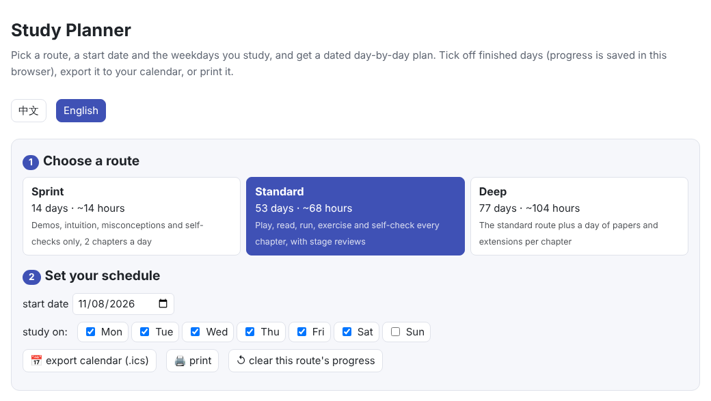
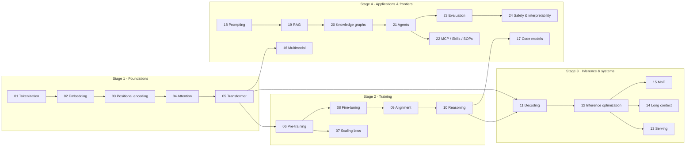
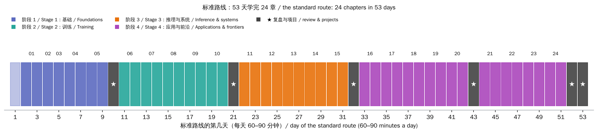

# Overview & Study Roadmap

> **In one sentence:** this knowledge base explains large language models in 24 chapters and 4 stages, from “how text becomes numbers” to “how models are trained, made fast, turned into applications, evaluated and kept safe”. This page gives the knowledge map and three study routes. The **standard route** spells out what to do each day: about 53 days at 60–90 minutes a day.
>
> 🌐 [中文版](README.md) · 🗓️ **[Open the study planner](interactive/planner.html?lang=en)**: pick a route, a start date and your study days to get a dated day-by-day plan, tick off progress, and export it to your calendar

[](interactive/planner.html?lang=en)

**After this page you will know:**

- What every chapter consists of, and how the parts work together
- The 4 stages of the 24 chapters, and which chapters build on which
- Who each of the three routes suits: sprint (14 days), standard (53 days), deep (77 days)
- Which chapters to take first for your goal when time is short
- What to do on each day of the standard route

## 1. How to use this knowledge base

### 1.1 The structure of a chapter

Every chapter has the same 7 sections and three kinds of material:

| Part | What it contains | How to use it |
|---|---|---|
| §1 Intuition | An everyday analogy and a small example of the problem being solved | Read first, for motivation |
| §2 Diagrams | Flow charts, and the “🎮 Try it yourself” list of demo items | Go through it alongside the demo |
| §3 How it works | Formulas, derivations, **numbers measured in the chapter's experiments**, and how real systems do it | The core; take your time |
| §4 Minimal code | Key code snippets and the findings the code checks | Run the full code alongside |
| §5 Misconceptions | The things most easily misunderstood | Check yourself after §3 |
| §6 Self-check | 3–5 questions with answers | Answer first, then expand the answers |
| §7 Further reading | Original papers and references | For going deeper |

The three kinds of material:

- **🎮 Interactive demos**: a single web page each; drag sliders and click buttons to see the effect, and many demos run small models right in the browser.
- **📖 Write-ups**: in Chinese and English; every number comes from actually running the chapter's code.
- **🧑‍💻 Code**: each chapter's `code/` holds runnable PyTorch experiments that take seconds to a few minutes on a laptop CPU, plus a Jupyter notebook that opens in Colab with one click. The `assert`s in the code are automatic checks of the chapter's findings.

### 1.2 The rhythm: play → read → run → check

1. **Play with the demo first**, guessing each result before you see it; the guesses you get wrong mark what to read most carefully.
2. **Then read the write-up**; when §3 brings in a formula, go back to the demo and drag things around.
3. **Then run the code**, matching every result it prints to a passage in the write-up; change one setting, write down your prediction, and run it again.
4. **Finally do the self-check**, going back to the matching section for anything you miss.

### 1.3 Setting up

Either way works:

- **Install nothing**: read and play on the [website](https://baiyuby.github.io/use_token_to_learn/en/); when you want to run code, click “Open in Colab” at the top of each chapter.
- **Run locally**:

```bash
git clone https://github.com/BaiYuBY/use_token_to_learn.git
```

```bash
cd use_token_to_learn && pip install -r requirements.txt
```

```bash
python docs/01-tokenization/code/bpe.py
```

Locally, `make serve` previews the website and `make code` runs every example. No GPU and no API keys are needed.

Look up unfamiliar terms in the [glossary](../glossary.en.md); specific, recent questions are answered in the [Q&A](../qa/index.en.md).

## 2. The knowledge map



| Stage | Chapters | You'll be able to answer |
|---|---|---|
| 1 Foundations | 01–05 | How does text become vectors? What does attention compute? What is inside a Transformer block, and how are its parameters counted? |
| 2 Training | 06–10 | What does pre-training optimize? How big should the model and data be? What do fine-tuning, alignment and reasoning RL each solve? |
| 3 Inference & systems | 11–15 | How does a model generate word by word? What do the KV cache, quantization, speculative decoding, continuous batching, long context and MoE each save? |
| 4 Applications & frontiers | 16–24 | How are images and code handled? How do you write prompts, build RAG and knowledge graphs, build agents, use MCP and Skills? How do you evaluate, and how do you keep things safe? |

Stage 1 underpins everything after it; take it in order. Stages 2 and 3 can be swapped. In stage 4, 18 → 22 is one continuous application track, while 16, 17, 23 and 24 stand fairly well alone.

## 3. Three routes

| Route | Days | Per day | Content | Suits |
|---|---|---|---|---|
| Sprint | 14 | about 1 hour | 2 chapters a day: the demo, §1 intuition, §2 diagrams, §5 misconceptions and the self-check | A quick overview, or very little time |
| **Standard** | **53** | **60–90 minutes** | Every chapter: play, read, run the code, one exercise and the self-check; a review day at the end of each stage; a two-day capstone | Most people: really understanding it and being able to use it |
| Deep | 77 | 75–90 minutes | The standard route plus a day after each chapter: one original paper, an extension exercise, a reproduced figure | Research, interview preparation, or a solid foundation |

Studying 6 days a week, that is about 3 weeks for the sprint, 9 for the standard route and 13 for the deep route. The [study planner](interactive/planner.html?lang=en) puts real dates on it from your start date and study days.



## 4. Short on time? Pick chapters by goal

If you don't plan to cover all 24 chapters, start with these for your goal (still in chapter order) and come back to the others when you need them:

| Goal | Start with | Why |
|---|---|---|
| Building applications with LLMs (APIs, RAG, agents) | 01, 04, 11, 18, 19, 20, 21, 22, 23, 24 | Tokenization and attention first, then everything from decoding to agents, evaluation and safety |
| Training and fine-tuning models | 01–10, 14, 15, 23 | The whole training pipeline, plus long context, MoE and evaluation |
| Deployment and inference optimization | 01, 04, 05, 11–15, 23 | From model structure to the KV cache, quantization, serving schedulers and parallelism |
| Research and safety | 01–06, 09, 10, 23, 24 | Structure, pre-training, alignment and reasoning models, then evaluation and interpretability |

## 5. The standard route, day by day

60–90 minutes a day; review and project days (in bold) take about 90. Studying 6 days a week leaves one day for rest or catching up. If you don't finish a day, carry it over rather than skipping its exercise and self-check. “➕ Optional” items are related [Q&A](../qa/index.en.md) pages to read if you have time.

<!-- plan:standard -->

#### Stage 1 · Foundations: from text to the Transformer

| Day | Topic | What to do |
| --- | --- | --- |
| 1 | Setup: get to know the site and your environment | 📖 Read this page: the knowledge map, the three routes, the fixed structure of every chapter<br>🧑‍💻 Pick how to run code: the website + Colab (a button at the top of each chapter), or locally with pip install -r requirements.txt<br>🧑‍💻 Run chapter 1's bpe.py to check your setup; bookmark the glossary and the Q&A<br>📝 Write down your goal (building applications? training models? deploying them?) and check the “by goal” suggestions below |
| 2 | [01 Tokenization](../01-tokenization/README.en.md) (1/2) | 🎮 Play the demo (5 items); guess each result before checking<br>📖 Read §1 intuition, §2 diagrams and §3.1–§3.3<br>📝 Write three sentences: what problem does this chapter solve, and what is the core idea? |
| 3 | [01 Tokenization](../01-tokenization/README.en.md) (2/2) | 📖 Read §3.4–§3.5, §4 code and §5 misconceptions<br>🧑‍💻 Run bpe.py and match every result it prints to a passage in the write-up<br>🔧 Exercise: Train bpe.py's train(text, n_merges) once on Chinese and once on English text and compare the merged tokens; halve the merges and count how many more tokens the same sentence takes<br>✅ Do the section 6 self-check, then compare with the answers<br>➕ Optional: how CNNs, RNNs and KNN work (qa/classic-models.md) |
| 4 | [02 Embedding](../02-embedding/README.en.md) | 🎮 Play the demo (5 items); guess each result before checking<br>📖 Read the whole chapter (§1 intuition → §5 misconceptions)<br>🧑‍💻 Run embedding.py and match every result it prints to a passage in the write-up<br>🔧 Exercise: Set the embedding dimension in embedding.py to 2, retrain, and see how many neighbours and analogies survive<br>✅ Do the section 6 self-check, then compare with the answers |
| 5 | [03 Positional Encoding](../03-positional-encoding/README.en.md) | 🎮 Play the demo (5 items); guess each result before checking<br>📖 Read the whole chapter (§1 intuition → §5 misconceptions)<br>🧑‍💻 Run positional.py and match every result it prints to a passage in the write-up<br>🔧 Exercise: Change base in positional.py's sinusoidal_pe from 10000 to 100, plot the dot product against distance, and compare with item 5 of the demo<br>✅ Do the section 6 self-check, then compare with the answers |
| 6 | [04 Attention](../04-attention/README.en.md) (1/2) | 🎮 Play the demo (5 items); guess each result before checking<br>📖 Read §1 intuition, §2 diagrams and §3.1–§3.2<br>📝 Write three sentences: what problem does this chapter solve, and what is the core idea? |
| 7 | [04 Attention](../04-attention/README.en.md) (2/2) | 📖 Read §3.3–§3.4, §4 code and §5 misconceptions<br>🧑‍💻 Run attention.py and match every result it prints to a passage in the write-up<br>🔧 Exercise: Remove the division by √d_k in attention.py, set d_k to 512, and print each row's largest softmax weight to watch it saturate<br>✅ Do the section 6 self-check, then compare with the answers |
| 8 | [05 The Transformer](../05-transformer/README.en.md) (1/2) | 🎮 Play the demo (6 items); guess each result before checking<br>📖 Read §1 intuition, §2 diagrams and §3.1–§3.3<br>📝 Write three sentences: what problem does this chapter solve, and what is the core idea? |
| 9 | [05 The Transformer](../05-transformer/README.en.md) (2/2) | 📖 Read §3.4–§3.6, §4 code and §5 misconceptions<br>🧑‍💻 Run transformer.py and match every result it prints to a passage in the write-up<br>🔧 Exercise: Use the chapter's parameter formula on GPT-2 small (12 layers, 768 dims, 50,257 vocabulary) and compare with 124M; retrain the mini GPT with 1 layer and compare its sentences<br>✅ Do the section 6 self-check, then compare with the answers |
| 10 | **Stage 1 review: the journey of a token** | 🧭 Draw, in your own words, the whole path from a word in the text to “next-word probabilities”: tokenizer → embedding + position → N blocks (attention + feed-forward) → output layer, with each step's tensor shapes<br>🧭 Check a real model's parameter count (e.g. Llama-3-8B) with the parameter calculator in chapter 5's demo<br>🧭 Redo the chapter 1–5 self-check questions you missed or were unsure of; look up unclear terms in the glossary |

#### Stage 2 · Training: pre-training, scaling, fine-tuning, alignment, reasoning

| Day | Topic | What to do |
| --- | --- | --- |
| 11 | [06 Pre-training](../06-pretraining/README.en.md) (1/2) | 🎮 Play the demo (6 items); guess each result before checking<br>📖 Read §1 intuition, §2 diagrams and §3.1–§3.2<br>📝 Write three sentences: what problem does this chapter solve, and what is the core idea? |
| 12 | [06 Pre-training](../06-pretraining/README.en.md) (2/2) | 📖 Read §3.3–§3.4, §4 code and §5 misconceptions<br>🧑‍💻 Run data_filters.py, pretrain.py and match every result it prints to a passage in the write-up<br>🔧 Exercise: Run pretrain.py with the small dataset raised from 100 to 1,000 sentences and watch the gap between training and validation loss shrink<br>✅ Do the section 6 self-check, then compare with the answers |
| 13 | [07 Scaling Laws](../07-scaling-laws/README.en.md) (1/2) | 🎮 Play the demo (6 items); guess each result before checking<br>📖 Read §1 intuition, §2 diagrams and §3.1–§3.3<br>📝 Write three sentences: what problem does this chapter solve, and what is the core idea? |
| 14 | [07 Scaling Laws](../07-scaling-laws/README.en.md) (2/2) | 📖 Read §3.4–§3.6, §4 code and §5 misconceptions<br>🧑‍💻 Run scaling.py and match every result it prints to a passage in the write-up<br>🔧 Exercise: Switch scaling.py's DEFAULT_FIT from besiroglu2024 to hoffmann2022 and compare the optimal parameters and tokens at 1e23 FLOPs<br>✅ Do the section 6 self-check, then compare with the answers<br>➕ Optional: how LLM compute is counted (qa/compute.md) |
| 15 | [08 Fine-tuning](../08-finetuning/README.en.md) (1/2) | 🎮 Play the demo (6 items); guess each result before checking<br>📖 Read §1 intuition, §2 diagrams and §3.1–§3.3<br>📝 Write three sentences: what problem does this chapter solve, and what is the core idea? |
| 16 | [08 Fine-tuning](../08-finetuning/README.en.md) (2/2) | 📖 Read §3.4–§3.6, §4 code and §5 misconceptions<br>🧑‍💻 Run lora.py, sft.py and match every result it prints to a passage in the write-up<br>🔧 Exercise: In lora.py set LoRALinear's r to 1 and to 16 and compare the trainable parameters and the results on unseen words<br>✅ Do the section 6 self-check, then compare with the answers |
| 17 | [09 Alignment](../09-alignment/README.en.md) (1/2) | 🎮 Play the demo (6 items); guess each result before checking<br>📖 Read §1 intuition, §2 diagrams and §3.1–§3.3<br>📝 Write three sentences: what problem does this chapter solve, and what is the core idea? |
| 18 | [09 Alignment](../09-alignment/README.en.md) (2/2) | 📖 Read §3.4–§3.6, §4 code and §5 misconceptions<br>🧑‍💻 Run align.py and match every result it prints to a passage in the write-up<br>🔧 Exercise: Halve beta for RLHF in align.py and see when the model starts piling up the words the reward model likes (reward hacking)<br>✅ Do the section 6 self-check, then compare with the answers |
| 19 | [10 Reasoning](../10-reasoning/README.en.md) (1/2) | 🎮 Play the demo (5 items); guess each result before checking<br>📖 Read §1 intuition, §2 diagrams and §3.1–§3.3<br>📝 Write three sentences: what problem does this chapter solve, and what is the core idea? |
| 20 | [10 Reasoning](../10-reasoning/README.en.md) (2/2) | 📖 Read §3.4–§3.5, §4 code and §5 misconceptions<br>🧑‍💻 Run reasoning.py and match every result it prints to a passage in the write-up<br>🔧 Exercise: Raise K_MAX in reasoning.py and see how answering directly degrades with more steps while thinking first holds up<br>✅ Do the section 6 self-check, then compare with the answers<br>➕ Optional: how reasoning effort is set (qa/reasoning-effort.md) |
| 21 | **Stage 2 review: how a model is made** | 🧭 Write a one-page note: pre-training (data, C ≈ 6ND) → scaling laws (how big, how much data) → SFT / LoRA → alignment (RLHF / DPO) → reasoning RL, and what each step solves<br>🧭 Estimate the FLOPs, H100s and days to train a 7B model on 2T tokens (item 6 of chapter 6's demo)<br>🧭 Compare RLHF, DPO and GRPO: what data and models each needs, and where each can go wrong |

#### Stage 3 · Inference & systems: decoding, speed-ups, serving, long context, MoE

| Day | Topic | What to do |
| --- | --- | --- |
| 22 | [11 Decoding](../11-decoding/README.en.md) (1/2) | 🎮 Play the demo (6 items); guess each result before checking<br>📖 Read §1 intuition, §2 diagrams and §3.1–§3.3<br>📝 Write three sentences: what problem does this chapter solve, and what is the core idea? |
| 23 | [11 Decoding](../11-decoding/README.en.md) (2/2) | 📖 Read §3.4–§3.6, §4 code and §5 misconceptions<br>🧑‍💻 Run decoding.py and match every result it prints to a passage in the write-up<br>🔧 Exercise: Generate 30 sentences with decoding.py's sample_sentence at temperatures 0.5, 1.0 and 1.5; count the grammatical ones and the distinct ones<br>✅ Do the section 6 self-check, then compare with the answers |
| 24 | [12 Inference Optimization](../12-inference-optimization/README.en.md) (1/2) | 🎮 Play the demo (5 items); guess each result before checking<br>📖 Read §1 intuition, §2 diagrams and §3.1–§3.3<br>📝 Write three sentences: what problem does this chapter solve, and what is the core idea? |
| 25 | [12 Inference Optimization](../12-inference-optimization/README.en.md) (2/2) | 📖 Read §3.4–§3.6, §4 code and §5 misconceptions<br>🧑‍💻 Run inference.py and match every result it prints to a passage in the write-up<br>🔧 Exercise: Quantize the same layer with inference.py's quantize at 8, 4 and 3 bits, per tensor and per channel, and compare the errors<br>✅ Do the section 6 self-check, then compare with the answers |
| 26 | [13 Serving Systems](../13-serving/README.en.md) (1/2) | 🎮 Play the demo (3 items); guess each result before checking<br>📖 Read §1 intuition, §2 diagrams and §3.1–§3.3<br>📝 Write three sentences: what problem does this chapter solve, and what is the core idea? |
| 27 | [13 Serving Systems](../13-serving/README.en.md) (2/2) | 📖 Read §3.4–§3.5, §4 code and §5 misconceptions<br>🧑‍💻 Run serving.py and match every result it prints to a passage in the write-up<br>🔧 Exercise: Double the request rate in serving.py's scheduling experiment and compare how TTFT and throughput change for each scheduler<br>✅ Do the section 6 self-check, then compare with the answers<br>➕ Optional: what DeepInfer is (qa/deepinfer.md) |
| 28 | [14 Long Context](../14-long-context/README.en.md) (1/2) | 🎮 Play the demo (4 items); guess each result before checking<br>📖 Read §1 intuition, §2 diagrams and §3.1–§3.2<br>📝 Write three sentences: what problem does this chapter solve, and what is the core idea? |
| 29 | [14 Long Context](../14-long-context/README.en.md) (2/2) | 📖 Read §3.3–§3.4, §4 code and §5 misconceptions<br>🧑‍💻 Run long_context.py and match every result it prints to a passage in the write-up<br>🔧 Exercise: Set long_context.py's TRAIN_LEN to 32, rerun, and see where the loss starts rising beyond the training length<br>✅ Do the section 6 self-check, then compare with the answers |
| 30 | [15 Mixture of Experts](../15-moe/README.en.md) (1/2) | 🎮 Play the demo (4 items); guess each result before checking<br>📖 Read §1 intuition, §2 diagrams and §3.1–§3.3<br>📝 Write three sentences: what problem does this chapter solve, and what is the core idea? |
| 31 | [15 Mixture of Experts](../15-moe/README.en.md) (2/2) | 📖 Read §3.4–§3.6, §4 code and §5 misconceptions<br>🧑‍💻 Run moe.py and match every result it prints to a passage in the write-up<br>🔧 Exercise: Change the experts per token k in moe.py from 2 to 1 and compare the loss, each expert's load and the compute<br>✅ Do the section 6 self-check, then compare with the answers |
| 32 | **Stage 3 review: deploying a model** | 🧭 Set a scenario: an 8B model, one 80 GB GPU, 64 concurrent requests, 8k context. Estimate weight and KV-cache memory and decide whether it fits (item 1 of chapter 12's demo)<br>🧭 Choose for this scenario: how many bits to quantize to? GQA? Paging and prefix caching? Is speculative decoding worth it? Write down why<br>🧭 Swap in an MoE model (e.g. Mixtral) and redo the memory and communication estimates (the calculators in chapters 13 and 15) |

#### Stage 4 · Applications & frontiers: multimodal to safety

| Day | Topic | What to do |
| --- | --- | --- |
| 33 | [16 Multimodal Models](../16-multimodal/README.en.md) (1/2) | 🎮 Play the demo (5 items); guess each result before checking<br>📖 Read §1 intuition, §2 diagrams and §3.1–§3.4<br>📝 Write three sentences: what problem does this chapter solve, and what is the core idea? |
| 34 | [16 Multimodal Models](../16-multimodal/README.en.md) (2/2) | 📖 Read §3.5–§3.7, §4 code and §5 misconceptions<br>🧑‍💻 Run multimodal.py and match every result it prints to a passage in the write-up<br>🔧 Exercise: In multimodal.py compare zero-shot accuracy with one prompt and with a prompt ensemble; halve the patch size and count the extra tokens per image<br>✅ Do the section 6 self-check, then compare with the answers |
| 35 | [17 Code Models](../17-code-models/README.en.md) (1/2) | 🎮 Play the demo (5 items); guess each result before checking<br>📖 Read §1 intuition, §2 diagrams and §3.1–§3.3<br>📝 Write three sentences: what problem does this chapter solve, and what is the core idea? |
| 36 | [17 Code Models](../17-code-models/README.en.md) (2/2) | 📖 Read §3.4–§3.6, §4 code and §5 misconceptions<br>🧑‍💻 Run code_models.py and match every result it prints to a passage in the write-up<br>🔧 Exercise: Work out pass@1 and pass@5 for n = 10, c = 3 by hand, check with code_models.py's estimator, and explain why 1 − (1 − c/n)^k is not used<br>✅ Do the section 6 self-check, then compare with the answers |
| 37 | [18 Prompt Engineering](../18-prompt-engineering/README.en.md) (1/2) | 🎮 Play the demo (3 items); guess each result before checking<br>📖 Read §1 intuition, §2 diagrams and §3.1–§3.2<br>📝 Write three sentences: what problem does this chapter solve, and what is the core idea? |
| 38 | [18 Prompt Engineering](../18-prompt-engineering/README.en.md) (2/2) | 📖 Read §3.3–§3.4, §4 code and §5 misconceptions<br>🧑‍💻 Run prompting.py and match every result it prints to a passage in the write-up<br>🔧 Exercise: In prompting.py change the number and order of few-shot examples and watch in-context accuracy; then write an injection and see whether the instruction hierarchy holds<br>✅ Do the section 6 self-check, then compare with the answers |
| 39 | [19 RAG & Vector Databases](../19-rag/README.en.md) (1/2) | 🎮 Play the demo (3 items); guess each result before checking<br>📖 Read §1 intuition, §2 diagrams and §3.1–§3.3<br>📝 Write three sentences: what problem does this chapter solve, and what is the core idea? |
| 40 | [19 RAG & Vector Databases](../19-rag/README.en.md) (2/2) | 📖 Read §3.4–§3.5, §4 code and §5 misconceptions<br>🧑‍💻 Run rag.py and match every result it prints to a passage in the write-up<br>🔧 Exercise: In rag.py compare recall for single-sentence chunks and chunks with context headers; vary HNSW's ef and plot recall against compute<br>✅ Do the section 6 self-check, then compare with the answers<br>➕ Optional: making outputs more reliable (qa/reliability.md) |
| 41 | [20 Knowledge Graphs](../20-knowledge-graphs/README.en.md) (1/2) | 🎮 Play the demo (4 items); guess each result before checking<br>📖 Read §1 intuition, §2 diagrams and §3.1–§3.3<br>📝 Write three sentences: what problem does this chapter solve, and what is the core idea? |
| 42 | [20 Knowledge Graphs](../20-knowledge-graphs/README.en.md) (2/2) | 📖 Read §3.4–§3.5, §4 code and §5 misconceptions<br>🧑‍💻 Run knowledge_graph.py and match every result it prints to a passage in the write-up<br>🔧 Exercise: Turn off entity resolution in knowledge_graph.py and recount 2- and 3-hop accuracy; then write a Cypher-like query of your own<br>✅ Do the section 6 self-check, then compare with the answers |
| 43 | **Stage 4 checkpoint: choosing a design for a knowledge Q&A system** | 🧭 Scenario: a company has 10,000 internal documents; staff ask factual questions, multi-hop questions across documents, and aggregate questions such as “how many in total”<br>🧭 Say which questions prompting, RAG and a knowledge graph each handle, and how they combine; draw a flow chart<br>🧭 List the likely failure at each step (chunks losing context, unresolved entities, prompt injection…) and how to check for it |
| 44 | [21 Agents & the Agent Loop](../21-agents/README.en.md) (1/2) | 🎮 Play the demo (3 items); guess each result before checking<br>📖 Read §1 intuition, §2 diagrams and §3.1–§3.4<br>📝 Write three sentences: what problem does this chapter solve, and what is the core idea? |
| 45 | [21 Agents & the Agent Loop](../21-agents/README.en.md) (2/2) | 📖 Read §3.5–§3.8, §4 code and §5 misconceptions<br>🧑‍💻 Run agent_loop.py, langgraph_agent.py and match every result it prints to a passage in the write-up<br>🔧 Exercise: Set the error rate in agent_loop.py to 0.3 and run with and without the self-check, comparing success and steps; then lower the step budget until runs fail<br>✅ Do the section 6 self-check, then compare with the answers |
| 46 | [22 MCP, Skills & SOPs](../22-mcp-skills-sop/README.en.md) (1/2) | 🎮 Play the demo (4 items); guess each result before checking<br>📖 Read §1 intuition, §2 diagrams and §3.1–§3.4<br>📝 Write three sentences: what problem does this chapter solve, and what is the core idea? |
| 47 | [22 MCP, Skills & SOPs](../22-mcp-skills-sop/README.en.md) (2/2) | 📖 Read §3.5–§3.8, §4 code and §5 misconceptions<br>🧑‍💻 Run mcp_from_scratch.py, mcp_sdk.py, skills.py, sop.py and match every result it prints to a passage in the write-up<br>🔧 Exercise: Add a tool to mcp_from_scratch.py's DocsServer (say, counting a company's employees) and call it with the client's tools/list and tools/call; then write a SKILL.md of your own<br>✅ Do the section 6 self-check, then compare with the answers |
| 48 | [23 Evaluation](../23-evaluation/README.en.md) (1/2) | 🎮 Play the demo (4 items); guess each result before checking<br>📖 Read §1 intuition, §2 diagrams and §3.1–§3.3<br>📝 Write three sentences: what problem does this chapter solve, and what is the core idea? |
| 49 | [23 Evaluation](../23-evaluation/README.en.md) (2/2) | 📖 Read §3.4–§3.6, §4 code and §5 misconceptions<br>🧑‍💻 Run benchmarks.py, contamination.py, llm_judge.py, perplexity.py and match every result it prints to a passage in the write-up<br>🔧 Exercise: Set the leak count in contamination.py to 2 and record the benchmark-vs-fresh gap and the AUC; with benchmarks.py, estimate how many questions separate two models 2 points apart<br>✅ Do the section 6 self-check, then compare with the answers |
| 50 | [24 Safety & Interpretability](../24-safety-interpretability/README.en.md) (1/2) | 🎮 Play the demo (4 items); guess each result before checking<br>📖 Read §1 intuition, §2 diagrams and §3.1–§3.3<br>📝 Write three sentences: what problem does this chapter solve, and what is the core idea? |
| 51 | [24 Safety & Interpretability](../24-safety-interpretability/README.en.md) (2/2) | 📖 Read §3.4–§3.6, §4 code and §5 misconceptions<br>🧑‍💻 Run hallucination.py, jailbreak.py, probes.py, sae.py and match every result it prints to a passage in the write-up<br>🔧 Exercise: In probes.py steer after block 2 instead and compare the α needed; in jailbreak.py extend adversarial training to all 4 harmful topics and check the cipher refusal rate<br>✅ Do the section 6 self-check, then compare with the answers |
| 52 | **Capstone (1): build an agent with tools** | 🧭 Connect chapter 22's MCP server to chapter 21's agent loop and give the agent the tools that chapter 20's multi-hop questions need<br>🧭 Write a SKILL.md teaching it the steps “look up the person, then the company, then calculate”; run it on 50 questions<br>🧭 Record each question's answer, number of steps and words read |
| 53 | **Capstone (2): evaluate it and check its safety** | 🧭 Evaluate it with chapter 23's methods: success rate with a 95% interval, and a paired comparison with and without the self-check; then write 20 fresh questions to see whether you overfitted your prompt<br>🧭 Attack it with ideas from chapters 24 and 18: hide an injected instruction in a document and see whether the agent obeys; add the limits its tool calls need<br>🧭 Final review: on this page's knowledge map, mark the three chapters you're most and least sure of, and plan your next deep read |

<!-- /plan:standard -->

## 6. The sprint and deep routes

**Sprint (14 days)**: 2 chapters a day; play the demo, read §1, §2 and §5, do the self-check, and skim §3's headings and figures. On the last day, draw the whole knowledge map from memory, then pick 3 chapters to study on the standard route.

<!-- plan:speed -->

| Day | Chapters |
| --- | --- |
| 1 | [01 Tokenization](../01-tokenization/README.en.md) + [02 Embedding](../02-embedding/README.en.md) |
| 2 | [03 Positional Encoding](../03-positional-encoding/README.en.md) + [04 Attention](../04-attention/README.en.md) |
| 3 | [05 The Transformer](../05-transformer/README.en.md) |
| 4 | [06 Pre-training](../06-pretraining/README.en.md) + [07 Scaling Laws](../07-scaling-laws/README.en.md) |
| 5 | [08 Fine-tuning](../08-finetuning/README.en.md) + [09 Alignment](../09-alignment/README.en.md) |
| 6 | [10 Reasoning](../10-reasoning/README.en.md) + [11 Decoding](../11-decoding/README.en.md) |
| 7 | [12 Inference Optimization](../12-inference-optimization/README.en.md) + [13 Serving Systems](../13-serving/README.en.md) |
| 8 | [14 Long Context](../14-long-context/README.en.md) + [15 Mixture of Experts](../15-moe/README.en.md) |
| 9 | [16 Multimodal Models](../16-multimodal/README.en.md) + [17 Code Models](../17-code-models/README.en.md) |
| 10 | [18 Prompt Engineering](../18-prompt-engineering/README.en.md) + [19 RAG & Vector Databases](../19-rag/README.en.md) |
| 11 | [20 Knowledge Graphs](../20-knowledge-graphs/README.en.md) + [21 Agents & the Agent Loop](../21-agents/README.en.md) |
| 12 | [22 MCP, Skills & SOPs](../22-mcp-skills-sop/README.en.md) |
| 13 | [23 Evaluation](../23-evaluation/README.en.md) + [24 Safety & Interpretability](../24-safety-interpretability/README.en.md) |
| 14 | **Final review** |

<!-- /plan:speed -->

**Deep (77 days)**: after the last day of each chapter on the standard route, add a deep-reading day:

- 📚 Pick one original paper from the chapter's section 7 and read it closely, comparing its main results with the chapter's experiments.
- 🔧 Change a setting the chapter's code hasn't tried; write down your prediction, then run it.
- 📈 Run the chapter's figure script under `figures/`, reproduce one figure and explain it.

Every day of all three routes can be viewed, ticked off and exported in the [study planner](interactive/planner.html?lang=en).

## 7. Tips for studying

- **Predict, then check**: before playing with a demo or changing code, write down what you expect. Wrong guesses show where understanding is still shaky.
- **Explain it in your own words**: after each chapter, try explaining it to someone in three to five sentences without notes; reread whatever you can't explain.
- **Take the self-checks seriously**: answer before looking. Note the ones you miss and redo them on review days.
- **Change one thing at a time in the code**: that's the only way to see what each setting does. When an `assert` fails, it often means your change affected one of the chapter's findings.
- **Don't stay stuck for more than 20 minutes**: check the glossary and earlier chapters; if it's still unclear, mark it and read on, since later chapters often resolve it.
- **When you fall behind**: protect “demo + §1–§3 + self-check” first; code exercises can be made up on review days.

## 8. After you finish

- **Read the original papers**: section 7 of each chapter lists the most important ones.
- **Follow the frontier**: the [Q&A](../qa/index.en.md) keeps adding new questions.
- **Build your own project**: replace the capstone with your own data and task, and evaluate it with chapter 23's methods.
- **Help improve it**: if you find a mistake or a better explanation, open an issue on [GitHub](https://github.com/BaiYuBY/use_token_to_learn).

The plan's data and checks live in [`code/study_plan.py`](code/study_plan.py): it checks that every chapter, section, code file and demo page the plan refers to exists, and that the tables on this page match the data.
