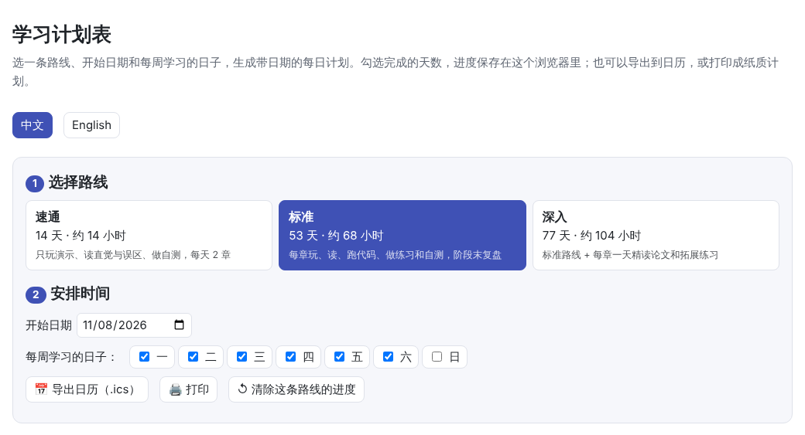
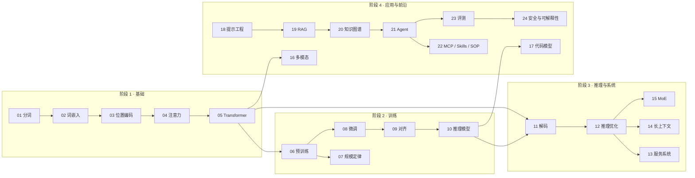
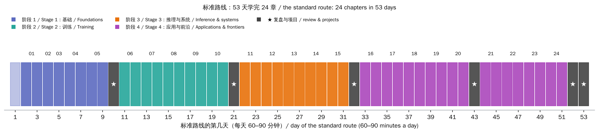

# 总览与学习路线图（Overview & Study Roadmap）

> **一句话总结：** 这套知识库用 24 章、4 个阶段讲清楚大语言模型：从“文本怎样变成数字”，到“模型怎样训练、怎样跑得快、怎样做成应用、怎样评测和保证安全”。本页给出知识地图和三条学习路线，其中**标准路线**按天排好了每天做什么：约 53 天，每天 60–90 分钟。
>
> 🌐 [English version](README.en.md) · 🗓️ **[打开学习计划表](interactive/planner.html?lang=zh)**：选路线、开始日期和学习日，生成带日期的每日计划，可勾选进度、导出日历

[](interactive/planner.html?lang=zh)

**读完本页你会知道：**

- 每一章由哪几部分组成，各部分怎样配合着学
- 24 章分成哪 4 个阶段，章节之间的先后依赖
- 三条路线（速通 14 天、标准 53 天、深入 77 天）各适合谁
- 时间有限时，按自己的目标先学哪几章
- 标准路线每一天具体做什么

## 1. 这套知识库怎么用

### 1.1 每一章的结构

每一章都是同样的 7 节，配三种材料：

| 部分 | 内容 | 怎么用 |
|---|---|---|
| §1 直觉 | 用生活中的类比和一个小例子讲清“要解决什么问题” | 先读，建立动机 |
| §2 图解 | 流程图，以及“🎮 动手试试”列出的交互演示条目 | 配合交互演示一起看 |
| §3 原理 | 公式、推导、**本章实验的实测数据**和真实系统的做法 | 主体，慢慢读 |
| §4 最小代码实现 | 关键代码片段，以及代码里检查了哪些结论 | 对照着运行完整代码 |
| §5 常见误区 | 最容易想错的几件事 | 读完原理后检查自己 |
| §6 自测题 | 3–5 道题，附参考答案 | 先自己答，再展开答案 |
| §7 延伸阅读 | 原始论文与资料 | 想深入时精读 |

三种材料：

- **🎮 交互演示**：单个网页，拖滑块、点按钮就能看到效果；很多演示直接在浏览器里运行小模型。
- **📖 讲解**：中英双语，文中的数字都来自本章代码的实际运行。
- **🧑‍💻 代码**：每章 `code/` 下是可直接运行的 PyTorch 小实验，笔记本 CPU 上几秒到两三分钟；每章另有一个 Jupyter notebook，可在 Colab 中一键打开。代码里的 `assert` 就是本章结论的“自动检查”。

### 1.2 推荐的节奏：玩 → 读 → 跑 → 测

1. **先玩交互演示**，每个操作前先猜结果，猜错的地方就是要重点读的地方。
2. **再读讲解**，§3 遇到公式时回到演示里拖一拖。
3. **然后跑代码**，把输出的每一条结论对应到讲解中的段落；再改一个参数，先写下预测，再运行验证。
4. **最后做自测题**，答不上的回到对应小节。

### 1.3 准备环境

两种方式任选一种：

- **不装任何东西**：在[在线网站](https://baiyuby.github.io/use_token_to_learn/)读讲解、玩演示；需要跑代码时，点每章顶部的“在 Colab 中打开”。
- **在本地运行**：

```bash
git clone https://github.com/BaiYuBY/use_token_to_learn.git
```

```bash
cd use_token_to_learn && pip install -r requirements.txt
```

```bash
python docs/01-tokenization/code/bpe.py
```

本地还可以用 `make serve` 预览网站，用 `make code` 运行全部代码。不需要 GPU，也不需要任何 API key。

遇到不认识的术语，查[术语表](../glossary.md)；一些具体又新鲜的问题，见[前沿问答](../qa/index.md)。

## 2. 知识地图



| 阶段 | 章节 | 学完能回答 |
|---|---|---|
| 1 基础 | 01–05 | 文字怎样变成向量？注意力在算什么？一个 Transformer 块里有什么，参数量怎么算？ |
| 2 训练 | 06–10 | 预训练在优化什么？模型和数据该多大？微调、对齐、推理模型的强化学习各解决什么问题？ |
| 3 推理与系统 | 11–15 | 模型怎样一个词一个词地生成？KV 缓存、量化、投机解码、连续批处理、长上下文、MoE 省的是什么？ |
| 4 应用与前沿 | 16–24 | 怎样处理图像和代码？怎样写提示、做 RAG 和知识图谱、搭 agent、用 MCP 和 Skills？怎样评测、怎样保证安全？ |

阶段 1 是所有后续内容的基础，建议按顺序学。阶段 2 和 3 可以对调；阶段 4 中，18 → 22 是一条连续的应用线，16、17、23、24 相对独立。

## 3. 三条路线

| 路线 | 天数 | 每天 | 内容 | 适合 |
|---|---|---|---|---|
| 速通 | 14 天 | 约 1 小时 | 每天 2 章：只玩演示、读 §1 直觉、§2 图解和 §5 常见误区、做自测 | 想先建立全局印象，或时间很紧 |
| **标准** | **53 天** | **60–90 分钟** | 每章都玩、读、跑代码、做一个练习和自测；每个阶段末一天复盘；最后两天综合项目 | 大多数人：想真正弄懂并能动手 |
| 深入 | 77 天 | 75–90 分钟 | 标准路线 + 每章之后一天：精读一篇原始论文、做拓展练习、复现一张图 | 做研究、准备面试，或想打牢基础 |

按每周学 6 天算，速通约 3 周，标准约 9 周，深入约 13 周。[学习计划表](interactive/planner.html?lang=zh)会按你的开始日期和学习日排出具体日期。



## 4. 时间有限？按目标挑章

不打算学完全部 24 章时，可以按目标先学下面几章（仍按章节号顺序），其他章节需要时再回来查：

| 目标 | 先学这些章 | 说明 |
|---|---|---|
| 用大模型做应用（调用 API、搭 RAG / agent） | 01、04、11、18、19、20、21、22、23、24 | 先懂分词和注意力，再从解码一路学到 agent、评测和安全 |
| 训练和微调模型 | 01–10、14、15、23 | 完整的训练链路，加上长上下文、MoE 和评测 |
| 部署和推理优化 | 01、04、05、11–15、23 | 从模型结构到 KV 缓存、量化、服务调度和并行 |
| 研究与安全 | 01–06、09、10、23、24 | 结构、预训练、对齐与推理模型，再到评测和可解释性 |

## 5. 标准路线：每天做什么

每天 60–90 分钟。复盘和项目日（加粗）约 90 分钟。建议每周学 6 天，留 1 天休息或补进度；某天没学完，就顺延，不要跳过自测和练习。“➕ 选读”是相关的[前沿问答](../qa/index.md)，有时间再看。

<!-- plan:standard -->

#### 阶段 1 · 基础：从文本到 Transformer

| 天 | 主题 | 今天做什么 |
| --- | --- | --- |
| 1 | 准备：认识知识库，配好环境 | 📖 读本页：知识地图、三条路线、每章的固定结构<br>🧑‍💻 选一种方式跑代码：在线网站 + Colab（每章顶部有按钮），或本地 pip install -r requirements.txt<br>🧑‍💻 运行 01 章的 bpe.py，确认环境可用；收藏术语表和前沿问答<br>📝 写下你学这套内容的目标（用模型做应用？训练模型？部署？），据此看看下面“按目标挑章”的建议 |
| 2 | [01 分词](../01-tokenization/README.md)（上） | 🎮 玩交互演示（共 5 项），先凭直觉猜结果再验证<br>📖 读 §1 直觉、§2 图解，以及 §3.1–§3.3<br>📝 用三句话写下：这一章要解决什么问题？核心想法是什么？ |
| 3 | [01 分词](../01-tokenization/README.md)（下） | 📖 读 §3.4–§3.5、§4 代码和 §5 常见误区<br>🧑‍💻 运行 bpe.py，把输出里的每条结论对应到讲解中的段落<br>🔧 练习：用 bpe.py 的 train(text, n_merges) 在一段中文和一段英文上各训练一次，比较合并出的词元；把合并次数减半，看同一句话多了几个词元<br>✅ 做第 6 节自测题，再对答案<br>➕ 选读：CNN、RNN、KNN 是怎么工作的（qa/classic-models.md） |
| 4 | [02 词嵌入](../02-embedding/README.md) | 🎮 玩交互演示（共 5 项），先凭直觉猜结果再验证<br>📖 读全文（§1 直觉 → §5 常见误区）<br>🧑‍💻 运行 embedding.py，把输出里的每条结论对应到讲解中的段落<br>🔧 练习：把 embedding.py 里词向量的维度调到 2，重新训练，看近邻和类比还剩多少<br>✅ 做第 6 节自测题，再对答案 |
| 5 | [03 位置编码](../03-positional-encoding/README.md) | 🎮 玩交互演示（共 5 项），先凭直觉猜结果再验证<br>📖 读全文（§1 直觉 → §5 常见误区）<br>🧑‍💻 运行 positional.py，把输出里的每条结论对应到讲解中的段落<br>🔧 练习：把 positional.py 里 sinusoidal_pe 的 base 从 10000 改成 100，画出点积随距离的变化，与交互演示第 5 项对照<br>✅ 做第 6 节自测题，再对答案 |
| 6 | [04 注意力机制](../04-attention/README.md)（上） | 🎮 玩交互演示（共 5 项），先凭直觉猜结果再验证<br>📖 读 §1 直觉、§2 图解，以及 §3.1–§3.2<br>📝 用三句话写下：这一章要解决什么问题？核心想法是什么？ |
| 7 | [04 注意力机制](../04-attention/README.md)（下） | 📖 读 §3.3–§3.4、§4 代码和 §5 常见误区<br>🧑‍💻 运行 attention.py，把输出里的每条结论对应到讲解中的段落<br>🔧 练习：在 attention.py 里去掉除以 √d_k，把 d_k 调到 512，打印每行 softmax 的最大权重，看它怎样“饱和”<br>✅ 做第 6 节自测题，再对答案 |
| 8 | [05 Transformer 结构](../05-transformer/README.md)（上） | 🎮 玩交互演示（共 6 项），先凭直觉猜结果再验证<br>📖 读 §1 直觉、§2 图解，以及 §3.1–§3.3<br>📝 用三句话写下：这一章要解决什么问题？核心想法是什么？ |
| 9 | [05 Transformer 结构](../05-transformer/README.md)（下） | 📖 读 §3.4–§3.6、§4 代码和 §5 常见误区<br>🧑‍💻 运行 transformer.py，把输出里的每条结论对应到讲解中的段落<br>🔧 练习：用本章的参数公式算 GPT-2 small（12 层、768 维、50257 词表）的参数量，与 1.24 亿对照；把迷你 GPT 改成 1 层再训练，比较生成的句子<br>✅ 做第 6 节自测题，再对答案 |
| 10 | **阶段 1 复盘：一个词元的旅程** | 🧭 用自己的话画出一个词从文本到“下一个词的概率”的全过程：分词 → 嵌入 + 位置 → N 个块（注意力 + 前馈）→ 输出层，标出每一步张量的形状<br>🧭 用 05 章交互演示的参数计算器核对一个真实模型（如 Llama-3-8B）的参数量<br>🧭 把 01–05 章自测题里答错或没把握的重做一遍；不清楚的术语查术语表 |

#### 阶段 2 · 训练：预训练、规模、微调、对齐、推理

| 天 | 主题 | 今天做什么 |
| --- | --- | --- |
| 11 | [06 预训练](../06-pretraining/README.md)（上） | 🎮 玩交互演示（共 6 项），先凭直觉猜结果再验证<br>📖 读 §1 直觉、§2 图解，以及 §3.1–§3.2<br>📝 用三句话写下：这一章要解决什么问题？核心想法是什么？ |
| 12 | [06 预训练](../06-pretraining/README.md)（下） | 📖 读 §3.3–§3.4、§4 代码和 §5 常见误区<br>🧑‍💻 运行 data_filters.py、pretrain.py，把输出里的每条结论对应到讲解中的段落<br>🔧 练习：运行 pretrain.py，把“少量数据”从 100 句改成 1000 句，看训练损失与验证损失的差距怎样缩小<br>✅ 做第 6 节自测题，再对答案 |
| 13 | [07 规模定律](../07-scaling-laws/README.md)（上） | 🎮 玩交互演示（共 6 项），先凭直觉猜结果再验证<br>📖 读 §1 直觉、§2 图解，以及 §3.1–§3.3<br>📝 用三句话写下：这一章要解决什么问题？核心想法是什么？ |
| 14 | [07 规模定律](../07-scaling-laws/README.md)（下） | 📖 读 §3.4–§3.6、§4 代码和 §5 常见误区<br>🧑‍💻 运行 scaling.py，把输出里的每条结论对应到讲解中的段落<br>🔧 练习：把 scaling.py 的 DEFAULT_FIT 从 besiroglu2024 换成 hoffmann2022，比较 1e23 FLOPs 下的最优参数量和词元数<br>✅ 做第 6 节自测题，再对答案<br>➕ 选读：大模型的算力怎么算（qa/compute.md） |
| 15 | [08 微调](../08-finetuning/README.md)（上） | 🎮 玩交互演示（共 6 项），先凭直觉猜结果再验证<br>📖 读 §1 直觉、§2 图解，以及 §3.1–§3.3<br>📝 用三句话写下：这一章要解决什么问题？核心想法是什么？ |
| 16 | [08 微调](../08-finetuning/README.md)（下） | 📖 读 §3.4–§3.6、§4 代码和 §5 常见误区<br>🧑‍💻 运行 lora.py、sft.py，把输出里的每条结论对应到讲解中的段落<br>🔧 练习：在 lora.py 里把 LoRALinear 的 r 改成 1 和 16，比较可训练参数量和在没见过的单词上的表现<br>✅ 做第 6 节自测题，再对答案 |
| 17 | [09 对齐](../09-alignment/README.md)（上） | 🎮 玩交互演示（共 6 项），先凭直觉猜结果再验证<br>📖 读 §1 直觉、§2 图解，以及 §3.1–§3.3<br>📝 用三句话写下：这一章要解决什么问题？核心想法是什么？ |
| 18 | [09 对齐](../09-alignment/README.md)（下） | 📖 读 §3.4–§3.6、§4 代码和 §5 常见误区<br>🧑‍💻 运行 align.py，把输出里的每条结论对应到讲解中的段落<br>🔧 练习：把 align.py 里 RLHF 的 beta 调小一半，看模型什么时候开始堆砌奖励模型喜欢的词（奖励黑客）<br>✅ 做第 6 节自测题，再对答案 |
| 19 | [10 推理模型与测试时计算](../10-reasoning/README.md)（上） | 🎮 玩交互演示（共 5 项），先凭直觉猜结果再验证<br>📖 读 §1 直觉、§2 图解，以及 §3.1–§3.3<br>📝 用三句话写下：这一章要解决什么问题？核心想法是什么？ |
| 20 | [10 推理模型与测试时计算](../10-reasoning/README.md)（下） | 📖 读 §3.4–§3.5、§4 代码和 §5 常见误区<br>🧑‍💻 运行 reasoning.py，把输出里的每条结论对应到讲解中的段落<br>🔧 练习：在 reasoning.py 里把题目的最大步数 K_MAX 调大，看“直接作答”的正确率随步数下降，而“先思考”能保持多久<br>✅ 做第 6 节自测题，再对答案<br>➕ 选读：推理强度是怎么设置的（qa/reasoning-effort.md） |
| 21 | **阶段 2 复盘：一个模型是怎样炼成的** | 🧭 写一页笔记：预训练（数据、C ≈ 6ND）→ 规模定律（模型多大、数据多少）→ SFT / LoRA → 对齐（RLHF / DPO）→ 推理强化学习，每一步解决什么问题<br>🧭 估算训练一个 70 亿参数、2 万亿词元的模型需要多少 FLOPs、多少张 H100、多少天（06 章交互演示第 6 项）<br>🧭 对比 RLHF、DPO 和 GRPO：各需要什么数据、什么模型、风险在哪里 |

#### 阶段 3 · 推理与系统：解码、加速、服务、长上下文、MoE

| 天 | 主题 | 今天做什么 |
| --- | --- | --- |
| 22 | [11 解码与采样](../11-decoding/README.md)（上） | 🎮 玩交互演示（共 6 项），先凭直觉猜结果再验证<br>📖 读 §1 直觉、§2 图解，以及 §3.1–§3.3<br>📝 用三句话写下：这一章要解决什么问题？核心想法是什么？ |
| 23 | [11 解码与采样](../11-decoding/README.md)（下） | 📖 读 §3.4–§3.6、§4 代码和 §5 常见误区<br>🧑‍💻 运行 decoding.py，把输出里的每条结论对应到讲解中的段落<br>🔧 练习：用 decoding.py 的 sample_sentence 在温度 0.5、1.0、1.5 下各生成 30 句，统计合乎语法的比例和不同句子的个数<br>✅ 做第 6 节自测题，再对答案 |
| 24 | [12 推理优化](../12-inference-optimization/README.md)（上） | 🎮 玩交互演示（共 5 项），先凭直觉猜结果再验证<br>📖 读 §1 直觉、§2 图解，以及 §3.1–§3.3<br>📝 用三句话写下：这一章要解决什么问题？核心想法是什么？ |
| 25 | [12 推理优化](../12-inference-optimization/README.md)（下） | 📖 读 §3.4–§3.6、§4 代码和 §5 常见误区<br>🧑‍💻 运行 inference.py，把输出里的每条结论对应到讲解中的段落<br>🔧 练习：用 inference.py 的 quantize 把同一层权重量化到 8、4、3 位，分别用按张量和按通道缩放，比较误差<br>✅ 做第 6 节自测题，再对答案 |
| 26 | [13 推理服务系统](../13-serving/README.md)（上） | 🎮 玩交互演示（共 3 项），先凭直觉猜结果再验证<br>📖 读 §1 直觉、§2 图解，以及 §3.1–§3.3<br>📝 用三句话写下：这一章要解决什么问题？核心想法是什么？ |
| 27 | [13 推理服务系统](../13-serving/README.md)（下） | 📖 读 §3.4–§3.5、§4 代码和 §5 常见误区<br>🧑‍💻 运行 serving.py，把输出里的每条结论对应到讲解中的段落<br>🔧 练习：在 serving.py 的调度实验里把请求率翻倍，比较各调度方案的 TTFT 和吞吐怎样变化<br>✅ 做第 6 节自测题，再对答案<br>➕ 选读：DeepInfer 是什么（qa/deepinfer.md） |
| 28 | [14 长上下文](../14-long-context/README.md)（上） | 🎮 玩交互演示（共 4 项），先凭直觉猜结果再验证<br>📖 读 §1 直觉、§2 图解，以及 §3.1–§3.2<br>📝 用三句话写下：这一章要解决什么问题？核心想法是什么？ |
| 29 | [14 长上下文](../14-long-context/README.md)（下） | 📖 读 §3.3–§3.4、§4 代码和 §5 常见误区<br>🧑‍💻 运行 long_context.py，把输出里的每条结论对应到讲解中的段落<br>🔧 练习：把 long_context.py 的 TRAIN_LEN 改成 32，重新运行，看超出训练长度后损失从哪里开始上升<br>✅ 做第 6 节自测题，再对答案 |
| 30 | [15 混合专家 MoE](../15-moe/README.md)（上） | 🎮 玩交互演示（共 4 项），先凭直觉猜结果再验证<br>📖 读 §1 直觉、§2 图解，以及 §3.1–§3.3<br>📝 用三句话写下：这一章要解决什么问题？核心想法是什么？ |
| 31 | [15 混合专家 MoE](../15-moe/README.md)（下） | 📖 读 §3.4–§3.6、§4 代码和 §5 常见误区<br>🧑‍💻 运行 moe.py，把输出里的每条结论对应到讲解中的段落<br>🔧 练习：把 moe.py 里每个词元选择的专家数 k 从 2 改成 1，比较损失、每个专家的负载和计算量<br>✅ 做第 6 节自测题，再对答案 |
| 32 | **阶段 3 复盘：部署一个模型** | 🧭 设定场景：一个 80 亿参数模型、一张 80 GB 显卡、64 个并发、8k 上下文。估算权重和 KV 缓存的显存，判断能否放下（12 章交互演示第 1 项）<br>🧭 为这个场景选方案：量化到几位？用 GQA 吗？需要分页和前缀缓存吗？投机解码值得吗？写下理由<br>🧭 换成一个 MoE 模型（如 Mixtral），重新估算显存和通信（13、15 章的计算器） |

#### 阶段 4 · 应用与前沿：多模态到安全

| 天 | 主题 | 今天做什么 |
| --- | --- | --- |
| 33 | [16 多模态模型](../16-multimodal/README.md)（上） | 🎮 玩交互演示（共 5 项），先凭直觉猜结果再验证<br>📖 读 §1 直觉、§2 图解，以及 §3.1–§3.4<br>📝 用三句话写下：这一章要解决什么问题？核心想法是什么？ |
| 34 | [16 多模态模型](../16-multimodal/README.md)（下） | 📖 读 §3.5–§3.7、§4 代码和 §5 常见误区<br>🧑‍💻 运行 multimodal.py，把输出里的每条结论对应到讲解中的段落<br>🔧 练习：在 multimodal.py 里比较单一提示和提示词集成的零样本准确率；把图像块大小减半，算一张图多出多少词元<br>✅ 做第 6 节自测题，再对答案 |
| 35 | [17 代码模型](../17-code-models/README.md)（上） | 🎮 玩交互演示（共 5 项），先凭直觉猜结果再验证<br>📖 读 §1 直觉、§2 图解，以及 §3.1–§3.3<br>📝 用三句话写下：这一章要解决什么问题？核心想法是什么？ |
| 36 | [17 代码模型](../17-code-models/README.md)（下） | 📖 读 §3.4–§3.6、§4 代码和 §5 常见误区<br>🧑‍💻 运行 code_models.py，把输出里的每条结论对应到讲解中的段落<br>🔧 练习：先手算 n = 10、c = 3 时的 pass@1 和 pass@5，再用 code_models.py 的估计函数核对；想想为什么不能直接用 1 − (1 − c/n)^k<br>✅ 做第 6 节自测题，再对答案 |
| 37 | [18 提示工程](../18-prompt-engineering/README.md)（上） | 🎮 玩交互演示（共 3 项），先凭直觉猜结果再验证<br>📖 读 §1 直觉、§2 图解，以及 §3.1–§3.2<br>📝 用三句话写下：这一章要解决什么问题？核心想法是什么？ |
| 38 | [18 提示工程](../18-prompt-engineering/README.md)（下） | 📖 读 §3.3–§3.4、§4 代码和 §5 常见误区<br>🧑‍💻 运行 prompting.py，把输出里的每条结论对应到讲解中的段落<br>🔧 练习：在 prompting.py 里改变少样本示例的数量和顺序，看上下文学习的正确率怎样变化；再设计一条注入，看指令层级能否挡住<br>✅ 做第 6 节自测题，再对答案 |
| 39 | [19 RAG 与向量数据库](../19-rag/README.md)（上） | 🎮 玩交互演示（共 3 项），先凭直觉猜结果再验证<br>📖 读 §1 直觉、§2 图解，以及 §3.1–§3.3<br>📝 用三句话写下：这一章要解决什么问题？核心想法是什么？ |
| 40 | [19 RAG 与向量数据库](../19-rag/README.md)（下） | 📖 读 §3.4–§3.5、§4 代码和 §5 常见误区<br>🧑‍💻 运行 rag.py，把输出里的每条结论对应到讲解中的段落<br>🔧 练习：在 rag.py 里比较单句切块和加上下文标题的切块的召回率；调 HNSW 的 ef，画出召回率与计算量的关系<br>✅ 做第 6 节自测题，再对答案<br>➕ 选读：怎么让输出更可靠（qa/reliability.md） |
| 41 | [20 知识图谱与图数据库](../20-knowledge-graphs/README.md)（上） | 🎮 玩交互演示（共 4 项），先凭直觉猜结果再验证<br>📖 读 §1 直觉、§2 图解，以及 §3.1–§3.3<br>📝 用三句话写下：这一章要解决什么问题？核心想法是什么？ |
| 42 | [20 知识图谱与图数据库](../20-knowledge-graphs/README.md)（下） | 📖 读 §3.4–§3.5、§4 代码和 §5 常见误区<br>🧑‍💻 运行 knowledge_graph.py，把输出里的每条结论对应到讲解中的段落<br>🔧 练习：在 knowledge_graph.py 里关掉实体消解，重新统计 2 跳和 3 跳问题的正确率；再写一条你自己的类 Cypher 查询<br>✅ 做第 6 节自测题，再对答案 |
| 43 | **阶段 4 中途复盘：给一个知识问答系统选方案** | 🧭 场景：公司内部有 1 万篇文档，员工会问事实、跨文档的多跳问题和“总共有多少”这类统计问题<br>🧭 分别说明提示工程、RAG、知识图谱各负责哪类问题，怎样组合；画一张流程图<br>🧭 列出每个环节可能的失败（切块丢上下文、实体没对齐、提示注入……）和检查办法 |
| 44 | [21 Agent 与 agent loop](../21-agents/README.md)（上） | 🎮 玩交互演示（共 3 项），先凭直觉猜结果再验证<br>📖 读 §1 直觉、§2 图解，以及 §3.1–§3.4<br>📝 用三句话写下：这一章要解决什么问题？核心想法是什么？ |
| 45 | [21 Agent 与 agent loop](../21-agents/README.md)（下） | 📖 读 §3.5–§3.8、§4 代码和 §5 常见误区<br>🧑‍💻 运行 agent_loop.py、langgraph_agent.py，把输出里的每条结论对应到讲解中的段落<br>🔧 练习：在 agent_loop.py 里把错误率调到 0.3，分别在开、关作答前自检时运行，比较成功率和步数；再把步数上限改小，看什么时候开始失败<br>✅ 做第 6 节自测题，再对答案 |
| 46 | [22 MCP、Skills 与 SOP](../22-mcp-skills-sop/README.md)（上） | 🎮 玩交互演示（共 4 项），先凭直觉猜结果再验证<br>📖 读 §1 直觉、§2 图解，以及 §3.1–§3.4<br>📝 用三句话写下：这一章要解决什么问题？核心想法是什么？ |
| 47 | [22 MCP、Skills 与 SOP](../22-mcp-skills-sop/README.md)（下） | 📖 读 §3.5–§3.8、§4 代码和 §5 常见误区<br>🧑‍💻 运行 mcp_from_scratch.py、mcp_sdk.py、skills.py、sop.py，把输出里的每条结论对应到讲解中的段落<br>🔧 练习：给 mcp_from_scratch.py 的 DocsServer 加一个新工具（比如统计某家公司的员工数），用客户端的 tools/list 和 tools/call 调用它；再写一个自己的 SKILL.md<br>✅ 做第 6 节自测题，再对答案 |
| 48 | [23 评测](../23-evaluation/README.md)（上） | 🎮 玩交互演示（共 4 项），先凭直觉猜结果再验证<br>📖 读 §1 直觉、§2 图解，以及 §3.1–§3.3<br>📝 用三句话写下：这一章要解决什么问题？核心想法是什么？ |
| 49 | [23 评测](../23-evaluation/README.md)（下） | 📖 读 §3.4–§3.6、§4 代码和 §5 常见误区<br>🧑‍💻 运行 benchmarks.py、contamination.py、llm_judge.py、perplexity.py，把输出里的每条结论对应到讲解中的段落<br>🔧 练习：把 contamination.py 的泄漏次数改成 2，记录基准与新题的差距和 AUC；在 benchmarks.py 里算出要区分相差 2 分的两个模型大约需要多少道题<br>✅ 做第 6 节自测题，再对答案 |
| 50 | [24 安全与可解释性](../24-safety-interpretability/README.md)（上） | 🎮 玩交互演示（共 4 项），先凭直觉猜结果再验证<br>📖 读 §1 直觉、§2 图解，以及 §3.1–§3.3<br>📝 用三句话写下：这一章要解决什么问题？核心想法是什么？ |
| 51 | [24 安全与可解释性](../24-safety-interpretability/README.md)（下） | 📖 读 §3.4–§3.6、§4 代码和 §5 常见误区<br>🧑‍💻 运行 hallucination.py、jailbreak.py、probes.py、sae.py，把输出里的每条结论对应到讲解中的段落<br>🔧 练习：在 probes.py 里换到第 2 块之后做引导，比较需要的 α；在 jailbreak.py 里让对抗训练覆盖全部 4 个有害话题，看密文请求的拒绝率<br>✅ 做第 6 节自测题，再对答案 |
| 52 | **综合项目（上）：搭一个带工具的 agent** | 🧭 把 22 章的 MCP 服务器和 21 章的 agent loop 接起来，给 agent 加上 20 章那种多跳问题需要的工具<br>🧭 写一个 SKILL.md，教它“先查人，再查公司，最后计算”的步骤；让它在 50 个问题上运行<br>🧭 记录每个问题的答案、步数和读入的词数 |
| 53 | **综合项目（下）：评测它，并检查它的安全** | 🧭 用 23 章的方法评测：成功率和 95% 置信区间，开、关自检的配对比较；再出 20 道没见过的新题，看有没有“过拟合”你的提示<br>🧭 用 24 章和 18 章的思路攻击它：在文档里藏一条注入指令，看 agent 会不会照做；给工具调用加上必要的限制<br>🧭 总复盘：回到本页的知识地图，标出最有把握和最没把握的三章，安排下一轮精读 |

<!-- /plan:standard -->

## 6. 速通路线与深入路线

**速通（14 天）**：每天 2 章，只玩演示、读 §1、§2、§5、做自测；§3 只看小标题和图。最后一天不看资料画出整张知识地图，再挑 3 章按标准路线精读。

<!-- plan:speed -->

| 天 | 章节 |
| --- | --- |
| 1 | [01 分词](../01-tokenization/README.md) + [02 词嵌入](../02-embedding/README.md) |
| 2 | [03 位置编码](../03-positional-encoding/README.md) + [04 注意力机制](../04-attention/README.md) |
| 3 | [05 Transformer 结构](../05-transformer/README.md) |
| 4 | [06 预训练](../06-pretraining/README.md) + [07 规模定律](../07-scaling-laws/README.md) |
| 5 | [08 微调](../08-finetuning/README.md) + [09 对齐](../09-alignment/README.md) |
| 6 | [10 推理模型与测试时计算](../10-reasoning/README.md) + [11 解码与采样](../11-decoding/README.md) |
| 7 | [12 推理优化](../12-inference-optimization/README.md) + [13 推理服务系统](../13-serving/README.md) |
| 8 | [14 长上下文](../14-long-context/README.md) + [15 混合专家 MoE](../15-moe/README.md) |
| 9 | [16 多模态模型](../16-multimodal/README.md) + [17 代码模型](../17-code-models/README.md) |
| 10 | [18 提示工程](../18-prompt-engineering/README.md) + [19 RAG 与向量数据库](../19-rag/README.md) |
| 11 | [20 知识图谱与图数据库](../20-knowledge-graphs/README.md) + [21 Agent 与 agent loop](../21-agents/README.md) |
| 12 | [22 MCP、Skills 与 SOP](../22-mcp-skills-sop/README.md) |
| 13 | [23 评测](../23-evaluation/README.md) + [24 安全与可解释性](../24-safety-interpretability/README.md) |
| 14 | **总复盘** |

<!-- /plan:speed -->

**深入（77 天）**：在标准路线每一章的最后一天之后，加一天“精读日”：

- 📚 从该章第 7 节延伸阅读里挑一篇原始论文精读，对照本章的实验看它的主要结论。
- 🔧 改一个本章代码里没试过的设置，先写下预测，再运行验证。
- 📈 运行本章 `figures/` 下的配图脚本，复现一张图并解释它。

三条路线的每一天都可以在[学习计划表](interactive/planner.html?lang=zh)里查看、勾选和导出。

## 7. 学习方法建议

- **先预测，再验证**：玩演示、改代码之前，先写下你认为会发生什么。猜错的地方，就是理解还不牢的地方。
- **用自己的话复述**：每章读完，试着不看资料用三五句话讲给别人听；讲不清的部分回去重读。
- **认真做自测题**：先答再看答案。答错的题记下来，阶段复盘时重做。
- **代码只改一处**：每次只改一个设置，才能看清它的作用。代码里的 `assert` 失败了，往往正说明你改动的设置影响了本章的某条结论。
- **卡住不超过 20 分钟**：先查术语表和前面的章节；还是不懂，就做个记号继续往下读，很多问题会在后面的章节里解开。
- **进度落后时**：优先保证“玩演示 + 读 §1–§3 + 自测”，代码练习可以在复盘日补上。

## 8. 学完之后

- **精读原始论文**：每章第 7 节列出了最重要的几篇。
- **跟踪前沿**：[前沿问答](../qa/index.md)会持续补充新问题。
- **做自己的项目**：把综合项目换成你自己的数据和任务，用 23 章的方法评测它。
- **参与改进**：发现错误或有更好的讲法，欢迎在 [GitHub](https://github.com/BaiYuBY/use_token_to_learn) 上提 issue。

本页的计划数据和校验在 [`code/study_plan.py`](code/study_plan.py) 中：它检查计划引用的每一章、每一节、每个代码文件和演示页面都存在，并保证本页的表格与数据一致。
