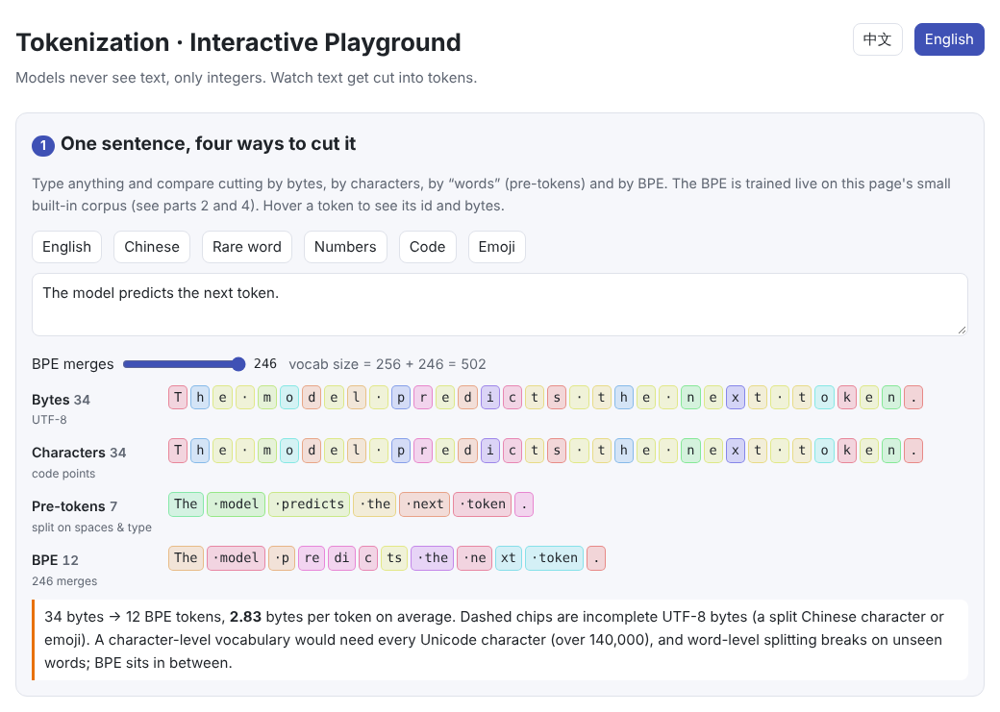
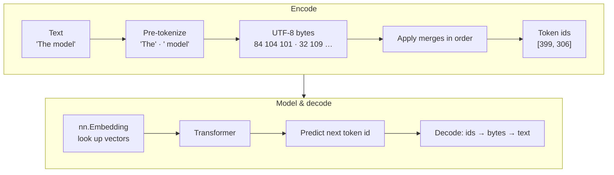

# Tokenization

> **In one sentence:** a tokenizer cuts text into tokens and maps them to integer ids, the only thing a model can “see” as input and the only thing it can produce as output.
>
> 🌐 [中文版](README.md) · 🎮 **[Open the interactive playground](interactive/tokenizer.html?lang=en)** · 📓 [Notebook](01-tokenization.ipynb) ([open in Colab](https://colab.research.google.com/github/BaiYuBY/use_token_to_learn/blob/main/docs/01-tokenization/01-tokenization.ipynb))

[](interactive/tokenizer.html?lang=en)

**In this chapter you will learn:**

- Why we use subwords instead of whole words or single characters
- How byte pair encoding (BPE) is trained: merge the most frequent neighbouring pair, again and again
- How new text is encoded by replaying the learned merges in order, and why byte-level BPE never meets an “unknown” word
- How the vocabulary size affects both sequence length and parameter count
- Common tokenizer quirks around spaces, case, numbers and Chinese text
- How to implement byte-level BPE from scratch in under 100 lines of Python and feed it into PyTorch's `nn.Embedding`

---

## 1. Intuition: why tokenize?

Neural networks only process numbers. To hand text to a model we cut it into pieces and give each piece an id. The question is: **how big should the pieces be?**

| Unit | Vocabulary size | Sequence length | Main problem |
| --- | --- | --- | --- |
| Words | hundreds of thousands or more | short | New words, typos and compounds become “unknown”; Chinese has no spaces to split on |
| Characters | Unicode has over 140,000 | long | Longer sequences cost more compute, and each token carries little meaning |
| Bytes | fixed at 256 | longest (3 bytes per Chinese character) | Sequences are far too long |
| **Subwords (BPE etc.)** | usually 30k–150k | moderate | The tokenizer must be trained on a corpus first |

Subword tokenization keeps **common words whole and splits rare words into smaller pieces**. “the” is one token, while “unbelievably” might become “un” + “believ” + “ably”. The vocabulary stays manageable and no text is ever impossible to represent.

## 2. Pictures

The same text produces very different token counts depending on the unit (BPE trained on this chapter's small corpus):


Note that the Chinese sentence has only 2 pre-tokens: Chinese has no spaces, so the whole sentence counts as one “word”. That is why Chinese relies so heavily on subword methods like BPE.

The full path from text into the model and back out:



As BPE learns more merges, each token holds more text:


On the right, each Chinese character starts as 3 tokens (a Chinese character usually takes 3 bytes in UTF-8) and drops towards 1 as merges are learned; common words even become a single token. The curves flatten because the corpus is tiny: once every pair appears only once, training stops early.

> **🎮 Try it yourself**
>
> In the [interactive playground](interactive/tokenizer.html?lang=en) you can:
>
> 1. Type any text and compare cutting by bytes, characters, pre-tokens and BPE
> 2. Step through BPE training and see which pair wins each round and how the vocabulary grows
> 3. Type a new word and replay every merge applied while encoding it
> 4. Drag a slider to change the vocabulary size and see the length vs parameters trade-off
> 5. Explore the quirks caused by spaces, case, numbers and rare characters

## 3. How it works

### 3.1 Pre-tokenization

Before BPE, a regular expression splits text into rough “words”, and **merges are never allowed to cross these boundaries**. GPT-2-style rules attach a leading space to the following word, so `" model"` (with its space) is one unit, and digits and punctuation are kept separate. This avoids wasting tokens on combinations like “dog.” and “dog!”.

### 3.2 Training: merge the most frequent pair, repeatedly

1. Start with a vocabulary of 256 bytes and write every word of the corpus as a byte sequence
2. Count every adjacent token pair $(a, b)$ (a word that appears $f$ times counts $f$ times)
3. Take the most frequent pair and create a new token $ab$ with id $256 + k$ (the $k$-th merge)
4. Replace every $(a, b)$ in the corpus with $ab$ and go back to step 2, until the target vocabulary size is reached

Training produces an **ordered list of merges**, and the vocabulary size is $V = 256 + \text{number of merges}$. The tokenizer is trained once and then kept fixed while the model is trained and used.

### 3.3 Encoding: replay the merges in order

Encoding new text does not count anything. Each pre-token is turned into bytes, and the **earliest-learned merge that currently applies** is used again and again until none applies. This guarantees the same text always gets the same ids.

Every text is a sequence of UTF-8 bytes and all 256 bytes are in the vocabulary, so byte-level BPE **needs no `[UNK]` token**. An unseen character at worst falls back to single bytes.

### 3.4 The vocabulary-size trade-off


- **A bigger vocabulary** means fewer tokens for the same text: shorter sequences, less attention compute (which grows with length squared) and more text per context window
- **The cost**: the embedding table has $V \times d_{\text{model}}$ parameters and so does the output layer that predicts the next token ($d_{\text{model}} \times V$); rare tokens also get few training examples and may be learned poorly

### 3.5 Other tokenization algorithms

| Algorithm | Used by | Difference from BPE |
| --- | --- | --- |
| **WordPiece** | BERT | Also merges bottom-up, but picks the pair that most increases the corpus likelihood rather than the most frequent one |
| **Unigram LM** | T5, some multilingual models | Works the other way round: starts from a large vocabulary and prunes the tokens whose removal hurts the likelihood least |
| **SentencePiece** | Llama 2, T5 and others | A library that runs BPE or Unigram directly on raw text, treating the space as an ordinary symbol `▁`, with no pre-tokenization |

Tokenizers also define **special tokens** such as the end-of-text marker `<|endoftext|>` or role markers in chat templates. They never come out of merging ordinary text; the program inserts them explicitly.

## 4. Minimal implementation

Full code: [`code/bpe.py`](code/bpe.py). Run `python docs/01-tokenization/code/bpe.py`: it trains on [`code/corpus.txt`](code/corpus.txt), prints the first 10 merges, checks that every sample decodes back to the original text, and finally feeds the ids into `nn.Embedding`.

The core training loop:

```python
words = Counter(tuple(w.encode("utf-8")) for w in pretokenize(text))
for step in range(n_merges):
    pairs = count_pairs(words)                            # count adjacent pairs
    pair = min(pairs, key=lambda p: (-pairs[p], p))       # most frequent pair
    if pairs[pair] < 2:
        break
    new_id = 256 + len(self.merges)
    self.merges[pair] = new_id
    self.vocab[new_id] = self.vocab[pair[0]] + self.vocab[pair[1]]
    words = Counter({merge_word(w, pair, new_id): f for w, f in words.items()})
```

Encoding one word:

```python
def encode_word(self, word_bytes):
    word = tuple(word_bytes)
    while len(word) > 1:
        # apply the earliest-learned merge first
        pair = min(zip(word, word[1:]), key=lambda p: self.merges.get(p, float("inf")))
        if pair not in self.merges:
            break
        word = merge_word(word, pair, self.merges[pair])
    return list(word)
```

The first thing the model does with the ids is a table lookup:

```python
ids = torch.tensor([bpe.encode("The model predicts the next token.")])  # (1, T)
embedding = nn.Embedding(num_embeddings=len(bpe.vocab), embedding_dim=16)
vectors = embedding(ids)                                                 # (1, T, 16)
```

> **In practice**
>
> Use OpenAI's `tiktoken` or Hugging Face's `tokenizers`; both are written in Rust and far faster. They work the same way as this chapter's code, with more detailed rules and much larger training corpora.

## 5. Common misconceptions

- **“A token is a word.”** A token can be a word, part of a word, a single character, or even some of the bytes of one Chinese character.
- **“One Chinese character is one token.”** It depends on the tokenizer. An English-centric tokenizer may spend 2–3 tokens on one character, while one trained on plenty of Chinese may fit a common phrase into a single token. This matters when you pay per token or count context length.
- **“The tokenizer is trained together with the model.”** It is trained separately beforehand and stays fixed while the model trains. Changing the tokenizer usually means retraining the embedding layer.
- **“A bigger vocabulary is always better.”** Too large a vocabulary bloats the embedding and output layers, and rare tokens are learned poorly.
- **“`hello` and ` hello` are the same token.”** A leading space or different case gives a completely different id that the model must learn separately.

## 6. Self-check

1. A BPE tokenizer performs 50,000 merges. How big is its vocabulary (ignoring special tokens)?
2. Why might a model's trouble counting the letter “r” in a word come from tokenization?
3. When encoding, why replay merges in the learned order instead of recounting frequencies?

<details>
<summary>Answers</summary>

1. 256 + 50,000 = 50,256. GPT-2's vocabulary has 50,257 entries: exactly one more, the special `<|endoftext|>` token.
2. A word is usually one or a few tokens. The model sees token ids, not individual letters, so “seeing” the letters has to be learned separately.
3. Encoding must be deterministic: the same text must always get the same ids so the model can learn a stable meaning for them. Also, the frequencies in a new text have nothing to do with the training corpus.

</details>

## 7. Further reading

- Sennrich et al., 2016. [Neural Machine Translation of Rare Words with Subword Units](https://arxiv.org/abs/1508.07909) (BPE comes to NLP)
- Radford et al., 2019. [Language Models are Unsupervised Multitask Learners](https://cdn.openai.com/better-language-models/language_models_are_unsupervised_multitask_learners.pdf) (GPT-2, byte-level BPE)
- Kudo, 2018. [Subword Regularization](https://arxiv.org/abs/1804.10959) (Unigram language-model tokenization)
- Kudo & Richardson, 2018. [SentencePiece](https://arxiv.org/abs/1808.06226)
- Andrej Karpathy. [Let's build the GPT Tokenizer](https://www.youtube.com/watch?v=zduSFxRajkE) and the code [minbpe](https://github.com/karpathy/minbpe)
- OpenAI. [tiktoken](https://github.com/openai/tiktoken)
