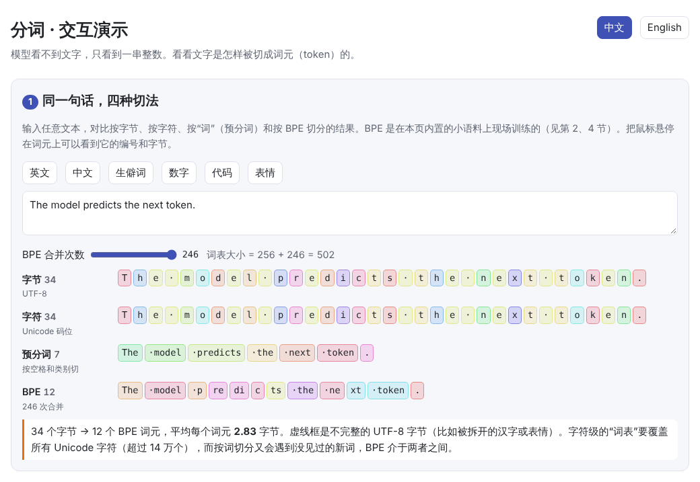
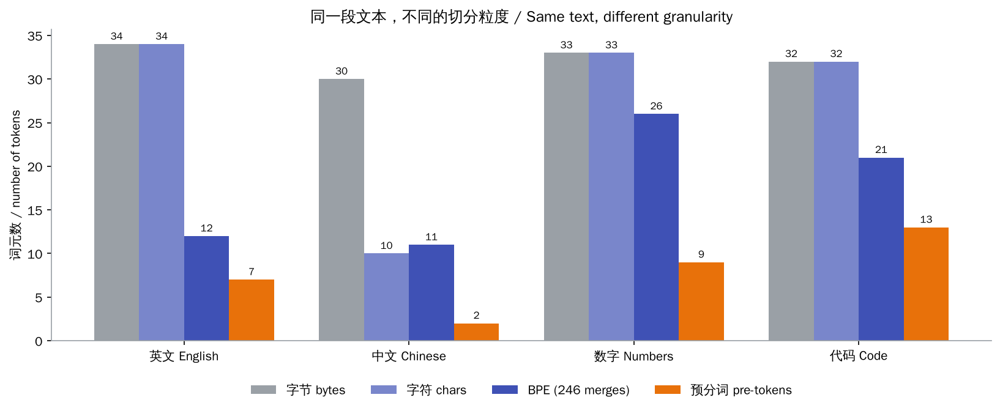
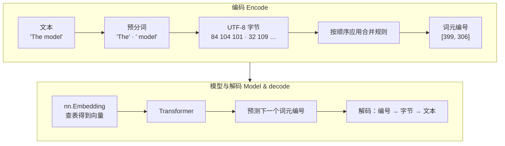
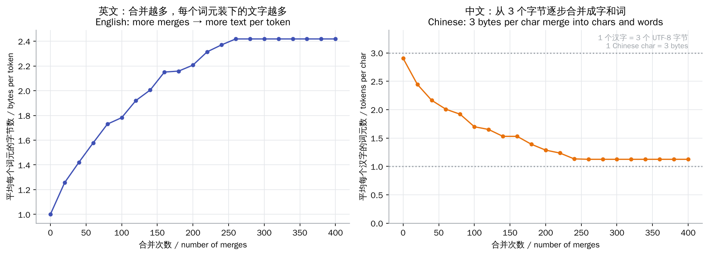
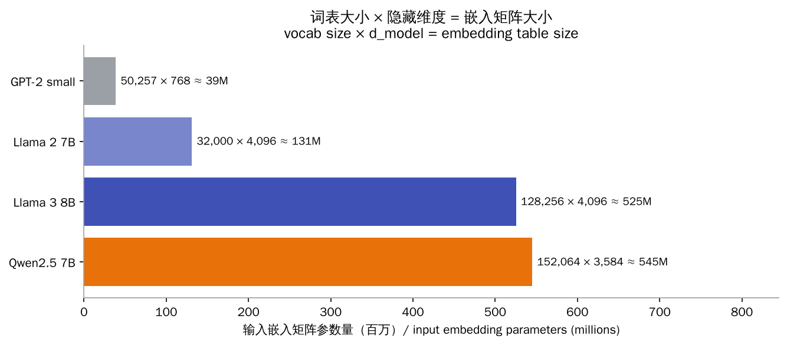

# 分词（Tokenization）

> **一句话总结：** 分词器把文本切成词元（token）并映射成整数编号，这是模型唯一能“看到”的输入，也是它唯一能输出的东西。
>
> 🌐 [English version](README.en.md) · 🎮 **[打开交互演示](interactive/tokenizer.html?lang=zh)**

[](interactive/tokenizer.html?lang=zh)

**本章你将学会：**

- 为什么不直接按字或按词切分，而要用“子词”
- 字节对编码（BPE）的训练过程：反复合并最常见的相邻对
- 编码新文本时如何按学到的顺序应用合并规则，以及为什么字节级 BPE 不会遇到“未知词”
- 词表大小如何同时影响序列长度和参数量
- 空格、大小写、数字、中文等常见的“分词怪现象”
- 用不到 100 行 Python 从零实现字节级 BPE，并接上 PyTorch 的 `nn.Embedding`

---

## 1. 直觉：为什么需要分词

神经网络只能处理数字。要把文本交给模型，必须先把它切成小块，再给每一块分配一个编号。问题是：**切多大？**

| 切分方式 | 词表大小 | 序列长度 | 主要问题 |
| --- | --- | --- | --- |
| 按词 | 几十万甚至更多 | 短 | 新词、拼写错误、复合词都会变成“未知词”；中文没有空格，难以切词 |
| 按字符 | Unicode 有超过 14 万个字符 | 长 | 序列变长，计算量随之增加，每个词元携带的信息少 |
| 按字节 | 固定 256 个 | 最长（一个汉字 3 个字节） | 序列太长 |
| **子词（BPE 等）** | 通常 3 万～15 万 | 适中 | 需要先在语料上训练分词器 |

子词分词的思路是：**常见的词整个作为一个词元，罕见的词拆成更小的片段**。比如 “the” 是一个词元，而 “unbelievably” 可能被拆成 “un” + “believ” + “ably”。这样，词表大小可控，又不会遇到完全无法表示的文本。

## 2. 图解

同一段文本按不同粒度切分，得到的词元数差别很大（BPE 在本章自带的小语料上训练）：



注意中文的“预分词”只有 2 个：中文没有空格，整句话会被当成一个“词”，所以中文更依赖 BPE 这类子词方法。

文本进入模型、再从模型出来的完整流程：



BPE 训练时，随着合并次数增加，每个词元能装下的文字越来越多：



右图中，中文一开始每个汉字要 3 个词元（UTF-8 中一个汉字通常占 3 个字节），合并后逐渐降到接近 1 个，常见的词甚至能合并成一个词元。曲线最后变平，是因为语料太小，所有相邻对都只剩下 1 次出现，训练提前结束了。

> **🎮 动手试试**
>
> 在[交互演示](interactive/tokenizer.html?lang=zh)中，你可以：
>
> 1. 输入任意文本，对比字节、字符、预分词和 BPE 四种切法
> 2. 一步一步执行 BPE 训练，看每一步选中了哪一对、词表如何增长
> 3. 输入新词，逐步回放编码时应用的每一条合并规则
> 4. 拖动滑块改变词表大小，观察序列长度与参数量的权衡
> 5. 观察空格、大小写、数字和生僻字带来的“怪现象”

## 3. 原理

### 3.1 预分词

在 BPE 之前，先用一个正则表达式把文本粗切成“词”，规定**合并不能跨越这些边界**。GPT-2 风格的规则会把前导空格留在后面的词上，所以 `" model"`（带空格）是一个整体，数字、标点也各自分开。这样可以避免学出 “dog.” 和 “dog!” 这类把词和标点粘在一起的无用词元。

### 3.2 训练：反复合并最常见的相邻对

1. 初始词表是 256 个字节，把语料中的每个词表示成字节序列
2. 统计所有相邻词元对 $(a, b)$ 的出现次数（同一个词出现 $f$ 次，就算 $f$ 次）
3. 取出现最多的一对，创建新词元 $ab$，编号为 $256 + k$（第 $k$ 次合并）
4. 在语料中把所有 $(a, b)$ 替换成 $ab$，回到第 2 步，直到达到目标词表大小

训练结束后得到一个**有序的合并列表**，词表大小 $V = 256 + \text{合并次数}$。分词器只训练一次，之后在训练和使用模型时都保持不变。

### 3.3 编码：按学到的顺序回放

编码新文本时不再统计频率：把每个预分词转成字节，然后**反复找出当前能用的、最早学到的那条合并规则**并应用，直到没有可用的规则。这保证了同一段文本永远得到同样的编号。

因为任何文本都是 UTF-8 字节序列，而 256 个字节都在词表中，所以字节级 BPE **不需要 `[UNK]`（未知词）词元**。没见过的字最坏也只是退回到单个字节。

### 3.4 词表大小的权衡



- **词表越大**：同样的文本需要的词元越少，序列更短，注意力的计算量（与长度的平方成正比）更小，上下文窗口能装下更多内容
- **代价**：嵌入矩阵有 $V \times d_{\text{model}}$ 个参数，输出层（预测下一个词元）也有 $d_{\text{model}} \times V$ 个参数；而且罕见词元的训练样本少，可能学不好

### 3.5 其他分词算法

| 算法 | 用于 | 与 BPE 的区别 |
| --- | --- | --- |
| **WordPiece** | BERT | 也是自底向上合并，但选择合并对时看的是“合并后语料似然提升多少”，而不是单纯的频率 |
| **Unigram LM** | T5、部分多语言模型 | 反过来：从一个很大的词表开始，逐步删掉对语料似然影响最小的词元 |
| **SentencePiece** | Llama 2、T5 等 | 一个工具库，可以用 BPE 或 Unigram；直接处理原始文本，把空格当作普通符号 `▁`，不依赖预分词 |

此外，分词器还会定义**特殊词元**，如文本结束符 `<|endoftext|>`、对话模板中的角色标记等。它们不会由普通文本合并得到，只能由程序显式插入。

## 4. 最小代码实现

完整代码：[`code/bpe.py`](code/bpe.py)，运行 `python docs/01-tokenization/code/bpe.py`。它会在 [`code/corpus.txt`](code/corpus.txt) 上训练，打印前 10 次合并，验证所有样例都能无损还原，最后把编号送进 `nn.Embedding`。

训练的核心循环：

```python
words = Counter(tuple(w.encode("utf-8")) for w in pretokenize(text))
for step in range(n_merges):
    pairs = count_pairs(words)                            # 统计相邻对
    pair = min(pairs, key=lambda p: (-pairs[p], p))       # 最常见的一对
    if pairs[pair] < 2:
        break
    new_id = 256 + len(self.merges)
    self.merges[pair] = new_id
    self.vocab[new_id] = self.vocab[pair[0]] + self.vocab[pair[1]]
    words = Counter({merge_word(w, pair, new_id): f for w, f in words.items()})
```

编码一个词：

```python
def encode_word(self, word_bytes):
    word = tuple(word_bytes)
    while len(word) > 1:
        # 先应用最早学到的合并
        pair = min(zip(word, word[1:]), key=lambda p: self.merges.get(p, float("inf")))
        if pair not in self.merges:
            break
        word = merge_word(word, pair, self.merges[pair])
    return list(word)
```

编号进入模型的第一步，就是在嵌入矩阵中查表：

```python
ids = torch.tensor([bpe.encode("The model predicts the next token.")])  # (1, T)
embedding = nn.Embedding(num_embeddings=len(bpe.vocab), embedding_dim=16)
vectors = embedding(ids)                                                 # (1, T, 16)
```

> **实际工程中**
>
> 可以直接使用 OpenAI 的 `tiktoken` 或 Hugging Face 的 `tokenizers`，它们用 Rust 实现，速度快得多。原理与本章的实现相同，只是规则更细致、训练语料大得多。

## 5. 常见误区

- **“一个词元就是一个词”**：词元可以是词、词的一部分、单个字符，甚至是半个汉字的字节。
- **“一个汉字就是一个词元”**：取决于分词器。在以英文为主的分词器里，一个汉字可能需要 2～3 个词元；在中文语料充足的分词器里，常见词组可能只占 1 个词元。按词元计费或计算上下文长度时，这一点很重要。
- **“分词器和模型一起训练”**：分词器是事先单独训练好的，模型训练期间保持不变。更换分词器通常意味着嵌入层要重新训练。
- **“词表越大越好”**：词表太大，嵌入层和输出层参数会膨胀，罕见词元也学不好。
- **“`hello` 和 ` hello` 是同一个词元”**：前导空格和大小写都会产生完全不同的编号，模型需要分别学习。

## 6. 自测题

1. 一个 BPE 分词器做了 50,000 次合并，它的词表有多大（不算特殊词元）？
2. 为什么说模型“不擅长数出单词里有几个字母 r”可能和分词有关？
3. 编码时，为什么要按“学到的顺序”应用合并，而不是每次重新统计频率？

<details>
<summary>参考答案</summary>

1. 256 + 50,000 = 50,256 个。GPT-2 的词表是 50,257 个，正好多出一个特殊词元 `<|endoftext|>`。
2. 一个单词常常是一个或几个词元，模型看到的是词元编号，而不是一个个字母，所以要“看清”字母需要额外学习。
3. 编码必须是确定的：同一段文本无论出现在哪里，都要得到同样的编号，模型才能学到稳定的含义。而且新文本的频率与训练语料无关。

</details>

## 7. 延伸阅读

- Sennrich et al., 2016. [Neural Machine Translation of Rare Words with Subword Units](https://arxiv.org/abs/1508.07909)（把 BPE 引入 NLP）
- Radford et al., 2019. [Language Models are Unsupervised Multitask Learners](https://cdn.openai.com/better-language-models/language_models_are_unsupervised_multitask_learners.pdf)（GPT-2，字节级 BPE）
- Kudo, 2018. [Subword Regularization](https://arxiv.org/abs/1804.10959)（Unigram 语言模型分词）
- Kudo & Richardson, 2018. [SentencePiece](https://arxiv.org/abs/1808.06226)
- Andrej Karpathy. [Let's build the GPT Tokenizer](https://www.youtube.com/watch?v=zduSFxRajkE) 与代码 [minbpe](https://github.com/karpathy/minbpe)
- OpenAI. [tiktoken](https://github.com/openai/tiktoken)
