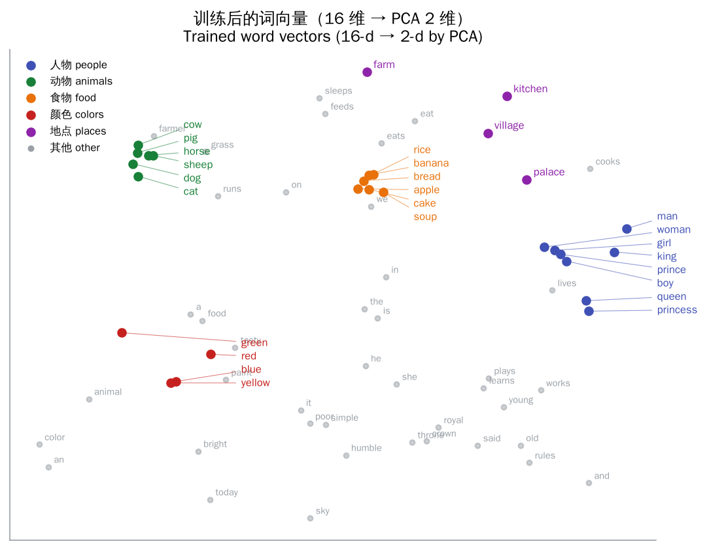
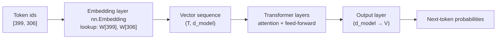
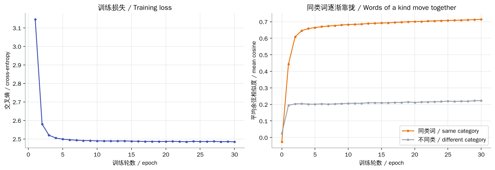
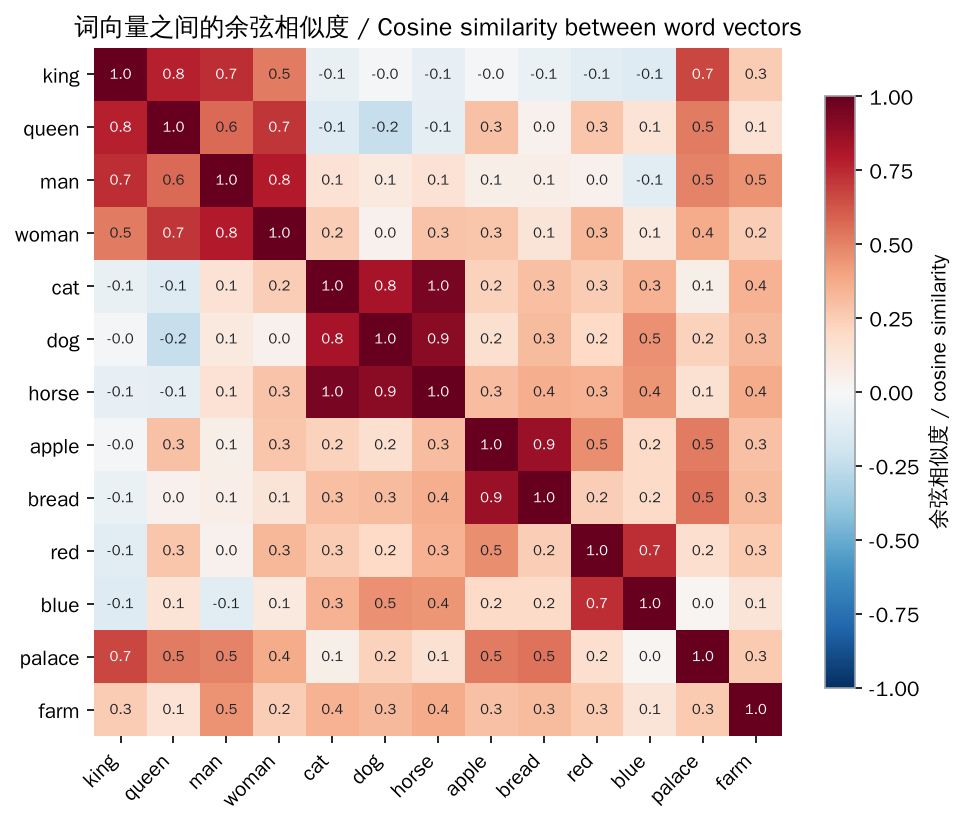
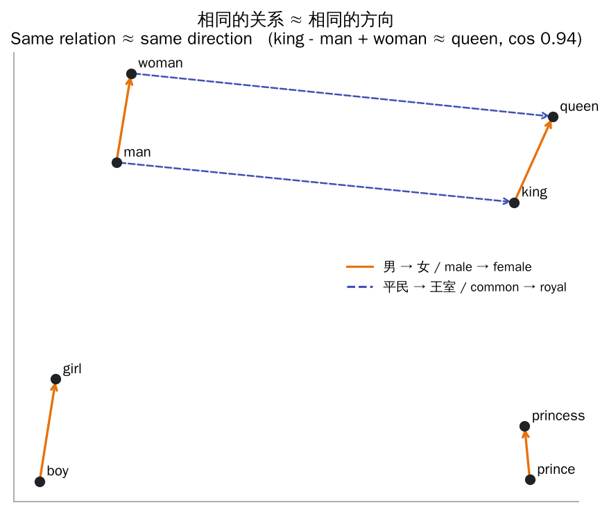

# Embeddings

> **In one sentence:** the embedding layer keeps one learnable vector per token id, and training makes words that appear in similar contexts point in similar directions.
>
> 🌐 [中文版](README.md) · 🎮 **[Open the interactive playground](interactive/embedding.html?lang=en)** · 📓 [Notebook](02-embedding.ipynb) ([open in Colab](https://colab.research.google.com/github/BaiYuBY/use_token_to_learn/blob/main/docs/02-embedding/02-embedding.ipynb))

[](interactive/embedding.html?lang=en)

**In this chapter you will learn:**

- Why dense embedding vectors are used instead of one-hot vectors
- That `nn.Embedding` is a table lookup, exactly equivalent to multiplying a one-hot vector by a matrix
- How word vectors are learned: skip-gram uses a word to predict the words around it
- How cosine similarity measures similarity, and the linear structure behind “king − man + woman ≈ queen”
- Where the embedding layer sits in a Transformer: static word vectors vs contextual representations

---

## 1. Intuition: why embeddings?

In the previous chapter the tokenizer turned text into a sequence of integer ids. The ids mean nothing by themselves: if `cat` were 37 and `dog` 38, that would say nothing about them being similar.

The most direct encoding is a **one-hot vector**: with $V$ words in the vocabulary, use a $V$-dimensional vector with a single 1. It has two problems:

- **Long and sparse**: a 100k-word vocabulary means 100k-dimensional vectors containing a single 1
- **No similarity**: any two one-hot vectors are perpendicular, so `cat` is as far from `dog` as it is from `palace`

An **embedding** gives each word a much shorter **dense vector** (say 768 dimensions) and lets the model learn its values. After training, words with similar meanings sit close together in this space.

The idea behind it is the **distributional hypothesis** from linguistics: “You shall know a word by the company it keeps” (J. R. Firth, 1957). Words that appear in similar contexts tend to have similar meanings.

## 2. Pictures

This chapter really trains 16-dimensional word vectors on a small corpus with PyTorch ([`code/embedding.py`](code/embedding.py)). Reduced to 2-D, you can see that without any category labels the model has grouped animals, food, colours and people:



Where the embedding layer sits in the model:



During training, the average cosine similarity between words of the same category rises quickly, while the similarity across categories barely moves:



> **🎮 Try it yourself**
>
> In the [interactive playground](interactive/embedding.html?lang=en) you can:
>
> 1. Click a word and see a one-hot vector times the embedding matrix pick out exactly its row
> 2. Rotate the 3-D semantic space and click a word to see its nearest neighbours
> 3. Replay training and watch the vectors start at random positions and gather by category
> 4. Drag two arrows to feel the difference between cosine similarity and the dot product
> 5. Build your own A − B + C and test vector analogies

## 3. How it works

### 3.1 An embedding is a lookup

Row $i$ of the embedding matrix $W \in \mathbb{R}^{V \times d}$ is the vector of token $i$:

$$
\mathbf{e}_i = W[i] = \mathbf{x}_i^\top W
$$

where $\mathbf{x}_i$ is the one-hot vector. Every row except row $i$ is multiplied by 0, so implementations simply fetch the row by its id instead of multiplying. All the numbers in $W$ are ordinary parameters, updated by backpropagation along with the rest of the model.

### 3.2 How word vectors are learned

**Skip-gram** (one flavour of word2vec) gives the model a simple task: given a centre word $w$, predict each context word $c$ in its window:

$$
P(c \mid w) = \mathrm{softmax}(U\,\mathbf{e}_w)_c, \qquad \mathcal{L} = -\log P(c \mid w)
$$

where $U$ is the output layer's weight. If `cat` and `dog` keep appearing in the same contexts (“the ___ sleeps on the farm”), then to predict those contexts well the gradients push their vectors in similar directions.

In large language models the embedding layer is not trained separately with skip-gram; it is learned end to end with the rest of the model through next-token prediction. The principle is the same: **a vector's position is decided by the predictions it has to help make**.

### 3.3 Cosine similarity

Word vectors are usually compared by the **angle** between them rather than by distance:

$$
\cos(\mathbf a, \mathbf b) = \frac{\mathbf a \cdot \mathbf b}{\lVert \mathbf a \rVert\,\lVert \mathbf b \rVert} \in [-1, 1]
$$

It is 1 for the same direction, 0 for perpendicular and −1 for opposite. A vector's length often reflects things like word frequency, and cosine similarity ignores length.



### 3.4 Analogies and linear structure

If the “male → female” difference always shows up in the contexts in the same way, it becomes a roughly fixed direction in the space:

$$
\mathbf e_{\text{king}} - \mathbf e_{\text{man}} + \mathbf e_{\text{woman}} \approx \mathbf e_{\text{queen}}
$$

In this chapter's corpus every person word combines three attributes (royal/common, male/female, adult/child), so the learned vectors form a neat parallelogram:



### 3.5 Embeddings inside a Transformer

- **Static vs contextual**: the embedding layer always returns the same vector for the same id, so “bank” (money or river) has only one embedding. Telling the senses apart is the job of the attention layers that follow, which adjust the vector using context (see [04 Attention](../04-attention/README.en.md)).
- **Position**: the embedding layer knows nothing about a token's position, so positional information must be added (see [03 Positional encoding](../03-positional-encoding/README.en.md)).
- **Weight tying**: the output layer is also a $d \times V$ matrix, and some models (GPT-2, for example) share it with the embedding matrix, saving $V \times d$ parameters.
- **Size**: the embedding matrix has $V \times d$ parameters, which can be a large share of a small model (see the vocabulary-size trade-off in [01 Tokenization](../01-tokenization/README.en.md)).

## 4. Minimal implementation

Full code: [`code/embedding.py`](code/embedding.py). Run `python docs/02-embedding/code/embedding.py`: it checks that lookup equals one-hot multiplication, trains skip-gram word vectors, and checks the neighbours and analogies.

An embedding is a lookup:

```python
emb = nn.Embedding(num_embeddings=10, embedding_dim=4)
ids = torch.tensor([3, 7, 3])
one_hot = F.one_hot(ids, num_classes=10).float()     # (3, 10)
assert torch.allclose(emb(ids), one_hot @ emb.weight)
```

The skip-gram model has just two layers:

```python
class SkipGram(nn.Module):
    def __init__(self, vocab_size, dim):
        super().__init__()
        self.emb = nn.Embedding(vocab_size, dim)                # the vectors we want
        self.out = nn.Linear(dim, vocab_size, bias=False)       # a score for every context word

    def forward(self, center):
        return self.out(self.emb(center))                       # (batch, vocab)

loss = F.cross_entropy(model(batch[:, 0]), batch[:, 1])         # centre word → context word
```

An analogy is vector addition followed by a cosine search:

```python
def analogy(weights, vocab, a, b, c, k=3):
    w = F.normalize(weights, dim=1)
    v = w[vocab.index(a)] - w[vocab.index(b)] + w[vocab.index(c)]
    return nearest(weights, vocab, v, k=k, exclude=(a, b, c))

analogy(weights, vocab, "king", "man", "woman")   # [('queen', 0.94), ...]
```

> **In practice**
>
> The original word2vec replaces the softmax over the whole vocabulary with “negative sampling” so it can train on billions of words. This chapter's vocabulary has only 69 words, so a full softmax keeps the code simpler.

## 5. Common misconceptions

- **“Each dimension has a clear meaning.”** The embedding space can be rotated freely without changing the model, so a single dimension usually has no interpretable meaning. What matters is the directions and angles between vectors.
- **“High similarity means synonyms.”** Antonyms such as hot and cold often appear in the same contexts and can have very similar vectors. Similarity measures similar *usage*, not identical meaning.
- **“Analogies always work.”** They rely on the data really containing a consistent structure. The famous examples are cherry-picked, and the search usually excludes A, B and C themselves (as this chapter does).
- **“An LLM's embedding layer is pre-trained separately.”** In GPT-style models it is trained together with the whole model.
- **“The embedding layer can tell word senses apart.”** It cannot: one id always maps to one vector. Later layers use context to separate the senses.

## 6. Self-check

1. With 32,000 tokens and `d_model = 4096`, how many parameters does the embedding matrix have? How many does tying it to the output layer save?
2. Why do one-hot vectors have “no similarity”?
3. At the start of training, why are the vectors for `cat` and `dog` not close? What brings them together?

<details>
<summary>Answers</summary>

1. 32,000 × 4096 = 131,072,000, about 131M. The output layer is also 4096 × 32,000, so tying saves the same amount again, about 131M.
2. The dot product of any two different one-hot vectors is 0 (they are perpendicular), so every pair of words is equally far apart.
3. The embedding matrix starts random, so the vectors are unrelated. During training they have to predict very similar contexts (farm, sleeps, eats…), and the gradients push them in similar directions.

</details>

## 7. Further reading

- Mikolov et al., 2013. [Efficient Estimation of Word Representations in Vector Space](https://arxiv.org/abs/1301.3781) (word2vec)
- Mikolov et al., 2013. [Distributed Representations of Words and Phrases and their Compositionality](https://arxiv.org/abs/1310.4546) (negative sampling and analogies)
- Pennington et al., 2014. [GloVe: Global Vectors for Word Representation](https://nlp.stanford.edu/pubs/glove.pdf)
- Press & Wolf, 2017. [Using the Output Embedding to Improve Language Models](https://arxiv.org/abs/1608.05859) (weight tying)
- Ethayarajh, 2019. [How Contextual are Contextualized Word Representations?](https://arxiv.org/abs/1909.00512)
- Jay Alammar. [The Illustrated Word2vec](https://jalammar.github.io/illustrated-word2vec/)
