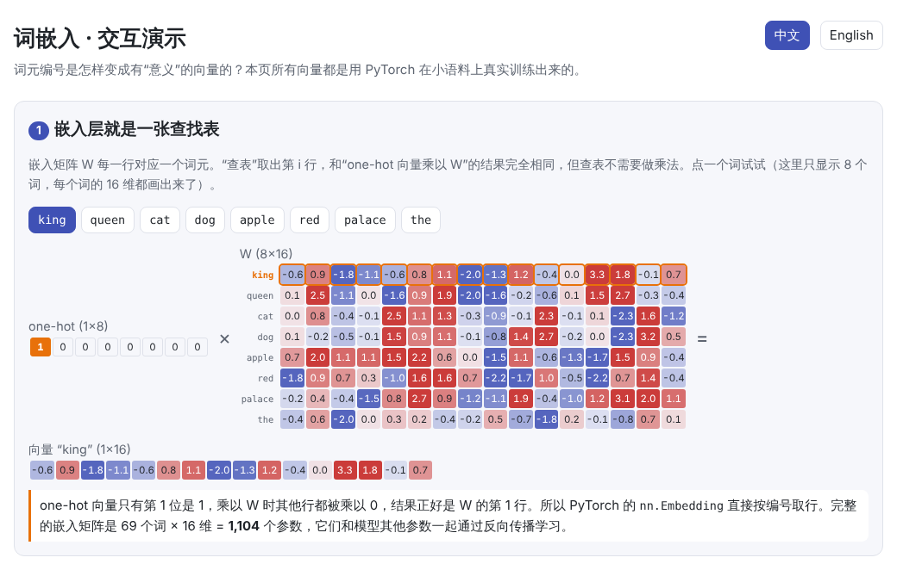
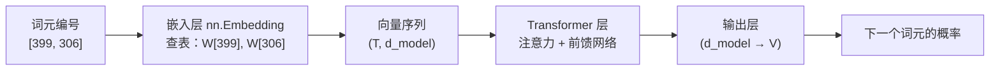

# 词嵌入（Embedding）

> **一句话总结：** 嵌入层为每个词元编号准备一个可学习的向量；训练会让出现在相似上下文中的词，向量指向相似的方向。
>
> 🌐 [English version](README.en.md) · 🎮 **[打开交互演示](interactive/embedding.html?lang=zh)**

[](interactive/embedding.html?lang=zh)

**本章你将学会：**

- 为什么不用 one-hot 向量，而要用稠密的嵌入向量
- `nn.Embedding` 本质上是查表，它与“one-hot 乘矩阵”完全等价
- 词向量是怎样学出来的：skip-gram 用一个词去预测它周围的词
- 如何用余弦相似度衡量词的相似程度，以及 “king − man + woman ≈ queen” 背后的线性结构
- 嵌入层在 Transformer 中的位置：静态词向量与上下文相关的表示

---

## 1. 直觉：为什么需要嵌入

上一章里，分词器把文本变成了一串整数编号。但编号本身没有含义：假设 `cat` 是 37 号、`dog` 是 38 号，这并不说明它们相似。

最直接的做法是 **one-hot 向量**：词表有 $V$ 个词，就用一个 $V$ 维向量，只在对应位置放 1。它有两个问题：

- **太长、太稀疏**：词表有 10 万个词，每个向量就是 10 万维，其中只有一个 1
- **没有相似性**：任意两个 one-hot 向量都互相垂直，`cat` 和 `dog` 的距离与 `cat` 和 `palace` 一样远

**嵌入（embedding）** 的做法是给每个词一个短得多的**稠密向量**（例如 768 维），并让模型自己学习这些数值。训练之后，含义相近的词会在这个空间中靠在一起。

背后的思想是语言学中的**分布假说**：“观其伴，知其义”（You shall know a word by the company it keeps, J. R. Firth, 1957）。出现在相似上下文中的词，含义往往相近。

## 2. 图解

本章用 PyTorch 在一个小语料上真实训练了 16 维的词向量（[`code/embedding.py`](code/embedding.py)）。降到 2 维后可以看到，模型在没有任何类别标签的情况下，把动物、食物、颜色、人物各自聚在了一起：


嵌入层在整个模型中的位置：



训练过程中，同类词之间的平均余弦相似度迅速上升，而不同类词之间的相似度基本不变：


> **🎮 动手试试**
>
> 在[交互演示](interactive/embedding.html?lang=zh)中，你可以：
>
> 1. 点击一个词，看 one-hot 向量乘以嵌入矩阵如何正好取出它那一行
> 2. 在 3D 语义空间中拖动旋转，点一个词查看它最相似的邻居
> 3. 回放训练过程，看词向量如何从随机位置出发、按类别聚在一起
> 4. 拖动两个箭头，直观理解余弦相似度与点积的区别
> 5. 自己组合 A − B + C，测试向量类比

## 3. 原理

### 3.1 嵌入就是查表

嵌入矩阵 $W \in \mathbb{R}^{V \times d}$ 的第 $i$ 行，就是编号为 $i$ 的词元的向量：

$$
\mathbf{e}_i = W[i] = \mathbf{x}_i^\top W
$$

其中 $\mathbf{x}_i$ 是 one-hot 向量。乘法中除了第 $i$ 行，其他行都被乘以 0，所以实际实现时直接按编号取行即可，不需要做矩阵乘法。$W$ 中的所有数值都是普通参数，和模型其他部分一起通过反向传播更新。

### 3.2 词向量是怎么学出来的

**skip-gram**（word2vec 的一种）给模型一个简单的任务：给定中心词 $w$，预测它窗口内的每个上下文词 $c$：

$$
P(c \mid w) = \mathrm{softmax}(U\,\mathbf{e}_w)_c, \qquad \mathcal{L} = -\log P(c \mid w)
$$

其中 $U$ 是输出层的权重。如果 `cat` 和 `dog` 经常出现在相同的上下文里（“the ___ sleeps on the farm”），为了预测好这些上下文，梯度会把它们的向量推向相似的方向。

在大语言模型中，嵌入层不是用 skip-gram 单独训练的，而是和整个模型一起，通过“预测下一个词元”这个任务端到端地学习。但原理相同：**向量的位置由它要帮助完成的预测决定**。

### 3.3 余弦相似度

比较两个词向量时，通常看它们的**夹角**而不是距离：

$$
\cos(\mathbf a, \mathbf b) = \frac{\mathbf a \cdot \mathbf b}{\lVert \mathbf a \rVert\,\lVert \mathbf b \rVert} \in [-1, 1]
$$

方向相同为 1，垂直为 0，相反为 −1。向量的长度常常和词频等因素有关，而余弦相似度不受长度影响。


### 3.4 向量类比与线性结构

如果语料中“男 → 女”的差异总是以相同的方式体现在上下文里，这个差异就会变成空间中一个大致固定的方向：

$$
\mathbf e_{\text{king}} - \mathbf e_{\text{man}} + \mathbf e_{\text{woman}} \approx \mathbf e_{\text{queen}}
$$

在本章的语料里，每个人物词都由“王室/平民、男/女、成人/孩子”三种属性组合而成，所以学出来的向量呈现出漂亮的平行四边形：


### 3.5 嵌入层在 Transformer 中

- **静态与上下文相关**：嵌入层对同一个编号永远给出同一个向量，所以 “bank”（银行/河岸）在嵌入层只有一个向量。区分不同含义，要靠后面的注意力层根据上下文去修改它（见 [04 注意力机制](../04-attention/README.md)）。
- **位置信息**：嵌入层本身不知道词的位置，所以还需要加上位置编码（03 位置编码，即将推出）。
- **权重共享（weight tying）**：输出层也是一个 $d \times V$ 的矩阵，有些模型（如 GPT-2）让它和嵌入矩阵共用同一份参数，能省下 $V \times d$ 个参数。
- **规模**：嵌入矩阵有 $V \times d$ 个参数，在小模型中占比可能相当大（见 [01 分词](../01-tokenization/README.md) 中“词表大小的权衡”）。

## 4. 最小代码实现

完整代码：[`code/embedding.py`](code/embedding.py)，运行 `python docs/02-embedding/code/embedding.py`。它会验证查表与 one-hot 乘法等价、训练 skip-gram 词向量，并检查近邻和类比结果。

嵌入就是查表：

```python
emb = nn.Embedding(num_embeddings=10, embedding_dim=4)
ids = torch.tensor([3, 7, 3])
one_hot = F.one_hot(ids, num_classes=10).float()     # (3, 10)
assert torch.allclose(emb(ids), one_hot @ emb.weight)
```

skip-gram 模型只有两层：

```python
class SkipGram(nn.Module):
    def __init__(self, vocab_size, dim):
        super().__init__()
        self.emb = nn.Embedding(vocab_size, dim)                # 我们想要的词向量
        self.out = nn.Linear(dim, vocab_size, bias=False)       # 给每个上下文词打分

    def forward(self, center):
        return self.out(self.emb(center))                       # (batch, vocab)

loss = F.cross_entropy(model(batch[:, 0]), batch[:, 1])         # 中心词 → 上下文词
```

类比就是向量加减，再找余弦相似度最高的词：

```python
def analogy(weights, vocab, a, b, c, k=3):
    w = F.normalize(weights, dim=1)
    v = w[vocab.index(a)] - w[vocab.index(b)] + w[vocab.index(c)]
    return nearest(weights, vocab, v, k=k, exclude=(a, b, c))

analogy(weights, vocab, "king", "man", "woman")   # [('queen', 0.94), ...]
```

> **实际工程中**
>
> 原始的 word2vec 用“负采样”代替对整个词表做 softmax，以便在几十亿词的语料上训练。本章的词表只有 69 个词，所以直接用完整的 softmax，代码更简单。

## 5. 常见误区

- **“向量的每一维都有明确含义”**：嵌入空间可以任意旋转而不影响模型效果，单独某一维通常没有可解释的含义。有意义的是向量之间的方向和夹角。
- **“相似度高就是同义词”**：反义词（如 hot 和 cold）常出现在相同的上下文中，向量也可能很接近。相似度衡量的是“用法相似”，不等于“意思相同”。
- **“类比总是成立”**：类比依赖数据中真的存在一致的结构。论文中常见的例子经过挑选，而且查找结果时通常排除了 A、B、C 本身（本章也是这样做的）。
- **“大模型的嵌入层是单独预训练的”**：在 GPT 这类模型中，嵌入层是和整个模型一起训练的。
- **“嵌入层能区分一词多义”**：它不能，同一个编号永远对应同一个向量；区分多义要靠后面的层结合上下文。

## 6. 自测题

1. 词表有 32,000 个词元、`d_model = 4096`，嵌入矩阵有多少参数？如果输出层与它共享权重，又能省下多少？
2. 为什么说 one-hot 向量“没有相似性”？
3. 训练开始时，`cat` 和 `dog` 的向量为什么并不接近？是什么让它们靠拢的？

<details>
<summary>参考答案</summary>

1. 32,000 × 4096 = 131,072,000，约 1.31 亿。输出层也是 4096 × 32,000，共享权重就能省下同样多，约 1.31 亿。
2. 任意两个不同的 one-hot 向量点积都是 0（互相垂直），所以所有词之间的“距离”都一样。
3. 嵌入矩阵是随机初始化的，开始时向量之间没有关系。训练中，它们要预测的上下文很相似（farm、sleeps、eats……），梯度把它们推向相似的方向。

</details>

## 7. 延伸阅读

- Mikolov et al., 2013. [Efficient Estimation of Word Representations in Vector Space](https://arxiv.org/abs/1301.3781)（word2vec）
- Mikolov et al., 2013. [Distributed Representations of Words and Phrases and their Compositionality](https://arxiv.org/abs/1310.4546)（负采样与类比）
- Pennington et al., 2014. [GloVe: Global Vectors for Word Representation](https://nlp.stanford.edu/pubs/glove.pdf)
- Press & Wolf, 2017. [Using the Output Embedding to Improve Language Models](https://arxiv.org/abs/1608.05859)（权重共享）
- Ethayarajh, 2019. [How Contextual are Contextualized Word Representations?](https://arxiv.org/abs/1909.00512)
- Jay Alammar. [The Illustrated Word2vec](https://jalammar.github.io/illustrated-word2vec/)
