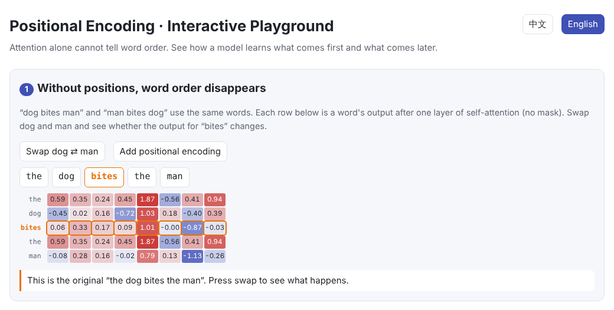
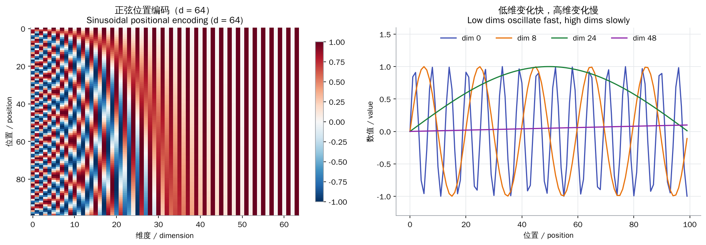
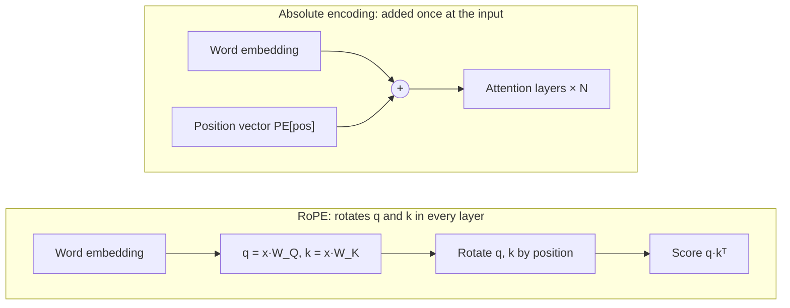
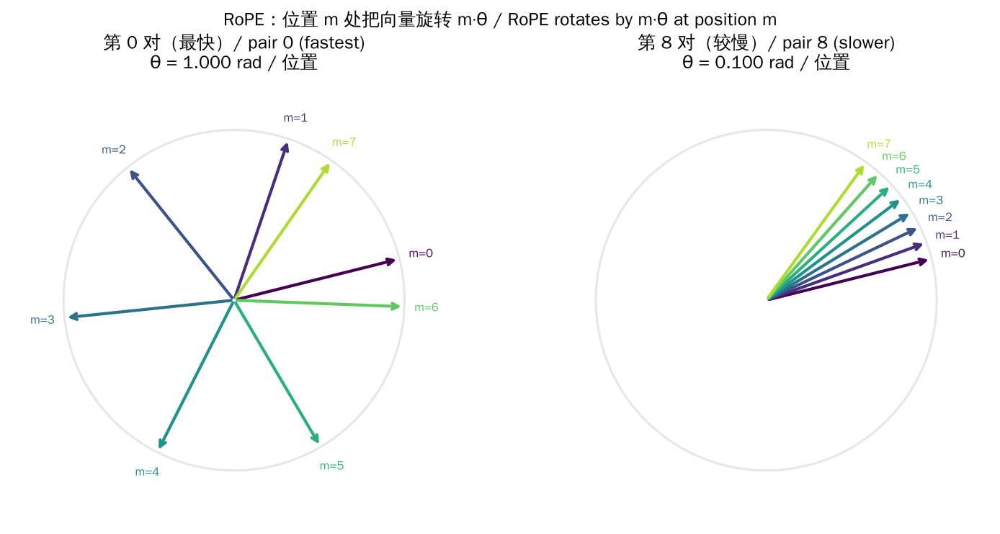
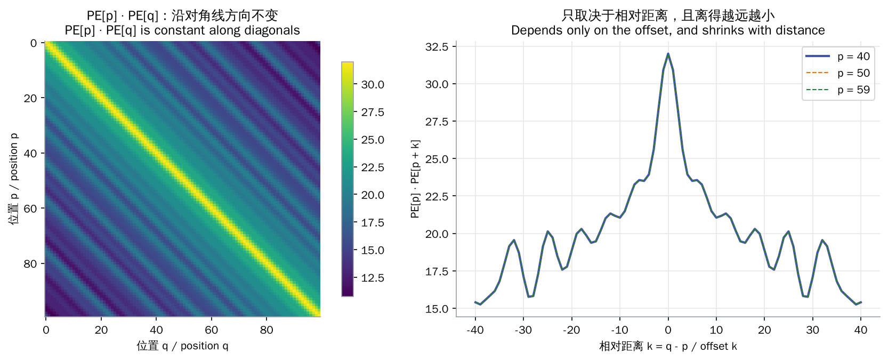
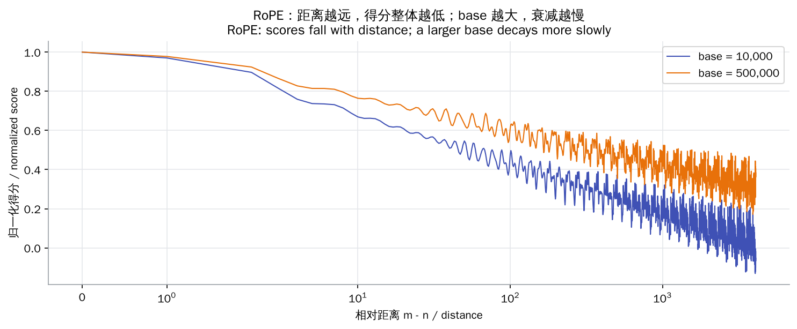

# Positional Encoding

> **In one sentence:** self-attention has no idea of word order, and positional encoding hands the model the “which position” information, either by adding it to the input (sinusoidal, learned) or by rotating q and k when scores are computed (RoPE).
>
> 🌐 [中文版](README.md) · 🎮 **[Open the interactive playground](interactive/positional.html?lang=en)** · 📓 [Notebook](03-positional-encoding.ipynb) ([open in Colab](https://colab.research.google.com/github/BaiYuBY/use_token_to_learn/blob/main/docs/03-positional-encoding/03-positional-encoding.ipynb))

[](interactive/positional.html?lang=en)

**In this chapter you will learn:**

- Why, without positions, “dog bites man” and “man bites dog” look identical to attention
- The sinusoidal encoding formula and the intuition of “clocks running at different speeds”
- Why dot products of sinusoidal encodings depend only on relative distance
- How rotary position embedding (RoPE) makes attention scores depend only on relative position, and how its base affects long contexts
- ALiBi, learned position embeddings, and common ways to extend the context length

---

## 1. Intuition: attention cannot see order

Recall [04 Attention](../04-attention/README.en.md): each token's output is a weighted sum of all Values, with weights from Query–Key dot products. **No step uses the tokens' positions.**

So if you shuffle the input tokens, the outputs are shuffled the same way and each token gets exactly the same result. In “the dog bites the man” and “the man bites the dog”, the output for “bites” is identical. To the model, the input is just **a bag of words**.

The fix is to give every position a unique “tag” so that the same word at a different position looks different to the model. There are two families of methods:

| Approach | Idea | Examples |
| --- | --- | --- |
| **Absolute positions** | Give each position a vector and add it to the word embedding | Sinusoidal (original Transformer), learned (GPT-2, BERT) |
| **Relative positions** | Adjust attention scores according to the distance between two tokens | RoPE (Llama, Qwen, Mistral and others), ALiBi (BLOOM and others) |

## 2. Pictures

The sinusoidal encoding is a positions × dimensions matrix. Dimensions on the left change fast, those on the right slowly:



The two families act at different places in the model:



RoPE treats each pair of components of q and k as a 2-D vector and rotates it by $m\theta$ at position m. Different pairs turn at different speeds:



> **🎮 Try it yourself**
>
> In the [interactive playground](interactive/positional.html?lang=en) you can:
>
> 1. Swap dog and man and see that, without positions, the output for “bites” does not change at all
> 2. Drag a position slider and watch a set of “clocks” encode the position
> 3. Check that the sinusoidal dot-product curve does not move with the absolute position
> 4. Rotate q and k with RoPE and “shift both” positions to see the score stay the same
> 5. Change RoPE's base and watch how scores decay with distance

## 3. How it works

### 3.1 The problem: permutation equivariance

Shuffle the rows of the input with a permutation matrix $P$ and the output of (unmasked) self-attention is shuffled in exactly the same way:

$$
\mathrm{Attn}(PX) = P\,\mathrm{Attn}(X)
$$

This is called **permutation equivariance**, and it shows that attention by itself carries no positional information.

### 3.2 Learned absolute position embeddings

The simplest approach: another embedding table `nn.Embedding(max_len, d_model)` whose row $p$ is the vector for position $p$, added to the word embedding and trained with everything else. GPT-2 and BERT do this. The drawback is that the model only handles lengths up to the maximum seen in training.

### 3.3 Sinusoidal encoding

The original Transformer uses a fixed formula with nothing to learn:

$$
PE_{(p,\,2i)} = \sin\!\left(\frac{p}{10000^{2i/d}}\right), \qquad PE_{(p,\,2i+1)} = \cos\!\left(\frac{p}{10000^{2i/d}}\right)
$$

Each $(\sin, \cos)$ pair is like the hand of a clock: every step in position turns clock $i$ by $\omega_i = 10000^{-2i/d}$ radians. Some useful properties:

- **Bounded and unique**: values stay in $[-1, 1]$ and every position has a different combination
- **A shift is a rotation**: $PE_{p+k}$ is $PE_p$ with every pair rotated by $k\,\omega_i$, a transformation that depends only on $k$
- **Dot products depend only on distance**: $PE_p \cdot PE_{p+k} = \sum_i \cos(k\,\omega_i)$, whatever $p$ is



### 3.4 Rotary position embedding (RoPE)

RoPE no longer adds a position vector to the input. Instead, in every layer and before computing attention, it rotates pair $i$ of $q$ and $k$ according to the position:

$$
\begin{pmatrix} q'_{2i} \\ q'_{2i+1} \end{pmatrix} =
\begin{pmatrix} \cos m\theta_i & -\sin m\theta_i \\ \sin m\theta_i & \cos m\theta_i \end{pmatrix}
\begin{pmatrix} q_{2i} \\ q_{2i+1} \end{pmatrix}, \qquad \theta_i = \text{base}^{-2i/d}
$$

Rotation matrices satisfy $R_m^\top R_n = R_{n-m}$, so the dot product of a query at position $m$ and a key at position $n$ is

$$
(R_m q)^\top (R_n k) = q^\top R_{n-m}\, k
$$

which **depends only on the relative distance $n - m$**. Rotations also keep vector lengths unchanged and add no parameters. Note that RoPE touches only q and k, never v.

When q and k point the same way, the farther apart they are, the more scrambled the rotation angles of the pairs become and the lower the score. **A larger base rotates more slowly, so distant scores decay more gently**, which is why long-context models raise the base:



### 3.5 ALiBi

ALiBi (Attention with Linear Biases) is even simpler. It leaves q and k alone and adds a penalty proportional to distance directly to the score:

$$
\text{score}_{ij} = q_i \cdot k_j - s \cdot (i - j)
$$

Each head has its own slope $s$ (from a geometric sequence), so farther tokens get lower scores.

### 3.6 Extending the context length

Models usually do poorly beyond their training length. Common ways to extend it:

- **Position interpolation**: rescale position $p$ to $p \cdot L_{\text{train}} / L_{\text{new}}$ so the new length “fits” inside the range seen in training, then fine-tune briefly
- **Raise RoPE's base** so rotations slow down (Llama 3 uses 500,000, Code Llama 1,000,000)
- **YaRN** and similar methods, which treat different frequency bands differently

## 4. Minimal implementation

Full code: [`code/positional.py`](code/positional.py). Run `python docs/03-positional-encoding/code/positional.py`; it checks every property in this chapter with asserts.

Sinusoidal encoding:

```python
def sinusoidal_pe(num_positions, d_model, base=10000.0):
    pos = torch.arange(num_positions, dtype=torch.float32)[:, None]                 # (T, 1)
    freq = base ** (-torch.arange(0, d_model, 2, dtype=torch.float32) / d_model)    # (d/2,)
    pe = torch.zeros(num_positions, d_model)
    pe[:, 0::2] = torch.sin(pos * freq)
    pe[:, 1::2] = torch.cos(pos * freq)
    return pe
```

RoPE:

```python
def apply_rope(x, positions, base=10000.0):
    angles = rope_angles(positions, x.size(-1), base)        # (T, dim/2): m * theta_i
    cos, sin = angles.cos(), angles.sin()
    x1, x2 = x[..., 0::2], x[..., 1::2]
    out = torch.empty_like(x)
    out[..., 0::2] = x1 * cos - x2 * sin
    out[..., 1::2] = x1 * sin + x2 * cos
    return out
```

Checking that the score depends only on relative distance:

```python
score = lambda m, n: apply_rope(q[None], torch.tensor([m])) @ apply_rope(k[None], torch.tensor([n])).T
assert torch.allclose(score(7, 3), score(107, 103))    # both 4 apart
```

> **In practice**
>
> Codebases disagree on which components form a pair. This chapter (and the RoFormer paper) pairs neighbours $(x_{2i}, x_{2i+1})$, while Hugging Face's Llama implementation pairs the first half with the second half (`rotate_half`). They are mathematically equivalent, but loading weights requires the matching convention.

## 5. Common misconceptions

- **“A causal mask makes positional encoding unnecessary.”** The mask does leak some order information (decoders trained without positional encoding still learn some sense of position), but explicit positional encoding usually works better and more reliably.
- **“RoPE is added to the input embeddings.”** RoPE rotates q and k inside every attention layer; it changes neither the input embeddings nor v.
- **“Sinusoidal encoding extrapolates to any length.”** The formula is defined for every position, but models usually degrade noticeably beyond their training length.
- **“Positional encoding tells the model each token's absolute index.”** With RoPE and ALiBi the scores depend only on relative distance; what the model sees is how far apart tokens are.

## 6. Self-check

1. Can a model with learned position embeddings and a maximum length of 1024 directly process a 2000-token input? Why?
2. In RoPE, which turns faster, pair 0 or the last pair? What kind of positional relation does each capture well?
3. Why does the RoPE score depend only on $m - n$? Answer in one sentence.

<details>
<summary>Answers</summary>

1. No. The position table has only 1024 rows, so positions from 1024 on have no vector.
2. Pair 0 is the fastest ($\theta_0 = 1$). Fast pairs are sensitive to small position differences between neighbours; slow pairs change gently and suit long-range relations.
3. Because rotations satisfy $R_m^\top R_n = R_{n-m}$: combining the two rotations leaves only the difference of their angles.

</details>

## 7. Further reading

- Vaswani et al., 2017. [Attention Is All You Need](https://arxiv.org/abs/1706.03762) (sinusoidal encoding)
- Shaw et al., 2018. [Self-Attention with Relative Position Representations](https://arxiv.org/abs/1803.02155)
- Su et al., 2021. [RoFormer: Enhanced Transformer with Rotary Position Embedding](https://arxiv.org/abs/2104.09864)
- Press et al., 2021. [Train Short, Test Long: Attention with Linear Biases Enables Input Length Extrapolation](https://arxiv.org/abs/2108.12409) (ALiBi)
- Chen et al., 2023. [Extending Context Window of Large Language Models via Positional Interpolation](https://arxiv.org/abs/2306.15595)
- Peng et al., 2023. [YaRN: Efficient Context Window Extension of Large Language Models](https://arxiv.org/abs/2309.00071)
- Haviv et al., 2022. [Transformer Language Models without Positional Encodings Still Learn Positional Information](https://arxiv.org/abs/2203.16634)
- EleutherAI. [Rotary Embeddings: A Relative Revolution](https://blog.eleuther.ai/rotary-embeddings/)
