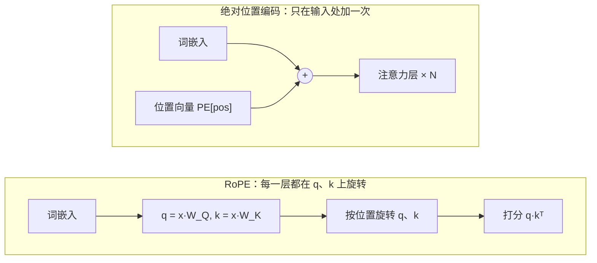

# 位置编码（Positional Encoding）

> **一句话总结：** 自注意力本身不知道词的先后顺序，位置编码把“第几个”这条信息交给模型。可以直接加到输入上（正弦、可学习），也可以在计算注意力时旋转 q 和 k（RoPE）。
>
> 🌐 [English version](README.en.md) · 🎮 **[打开交互演示](interactive/positional.html?lang=zh)** · 📓 [Notebook](03-positional-encoding.ipynb)（[在 Colab 中打开](https://colab.research.google.com/github/BaiYuBY/use_token_to_learn/blob/main/docs/03-positional-encoding/03-positional-encoding.ipynb)）

[](interactive/positional.html?lang=zh)

**本章你将学会：**

- 为什么不加位置信息时，“狗咬人”和“人咬狗”在注意力眼里一模一样
- 正弦位置编码的公式，以及“一组转速不同的时钟”这种直观理解
- 为什么正弦编码的点积只取决于相对距离
- 旋转位置编码（RoPE）如何让注意力分数只取决于相对位置，以及 base 对长上下文的影响
- ALiBi、可学习位置编码，以及扩展上下文长度的常见方法

---

## 1. 直觉：注意力分不清顺序

回顾 [04 注意力机制](../04-attention/README.md)：每个词的输出是所有词的 Value 按权重求和，权重来自 Query 和 Key 的点积。这里面**没有任何一步用到了词的位置**。

所以，如果把输入的词打乱，输出只是跟着打乱，每个词得到的结果完全不变。“the dog bites the man” 和 “the man bites the dog” 中，bites 的输出一模一样。对模型来说，输入只是**一袋词**。

解决办法是给每个位置一个独特的“标记”，让同一个词出现在不同位置时，模型看到的东西不同。主要有两类做法：

| 做法 | 思路 | 代表 |
| --- | --- | --- |
| **绝对位置编码** | 给每个位置一个向量，加到词嵌入上 | 正弦编码（原始 Transformer）、可学习编码（GPT-2、BERT） |
| **相对位置编码** | 在计算注意力分数时，根据两个词的距离调整分数 | RoPE（Llama、Qwen、Mistral 等）、ALiBi（BLOOM 等） |

## 2. 图解

正弦位置编码是一个“位置 × 维度”的矩阵。左边的维度变化快，右边的变化慢：


两类方法作用在模型的不同地方：



RoPE 把 q 和 k 的每一对分量看成平面上的向量，在位置 m 处旋转 $m\theta$。不同的“对”转速不同：


> **🎮 动手试试**
>
> 在[交互演示](interactive/positional.html?lang=zh)中，你可以：
>
> 1. 交换 dog 和 man，亲眼看到没有位置编码时 bites 的输出完全不变
> 2. 拖动位置滑块，观察一组“时钟”如何表示位置
> 3. 验证正弦编码的点积曲线不随绝对位置移动
> 4. 旋转 RoPE 中的 q、k，并“同时右移”两个位置，看分数保持不变
> 5. 调整 RoPE 的 base，观察远距离分数的衰减

## 3. 原理

### 3.1 问题：置换等变

把输入的行用置换矩阵 $P$ 打乱，自注意力（不加掩码）的输出也只是被同样地打乱：

$$
\mathrm{Attn}(PX) = P\,\mathrm{Attn}(X)
$$

这叫**置换等变**。它说明注意力本身不包含位置信息。

### 3.2 可学习的绝对位置编码

最简单的做法：再建一张嵌入表 `nn.Embedding(max_len, d_model)`，第 $p$ 行就是位置 $p$ 的向量，加到词嵌入上，和其他参数一起训练。GPT-2 和 BERT 就是这样做的。缺点是只能处理训练时见过的最大长度。

### 3.3 正弦位置编码

原始 Transformer 用固定的公式，不需要学习：

$$
PE_{(p,\,2i)} = \sin\!\left(\frac{p}{10000^{2i/d}}\right), \qquad PE_{(p,\,2i+1)} = \cos\!\left(\frac{p}{10000^{2i/d}}\right)
$$

每一对 $(\sin, \cos)$ 就像一个时钟的指针，位置每加 1，第 $i$ 个时钟转过 $\omega_i = 10000^{-2i/d}$ 弧度。它有几个好性质：

- **有界且唯一**：数值都在 $[-1, 1]$ 内，每个位置的组合都不同
- **平移是旋转**：$PE_{p+k}$ 等于把 $PE_p$ 的每一对分量旋转 $k\,\omega_i$，这个变换只取决于 $k$
- **点积只看距离**：$PE_p \cdot PE_{p+k} = \sum_i \cos(k\,\omega_i)$，与 $p$ 无关


### 3.4 旋转位置编码（RoPE）

RoPE 不再把位置向量加到输入上，而是在每一层计算注意力之前，把 $q$ 和 $k$ 的第 $i$ 对分量按位置旋转：

$$
\begin{pmatrix} q'_{2i} \\ q'_{2i+1} \end{pmatrix} =
\begin{pmatrix} \cos m\theta_i & -\sin m\theta_i \\ \sin m\theta_i & \cos m\theta_i \end{pmatrix}
\begin{pmatrix} q_{2i} \\ q_{2i+1} \end{pmatrix}, \qquad \theta_i = \text{base}^{-2i/d}
$$

旋转矩阵满足 $R_m^\top R_n = R_{n-m}$，所以位置 $m$ 的 query 和位置 $n$ 的 key 的点积是

$$
(R_m q)^\top (R_n k) = q^\top R_{n-m}\, k
$$

**只取决于相对距离 $n - m$**。同时旋转不改变向量长度，也不需要额外参数。注意：RoPE 只作用于 q 和 k，不作用于 v。

当 q 和 k 方向相同时，距离越远，各对分量转过的角度越“乱”，分数整体下降。**base 越大，旋转越慢，远距离衰减越平缓**，这正是长上下文模型调大 base 的原因：


### 3.5 ALiBi

ALiBi（Attention with Linear Biases）更简单：不改动 q、k，而是直接给注意力分数加一个与距离成正比的惩罚：

$$
\text{score}_{ij} = q_i \cdot k_j - s \cdot (i - j)
$$

每个头的斜率 $s$ 不同（按几何级数取值），离得越远的词分数越低。

### 3.6 扩展上下文长度

模型在训练长度之外通常表现不好。几种常见的扩展办法：

- **位置插值**：把位置 $p$ 缩放成 $p \cdot L_{\text{train}} / L_{\text{new}}$，让新长度“挤进”训练时见过的范围，再少量微调
- **调大 RoPE 的 base**：让旋转变慢（例如 Llama 3 用 500,000，Code Llama 用 1,000,000）
- **YaRN** 等方法：对不同频率的分量分别处理

## 4. 最小代码实现

完整代码：[`code/positional.py`](code/positional.py)，运行 `python docs/03-positional-encoding/code/positional.py`。它会用 assert 验证本章的每一条性质。

正弦位置编码：

```python
def sinusoidal_pe(num_positions, d_model, base=10000.0):
    pos = torch.arange(num_positions, dtype=torch.float32)[:, None]                 # (T, 1)
    freq = base ** (-torch.arange(0, d_model, 2, dtype=torch.float32) / d_model)    # (d/2,)
    pe = torch.zeros(num_positions, d_model)
    pe[:, 0::2] = torch.sin(pos * freq)
    pe[:, 1::2] = torch.cos(pos * freq)
    return pe
```

RoPE：

```python
def apply_rope(x, positions, base=10000.0):
    angles = rope_angles(positions, x.size(-1), base)        # (T, dim/2): m * theta_i
    cos, sin = angles.cos(), angles.sin()
    x1, x2 = x[..., 0::2], x[..., 1::2]
    out = torch.empty_like(x)
    out[..., 0::2] = x1 * cos - x2 * sin
    out[..., 1::2] = x1 * sin + x2 * cos
    return out
```

验证分数只取决于相对距离：

```python
score = lambda m, n: apply_rope(q[None], torch.tensor([m])) @ apply_rope(k[None], torch.tensor([n])).T
assert torch.allclose(score(7, 3), score(107, 103))    # 距离都是 4
```

> **实际工程中**
>
> 不同代码库对“哪些分量配成一对”的约定不同：本章（和 RoFormer 原文）把相邻的 $(x_{2i}, x_{2i+1})$ 配对；Hugging Face 的 Llama 实现则把前一半和后一半配对（`rotate_half`）。两者数学上等价，但加载权重时必须用对应的约定。

## 5. 常见误区

- **“有因果掩码就不需要位置编码”**：因果掩码确实泄露了一些顺序信息（研究发现不加位置编码的解码器也能学到一定的位置感），但显式的位置编码通常效果更好、更稳定。
- **“RoPE 加在输入嵌入上”**：RoPE 在每一层注意力里旋转 q 和 k，不改变输入嵌入，也不作用于 v。
- **“正弦编码能无限外推到任意长度”**：公式对任意位置都有定义，但模型在训练长度之外的表现通常会明显下降。
- **“位置编码让模型知道每个词的绝对序号”**：对 RoPE、ALiBi 来说，注意力分数只依赖相对距离，模型关注的是“隔了多远”。

## 6. 自测题

1. 一个用可学习位置编码、最大长度 1024 的模型，能直接处理 2000 个词元的输入吗？为什么？
2. RoPE 中第 0 对和最后一对，哪一对转得更快？各自擅长捕捉什么样的位置关系？
3. 为什么 RoPE 的分数只取决于 $m - n$？用一句话说明。

<details>
<summary>参考答案</summary>

1. 不能。位置嵌入表只有 1024 行，位置 1024 之后没有对应的向量。
2. 第 0 对最快（$\theta_0 = 1$）。快的对对相邻词的细微位置差异很敏感，慢的对变化平缓，适合表示远距离的关系。
3. 因为旋转满足 $R_m^\top R_n = R_{n-m}$：两个旋转合在一起，只剩下它们角度之差。

</details>

## 7. 延伸阅读

- Vaswani et al., 2017. [Attention Is All You Need](https://arxiv.org/abs/1706.03762)（正弦位置编码）
- Shaw et al., 2018. [Self-Attention with Relative Position Representations](https://arxiv.org/abs/1803.02155)
- Su et al., 2021. [RoFormer: Enhanced Transformer with Rotary Position Embedding](https://arxiv.org/abs/2104.09864)
- Press et al., 2021. [Train Short, Test Long: Attention with Linear Biases Enables Input Length Extrapolation](https://arxiv.org/abs/2108.12409)（ALiBi）
- Chen et al., 2023. [Extending Context Window of Large Language Models via Positional Interpolation](https://arxiv.org/abs/2306.15595)
- Peng et al., 2023. [YaRN: Efficient Context Window Extension of Large Language Models](https://arxiv.org/abs/2309.00071)
- Haviv et al., 2022. [Transformer Language Models without Positional Encodings Still Learn Positional Information](https://arxiv.org/abs/2203.16634)
- EleutherAI. [Rotary Embeddings: A Relative Revolution](https://blog.eleuther.ai/rotary-embeddings/)
