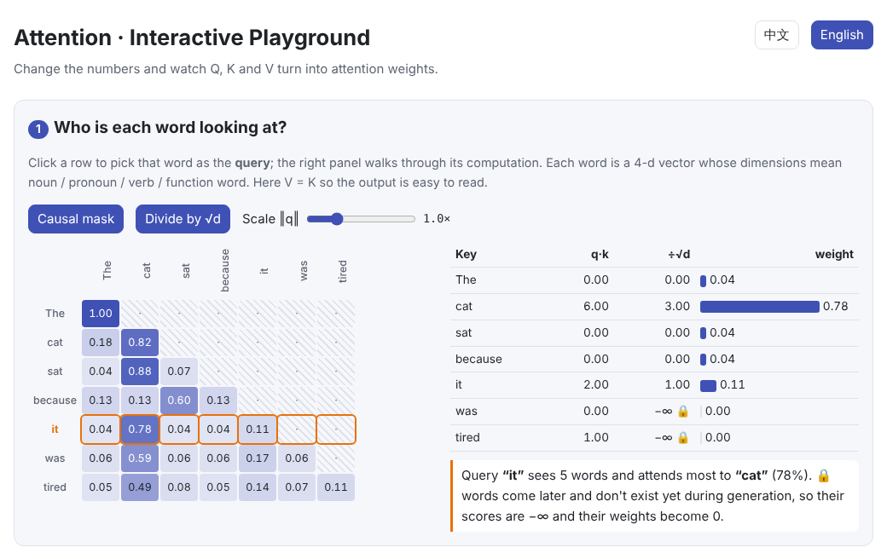
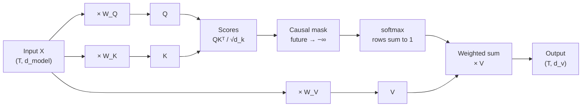

# Attention

> **In one sentence:** attention lets every token gather information from other tokens, in proportion to how relevant they are.
>
> 🌐 [中文版](https://baiyuby.github.io/use_token_to_learn/04-attention/) · 🎮 **[Open the interactive playground](https://baiyuby.github.io/use_token_to_learn/04-attention/interactive/attention.html?lang=en)**

[](https://baiyuby.github.io/use_token_to_learn/04-attention/interactive/attention.html?lang=en)

**In this chapter you will learn:**

- What Query, Key and Value are, and why there are three of them
- The full scaled dot-product attention pipeline, and why we divide by $\sqrt{d_k}$
- How the causal mask keeps the model from “peeking at the answer”
- How multi-head attention splits and merges tensors
- How to implement all of it in under 50 lines of PyTorch, checked against the built-in versions

---

## 1. Intuition: why attention?

When you read *“The cat sat because **it** was tired”*, you resolve **it** by looking back at **cat**.

Before attention, an RNN had to squeeze everything it had read into one fixed-size hidden state, and long inputs lost information. Attention takes a different approach: **every token can look directly at every (allowed) token and decide for itself what to look at, and how much.**

Think of it as a lookup:

| Role | Analogy | Purpose |
| --- | --- | --- |
| **Query** $q_i$ | What am I looking for? | The question the current token asks |
| **Key** $k_j$ | What can I offer? | The label each token wears |
| **Value** $v_j$ | My actual content | What gets passed along once selected |

How well a query matches each key sets the weights, and the output is the weighted sum of the values. Keys and values are separate because the features used to *be found* need not match the information that is *passed on*.

## 2. Pictures

A hand-built toy example (4-d vectors whose dimensions mean noun / pronoun / verb / function word) gives real numbers to look at:


78% of the weight in the **it** row lands on **cat**: that is coreference resolution.

The computation has three steps: score → mask → softmax.


The whole data flow:



> **🎮 Try it yourself**
>
> In the [interactive playground](https://baiyuby.github.io/use_token_to_learn/04-attention/interactive/attention.html?lang=en) you can:
>
> 1. Click any row to see that token's scores and weights step by step
> 2. Toggle the causal mask and the $\sqrt{d}$ scaling and watch the heatmap change
> 3. Drag sliders to rewrite a query so that “it” looks somewhere else
> 4. Change the dimension d and watch an unscaled softmax saturate
> 5. Compare four typical attention heads and compute multi-head tensor shapes

## 3. The math

### 3.1 Scaled dot-product attention

Given an input $X \in \mathbb{R}^{T \times d_{\text{model}}}$:

$$
Q = XW_Q,\quad K = XW_K,\quad V = XW_V
$$

$$
\mathrm{Attention}(Q, K, V) = \mathrm{softmax}\!\left(\frac{QK^\top}{\sqrt{d_k}} + M\right)V
$$

- $QK^\top \in \mathbb{R}^{T \times T}$: entry $(i, j)$ is how much token $i$ “likes” token $j$
- softmax runs **per row**, so each row of weights sums to 1
- $M$ is the mask: 0 where attending is allowed, $-\infty$ where it is not

### 3.2 Why divide by √d_k?

If the entries of $q$ and $k$ are independent with mean 0 and variance 1, then

$$
\mathrm{Var}(q \cdot k) = \sum_{i=1}^{d_k} \mathrm{Var}(q_i k_i) = d_k
$$

The bigger the dimension, the wider the range of scores, and softmax approaches a one-hot vector: almost all the weight lands on one position and the gradients of the others vanish. Dividing by $\sqrt{d_k}$ brings the variance back to 1:


### 3.3 The causal mask

In autoregressive models such as GPT, position $i$ may only see positions $j \le i$:

$$
M_{ij} = \begin{cases} 0 & j \le i \\ -\infty & j > i \end{cases}
$$

Since $e^{-\infty} = 0$, masked positions get exactly zero weight. Training can then predict every position **in parallel** without leaking the answer.

### 3.4 Multi-head attention

Split $d_{\text{model}}$ into $h$ heads. Each head runs attention independently in a $d_{\text{head}} = d_{\text{model}} / h$-dimensional subspace; the results are concatenated and multiplied by $W_O$:

$$
\mathrm{MultiHead}(X) = \mathrm{Concat}(\text{head}_1, \dots, \text{head}_h)\,W_O
$$

Different heads learn different patterns, such as “look at the previous token”, “look at the referent” or “look at the first token”. The total compute is about the same as one big head.

| Tensor | Shape |
| --- | --- |
| input `x` | `(B, T, d_model)` |
| split `q, k, v` | `(B, h, T, d_head)` |
| scores / weights | `(B, h, T, T)` ← grows with sequence length squared |
| merged output | `(B, T, d_model)` |

## 4. Minimal implementation (PyTorch)

Full code: [`code/attention.py`](code/attention.py). Run `python docs/04-attention/code/attention.py`; it checks itself against `F.scaled_dot_product_attention` and `nn.MultiheadAttention`.

```python
def scaled_dot_product_attention(q, k, v, causal=False):
    d_k = q.size(-1)
    scores = q @ k.transpose(-2, -1) / math.sqrt(d_k)       # (..., T, T)
    if causal:
        T = scores.size(-1)
        mask = torch.ones(T, T, dtype=torch.bool, device=q.device).tril()
        scores = scores.masked_fill(~mask, float("-inf"))
    weights = scores.softmax(dim=-1)                         # rows sum to 1
    return weights @ v, weights
```

Multi-head attention only adds reshapes around it:

```python
q, k, v = self.qkv(x).split(D, dim=-1)
q, k, v = (t.view(B, T, H, D // H).transpose(1, 2) for t in (q, k, v))  # (B, H, T, d_head)
y, _ = scaled_dot_product_attention(q, k, v, causal=True)
y = y.transpose(1, 2).reshape(B, T, D)                                  # merge heads
return self.out(y)
```

> **In practice**
>
> Production code calls `torch.nn.functional.scaled_dot_product_attention` directly. It picks efficient kernels such as FlashAttention and never materialises the $T \times T$ matrix.

## 5. Common misconceptions

- **“Attention weights explain the model.”** They show where information flows into this layer, not why the model decided something. Use them alongside other interpretability methods.
- **“Softmax runs over columns.”** It normalises each query's **row**; the weights a given key receives need not sum to 1.
- **“More heads means more parameters.”** $W_Q, W_K, W_V, W_O$ always total $4 d_{\text{model}}^2$, whatever the number of heads.
- **“Masking means setting weights to 0.”** Scores must be set to $-\infty$ **before** softmax. Zeroing after softmax leaves rows that no longer sum to 1.

## 6. Self-check

1. Going from a 1k to an 8k sequence, how much bigger does the score matrix get?
2. What is the main difference between self-attention in an encoder (BERT) and in a decoder (GPT)?
3. If every key is the same vector, what do the attention weights look like?

<details>
<summary>Answers</summary>

1. 64×, because its size is proportional to $T^2$.
2. The decoder uses a causal mask and only sees the past; the encoder sees the whole sequence.
3. Every row is uniform: all scores are equal, so each weight is $1/T$ (or $1/(i+1)$ with a causal mask).

</details>

## 7. Further reading

- Vaswani et al., 2017. [Attention Is All You Need](https://arxiv.org/abs/1706.03762)
- Bahdanau et al., 2014. [Neural Machine Translation by Jointly Learning to Align and Translate](https://arxiv.org/abs/1409.0473) (the original attention mechanism)
- Jay Alammar. [The Illustrated Transformer](https://jalammar.github.io/illustrated-transformer/)
- Andrej Karpathy. [Let's build GPT: from scratch, in code, spelled out](https://www.youtube.com/watch?v=kCc8FmEb1nY)
- Dao et al., 2022. [FlashAttention](https://arxiv.org/abs/2205.14135)
- Elhage et al., 2021. [A Mathematical Framework for Transformer Circuits](https://transformer-circuits.pub/2021/framework/index.html) (interpreting attention heads)
