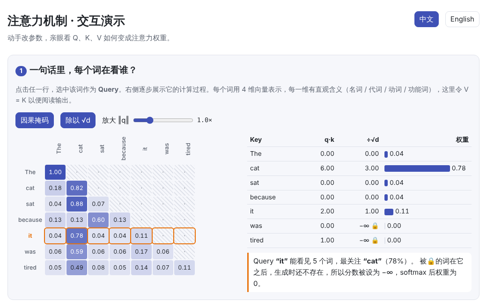
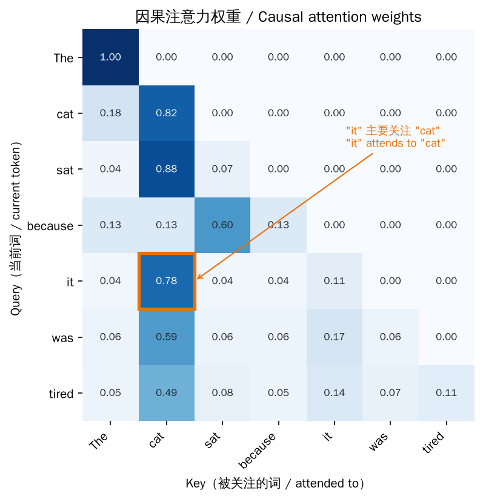
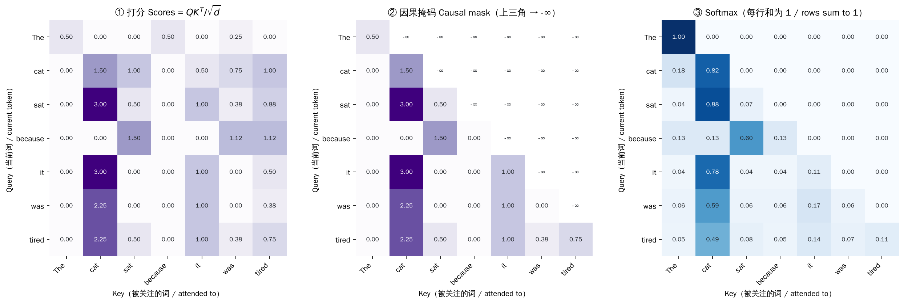
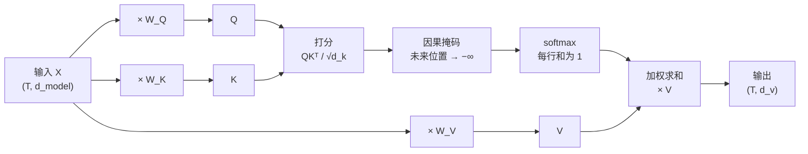
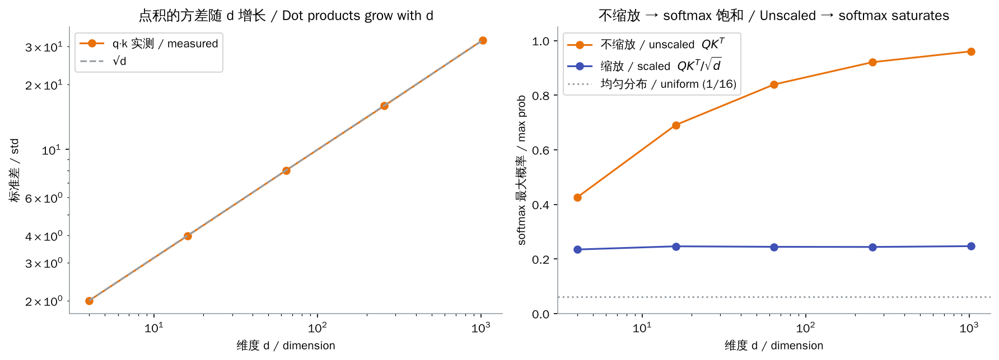

# 注意力机制（Attention）

> **一句话总结：** 注意力让序列中的每个词，根据“相关程度”从其他词那里按比例收集信息。
>
> 🌐 [English version](README.en.md) · 🎮 **[打开交互演示](interactive/attention.html?lang=zh)** · 📓 [Notebook](04-attention.ipynb)（[在 Colab 中打开](https://colab.research.google.com/github/BaiYuBY/use_token_to_learn/blob/main/docs/04-attention/04-attention.ipynb)）

[](interactive/attention.html?lang=zh)

**本章你将学会：**

- Query、Key、Value 各自是什么、为什么要分成三份
- 缩放点积注意力的完整计算流程，以及为什么要除以 $\sqrt{d_k}$
- 因果掩码（Causal Mask）如何保证模型“不偷看答案”
- 多头注意力如何拆分与合并张量
- 用不到 50 行 PyTorch 实现上述全部内容，并与官方实现逐位对比

---

## 1. 直觉：为什么需要注意力

读到句子 *“The cat sat because **it** was tired”* 中的 **it** 时，你会自动回头去找它指代的 **cat**。

在注意力出现之前，RNN 要把前面所有内容压缩进一个固定长度的隐藏状态，句子越长，信息丢得越多。注意力的做法是：**每个词都可以直接回看所有（允许看的）词，并自己决定看谁、看多少。**

可以把它想象成一次“检索”：

| 角色 | 比喻 | 作用 |
| --- | --- | --- |
| **Query（查询）** $q_i$ | 我在找什么？ | 当前词发出的“问题” |
| **Key（键）** $k_j$ | 我能提供什么？ | 每个词贴在自己身上的“标签” |
| **Value（值）** $v_j$ | 我的实际内容 | 被选中后真正传递出去的信息 |

Query 和 Key 的匹配程度决定权重，再用权重对 Value 加权求和。之所以把 Key 和 Value 分开，是因为“用来被找到的特征”和“被找到后要传递的信息”不必相同。

## 2. 图解

下面用一个手工构造的小例子（每个词 4 维向量，各维度分别代表“名词 / 代词 / 动词 / 功能词”）展示真实的计算结果：



**it** 这一行的权重有 78% 落在 **cat** 上，这正是“指代消解”。

完整计算分三步：打分 → 掩码 → softmax。



整体数据流如下：



> **🎮 动手试试**
>
> 在[交互演示](interactive/attention.html?lang=zh)中，你可以：
>
> 1. 点击任意一行，查看该词逐步的打分与权重
> 2. 开关因果掩码和 $\sqrt{d}$ 缩放，观察热力图的变化
> 3. 拖动滑块改写 Query，让 “it” 改去关注别的词
> 4. 调整维度 d，亲眼看到不缩放时 softmax 如何“饱和”
> 5. 对比 4 种典型注意力头，并计算多头注意力的张量形状

## 3. 数学形式

### 3.1 缩放点积注意力

给定输入 $X \in \mathbb{R}^{T \times d_{\text{model}}}$：

$$
Q = XW_Q,\quad K = XW_K,\quad V = XW_V
$$

$$
\mathrm{Attention}(Q, K, V) = \mathrm{softmax}\!\left(\frac{QK^\top}{\sqrt{d_k}} + M\right)V
$$

- $QK^\top \in \mathbb{R}^{T \times T}$：第 $i$ 行第 $j$ 列是第 $i$ 个词对第 $j$ 个词的打分
- softmax **按行**计算，所以每一行的权重之和为 1
- $M$ 是掩码矩阵，允许的位置为 0，禁止的位置为 $-\infty$

### 3.2 为什么要除以 √d_k

如果 $q, k$ 的各分量独立、均值 0、方差 1，那么

$$
\mathrm{Var}(q \cdot k) = \sum_{i=1}^{d_k} \mathrm{Var}(q_i k_i) = d_k
$$

维度越大，打分的数值范围越大，softmax 就越接近 one-hot：几乎所有权重都压到一个位置上，其余位置的梯度趋近于 0，训练变得困难。除以 $\sqrt{d_k}$ 能把方差拉回 1：



### 3.3 因果掩码

在 GPT 这类自回归模型中，第 $i$ 个位置只能看见 $j \le i$ 的位置：

$$
M_{ij} = \begin{cases} 0 & j \le i \\ -\infty & j > i \end{cases}
$$

因为 $e^{-\infty} = 0$，被掩盖位置的权重恰好为 0。这样，训练时可以**一次性并行**计算所有位置的预测，又不会泄露“答案”。

### 3.4 多头注意力

把 $d_{\text{model}}$ 切成 $h$ 份，每个头在 $d_{\text{head}} = d_{\text{model}} / h$ 维的子空间里独立计算注意力，最后拼接并乘以 $W_O$：

$$
\mathrm{MultiHead}(X) = \mathrm{Concat}(\text{head}_1, \dots, \text{head}_h)\,W_O
$$

不同的头会学到不同的关注模式，比如“看前一个词”“看指代对象”“看句首”等。总计算量与单头大致相同。

| 张量 | 形状 |
| --- | --- |
| 输入 `x` | `(B, T, d_model)` |
| 拆分后的 `q, k, v` | `(B, h, T, d_head)` |
| 打分 / 权重 | `(B, h, T, T)` ← 随序列长度平方增长 |
| 合并后的输出 | `(B, T, d_model)` |

## 4. 最小代码实现（PyTorch）

完整代码：[`code/attention.py`](code/attention.py)，运行 `python docs/04-attention/code/attention.py`，会与 `F.scaled_dot_product_attention` 和 `nn.MultiheadAttention` 的结果自动比对。

```python
def scaled_dot_product_attention(q, k, v, causal=False):
    d_k = q.size(-1)
    scores = q @ k.transpose(-2, -1) / math.sqrt(d_k)       # (..., T, T)
    if causal:
        T = scores.size(-1)
        mask = torch.ones(T, T, dtype=torch.bool, device=q.device).tril()
        scores = scores.masked_fill(~mask, float("-inf"))
    weights = scores.softmax(dim=-1)                         # 每行和为 1
    return weights @ v, weights
```

多头只是在前后加上 reshape：

```python
q, k, v = self.qkv(x).split(D, dim=-1)
q, k, v = (t.view(B, T, H, D // H).transpose(1, 2) for t in (q, k, v))  # (B, H, T, d_head)
y, _ = scaled_dot_product_attention(q, k, v, causal=True)
y = y.transpose(1, 2).reshape(B, T, D)                                  # 合并多头
return self.out(y)
```

> **实际工程中**
>
> 生产代码通常直接调用 `torch.nn.functional.scaled_dot_product_attention`，它会自动选择 FlashAttention 等高效内核，不需要显式构造 $T \times T$ 的矩阵。

## 5. 常见误区

- **“注意力权重 = 模型的解释”**：权重只说明信息从哪里流入这一层，不等于模型做决定的原因，要配合其他可解释性方法使用。
- **“softmax 是对列做的”**：softmax 对每个 Query 的**行**做归一化，同一个 Key 收到的权重之和不一定是 1。
- **“多头 = 更多参数”**：$W_Q, W_K, W_V, W_O$ 的总参数始终是 $4 d_{\text{model}}^2$，与头数无关。
- **“掩码就是把权重设为 0”**：必须在 softmax **之前**把分数设为 $-\infty$。如果在 softmax 之后置 0，剩余权重之和就不再是 1。

## 6. 自测题

1. 序列长度从 1k 增加到 8k，注意力打分矩阵的大小变为原来的几倍？
2. 编码器（如 BERT）和解码器（如 GPT）的自注意力，最主要的区别是什么？
3. 如果把所有 Key 都设为同一个向量，注意力权重会是什么样？

<details>
<summary>参考答案</summary>

1. 64 倍，因为矩阵大小与 $T^2$ 成正比。
2. 解码器使用因果掩码，只能看见过去；编码器能看见整个序列。
3. 每一行都是均匀分布：所有打分相同，softmax 后每个位置的权重都是 $1/T$（因果掩码下为 $1/(i+1)$）。

</details>

## 7. 延伸阅读

- Vaswani et al., 2017. [Attention Is All You Need](https://arxiv.org/abs/1706.03762)
- Bahdanau et al., 2014. [Neural Machine Translation by Jointly Learning to Align and Translate](https://arxiv.org/abs/1409.0473)（最早的注意力机制）
- Jay Alammar. [The Illustrated Transformer](https://jalammar.github.io/illustrated-transformer/)
- Andrej Karpathy. [Let's build GPT: from scratch, in code, spelled out](https://www.youtube.com/watch?v=kCc8FmEb1nY)
- Dao et al., 2022. [FlashAttention](https://arxiv.org/abs/2205.14135)
- Elhage et al., 2021. [A Mathematical Framework for Transformer Circuits](https://transformer-circuits.pub/2021/framework/index.html)（注意力头的可解释性）
