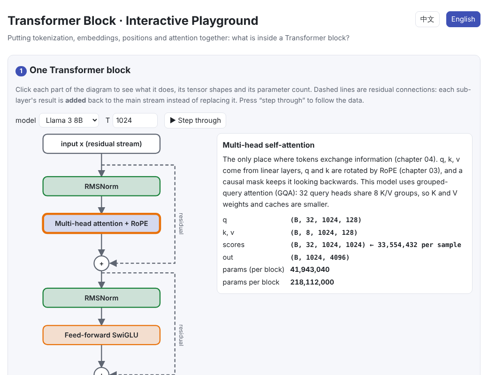
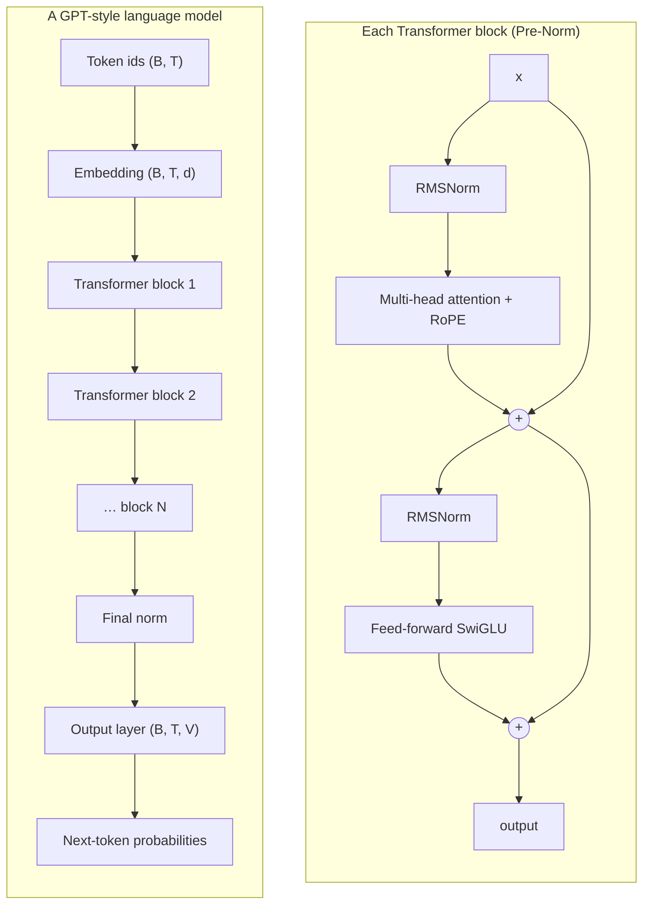

# The Transformer Block

> **In one sentence:** a Transformer block = attention (tokens talk to each other) + a feed-forward network (each token is processed on its own), each normalized first and added back to the main stream through a residual connection; stack N identical blocks, add an embedding layer and an output layer, and you have a complete GPT.
>
> 🌐 [中文版](README.md) · 🎮 **[Open the interactive playground](interactive/transformer.html?lang=en)**

[](interactive/transformer.html?lang=en)

**In this chapter you will learn:**

- What parts a Transformer block has and how data and tensor shapes flow through it
- Why residual connections make deep networks trainable
- The difference between LayerNorm and RMSNorm, and why modern models use Pre-Norm
- What the feed-forward network, GELU and SwiGLU do
- How to compute the parameter count straight from the architecture, checked against the official numbers for GPT-2, Llama 2 and Llama 3
- How to build a complete tiny GPT in under 200 lines of PyTorch and train it to generate text

---

## 1. Intuition: assembling the previous chapters

The previous chapters each covered one part of a Transformer:

- [01 Tokenization](../01-tokenization/README.en.md): text → token ids
- [02 Embeddings](../02-embedding/README.en.md): ids → vectors
- [03 Positional encoding](../03-positional-encoding/README.en.md): telling the model the word order
- [04 Attention](../04-attention/README.en.md): letting tokens exchange information

A **Transformer block** organizes them into two sub-layers:

1. **Attention**: the tokens “hold a meeting”, and each one gathers information from the others
2. **Feed-forward network (FFN)**: each token “goes away to think on its own”, applying a non-linear transformation to its vector

Each sub-layer is preceded by a **normalization** that brings the numbers back into a stable range, and its result is **added** back to the main stream through a **residual connection** instead of replacing it. A block's input and output have exactly the same shape, so identical blocks can be stacked.

Think of the main stream as a **residual stream**: each block reads from it, computes an update, and writes the update back.

## 2. Pictures

A complete decoder-only (GPT-style) model:



Where do the parameters live? About a third of GPT-2 small is embeddings; in 7B/8B-class models about two thirds are feed-forward networks:


This chapter's code trains a tiny GPT of about 100k parameters (character level). Continuing from “the ”:

| Step | Generated text (excerpt) |
| --- | --- |
| 0 | `the zqtvpeom i stzpv lliyyz,s,,:c,b obrpyuxefqnnrfvn` |
| 100 | `the nequtk on lorkens and heach block has are rach haal hearembers` |
| 300 | `the numbers in a healthy range before each part.` |


> **🎮 Try it yourself**
>
> In the [interactive playground](interactive/transformer.html?lang=en) you can:
>
> 1. Click each part of a Transformer block to see what it does, its tensor shapes and its parameter count
> 2. Toggle residual connections and change the depth to watch gradients vanish
> 3. Compare how LayerNorm and RMSNorm react to shifting and scaling
> 4. Drag SwiGLU's “gate” and “value” to understand gating
> 5. Check real models' parameter counts with the calculator, or design your own
> 6. Drag through training steps and watch the tiny GPT go from gibberish to sentences

## 3. How it works

### 3.1 The block: Pre-Norm

Modern models (nearly all of them since GPT-2) use **Pre-Norm**:

$$
\begin{aligned}
h &= x + \mathrm{Attention}(\mathrm{Norm}(x)) \\
y &= h + \mathrm{FFN}(\mathrm{Norm}(h))
\end{aligned}
$$

The original Transformer used **Post-Norm**, $x = \mathrm{Norm}(x + \mathrm{Attention}(x))$. Post-Norm puts the normalization on the residual path, which makes deep stacks hard to train without tricks such as learning-rate warm-up; Pre-Norm keeps the residual path “clean”, so deep models train more stably.

### 3.2 Residual connections and gradients

Differentiate a residual block $y = x + f(x)$:

$$
\frac{\partial y}{\partial x} = I + \frac{\partial f}{\partial x}
$$

The identity $I$ means the gradient can at least pass straight back to the previous layer. Without residuals the gradient is multiplied by $\partial f / \partial x$ at every layer, and after a few dozen layers it can easily shrink to almost nothing (vanishing gradients):


### 3.3 Normalization: LayerNorm and RMSNorm

Both act on each token's $d$-dimensional vector $x$ separately (not across tokens, not across the batch):

$$
\mathrm{LayerNorm}(x) = \frac{x - \mu}{\sqrt{\sigma^2 + \epsilon}} \odot \gamma + \beta, \qquad
\mathrm{RMSNorm}(x) = \frac{x}{\sqrt{\tfrac{1}{d}\sum_i x_i^2 + \epsilon}} \odot \gamma
$$

RMSNorm drops the mean subtraction and the bias $\beta$. It is cheaper and works about as well, and Llama, Qwen and others use it.


### 3.4 The feed-forward network and SwiGLU

The FFN acts on each token independently: widen to $d_{ff}$, apply a non-linearity, project back to $d$.

$$
\mathrm{FFN}_{\text{GELU}}(x) = W_2\,\mathrm{GELU}(W_1 x), \qquad
\mathrm{FFN}_{\text{SwiGLU}}(x) = W_{\text{down}}\big(\mathrm{SiLU}(W_{\text{gate}}\,x) \odot W_{\text{up}}\,x\big)
$$

- The original Transformer and GPT-2 use two matrices with $d_{ff} = 4d$
- SwiGLU adds a “gate” matrix: one branch goes through SiLU and gates the other branch element-wise. To keep the parameter count close to a plain FFN, $d_{ff} \approx \tfrac{8}{3} d$ is typical (Llama 2 7B: 4096 → 11008)


### 3.5 Parameter counts straight from the architecture

With model width $d$, $L$ layers, vocabulary $V$ and FFN width $d_{ff}$, ignoring biases:

| Part | Parameters |
| --- | --- |
| Embedding | $V \cdot d$ |
| Attention per layer | $W_Q, W_K, W_V, W_O$: $4d^2$ ($W_K, W_V$ are smaller with GQA) |
| FFN per layer (SwiGLU) | $3 \cdot d \cdot d_{ff}$ |
| Norms per layer | $2d$ |
| Output layer | $V \cdot d$ (0 if tied to the embedding) |

These formulas reproduce the published sizes **exactly** (this chapter's code checks each one with an assert):

| Model | $d$ | Layers | $d_{ff}$ | Vocab | Other | Parameters |
| --- | --- | --- | --- | --- | --- | --- |
| GPT-2 small | 768 | 12 | 3072 | 50,257 | GELU, biases, tied weights, 1024 learned positions | 124,439,808 |
| Llama 2 7B | 4096 | 32 | 11008 | 32,000 | SwiGLU | 6,738,415,616 |
| Llama 3 8B | 4096 | 32 | 14336 | 128,256 | SwiGLU, GQA (8 KV groups) | 8,030,261,248 |

**Grouped-query attention (GQA)**: several query heads share one set of keys and values. Llama 3 8B has 32 query heads and 8 KV groups, so $W_K$ and $W_V$ are only $d \times 1024$ and the KV cache at inference time is a quarter of the size.

### 3.6 The training objective

The model outputs a next-token distribution at every position and is trained with cross-entropy. Thanks to the causal mask, a sequence of length $T$ yields $T$ training examples **in parallel**. At the start of training a good initialization makes predictions close to uniform, with a loss of about $\ln V$.

## 4. Minimal implementation

Full code: [`code/transformer.py`](code/transformer.py). Run `python docs/05-transformer/code/transformer.py`: it checks LayerNorm/RMSNorm against PyTorch's built-ins, verifies real models' parameter counts, and trains a tiny GPT.

A Pre-Norm block:

```python
class Block(nn.Module):
    def __init__(self, d, n_heads, d_ff):
        super().__init__()
        self.norm1, self.attn = RMSNorm(d), CausalSelfAttention(d, n_heads)
        self.norm2, self.ffn = RMSNorm(d), SwiGLU(d, d_ff)

    def forward(self, x):
        x = x + self.attn(self.norm1(x))   # tokens exchange information
        x = x + self.ffn(self.norm2(x))    # each token is processed alone
        return x
```

The full model:

```python
class TinyGPT(nn.Module):
    def __init__(self, vocab_size, d=64, n_layers=2, n_heads=4, d_ff=172):
        super().__init__()
        self.embed = nn.Embedding(vocab_size, d)
        self.blocks = nn.ModuleList(Block(d, n_heads, d_ff) for _ in range(n_layers))
        self.norm = RMSNorm(d)
        self.head = nn.Linear(d, vocab_size, bias=False)
        self.head.weight = self.embed.weight          # weight tying

    def forward(self, ids):                           # (B, T)
        x = self.embed(ids)                           # (B, T, d)
        for block in self.blocks:
            x = block(x)
        return self.head(self.norm(x))                # (B, T, vocab)
```

The training loop:

```python
x = torch.stack([data[s:s + ctx] for s in starts])          # inputs
y = torch.stack([data[s + 1:s + ctx + 1] for s in starts])  # targets: shifted by one
loss = F.cross_entropy(model(x).flatten(0, 1), y.flatten())
opt.zero_grad(); loss.backward(); opt.step()
```

> **A pitfall we hit: initialization**
>
> This chapter first used PyTorch's default embedding initialization (standard deviation 1). Because the output layer shares the embedding's weights, the initial logits were huge, the first loss was over 20 (far above $\ln 30 \approx 3.4$), and the trained model produced only gibberish. Switching to GPT-2's choice (standard deviation 0.02) brought the initial loss to about 3.46 and training back to normal.

## 5. Common misconceptions

- **“A Transformer's parameters are mostly in attention.”** In large models about two thirds are in the FFNs (section 3.5).
- **“LayerNorm normalizes over the batch.”** That is BatchNorm. LayerNorm and RMSNorm normalize each token's features separately, independent of batch size and other tokens.
- **“Residual connections are a minor trick.”** Without them, networks dozens of layers deep barely train at all (section 3.2).
- **“A low training loss means a good model.”** This chapter's tiny GPT reaches a loss of 0.07 because it has memorized the short text. Real quality is measured on held-out validation data.

## 6. Self-check

1. With $d = 4096$ and no GQA, how many parameters do one layer's $W_Q, W_K, W_V, W_O$ have?
2. Why must a Transformer block's output have the same shape as its input?
3. What is the difference between Pre-Norm and Post-Norm, and why do modern models prefer Pre-Norm?

<details>
<summary>Answers</summary>

1. $4 \times 4096^2 = 67{,}108{,}864$, about 67M.
2. First, the residual connection computes $x + f(x)$, which needs matching shapes; second, it lets identical blocks be stacked.
3. Pre-Norm normalizes before each sub-layer and keeps normalization off the residual path; Post-Norm normalizes after the addition. With Pre-Norm the gradient flows straight back along the residual path, so deep models train more stably.

</details>

## 7. Further reading

- Vaswani et al., 2017. [Attention Is All You Need](https://arxiv.org/abs/1706.03762)
- He et al., 2015. [Deep Residual Learning for Image Recognition](https://arxiv.org/abs/1512.03385) (residual connections)
- Ba et al., 2016. [Layer Normalization](https://arxiv.org/abs/1607.06450)
- Zhang & Sennrich, 2019. [Root Mean Square Layer Normalization](https://arxiv.org/abs/1910.07467)
- Xiong et al., 2020. [On Layer Normalization in the Transformer Architecture](https://arxiv.org/abs/2002.04745) (Pre-Norm vs Post-Norm)
- Shazeer, 2020. [GLU Variants Improve Transformer](https://arxiv.org/abs/2002.05202) (SwiGLU)
- Ainslie et al., 2023. [GQA: Training Generalized Multi-Query Transformer Models](https://arxiv.org/abs/2305.13245)
- Touvron et al., 2023. [Llama 2: Open Foundation and Fine-Tuned Chat Models](https://arxiv.org/abs/2307.09288)
- Elhage et al., 2021. [A Mathematical Framework for Transformer Circuits](https://transformer-circuits.pub/2021/framework/index.html) (the residual-stream view)
- Andrej Karpathy. [nanoGPT](https://github.com/karpathy/nanoGPT)
