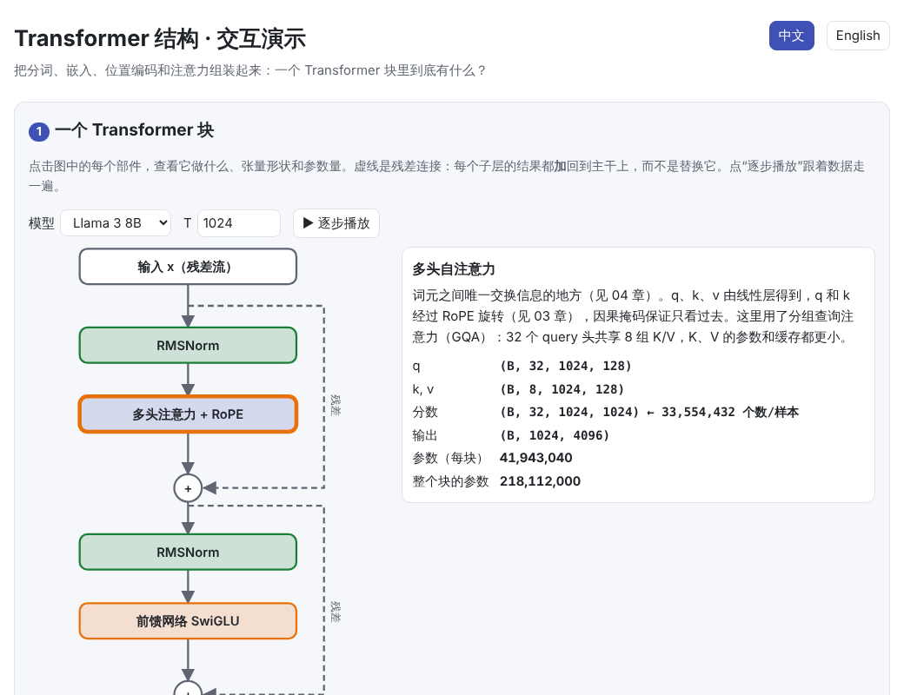
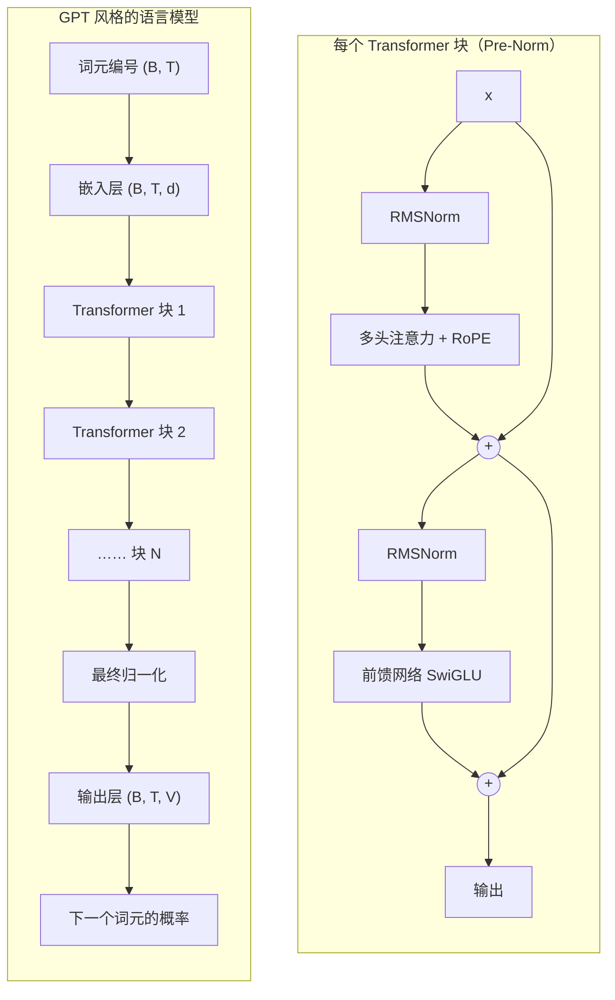
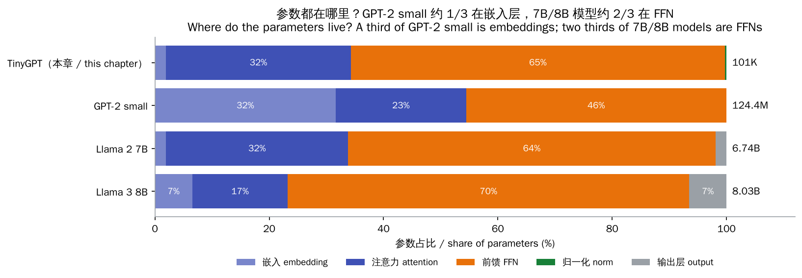
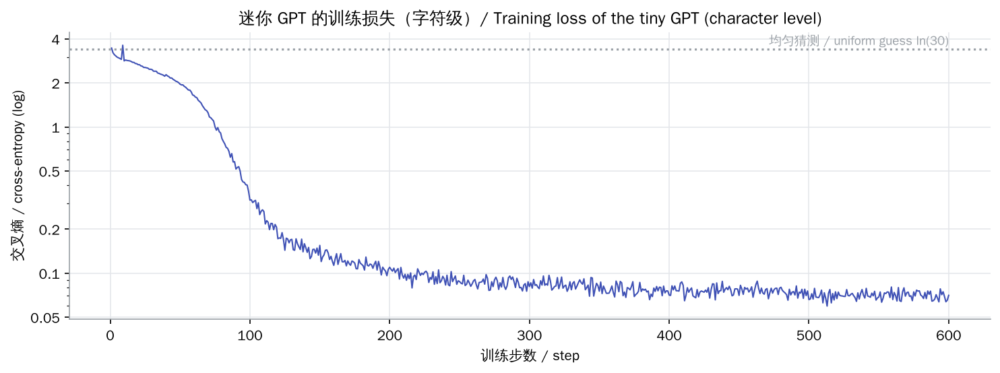
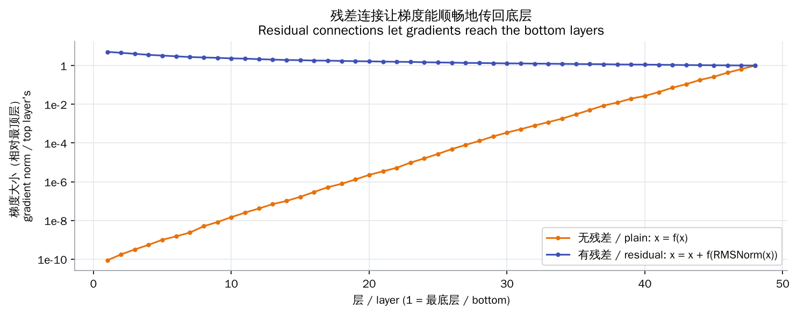
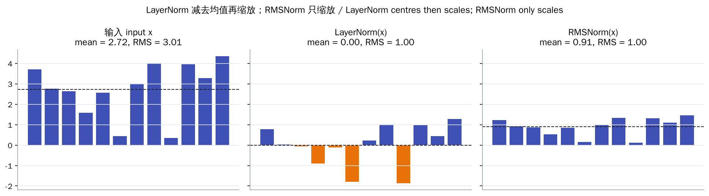
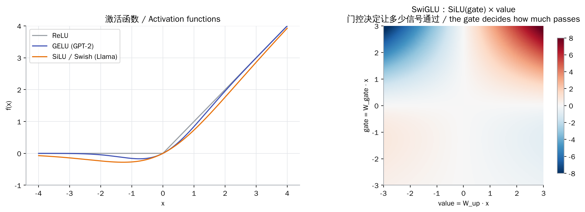

# Transformer 结构（Transformer Block）

> **一句话总结：** 一个 Transformer 块 = 注意力（词元之间交流）+ 前馈网络（每个词元单独加工），两者都先归一化、再通过残差连接加回主干；把同样的块叠 N 层，前后接上嵌入层和输出层，就是一个完整的 GPT。
>
> 🌐 [English version](README.en.md) · 🎮 **[打开交互演示](interactive/transformer.html?lang=zh)** · 📓 [Notebook](05-transformer.ipynb)（[在 Colab 中打开](https://colab.research.google.com/github/BaiYuBY/use_token_to_learn/blob/main/docs/05-transformer/05-transformer.ipynb)）

[](interactive/transformer.html?lang=zh)

**本章你将学会：**

- 一个 Transformer 块里有哪些部件，数据和张量形状如何流动
- 残差连接为什么让深层网络可以训练
- LayerNorm 与 RMSNorm 的区别，以及为什么现代模型用 Pre-Norm
- 前馈网络、GELU、SwiGLU 的作用
- 怎样从结构直接算出参数量，并与 GPT-2、Llama 2、Llama 3 的官方数字逐一核对
- 用不到 200 行 PyTorch 搭一个完整的迷你 GPT，并训练它生成文本

---

## 1. 直觉：把前面几章组装起来

前面几章分别讲了 Transformer 的几个零件：

- [01 分词](../01-tokenization/README.md)：文本 → 词元编号
- [02 词嵌入](../02-embedding/README.md)：编号 → 向量
- [03 位置编码](../03-positional-encoding/README.md)：告诉模型词的顺序
- [04 注意力机制](../04-attention/README.md)：让词元之间交换信息

一个 **Transformer 块**把它们组织起来，由两个子层组成：

1. **注意力**：词元之间“开会交流”，每个词元从其他词元那里收集信息
2. **前馈网络（FFN）**：每个词元“回去独立思考”，对自己的向量做一次非线性加工

每个子层前面都有一次**归一化**，把数值拉回稳定的范围；子层的结果通过**残差连接**加回到主干，而不是替换主干。块的输入和输出形状完全相同，所以同样的块可以一层层叠下去。

可以把主干想象成一条**残差流（residual stream）**：每个块从流里读取信息、算出一个“增量”，再写回流里。

## 2. 图解

完整的解码器（GPT 风格）模型：



参数都在哪里？在 GPT-2 small 中约 1/3 在嵌入层；在 7B/8B 级别的模型中，约 2/3 在前馈网络：



本章的代码训练了一个约 10 万参数的迷你 GPT（字符级），从 “the ” 开始续写：

| 训练步数 | 生成结果（节选） |
| --- | --- |
| 0 | `the zqtvpeom i stzpv lliyyz,s,,:c,b obrpyuxefqnnrfvn` |
| 100 | `the nequtk on lorkens and heach block has are rach haal hearembers` |
| 300 | `the numbers in a healthy range before each part.` |



> **🎮 动手试试**
>
> 在[交互演示](interactive/transformer.html?lang=zh)中，你可以：
>
> 1. 点击 Transformer 块中的每个部件，查看它的作用、张量形状和参数量
> 2. 开关残差连接、调整层数，观察梯度如何消失
> 3. 对比 LayerNorm 和 RMSNorm 对平移、缩放的反应
> 4. 拖动 SwiGLU 的“门”和“值”，理解门控
> 5. 用参数计算器核对真实模型的参数量，或设计自己的模型
> 6. 拖动训练步数，看迷你 GPT 的生成从乱码变成句子

## 3. 原理

### 3.1 块的结构：Pre-Norm

现代模型（GPT-2 之后的绝大多数模型）使用 **Pre-Norm**：

$$
\begin{aligned}
h &= x + \mathrm{Attention}(\mathrm{Norm}(x)) \\
y &= h + \mathrm{FFN}(\mathrm{Norm}(h))
\end{aligned}
$$

原始 Transformer 用的是 **Post-Norm**，即 $x = \mathrm{Norm}(x + \mathrm{Attention}(x))$。Post-Norm 把归一化放在残差路径上，层数一多就很难训练，通常需要学习率预热等技巧；Pre-Norm 让残差路径保持“干净”，深层模型训练更稳定。

### 3.2 残差连接与梯度

对残差块 $y = x + f(x)$ 求导：

$$
\frac{\partial y}{\partial x} = I + \frac{\partial f}{\partial x}
$$

单位矩阵 $I$ 意味着梯度至少可以原样传回前一层。没有残差时，梯度每经过一层都要乘一次 $\partial f / \partial x$，几十层之后很容易缩到几乎为 0（梯度消失）：



### 3.3 归一化：LayerNorm 与 RMSNorm

对每个词元的 $d$ 维向量 $x$ 分别计算（不跨词元，也不跨 batch）：

$$
\mathrm{LayerNorm}(x) = \frac{x - \mu}{\sqrt{\sigma^2 + \epsilon}} \odot \gamma + \beta, \qquad
\mathrm{RMSNorm}(x) = \frac{x}{\sqrt{\tfrac{1}{d}\sum_i x_i^2 + \epsilon}} \odot \gamma
$$

RMSNorm 省掉了减均值和偏置 $\beta$，计算更少，效果相当，Llama、Qwen 等模型都用它。



### 3.4 前馈网络与 SwiGLU

FFN 对每个词元独立计算：先把维度扩大到 $d_{ff}$，经过非线性，再压回 $d$。

$$
\mathrm{FFN}_{\text{GELU}}(x) = W_2\,\mathrm{GELU}(W_1 x), \qquad
\mathrm{FFN}_{\text{SwiGLU}}(x) = W_{\text{down}}\big(\mathrm{SiLU}(W_{\text{gate}}\,x) \odot W_{\text{up}}\,x\big)
$$

- 原始 Transformer 和 GPT-2 用两层矩阵，$d_{ff} = 4d$
- SwiGLU 多了一个“门”矩阵：一条支路经过 SiLU 后作为门，与另一条支路逐元素相乘。为了让参数量与普通 FFN 接近，通常取 $d_{ff} \approx \tfrac{8}{3} d$（Llama 2 7B：4096 → 11008）



### 3.5 参数量：从结构直接算出来

设模型维度 $d$、层数 $L$、词表 $V$、FFN 宽度 $d_{ff}$，不考虑偏置时：

| 部分 | 参数量 |
| --- | --- |
| 嵌入层 | $V \cdot d$ |
| 每层注意力 | $W_Q, W_K, W_V, W_O$：$4d^2$（使用 GQA 时 $W_K, W_V$ 更小） |
| 每层 FFN（SwiGLU） | $3 \cdot d \cdot d_{ff}$ |
| 每层归一化 | $2d$ |
| 输出层 | $V \cdot d$（与嵌入层共享权重时为 0） |

用这个公式算出的结果与官方公布的参数量**完全一致**（本章代码用 assert 逐一验证）：

| 模型 | $d$ | 层数 | $d_{ff}$ | 词表 | 其他 | 参数量 |
| --- | --- | --- | --- | --- | --- | --- |
| GPT-2 small | 768 | 12 | 3072 | 50,257 | GELU、偏置、共享权重、1024 个可学习位置 | 124,439,808 |
| Llama 2 7B | 4096 | 32 | 11008 | 32,000 | SwiGLU | 6,738,415,616 |
| Llama 3 8B | 4096 | 32 | 14336 | 128,256 | SwiGLU、GQA（8 组 KV） | 8,030,261,248 |

**分组查询注意力（GQA）**：多个 query 头共享同一组 key/value。Llama 3 8B 有 32 个 query 头、8 组 KV，$W_K$ 和 $W_V$ 只有 $d \times 1024$，推理时的 KV 缓存也只有原来的 1/4。

### 3.6 训练目标

模型对每个位置输出下一个词元的分布，用交叉熵训练。由于有因果掩码，一个长度为 $T$ 的序列可以**一次性并行**地得到 $T$ 个训练样本。训练开始时，一个好的初始化应让预测接近均匀分布，损失约为 $\ln V$。

## 4. 最小代码实现

完整代码：[`code/transformer.py`](code/transformer.py)，运行 `python docs/05-transformer/code/transformer.py`。它会验证 LayerNorm/RMSNorm 与 PyTorch 内置实现一致、核对真实模型的参数量，并训练一个迷你 GPT。

一个 Pre-Norm 块：

```python
class Block(nn.Module):
    def __init__(self, d, n_heads, d_ff):
        super().__init__()
        self.norm1, self.attn = RMSNorm(d), CausalSelfAttention(d, n_heads)
        self.norm2, self.ffn = RMSNorm(d), SwiGLU(d, d_ff)

    def forward(self, x):
        x = x + self.attn(self.norm1(x))   # 词元之间交换信息
        x = x + self.ffn(self.norm2(x))    # 每个词元单独加工
        return x
```

完整的模型：

```python
class TinyGPT(nn.Module):
    def __init__(self, vocab_size, d=64, n_layers=2, n_heads=4, d_ff=172):
        super().__init__()
        self.embed = nn.Embedding(vocab_size, d)
        self.blocks = nn.ModuleList(Block(d, n_heads, d_ff) for _ in range(n_layers))
        self.norm = RMSNorm(d)
        self.head = nn.Linear(d, vocab_size, bias=False)
        self.head.weight = self.embed.weight          # 权重共享

    def forward(self, ids):                           # (B, T)
        x = self.embed(ids)                           # (B, T, d)
        for block in self.blocks:
            x = block(x)
        return self.head(self.norm(x))                # (B, T, vocab)
```

训练循环：

```python
x = torch.stack([data[s:s + ctx] for s in starts])          # 输入
y = torch.stack([data[s + 1:s + ctx + 1] for s in starts])  # 目标：右移一位
loss = F.cross_entropy(model(x).flatten(0, 1), y.flatten())
opt.zero_grad(); loss.backward(); opt.step()
```

> **踩过的坑：初始化**
>
> 本章最初用 PyTorch 默认的嵌入初始化（标准差 1），由于输出层与嵌入层共享权重，初始 logits 很大，第一步的损失高达 20 多（远高于 $\ln 30 \approx 3.4$），训练出来的模型生成的全是乱码。改成 GPT-2 的做法（标准差 0.02）后，初始损失正好约为 3.46，训练也恢复正常。

## 5. 常见误区

- **“Transformer 的参数主要在注意力里”**：在大模型中，约 2/3 的参数在 FFN 里（见 3.5 节）。
- **“LayerNorm 是在 batch 上做归一化”**：那是 BatchNorm。LayerNorm/RMSNorm 对每个词元的特征维度单独归一化，与 batch 大小和其他词元无关。
- **“残差连接只是个小技巧”**：没有残差连接，几十层的网络几乎无法训练（见 3.2 节）。
- **“训练损失很低，模型就很好”**：本章的迷你 GPT 损失降到 0.07，是因为它把这段短文本背下来了。衡量真实效果要看没有参与训练的验证集。

## 6. 自测题

1. $d = 4096$、不用 GQA 时，一层注意力的 $W_Q, W_K, W_V, W_O$ 共有多少参数？
2. 为什么 Transformer 块的输出形状必须与输入相同？
3. Pre-Norm 和 Post-Norm 的区别是什么？为什么现代模型偏爱 Pre-Norm？

<details>
<summary>参考答案</summary>

1. $4 \times 4096^2 = 67{,}108{,}864$，约 6700 万。
2. 一是残差连接要做 $x + f(x)$，两者形状必须相同；二是这样才能把相同的块一层层叠起来。
3. Pre-Norm 在子层之前归一化，残差路径上没有归一化；Post-Norm 在相加之后归一化。Pre-Norm 让梯度沿残差路径直接传回，深层模型更容易稳定训练。

</details>

## 7. 延伸阅读

- Vaswani et al., 2017. [Attention Is All You Need](https://arxiv.org/abs/1706.03762)
- He et al., 2015. [Deep Residual Learning for Image Recognition](https://arxiv.org/abs/1512.03385)（残差连接）
- Ba et al., 2016. [Layer Normalization](https://arxiv.org/abs/1607.06450)
- Zhang & Sennrich, 2019. [Root Mean Square Layer Normalization](https://arxiv.org/abs/1910.07467)
- Xiong et al., 2020. [On Layer Normalization in the Transformer Architecture](https://arxiv.org/abs/2002.04745)（Pre-Norm 与 Post-Norm）
- Shazeer, 2020. [GLU Variants Improve Transformer](https://arxiv.org/abs/2002.05202)（SwiGLU）
- Ainslie et al., 2023. [GQA: Training Generalized Multi-Query Transformer Models](https://arxiv.org/abs/2305.13245)
- Touvron et al., 2023. [Llama 2: Open Foundation and Fine-Tuned Chat Models](https://arxiv.org/abs/2307.09288)
- Elhage et al., 2021. [A Mathematical Framework for Transformer Circuits](https://transformer-circuits.pub/2021/framework/index.html)（残差流的视角）
- Andrej Karpathy. [nanoGPT](https://github.com/karpathy/nanoGPT)
