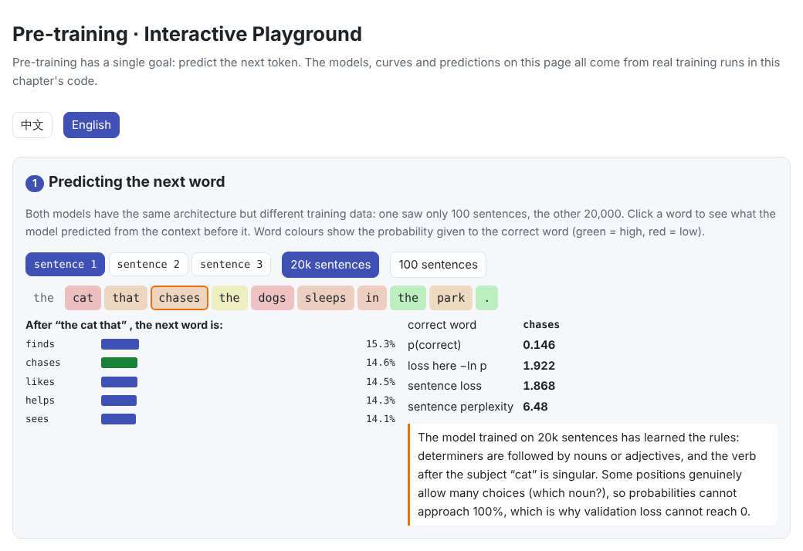
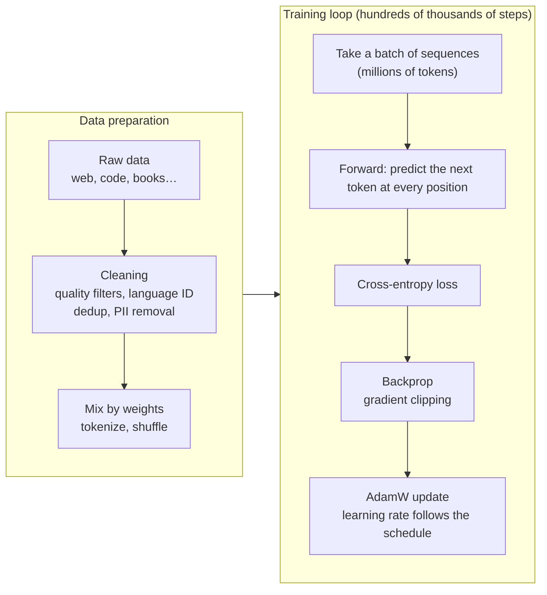
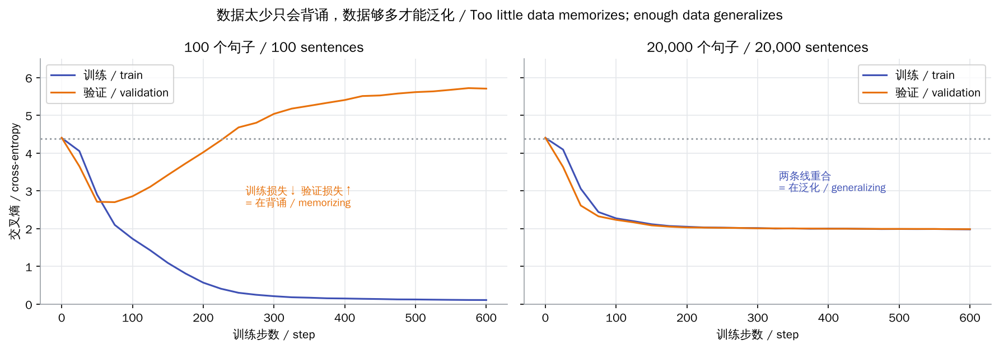
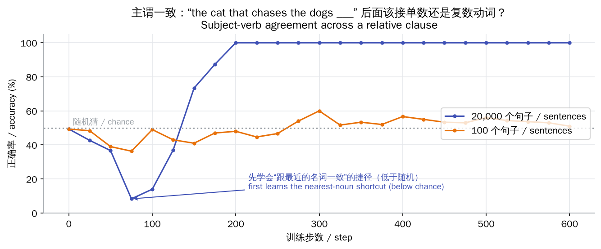
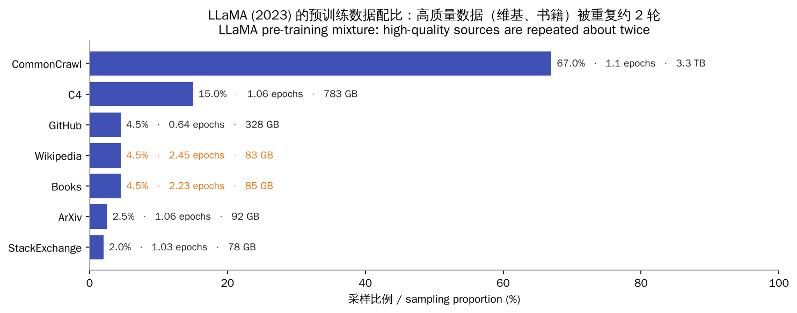
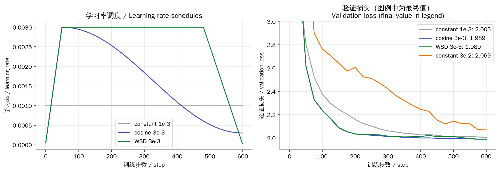

# Pre-training

> **In one sentence:** pre-training does one thing over and over on huge amounts of text: predict the next token and pay a cross-entropy penalty for mistakes. Data quality and quantity, the learning-rate schedule and the compute budget decide whether the model ends up learning rules or memorizing.
>
> 🌐 [中文版](README.md) · 🎮 **[Open the interactive playground](interactive/pretraining.html?lang=en)** · 📓 [Notebook](06-pretraining.ipynb) ([open in Colab](https://colab.research.google.com/github/BaiYuBY/use_token_to_learn/blob/main/docs/06-pretraining/06-pretraining.ipynb))

[](interactive/pretraining.html?lang=en)

**In this chapter you will learn:**

- The pre-training objective: next-token prediction, cross-entropy and perplexity
- Why “just predicting the next word” teaches grammar and knowledge, and when it does not
- Training loss vs validation loss: memorizing vs generalizing
- The data-cleaning pipeline: quality filters, language ID, deduplication, PII removal
- Data mixtures and repetition (epochs)
- Learning-rate warmup, cosine decay and WSD schedules; AdamW and gradient clipping
- Estimating training compute with $6ND$

---

## 1. Intuition: what next-word prediction can teach

The pre-training task sounds almost too simple: give the model some text and have it predict the next token. Doing that well, though, forces the model to learn a great deal:

- To predict the verb in “the cats that chase the dog ___”, it must know the subject is the plural “cats”, not the nearest noun “dog”: that is **grammar**
- To predict “The capital of France is ___”, it must remember **facts**
- To predict the next line of a program, it must follow the code's **logic**

This chapter runs a fully controlled experiment: a small grammar generates English sentences (subject and verb must agree in number, sometimes across a relative clause), and the same small model is trained on different amounts of that data. The results are clear-cut:

| Training data | Train loss | Val loss | Val perplexity | Agreement accuracy |
| --- | --- | --- | --- | --- |
| Untrained | — | 4.41 (≈ ln 80 = 4.38) | ≈ 80 | 49% (chance) |
| 100 sentences | 0.11 | 5.71 | 302 | 51% (chance) |
| 20,000 sentences | 1.98 | 1.99 | 7.3 | **100%** |

With too little data the model memorizes the training sentences and does worse than random guessing on new ones; with enough data it learns the rules.

## 2. Pictures

The whole pre-training pipeline:



Training vs validation loss: with too little data they part ways; with enough data they overlap:



Has the model really learned grammar? Check whether it gives the singular verb more probability in “the cat that chases the dogs ___”:



Interestingly, in the 20,000-sentence run accuracy first **drops to 8%** (far below the 50% chance level) before climbing to 100%: the model first picks up the shortcut “agree with the nearest noun” and only then learns the real sentence structure.

> **🎮 Try it yourself**
>
> In the [interactive playground](interactive/pretraining.html?lang=en) you can:
>
> 1. Compare both models' next-word probabilities at every position
> 2. Drag a slider to understand cross-entropy and perplexity
> 3. Toggle data-cleaning rules and see which documents survive
> 4. Adjust the data mixture and see how many epochs each source needs
> 5. Shape your own learning-rate curve and compare real runs with 4 schedules
> 6. Estimate how many GPUs and days a training run takes

## 3. How it works

### 3.1 The objective: cross-entropy and perplexity

For a token sequence $x_1, \dots, x_T$ the model predicts the next token at every position, and the loss is the average negative log-probability of the correct answers:

$$
\mathcal{L} = -\frac{1}{T}\sum_{t=1}^{T} \log p_\theta(x_t \mid x_{<t}), \qquad \text{perplexity} = e^{\mathcal{L}}
$$

- **Starting point**: a randomly initialized model is close to uniform, so $\mathcal{L} \approx \ln V$ and perplexity is about the vocabulary size $V$
- **Floor**: language is inherently uncertain (the next word often has several sensible choices), so validation loss can never reach 0. In this chapter's grammar many positions genuinely allow any noun or adjective, so validation loss levels off around 1.99
- **What perplexity means**: a perplexity of 7.3 is like the model hesitating between about 7 words on average

### 3.2 Data: quality is harder than quantity

Real pre-training data comes from the web (Common Crawl), code, books, papers and encyclopedias, up to trillions of tokens. Raw web pages vary wildly in quality and must be cleaned:

| Step | What it does | Examples |
| --- | --- | --- |
| Quality filtering | Heuristics or classifiers remove low-quality text | Too short, all caps, too many symbols, spam |
| Language ID | Keep only the target languages | Drop pages in other languages |
| Deduplication | Remove exact and near-duplicate documents | Mirrors, reposts, templated pages |
| PII removal | Replace emails, phone numbers and other personal data | `jane@example.com` → `<EMAIL>` |

**Deduplication matters**: repeated data gets memorized and regurgitated verbatim, and it wastes compute. Research shows that deduplicating training data makes models emit memorized text less often and train more efficiently.

**Mixture and repetition**: high-quality data is scarce, so raising its share means repeating it. LLaMA (2023) repeated Wikipedia and books a little over twice, while web data was used about once:



When data is limited, research finds that up to about 4 epochs of repetition is almost as good as fresh data, with quickly diminishing returns after that.

### 3.3 Optimization: AdamW, gradient clipping and learning-rate schedules

- **AdamW**: Adam with decoupled weight decay; large-model training commonly uses $\beta_2 = 0.95$ and weight decay 0.1
- **Gradient clipping**: cap the total gradient norm at 1.0 so occasional huge gradients cannot wreck training
- **Warmup**: parameters start random and gradients and Adam's second-moment estimates are unstable, so the learning rate ramps up from very small to the peak
- **Decay**:
  - **Cosine decay**: smoothly down from the peak to about 10% of it; requires knowing the total number of steps
  - **WSD (Warmup-Stable-Decay)**: hold the peak most of the time and decay quickly only at the end. Training can then continue from any “stable” checkpoint, with a separate decay run when needed



In this chapter's runs, cosine and WSD reach the same final validation loss (1.989), both better than a low constant rate without warmup (2.005); a rate that is too high (3e-2) makes the loss fall slowly and noisily (2.069).

### 3.4 Estimating compute: $C \approx 6ND$

Training a model with $N$ parameters on $D$ tokens takes roughly

$$
C \approx 6ND \ \text{floating-point operations}
$$

The forward pass is about $2ND$ (one multiply and one add per parameter per token) and the backward pass about twice the forward. For Llama 3 8B, $N = 8 \times 10^9$ and $D > 15 \times 10^{12}$, so $C \approx 7.2 \times 10^{23}$. At the H100's bf16 peak of 989 TFLOPS and 40% utilization (MFU), that is about 500k GPU-hours.

Note that Llama 3 8B saw about 1,875 tokens per parameter, far more than the roughly 20 that are “compute-optimal” (see 07 Scaling Laws). That is a deliberate trade-off: over-training a small model makes it cheaper to deploy and serve.

## 4. Minimal implementation

Full code:

- [`code/pretrain.py`](code/pretrain.py): the small grammar, the GPT model, learning-rate schedules, the training loop and the agreement probe. Run `python docs/06-pretraining/code/pretrain.py`
- [`code/data_filters.py`](code/data_filters.py): the data-cleaning pipeline. Run `python docs/06-pretraining/code/data_filters.py`

The heart of the training loop:

```python
for step in range(steps):
    for group in opt.param_groups:
        group["lr"] = cosine_lr(step, steps, peak_lr, warmup)       # learning-rate schedule
    x, y = batch(train_data)                                        # y is x shifted by one
    loss = F.cross_entropy(model(x).flatten(0, 1), y.flatten())
    opt.zero_grad()
    loss.backward()
    nn.utils.clip_grad_norm_(model.parameters(), 1.0)               # gradient clipping
    opt.step()
```

Warmup plus cosine decay:

```python
def cosine_lr(step, total, peak, warmup, min_ratio=0.1):
    if step < warmup:
        return peak * (step + 1) / warmup
    progress = (step - warmup) / max(1, total - warmup)
    return peak * (min_ratio + (1 - min_ratio) * 0.5 * (1 + math.cos(math.pi * progress)))
```

Checking whether the model learned agreement:

```python
words = noun_phrase(rng, SUBJECTS, plural) + ["that", verb(rng, TRANSITIVE, plural)]
words += noun_phrase(rng, OBJECTS, not plural)          # the nearest noun has the other number
probs = model(encode(words)[None])[0, -1].softmax(-1)
p_sing, p_plur = probs[SINGULAR_VERBS].sum(), probs[PLURAL_VERBS].sum()
```

> **In practice**
>
> Real pre-training also needs bf16 mixed precision, data parallelism / FSDP / tensor parallelism / pipeline parallelism, and checkpointing with failure recovery. This chapter builds the model from PyTorch's own `nn.TransformerEncoderLayer` (with a causal mask); see [05 Transformer block](../05-transformer/README.en.md) for what is inside.

## 5. Common misconceptions

- **“Lower training loss is always better.”** Training loss alone is fooled by memorization. The 100-sentence model has a training loss of just 0.11 yet learned none of the rules; look at validation loss and targeted tests.
- **“Validation loss can reach 0.”** Language is inherently uncertain, so loss has a floor it cannot go below.
- **“More data is always better, whatever its quality.”** Low-quality and duplicated data waste compute and teach the model to memorize junk; cleaning and deduplication often help more than simply adding volume.
- **“Pre-training goes over the data many times.”** Large-model pre-training usually sees most data about once, repeating only small high-quality sources a few times.
- **“The model learns a rule in one go.”** This chapter's run shows a model can first learn a wrong shortcut and be corrected by more data later.

## 6. Self-check

1. A model's validation perplexity is 8. What is its cross-entropy, and what does that mean intuitively?
2. Roughly how many floating-point operations does it take to train a 1-billion-parameter model on 20 billion tokens?
3. Why deduplicate pre-training data?

<details>
<summary>Answers</summary>

1. $\ln 8 \approx 2.08$. On average the model is like choosing uniformly among about 8 words for the next one.
2. $6 \times 10^9 \times 2 \times 10^{10} = 1.2 \times 10^{20}$.
3. Duplicates get memorized verbatim (possibly leaking private data), waste compute, and bias the model towards the repeated content.

</details>

## 7. Further reading

- Radford et al., 2019. [Language Models are Unsupervised Multitask Learners](https://cdn.openai.com/better-language-models/language_models_are_unsupervised_multitask_learners.pdf) (GPT-2)
- Kaplan et al., 2020. [Scaling Laws for Neural Language Models](https://arxiv.org/abs/2001.08361) ($C \approx 6ND$)
- Hoffmann et al., 2022. [Training Compute-Optimal Large Language Models](https://arxiv.org/abs/2203.15556) (Chinchilla)
- Touvron et al., 2023. [LLaMA: Open and Efficient Foundation Language Models](https://arxiv.org/abs/2302.13971) (data mixture)
- Lee et al., 2021. [Deduplicating Training Data Makes Language Models Better](https://arxiv.org/abs/2107.06499)
- Muennighoff et al., 2023. [Scaling Data-Constrained Language Models](https://arxiv.org/abs/2305.16264) (how many epochs still help)
- Penedo et al., 2023. [The RefinedWeb Dataset for Falcon LLM](https://arxiv.org/abs/2306.01116)
- Penedo et al., 2024. [The FineWeb Datasets](https://arxiv.org/abs/2406.17557)
- Loshchilov & Hutter, 2017. [Decoupled Weight Decay Regularization](https://arxiv.org/abs/1711.05101) (AdamW)
- Hu et al., 2024. [MiniCPM: Unveiling the Potential of Small Language Models with Scalable Training Strategies](https://arxiv.org/abs/2404.06395) (WSD schedule)
- Linzen et al., 2016. [Assessing the Ability of LSTMs to Learn Syntax-Sensitive Dependencies](https://arxiv.org/abs/1611.01368) (agreement and “attractors”)
