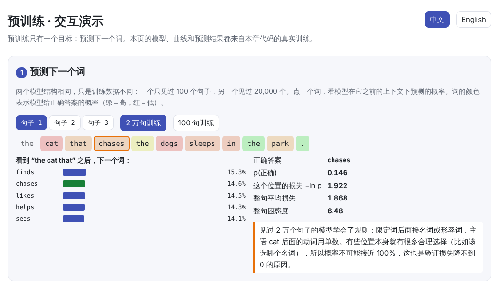
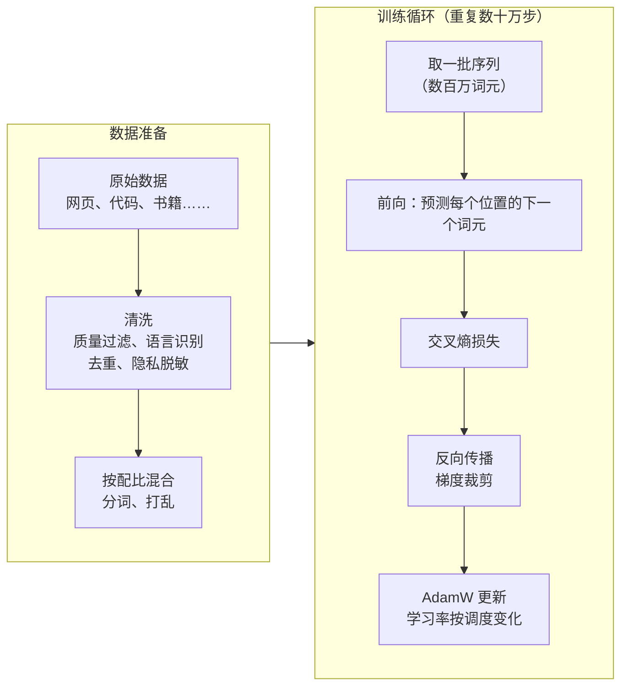

# 预训练（Pre-training）

> **一句话总结：** 预训练就是在海量文本上反复做一件事：预测下一个词元，并用交叉熵惩罚预测错误。数据的质量与数量、学习率调度和算力预算，决定了模型最终学到的是规律还是死记硬背。
>
> 🌐 [English version](README.en.md) · 🎮 **[打开交互演示](interactive/pretraining.html?lang=zh)** · 📓 [Notebook](06-pretraining.ipynb)（[在 Colab 中打开](https://colab.research.google.com/github/BaiYuBY/use_token_to_learn/blob/main/docs/06-pretraining/06-pretraining.ipynb)）

[](interactive/pretraining.html?lang=zh)

**本章你将学会：**

- 预训练的目标：下一个词元预测、交叉熵与困惑度
- 为什么“只是预测下一个词”就能学到语法和知识，以及什么时候学不到
- 训练损失与验证损失的区别：背诵与泛化
- 数据清洗流水线：质量过滤、语言识别、去重、隐私脱敏
- 数据配比与重复轮数（epoch）
- 学习率预热、余弦衰减、WSD 调度，AdamW 与梯度裁剪
- 用 $6ND$ 估算训练算力

---

## 1. 直觉：预测下一个词能学到什么

预训练的任务简单到让人怀疑：给模型一段文本，让它预测下一个词元。但要把这件事做好，模型必须掌握很多东西：

- 要预测 “the cats that chase the dog ___” 后面的动词，就得知道主语是复数的 cats，而不是离得最近的 dog：这是**语法**
- 要预测 “法国的首都是 ___”，就得记住**事实**
- 要预测一段代码的下一行，就得理解代码的**逻辑**

本章做了一个可以完全掌控的实验：用一个小语法生成英文句子（主语和动词必须单复数一致，中间可能隔着一个从句），然后在不同数量的数据上训练同一个小模型。结果非常清楚：

| 训练数据 | 训练损失 | 验证损失 | 验证困惑度 | 主谓一致正确率 |
| --- | --- | --- | --- | --- |
| 未训练 | — | 4.41（≈ ln 80 = 4.38） | ≈ 80 | 49%（随机） |
| 100 个句子 | 0.11 | 5.71 | 302 | 51%（随机） |
| 20,000 个句子 | 1.98 | 1.99 | 7.3 | **100%** |

数据太少时，模型把训练句子背了下来，在新句子上的表现甚至比随机乱猜还差；数据足够多时，它学会了规则。

## 2. 图解

预训练的完整流程：



训练损失和验证损失：数据太少时两者分道扬镳，数据足够时两者重合：


模型有没有真正学会语法？看它在 “the cat that chases the dogs ___” 中是否给单数动词更高的概率：


有意思的是，在 20,000 句的训练中，正确率先**跌到 8%**（远低于随机的 50%），之后才升到 100%：模型先学会了“动词跟最近的名词一致”这条捷径，然后才学会真正的句子结构。

> **🎮 动手试试**
>
> 在[交互演示](interactive/pretraining.html?lang=zh)中，你可以：
>
> 1. 对比两个模型在每个位置预测下一个词的概率
> 2. 拖动滑块理解交叉熵与困惑度
> 3. 开关数据清洗规则，看哪些文档被保留
> 4. 调整数据配比，看每个来源要重复几轮
> 5. 自己调学习率曲线，并对比 4 种调度的真实训练结果
> 6. 估算训练一个模型需要多少 GPU 和多少天

## 3. 原理

### 3.1 目标函数：交叉熵与困惑度

对一段词元序列 $x_1, \dots, x_T$，模型在每个位置预测下一个词元，损失是正确答案概率的负对数的平均：

$$
\mathcal{L} = -\frac{1}{T}\sum_{t=1}^{T} \log p_\theta(x_t \mid x_{<t}), \qquad \text{困惑度} = e^{\mathcal{L}}
$$

- **初始值**：随机初始化的模型接近均匀分布，$\mathcal{L} \approx \ln V$，困惑度约等于词表大小 $V$
- **下限**：语言本身有不确定性（下一个词往往有多种合理选择），所以验证损失不可能降到 0。本章的小语法中，很多位置本来就可以随机选一个名词或形容词，所以验证损失停在约 1.99
- **困惑度的直观含义**：困惑度 7.3 相当于模型平均在约 7 个词之间犹豫

### 3.2 数据：质量比数量更难

真实的预训练数据来自网页（Common Crawl）、代码、书籍、论文、百科等，规模可达数万亿词元。原始网页质量参差不齐，需要清洗：

| 步骤 | 做什么 | 例子 |
| --- | --- | --- |
| 质量过滤 | 启发式规则或分类器去掉低质量文本 | 太短、全大写、符号过多、重复刷屏 |
| 语言识别 | 只保留目标语言 | 去掉非目标语言的网页 |
| 去重 | 去掉完全相同和高度相似的文档 | 镜像网站、转载、模板页 |
| 隐私脱敏 | 替换邮箱、电话等个人信息 | `jane@example.com` → `<EMAIL>` |

**去重很重要**：重复的数据会被模型记住并逐字复述，还浪费算力。研究表明，对训练数据去重能降低模型逐字复述训练文本的频率，并让训练更高效。

**配比与重复**：高质量数据量少，提高它的比例就意味着要重复多轮。LLaMA（2023）就把维基百科和书籍重复了 2 轮多，而网页数据只用了约 1 轮：


研究发现，在数据受限时，重复约 4 轮以内几乎和新数据一样有效，之后收益迅速下降。

### 3.3 优化：AdamW、梯度裁剪与学习率调度

- **AdamW**：带解耦权重衰减的 Adam，大模型训练常用 $\beta_2 = 0.95$、权重衰减 0.1
- **梯度裁剪**：把梯度的总范数限制在 1.0 以内，防止偶尔出现的巨大梯度破坏训练
- **学习率预热（warmup）**：开始时参数是随机的，梯度和 Adam 的二阶矩估计都不稳定，先用很小的学习率逐步升到峰值
- **衰减**：
  - **余弦衰减**：从峰值平滑降到峰值的约 10%，需要事先知道总步数
  - **WSD（Warmup-Stable-Decay）**：大部分时间保持峰值，只在最后一段快速衰减。好处是可以随时从“稳定段”的检查点接着训练，再单独做衰减


本章的实验中，余弦和 WSD 的最终验证损失相同（1.989），都优于不预热的低恒定学习率（2.005）；学习率太高（3e-2）时损失下降又慢又抖（2.069）。

### 3.4 算力估算：$C \approx 6ND$

训练一个参数量为 $N$ 的模型、看 $D$ 个词元，大约需要

$$
C \approx 6ND \ \text{次浮点运算}
$$

前向传播约 $2ND$（每个参数一次乘法加一次加法），反向传播约是前向的两倍。以 Llama 3 8B 为例：$N = 8 \times 10^9$，$D > 15 \times 10^{12}$，$C \approx 7.2 \times 10^{23}$。按 H100 的 bf16 峰值 989 TFLOPS、40% 的利用率（MFU）计算，大约需要 50 万 GPU 小时。

注意 Llama 3 8B 每个参数看了约 1,875 个词元，远多于“计算最优”所需的约 20 个（见 07 Scaling Laws）。这是有意的取舍：小模型多训练一些，部署和推理时更便宜。

## 4. 最小代码实现

完整代码：

- [`code/pretrain.py`](code/pretrain.py)：小语法、GPT 模型、学习率调度、训练循环、主谓一致探针。运行 `python docs/06-pretraining/code/pretrain.py`
- [`code/data_filters.py`](code/data_filters.py)：数据清洗流水线。运行 `python docs/06-pretraining/code/data_filters.py`

训练循环的核心：

```python
for step in range(steps):
    for group in opt.param_groups:
        group["lr"] = cosine_lr(step, steps, peak_lr, warmup)       # 学习率调度
    x, y = batch(train_data)                                        # y 是 x 右移一位
    loss = F.cross_entropy(model(x).flatten(0, 1), y.flatten())
    opt.zero_grad()
    loss.backward()
    nn.utils.clip_grad_norm_(model.parameters(), 1.0)               # 梯度裁剪
    opt.step()
```

预热加余弦衰减：

```python
def cosine_lr(step, total, peak, warmup, min_ratio=0.1):
    if step < warmup:
        return peak * (step + 1) / warmup
    progress = (step - warmup) / max(1, total - warmup)
    return peak * (min_ratio + (1 - min_ratio) * 0.5 * (1 + math.cos(math.pi * progress)))
```

检查模型是否学会了主谓一致：

```python
words = noun_phrase(rng, SUBJECTS, plural) + ["that", verb(rng, TRANSITIVE, plural)]
words += noun_phrase(rng, OBJECTS, not plural)          # 最近的名词与主语单复数相反
probs = model(encode(words)[None])[0, -1].softmax(-1)
p_sing, p_plur = probs[SINGULAR_VERBS].sum(), probs[PLURAL_VERBS].sum()
```

> **实际工程中**
>
> 真实的预训练还要用到 bf16 混合精度、数据并行 / FSDP / 张量并行 / 流水线并行，以及检查点保存与故障恢复。本章的模型结构直接用了 PyTorch 自带的 `nn.TransformerEncoderLayer`（配合因果掩码），内部原理见 [05 Transformer 结构](../05-transformer/README.md)。

## 5. 常见误区

- **“训练损失越低越好”**：只看训练损失会被背诵骗过。100 句的模型训练损失只有 0.11，却什么规则都没学会，要看验证损失和针对性的测试。
- **“验证损失可以降到 0”**：语言本身有不确定性，损失有一个降不下去的下限。
- **“数据越多越好，质量无所谓”**：低质量和重复的数据会浪费算力，还会让模型背诵垃圾内容；清洗和去重往往比单纯加量更有效。
- **“预训练要把数据看很多遍”**：大模型预训练通常对大部分数据只看约一遍，只有少量高质量数据会重复几轮。
- **“模型一步到位地学会规则”**：本章的实验显示，模型可能先学会一条错误的捷径，再被更多数据纠正过来。

## 6. 自测题

1. 一个模型的验证困惑度是 8，交叉熵是多少？直观上是什么意思？
2. 训练一个 10 亿参数的模型、看 200 亿词元，大约需要多少次浮点运算？
3. 为什么要对预训练数据去重？

<details>
<summary>参考答案</summary>

1. $\ln 8 \approx 2.08$。平均而言，模型就像在约 8 个词之间等概率地挑选下一个词。
2. $6 \times 10^9 \times 2 \times 10^{10} = 1.2 \times 10^{20}$ 次。
3. 重复的数据会让模型逐字背诵（还可能泄露隐私）、浪费算力，并让模型过度偏向被重复的内容。

</details>

## 7. 延伸阅读

- Radford et al., 2019. [Language Models are Unsupervised Multitask Learners](https://cdn.openai.com/better-language-models/language_models_are_unsupervised_multitask_learners.pdf)（GPT-2）
- Kaplan et al., 2020. [Scaling Laws for Neural Language Models](https://arxiv.org/abs/2001.08361)（$C \approx 6ND$）
- Hoffmann et al., 2022. [Training Compute-Optimal Large Language Models](https://arxiv.org/abs/2203.15556)（Chinchilla）
- Touvron et al., 2023. [LLaMA: Open and Efficient Foundation Language Models](https://arxiv.org/abs/2302.13971)（数据配比）
- Lee et al., 2021. [Deduplicating Training Data Makes Language Models Better](https://arxiv.org/abs/2107.06499)
- Muennighoff et al., 2023. [Scaling Data-Constrained Language Models](https://arxiv.org/abs/2305.16264)（重复多少轮还有用）
- Penedo et al., 2023. [The RefinedWeb Dataset for Falcon LLM](https://arxiv.org/abs/2306.01116)
- Penedo et al., 2024. [The FineWeb Datasets](https://arxiv.org/abs/2406.17557)
- Loshchilov & Hutter, 2017. [Decoupled Weight Decay Regularization](https://arxiv.org/abs/1711.05101)（AdamW）
- Hu et al., 2024. [MiniCPM: Unveiling the Potential of Small Language Models with Scalable Training Strategies](https://arxiv.org/abs/2404.06395)（WSD 调度）
- Linzen et al., 2016. [Assessing the Ability of LSTMs to Learn Syntax-Sensitive Dependencies](https://arxiv.org/abs/1611.01368)（主谓一致与“吸引子”）
