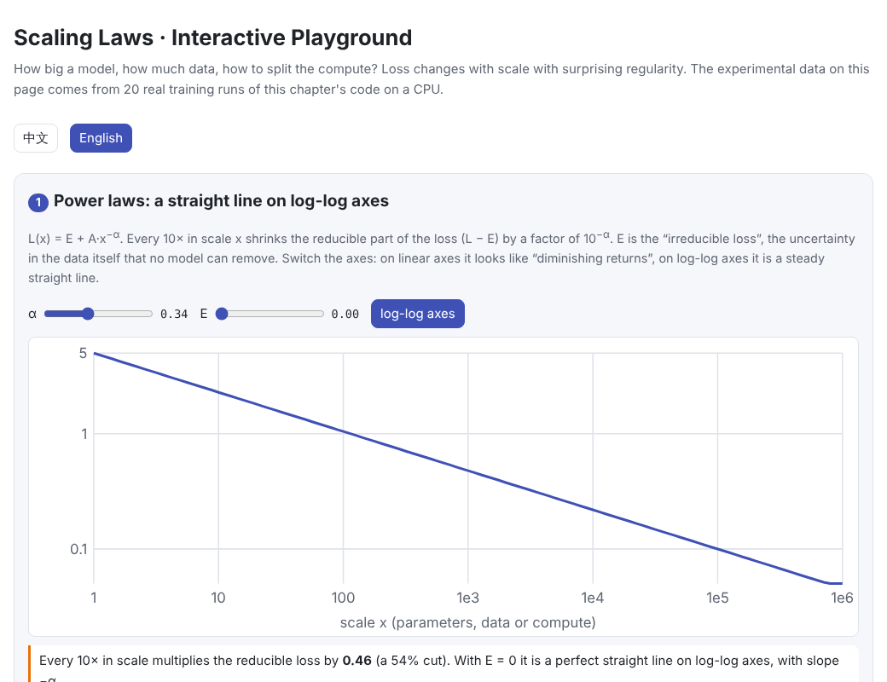
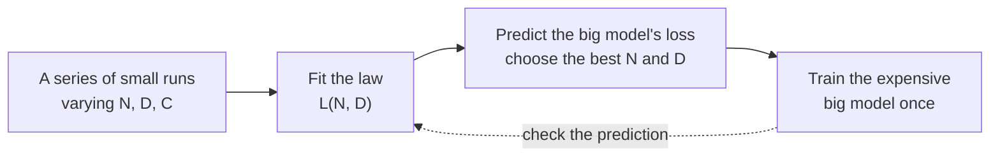
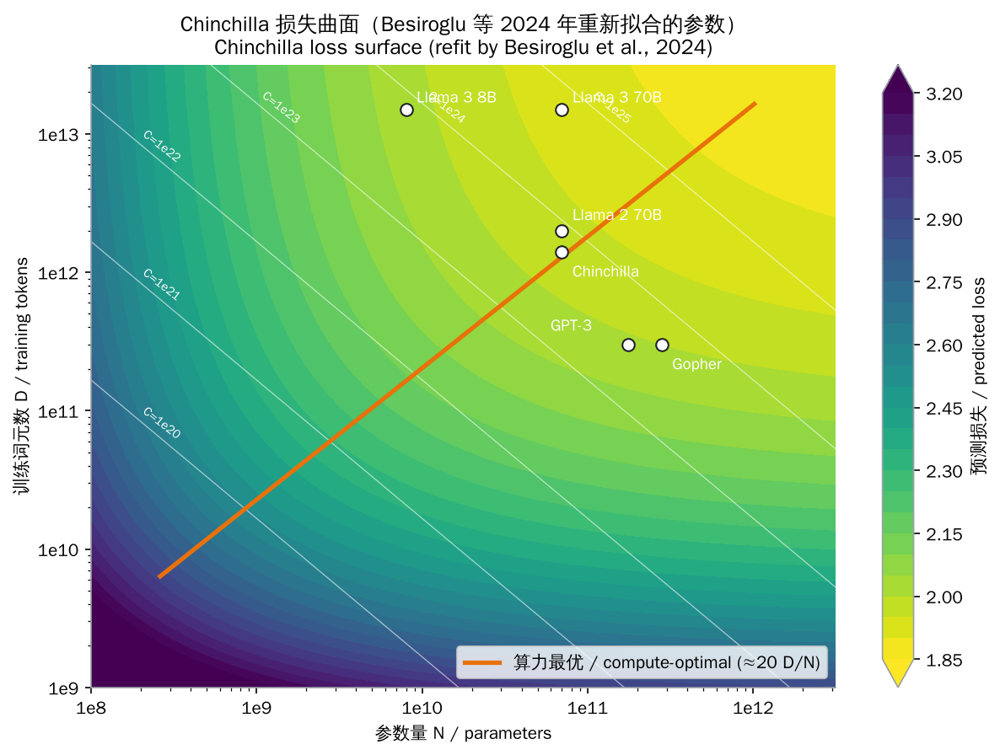
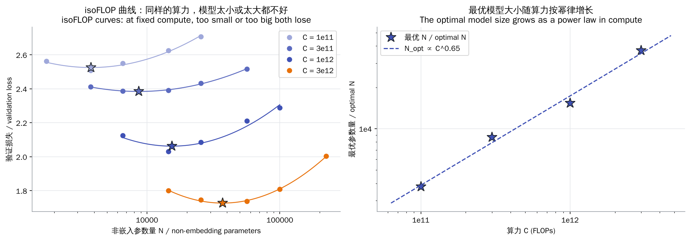
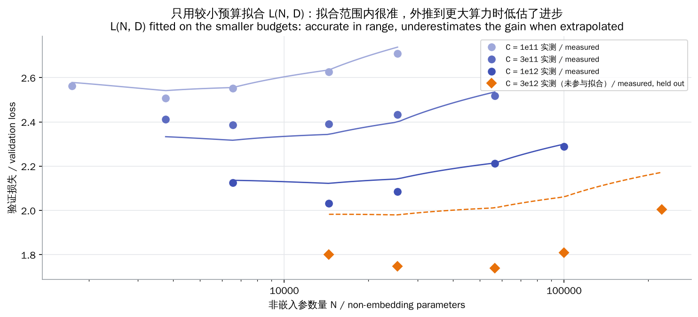
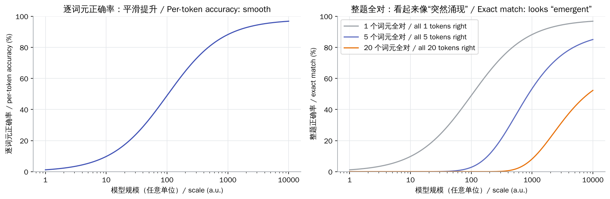

# Scaling Laws

> **In one sentence:** language-model loss falls as a power law in parameters, data and compute, regularly enough that small experiments can predict big models. At fixed compute, model and data should grow together (Chinchilla: about 20 tokens per parameter); once serving costs count, a smaller model trained on more data is often the better deal.
>
> 🌐 [中文版](README.md) · 🎮 **[Open the interactive playground](interactive/scaling.html?lang=en)** · 📓 [Notebook](07-scaling-laws.ipynb) ([open in Colab](https://colab.research.google.com/github/BaiYuBY/use_token_to_learn/blob/main/docs/07-scaling-laws/07-scaling-laws.ipynb))

[](interactive/scaling.html?lang=en)

**In this chapter you will learn:**

- What a power law is and why it is a straight line on log-log axes
- How to split a fixed compute budget between model size and data: Kaplan's and Chinchilla's answers
- A real story about checking fitted formulas: the replication of Chinchilla's fit
- How to run an isoFLOP experiment yourself, and when extrapolation fails
- Why, once serving costs count, Llama 3 8B was “over-trained” on 15 trillion tokens
- How “emergent abilities” relate to the choice of metric

---

## 1. Intuition: why scaling laws?

Training a large model costs millions of dollars, so you cannot try every configuration. Scaling laws answer:

- Given a budget, **how big should the model be, and how much data should it see?**
- If we scale up 10×, **what loss will we reach?**
- Can **cheap small experiments** predict an expensive big one?

Around 2020, researchers found that a language model's test loss $L$ follows remarkably stable power laws in parameters $N$, data $D$ and compute $C$, across many orders of magnitude. That turned training large models from guesswork into engineering that can be planned. Labs typically use scaling laws like this:



## 2. Pictures

The loss surface predicted by the Chinchilla formula. White lines are iso-compute lines ($C = 6ND$); the orange line is the optimal configuration for each budget:



GPT-3 and Gopher sit below and to the right of the orange line: models too big for their data. Chinchilla used a smaller model and more data to reach a lower loss at similar compute. Llama 3 sits far above the line: a deliberately small model trained on huge amounts of data so that it is cheap to serve.

This chapter's isoFLOP experiment on a CPU: 5 model sizes per compute budget, and every curve is U-shaped:



> **🎮 Try it yourself**
>
> In the [interactive playground](interactive/scaling.html?lang=en) you can:
>
> 1. Change a power law's exponent and irreducible loss, on linear and log-log axes
> 2. Drag the compute budget to see the optimal model size and data, and switch between two sets of Chinchilla parameters
> 3. Browse the isoFLOP results of this chapter's 20 real training runs
> 4. Test how far small runs can be extrapolated
> 5. Add serving costs and watch the optimal model shrink
> 6. Change how many tokens must all be right and watch smooth progress turn into “emergence”

## 3. How it works

### 3.1 Power laws

If $L(x) = A \cdot x^{-\alpha}$, taking logs gives $\log L = \log A - \alpha \log x$: a straight line of slope $-\alpha$ on log-log axes. Every 10× in scale multiplies the loss by $10^{-\alpha}$.

Kaplan et al. (2020) found that, when nothing else is the bottleneck, loss falls as a power law in non-embedding parameters, data and compute, with exponents of about $\alpha_N \approx 0.076$, $\alpha_D \approx 0.095$ and $\alpha_C \approx 0.050$. Such small exponents mean that a clear drop in loss takes many orders of magnitude of scale.

In practice part of the loss never goes away: the **irreducible loss** $E$, the inherent uncertainty of language (see [06 Pre-training](../06-pretraining/README.en.md)).

### 3.2 Compute-optimal: splitting model and data

Training compute is about $C \approx 6ND$ (see chapter 06). The same $C$ can go to a big model on little data or a small model on lots of data. Chinchilla (Hoffmann et al., 2022) studied this with three methods; one of them fits

$$
L(N, D) = E + \frac{A}{N^{\alpha}} + \frac{B}{D^{\beta}}
$$

and minimizes it subject to $6ND = C$, giving

$$
N_{\text{opt}} \propto C^{\frac{\beta}{\alpha+\beta}}, \qquad D_{\text{opt}} \propto C^{\frac{\alpha}{\alpha+\beta}}
$$

Chinchilla's conclusion: **model and data should grow at roughly the same rate** (both exponents about 0.5), with an optimum of about **20 tokens per parameter**. Following it, they trained Chinchilla (70B parameters, 1.4T tokens) on Gopher's (280B parameters, 300B tokens) compute budget and got a better model.

Earlier, Kaplan et al. had concluded $N_{\text{opt}} \propto C^{0.73}$, i.e. that mostly the model should grow. Later work attributes the difference to factors such as whether embedding parameters are counted, whether the learning-rate schedule matches the training length, and the scale of the experiments.

### 3.3 Fitted formulas need checking too

The “Approach 3” parameters published in the Chinchilla paper ($E = 1.69$, $A = 406.4$, $B = 410.7$, $\alpha = 0.34$, $\beta = 0.28$) have a problem: computing the optimum at Chinchilla's own budget gives about 33B parameters and about 93 tokens per parameter, which contradicts the paper's own conclusion (70B, about 20 tokens per parameter).

Besiroglu et al. (2024) re-extracted the data from the paper's figures and refit it, obtaining $E = 1.82$, $A = 482$, $B = 2085$, $\alpha = 0.348$, $\beta = 0.366$. At Chinchilla's budget the refit gives about 73B parameters and about 18 tokens per parameter, consistent with the paper's conclusion. **This chapter uses the refit by default**; the playground lets you compare both.

### 3.4 This chapter's experiment

To see these laws first-hand, this chapter trains character-level models on the Python standard library's source code (about 10 million characters):

- Models: 2-layer Transformers that differ only in width $d$ (8 to 96), from about 1,700 to about 220,000 non-embedding parameters
- 4 compute budgets: $10^{11}$, $3 \times 10^{11}$, $10^{12}$ and $3 \times 10^{12}$ FLOPs, 5 models each, 20 runs in total
- Compute accounting: for models this small $6N$ badly underestimates the real cost, so attention ($6 \cdot n_{\text{layer}} \cdot n_{\text{ctx}} \cdot d$, after Kaplan et al.) and the output layer ($6dV$) are counted too
- At the largest budget the smaller models repeat the data about twice (see chapter 06: up to about 4 epochs costs little)

Results:

| Finding | Value |
| --- | --- |
| Loss vs model size is U-shaped at every budget | see the figure above |
| Fitting the curve minima | $N_{\text{opt}} \propto C^{0.65}$ |
| Fitting $L(N, D)$ to all 20 runs | $N_{\text{opt}} \propto C^{0.53}$ (close to Chinchilla's about 0.5) |

The two methods disagree, which is common in small experiments; Chinchilla's three methods also differ from each other.

**Extrapolation test**: fit on the 15 runs from the three smaller budgets and predict the 5 runs at the largest. The mean error inside the fitted range is only 0.034, but 0.22 when extrapolating, and every prediction overestimates the loss:



One reason is that these runs are tiny: the small-budget models train for only a few hundred steps, so optimization effects dominate. Large-model teams fit on bigger, better-tuned runs that span more orders of magnitude (the GPT-4 technical report says the final loss was predicted accurately from much smaller models). The lesson: **scaling laws are reliable only within the range where they have been validated.**

### 3.5 Beyond Chinchilla: counting serving costs

Chinchilla minimizes **training** cost only. Once deployed, every generated token costs about $2N$ more operations. For a model serving many users, the total cost is

$$
\text{total cost} \approx 6ND + 2N \cdot I
$$

where $I$ is the total number of tokens served. For the same target loss, the larger $I$ is, the smaller the optimal $N$ and the larger $D$. That is why Llama 3 8B was trained on over 15 trillion tokens (about 1,900 per parameter). Data itself can also become the bottleneck, in which case some repetition helps (see chapter 06).

### 3.6 “Emergence” and the choice of metric

Some downstream abilities seem to appear suddenly at a certain scale. One explanation is the metric: if per-token accuracy $p$ improves smoothly with scale but a task requires all $k$ tokens to be right, the task accuracy is $p^k$, which stays near 0 for a long time and then rises quickly:



This does not mean every case of emergence is an artefact, but it is a reminder to look closely at the metric before concluding that an ability “suddenly appeared”.

## 4. Minimal implementation

Full code: [`code/scaling.py`](code/scaling.py). Run `python docs/07-scaling-laws/code/scaling.py` (about 15 seconds: formula checks and a quick experiment). The full isoFLOP sweep lives in [`figures/scaling_figures.py`](figures/scaling_figures.py) and takes about 7 minutes on a laptop CPU.

The Chinchilla formula and its closed-form optimum:

```python
def chinchilla_loss(n_params, n_tokens, fit="besiroglu2024"):
    f = FITS[fit]
    return f["E"] + f["A"] / n_params ** f["alpha"] + f["B"] / n_tokens ** f["beta"]

def compute_optimal(compute, fit="besiroglu2024"):
    f = FITS[fit]
    g = (f["alpha"] * f["A"] / (f["beta"] * f["B"])) ** (1 / (f["alpha"] + f["beta"]))
    n = g * (compute / 6) ** (f["beta"] / (f["alpha"] + f["beta"]))
    return n, compute / (6 * n)
```

The isoFLOP experiment: every model spends exactly the same compute:

```python
for c, widths in BUDGETS.items():
    for d in widths:
        tokens = c / flops_per_token(d, vocab_size)     # fixed compute: bigger model, less data
        loss = train_run(d, tokens, train_data, val_data, vocab_size)
```

Fitting $L(N, D)$ like Chinchilla's Approach 3:

```python
pred = e + torch.exp(log_a - alpha * torch.log(n)) + torch.exp(log_b - beta * torch.log(d))
loss = F.huber_loss(torch.log(pred), torch.log(measured), delta=1e-3, reduction="sum")
```

## 5. Common misconceptions

- **“Bigger models are always better.”** At fixed compute, too big a model sees too little data and does worse (the U-shaped curves).
- **“Scaling laws are laws of physics.”** They are empirical regularities that hold for the range, data distribution and training recipe where they were measured; extrapolate with care.
- **“20 tokens per parameter is a golden rule.”** It is only the **training**-compute optimum. With serving costs or data limits the best ratio can be very different.
- **“Loss can go down forever.”** There is an irreducible loss $E$.
- **“Downstream abilities improve as smoothly as loss.”** Loss falls smoothly, but task performance can jump depending on the metric and its threshold.

## 6. Self-check

1. At about 20 tokens per parameter and $C = 6 \times 10^{21}$ FLOPs, roughly how many parameters and tokens are optimal?
2. Why does Chinchilla (70B) beat Gopher (280B) at about the same $5 \times 10^{23}$ FLOPs?
3. A company is training a model that hundreds of millions of people will use. Should it be bigger or smaller than the Chinchilla optimum?

<details>
<summary>Answers</summary>

1. From $6ND = C$ and $D = 20N$: $N = \sqrt{C/120} \approx 7 \times 10^9$ (about 7 billion parameters) and $D \approx 1.4 \times 10^{11}$ (about 140 billion tokens).
2. Gopher's model is too big for its data (about 1 token per parameter); Chinchilla is close to the optimal ratio (about 20 tokens per parameter).
3. Smaller, trained on more data. Serving cost is proportional to parameters, so with heavy usage a one-off training cost buys long-term serving savings.

</details>

## 7. Further reading

- Hestness et al., 2017. [Deep Learning Scaling is Predictable, Empirically](https://arxiv.org/abs/1712.00409)
- Kaplan et al., 2020. [Scaling Laws for Neural Language Models](https://arxiv.org/abs/2001.08361)
- Hoffmann et al., 2022. [Training Compute-Optimal Large Language Models](https://arxiv.org/abs/2203.15556) (Chinchilla)
- Besiroglu et al., 2024. [Chinchilla Scaling: A replication attempt](https://arxiv.org/abs/2404.10102)
- Pearce & Song, 2024. [Reconciling Kaplan and Chinchilla Scaling Laws](https://arxiv.org/abs/2406.12907)
- Sardana & Frankle, 2023. [Beyond Chinchilla-Optimal: Accounting for Inference in Language Model Scaling Laws](https://arxiv.org/abs/2401.00448)
- Muennighoff et al., 2023. [Scaling Data-Constrained Language Models](https://arxiv.org/abs/2305.16264)
- OpenAI, 2023. [GPT-4 Technical Report](https://arxiv.org/abs/2303.08774) (predictable scaling)
- Wei et al., 2022. [Emergent Abilities of Large Language Models](https://arxiv.org/abs/2206.07682)
- Schaeffer et al., 2023. [Are Emergent Abilities of Large Language Models a Mirage?](https://arxiv.org/abs/2304.15004)
