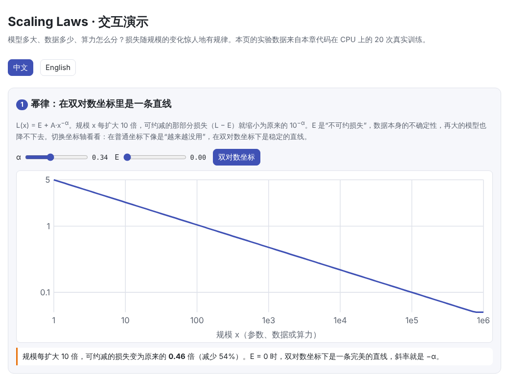

# Scaling Laws（规模定律）

> **一句话总结：** 语言模型的损失随参数量、数据量和算力的增长呈幂律下降，规律稳定到可以用小实验预测大模型。在固定算力下，模型和数据应该按比例一起扩大（Chinchilla：约 20 个词元/参数）；但如果还要考虑推理成本，更小的模型配更多数据往往更划算。
>
> 🌐 [English version](README.en.md) · 🎮 **[打开交互演示](interactive/scaling.html?lang=zh)**

[](interactive/scaling.html?lang=zh)

**本章你将学会：**

- 什么是幂律，为什么在双对数坐标下是一条直线
- 固定算力时，模型大小和数据量如何分配：Kaplan 与 Chinchilla 的结论
- 一个关于“拟合公式需要核验”的真实故事：Chinchilla 公式的复现研究
- 亲手做一个 isoFLOP 实验，并看看外推预测在什么时候会失败
- 为什么考虑推理成本后，Llama 3 8B 要“过度训练”到 15 万亿词元
- “能力涌现”与评估指标之间的关系

---

## 1. 直觉：为什么需要规模定律

训练一个大模型要花几百万美元，不可能每种配置都试一遍。规模定律回答的是：

- 给定预算，**模型应该多大？数据应该多少？**
- 把规模扩大 10 倍，**损失会降到多少？**
- 能不能先用**便宜的小实验**预测昂贵的大实验？

2020 年前后，研究者发现语言模型的测试损失 $L$ 与参数量 $N$、数据量 $D$、算力 $C$ 之间存在惊人稳定的幂律关系，跨越了好几个数量级。这让训练大模型从“碰运气”变成了可以规划的工程。实验室通常这样使用规模定律：


## 2. 图解

Chinchilla 公式预测的损失曲面。白线是等算力线（$C = 6ND$），橙线是每个算力下的最优配置：


可以看到 GPT-3 和 Gopher 落在橙线右下方：模型太大、数据太少。Chinchilla 用更小的模型、更多的数据，在差不多的算力下取得了更低的损失。Llama 3 则远在橙线上方：为了推理便宜，刻意用小模型训练极多数据。

本章在 CPU 上做的 isoFLOP 实验：每个算力预算下训练 5 个不同大小的模型，每条曲线都是 U 形：


> **🎮 动手试试**
>
> 在[交互演示](interactive/scaling.html?lang=zh)中，你可以：
>
> 1. 调整幂律的指数和不可约损失，对比普通坐标与双对数坐标
> 2. 拖动算力，看最优的模型大小和数据量，并切换两套 Chinchilla 参数
> 3. 浏览本章 20 次真实训练的 isoFLOP 结果
> 4. 检验用小实验外推大实验的误差
> 5. 加入推理成本，看最优模型如何变小
> 6. 调整“整题全对”需要的词元数，看平滑的进步如何变成“涌现”

## 3. 原理

### 3.1 幂律

如果 $L(x) = A \cdot x^{-\alpha}$，两边取对数得到 $\log L = \log A - \alpha \log x$：在双对数坐标下是一条斜率为 $-\alpha$ 的直线。规模每扩大 10 倍，损失就变为原来的 $10^{-\alpha}$ 倍。

Kaplan 等人（2020）发现，在其他因素不成为瓶颈时，损失分别随非嵌入参数量、数据量和算力按幂律下降，指数约为 $\alpha_N \approx 0.076$、$\alpha_D \approx 0.095$、$\alpha_C \approx 0.050$。指数很小意味着：想让损失明显下降，规模要扩大很多个数量级。

实际中损失还有一个降不下去的部分，称为**不可约损失** $E$：语言本身就有不确定性（见 [06 预训练](../06-pretraining/README.md)）。

### 3.2 算力最优：模型与数据怎么分

训练算力约为 $C \approx 6ND$（见 06 章）。同样的 $C$ 可以分给大模型少数据，也可以分给小模型多数据。Chinchilla（Hoffmann 等，2022）用三种方法研究这个问题，其中一种是拟合

$$
L(N, D) = E + \frac{A}{N^{\alpha}} + \frac{B}{D^{\beta}}
$$

在 $6ND = C$ 的约束下最小化，得到

$$
N_{\text{opt}} \propto C^{\frac{\beta}{\alpha+\beta}}, \qquad D_{\text{opt}} \propto C^{\frac{\alpha}{\alpha+\beta}}
$$

Chinchilla 的结论是：**模型和数据应该以大致相同的速度扩大**（两个指数都约为 0.5），最优比例约为**每个参数 20 个词元**。按这个结论，他们用 Gopher（280B 参数、300B 词元）的算力训练了 Chinchilla（70B 参数、1.4T 词元），效果更好。

更早的 Kaplan 等人得出的结论是 $N_{\text{opt}} \propto C^{0.73}$，即应该主要扩大模型。后续研究认为，差异与是否计入嵌入参数、学习率调度是否与训练长度相匹配、实验规模等因素有关。

### 3.3 拟合出来的公式也需要核验

Chinchilla 论文发表的“方法 3”参数（$E = 1.69$、$A = 406.4$、$B = 410.7$、$\alpha = 0.34$、$\beta = 0.28$）有一个问题：用它计算 Chinchilla 自己那个算力下的最优配置，得到的是约 33B 参数、约 93 词元/参数，与论文自己的结论（70B、约 20 词元/参数）不一致。

Besiroglu 等人（2024）从论文的图中重新提取数据并重新拟合，得到 $E = 1.82$、$A = 482$、$B = 2085$、$\alpha = 0.348$、$\beta = 0.366$。新参数在 Chinchilla 的算力下给出约 73B 参数、约 18 词元/参数，与论文的结论一致。**本章默认使用重新拟合的参数**，交互演示中可以切换对比。

### 3.4 本章的实验

为了亲眼看到这些规律，本章在 Python 标准库的源代码（约 1000 万个字符）上做字符级训练：

- 模型：2 层 Transformer，只改变宽度 $d$（8 到 96），非嵌入参数从约 1,700 到约 22 万
- 4 个算力预算：$10^{11}$、$3 \times 10^{11}$、$10^{12}$、$3 \times 10^{12}$ FLOPs，每个预算 5 个模型，共 20 次训练
- 算力计数：对这么小的模型，$6N$ 会严重低估真实计算量，所以按 Kaplan 等人的公式额外计入注意力（$6 \cdot n_{\text{layer}} \cdot n_{\text{ctx}} \cdot d$）和输出层（$6dV$）
- 最大的预算下，较小的模型要把数据重复约 2 轮（见 06 章：约 4 轮以内影响不大）

结果：

| 发现 | 数值 |
| --- | --- |
| 每个预算的损失随模型大小呈 U 形 | 见上图 |
| 用每条曲线的最低点拟合 | $N_{\text{opt}} \propto C^{0.65}$ |
| 对全部 20 次实验拟合 $L(N, D)$ | $N_{\text{opt}} \propto C^{0.53}$（接近 Chinchilla 的约 0.5） |

两种方法给出的指数不同，这在小规模实验中很常见，Chinchilla 论文的三种方法之间也有差异。

**外推测试**：只用前三个预算的 15 次实验拟合，预测最大预算的 5 次实验。拟合范围内平均误差只有 0.034，外推时却达到 0.22，而且全都高估了损失：


原因之一是这些实验太小：小预算的模型只训练了几百步，结果受优化过程影响很大。真实的大模型团队会用更大、调参更充分、跨越更多数量级的实验来拟合（GPT-4 技术报告称，用算力小得多的模型就准确预测了最终损失）。教训是：**规模定律只在被验证过的范围内可靠。**

### 3.5 超越 Chinchilla：把推理成本算进来

Chinchilla 只最小化**训练**成本。模型上线后，每生成一个词元还要花约 $2N$ 次运算。如果模型要服务大量用户，总成本是

$$
\text{总成本} \approx 6ND + 2N \cdot I
$$

其中 $I$ 是推理的总词元数。在达到同样损失的前提下，$I$ 越大，最优的 $N$ 越小、$D$ 越大。这就是 Llama 3 8B 用超过 15 万亿词元训练（约 1,900 词元/参数）的原因。数据量本身也可能成为瓶颈，这时可以适当重复数据（见 06 章）。

### 3.6 “能力涌现”与评估指标

有些下游能力看起来在某个规模“突然出现”。一种解释是评估指标造成的：如果模型每个词元的正确率 $p$ 随规模平滑提升，而任务要求连续 $k$ 个词元全对，那么整题正确率是 $p^k$，会长期接近 0，然后快速上升：


这并不意味着所有的涌现都是假象，但提醒我们：判断能力是否“突然出现”时，要注意指标的选择。

## 4. 最小代码实现

完整代码：[`code/scaling.py`](code/scaling.py)，运行 `python docs/07-scaling-laws/code/scaling.py`（约 15 秒，包含公式检查和一个快速实验）。完整的 isoFLOP 实验在 [`figures/scaling_figures.py`](figures/scaling_figures.py) 中，在笔记本 CPU 上约需 7 分钟。

Chinchilla 公式与闭式最优解：

```python
def chinchilla_loss(n_params, n_tokens, fit="besiroglu2024"):
    f = FITS[fit]
    return f["E"] + f["A"] / n_params ** f["alpha"] + f["B"] / n_tokens ** f["beta"]

def compute_optimal(compute, fit="besiroglu2024"):
    f = FITS[fit]
    g = (f["alpha"] * f["A"] / (f["beta"] * f["B"])) ** (1 / (f["alpha"] + f["beta"]))
    n = g * (compute / 6) ** (f["beta"] / (f["alpha"] + f["beta"]))
    return n, compute / (6 * n)
```

isoFLOP 实验：每个模型都恰好花掉同样的算力：

```python
for c, widths in BUDGETS.items():
    for d in widths:
        tokens = c / flops_per_token(d, vocab_size)     # 算力固定，模型越大，数据越少
        loss = train_run(d, tokens, train_data, val_data, vocab_size)
```

像 Chinchilla 方法 3 那样拟合 $L(N, D)$：

```python
pred = e + torch.exp(log_a - alpha * torch.log(n)) + torch.exp(log_b - beta * torch.log(d))
loss = F.huber_loss(torch.log(pred), torch.log(measured), delta=1e-3, reduction="sum")
```

## 5. 常见误区

- **“模型越大越好”**：在固定算力下，模型太大意味着看的数据太少，反而更差（U 形曲线）。
- **“规模定律是物理定律”**：它是经验规律，只在被验证过的范围、数据分布和训练方法下成立，外推要谨慎。
- **“20 词元/参数是金科玉律”**：它只是**训练**算力最优的比例。考虑推理成本或数据限制时，最优比例会大不相同。
- **“损失可以无限降低”**：存在不可约损失 $E$。
- **“下游能力和损失一样平滑”**：损失平滑下降，但具体任务的表现可能因指标、阈值而呈现跳变。

## 6. 自测题

1. 按“每个参数 20 个词元”，算力 $C = 6 \times 10^{21}$ FLOPs 时，最优的参数量和词元数大约是多少？
2. 为什么同样是约 $5 \times 10^{23}$ FLOPs，Chinchilla（70B）比 Gopher（280B）效果更好？
3. 一家公司要训练一个会被数亿用户使用的模型，它应该比 Chinchilla 最优的模型更大还是更小？

<details>
<summary>参考答案</summary>

1. 由 $6ND = C$ 和 $D = 20N$ 得 $N = \sqrt{C/120} \approx 7 \times 10^9$（约 70 亿参数），$D \approx 1.4 \times 10^{11}$（约 1400 亿词元）。
2. Gopher 的模型太大、数据太少（约 1 词元/参数），Chinchilla 更接近最优比例（约 20 词元/参数）。
3. 更小，并用更多数据训练。推理成本与参数量成正比，服务量大时，用一次性的训练成本换长期的推理节省更划算。

</details>

## 7. 延伸阅读

- Hestness et al., 2017. [Deep Learning Scaling is Predictable, Empirically](https://arxiv.org/abs/1712.00409)
- Kaplan et al., 2020. [Scaling Laws for Neural Language Models](https://arxiv.org/abs/2001.08361)
- Hoffmann et al., 2022. [Training Compute-Optimal Large Language Models](https://arxiv.org/abs/2203.15556)（Chinchilla）
- Besiroglu et al., 2024. [Chinchilla Scaling: A replication attempt](https://arxiv.org/abs/2404.10102)
- Pearce & Song, 2024. [Reconciling Kaplan and Chinchilla Scaling Laws](https://arxiv.org/abs/2406.12907)
- Sardana & Frankle, 2023. [Beyond Chinchilla-Optimal: Accounting for Inference in Language Model Scaling Laws](https://arxiv.org/abs/2401.00448)
- Muennighoff et al., 2023. [Scaling Data-Constrained Language Models](https://arxiv.org/abs/2305.16264)
- OpenAI, 2023. [GPT-4 Technical Report](https://arxiv.org/abs/2303.08774)（可预测的扩展）
- Wei et al., 2022. [Emergent Abilities of Large Language Models](https://arxiv.org/abs/2206.07682)
- Schaeffer et al., 2023. [Are Emergent Abilities of Large Language Models a Mirage?](https://arxiv.org/abs/2304.15004)
