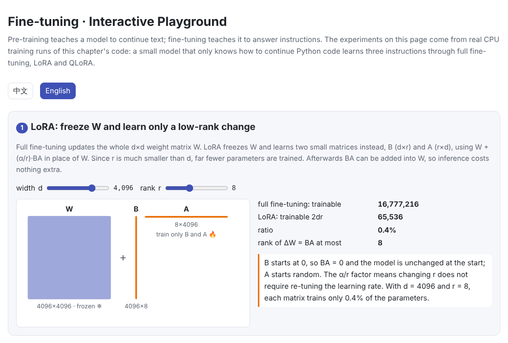
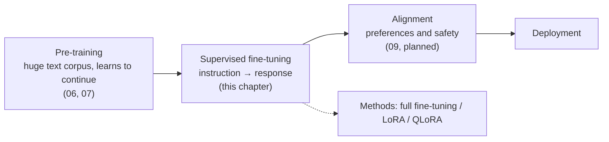
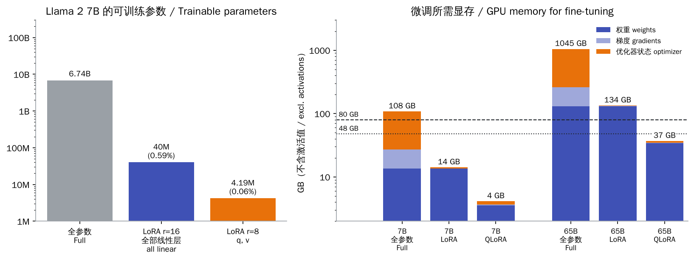
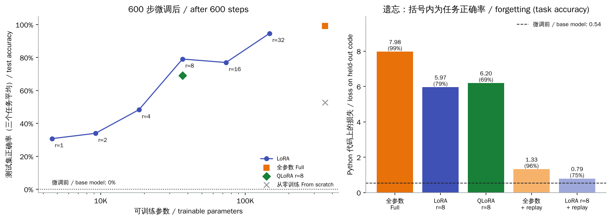
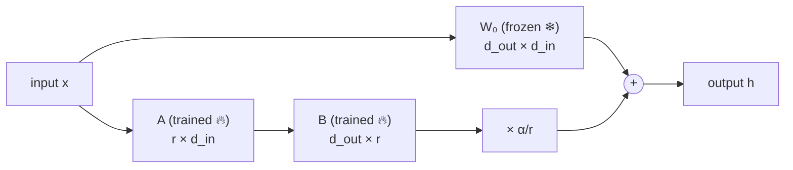
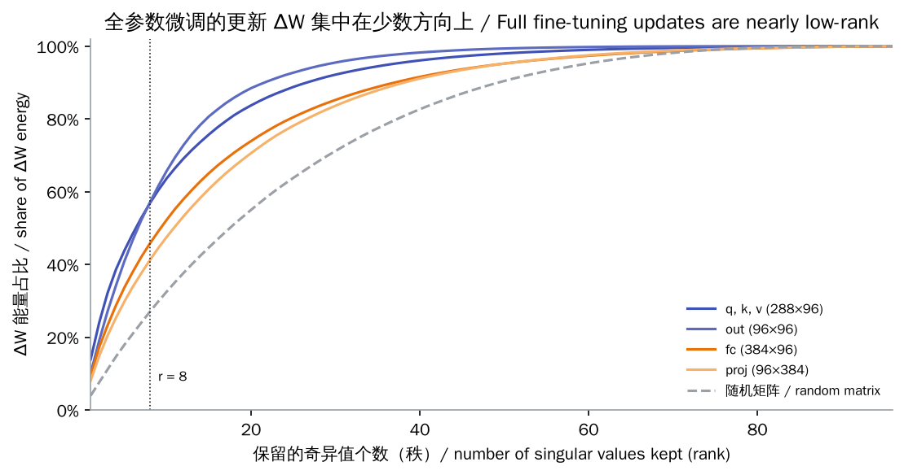
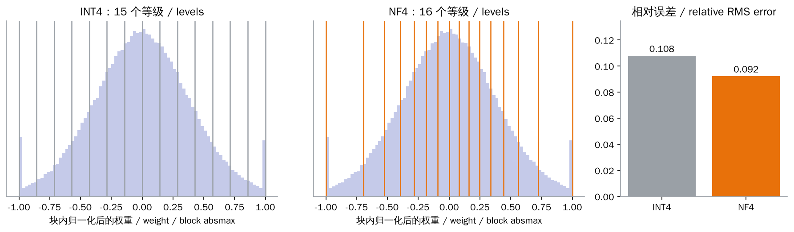

# Fine-tuning

> **In one sentence:** A pre-trained model only knows how to continue text. Fine-tuning keeps training it on a small, targeted dataset so it learns to answer instructions (supervised fine-tuning, SFT) or to adapt to a domain. Full fine-tuning works well but needs a lot of GPU memory. LoRA freezes the original weights and learns only a low-rank change, so it trains far fewer parameters and needs far less memory. QLoRA also squeezes the frozen weights into 4 bits, so a single GPU can fine-tune models with tens of billions of parameters. Whatever the method, watch out for catastrophic forgetting.
>
> 🌐 [中文版](README.md) · 🎮 **[Open the interactive playground](interactive/finetune.html?lang=en)** · 📓 [Notebook](08-finetuning.ipynb) ([open in Colab](https://colab.research.google.com/github/BaiYuBY/use_token_to_learn/blob/main/docs/08-finetuning/08-finetuning.ipynb))

[](interactive/finetune.html?lang=en)

**In this chapter you will learn:**

- What SFT data looks like: chat templates and loss masking
- Why full fine-tuning needs so much memory: about 16 bytes per parameter
- How LoRA works: low-rank factors, initialization, the scaling factor and merging
- How QLoRA saves more memory with the 4-bit NF4 format
- How full fine-tuning, LoRA and QLoRA compare in a CPU experiment you can run, how catastrophic forgetting shows up, and how replay reduces it

---

## 1. Intuition: from continuing to answering

The model from [06 Pre-training](../06-pretraining/README.en.md) has learned to predict the next token, that is, to continue text. Ask it a question and it usually does not answer; it treats the question as the start of a document and keeps writing. The base model in this chapter's experiment was pre-trained only on Python source code. Give it `Reverse: lambda` and it outputs `#`: to it, this looks like a line of code that should be followed by a comment.

**Fine-tuning** continues training a pre-trained model on a small, targeted dataset. The most common step is **supervised fine-tuning** (SFT, also called instruction tuning): collect many “instruction → ideal response” examples and teach the model to respond to instructions. Alignment usually follows (see 09 Alignment, planned).



Fine-tuning uses the same objective as pre-training (predict the next token) and the same training loop. What differs is the **data** (small, curated, in a fixed format) and the **scale** (usually orders of magnitude fewer tokens). The real difficulties are two:

1. **Memory**: fully fine-tuning a 7B model takes over a hundred GB of GPU memory, more than most people have.
2. **Forgetting**: train too hard on new data and the model loses what it could do before.

LoRA and QLoRA mainly address the first. This chapter's experiment shows that they do not automatically solve the second.

## 2. Pictures

Trainable parameters and memory for full fine-tuning, LoRA and QLoRA (using the Llama 2 7B and LLaMA 65B architectures):



This chapter's CPU experiment: a small model that only knows how to continue Python code learns three instructions by different methods. On the left, accuracy against trainable parameters; on the right, how much was forgotten:



> **🎮 Try it**
>
> In the [interactive playground](interactive/finetune.html?lang=en) you can:
>
> 1. Change the matrix width d and the rank r and see how many parameters LoRA saves
> 2. Drag r to approximate the real ΔW from this chapter's experiment with a low-rank matrix
> 3. Type any word and see the template and loss mask of an SFT example
> 4. Browse the results of this chapter's 39 real fine-tuning runs and compare each method's answers on unseen words
> 5. Use the memory calculator to see how many GPUs fine-tuning each Llama model needs
> 6. Compare NF4 and INT4 quantization error, change the block size and see the effect of outliers

## 3. How it works

### 3.1 SFT data: templates and loss masking

Each example is an instruction plus a response, joined into one piece of text by a fixed **template**. This chapter uses the Alpaca style:

```text
### Instruction:
Reverse: lambda
### Response:
adbmal
```

Real chat models each use their own **chat template**, with special tokens marking who is speaking in each turn, for example ChatML: `<|im_start|>user ... <|im_end|><|im_start|>assistant ...`. Inference must use the same template as training, or quality drops noticeably. Hugging Face tokenizers handle this with `apply_chat_template`.

The objective is still cross-entropy, but usually computed only on the **response** (**loss masking**):

$$
\mathcal{L} = -\frac{1}{|R|} \sum_{t \in R} \log p_\theta(x_t \mid x_{<t})
$$

where $R$ is the set of response positions (including the end marker). The prompt is still input that the model sees; it is just not asked to learn to generate it. The end marker is learned too: the model has to learn **when to stop**. In PyTorch, set the prompt's targets to `-100` and `F.cross_entropy` ignores them.

Data **quality** often matters more than quantity. LIMA (Zhou et al., 2023) fine-tuned a 65B model on just 1,000 carefully chosen examples and got strong conversational ability. The authors argue that a model's knowledge and abilities come mostly from pre-training, and SFT mainly teaches the format and style of answers.

### 3.2 The memory bill of full fine-tuning

With mixed-precision AdamW, every parameter needs:

| What | Precision | Bytes per parameter |
| --- | --- | --- |
| Weight | BF16 | 2 |
| Gradient | BF16 | 2 |
| Master weight (high-precision copy for the update) | FP32 | 4 |
| Adam's first and second moments $m, v$ | FP32 | 8 |
| **Total** | | **16** |

Llama 2 7B has 6.74 billion parameters, so full fine-tuning needs about 108 GB for these alone, before activations. That does not fit on an 80 GB A100 or H100. This is where parameter-efficient fine-tuning (PEFT) starts: **leave most parameters alone and train only a small fraction**.

### 3.3 LoRA: learn only a low-rank change

What fine-tuning learns is a change $\Delta W$ to the weights. LoRA (Hu et al., 2021) assumes this change has **low rank**, and writes it directly as the product of two small matrices:

$$
h = W_0 x + \frac{\alpha}{r} B A x, \qquad W_0 \in \mathbb{R}^{d_{\text{out}} \times d_{\text{in}}}\ \text{frozen},\quad B \in \mathbb{R}^{d_{\text{out}} \times r},\ A \in \mathbb{R}^{r \times d_{\text{in}}}
$$

- **Parameters**: each matrix trains only $r(d_{\text{in}} + d_{\text{out}})$ parameters. With $d = 4096$ and $r = 8$ that is 0.4% of the matrix.
- **Initialization**: $B = 0$ and $A$ random, so $BA = 0$ at the start and the model is exactly the original. $A$ must not also be 0, or $B$'s gradient is 0 and neither ever learns.
- **Scaling** $\alpha / r$: lets you change $r$ without re-tuning the learning rate. Common settings are $\alpha = 16$ or $\alpha = 2r$.
- **Merging**: after training, compute $W = W_0 + \frac{\alpha}{r} BA$ and swap in an ordinary linear layer, so **inference costs nothing extra**. Or keep them separate, so one base model can carry several LoRA adapters for different tasks.
- **Which layers**: the original paper applied LoRA only to attention's $W_q$ and $W_v$. The QLoRA paper found that matching full fine-tuning requires applying it to **all linear layers**, including the feed-forward network.



Why should low rank be enough? Aghajanyan et al. (2020) found that fine-tuning a large model within a very low-dimensional subspace gets close to full fine-tuning (the “intrinsic dimension” is low). This chapter also looks directly at the $\Delta W$ produced by full fine-tuning: its energy is clearly concentrated in a few directions, far more than for a random matrix:



Do not overstate it, though: on this chapter's tiny model, a rank-8 approximation keeps only about half of ΔW's energy, and LoRA needs a fairly large rank to approach full fine-tuning's accuracy (see 3.5).

On GPT-3 175B, the LoRA paper cut trainable parameters by about 10,000× and training memory by about 3×, with quality on par with full fine-tuning. Other parameter-efficient methods include Adapters (small networks inserted between layers), Prefix / Prompt Tuning (learning only a “virtual prompt”), and DoRA (updating a weight's magnitude and direction separately). LoRA is the most widely used because it is simple, mergeable and reliable.

### 3.4 QLoRA: store the frozen weights in 4 bits

With LoRA, most of the memory goes to **the frozen weights themselves** (about 13.5 GB for a 7B model in BF16). QLoRA (Dettmers et al., 2023) **quantizes** them to 4 bits for storage and dequantizes them to BF16 on the fly for each computation, while the LoRA part still trains in BF16:

1. **NF4 (4-bit NormalFloat)**: 4 bits can represent only 16 values. Weights are split into blocks of 64; each block is divided by its largest magnitude to fit in $[-1, 1]$, then each weight snaps to the nearest level. Neural-network weights are roughly normal, and NF4 places its 16 levels at quantiles of a normal distribution, denser near 0, so its error is lower than evenly spaced INT4. This chapter's code rebuilds the NF4 table from normal quantiles and it matches the values in bitsandbytes exactly.
2. **Double quantization**: each block stores an extra 32-bit scale, 0.5 extra bits per parameter on average. Quantizing those scales to 8 bits brings it down to about 0.127 bits.
3. **Paged optimizers**: when memory runs short, optimizer state is paged out to CPU memory, so an occasional memory spike does not crash training.



With this, a 65B model's weights take only about 34 GB. The QLoRA paper fine-tuned a 65B model on a single 48 GB GPU, matching 16-bit full fine-tuning.

### 3.5 This chapter's experiment

- **Base model**: a 3-layer, width-96 character-level GPT (about 360K parameters), pre-trained for 2,000 steps on the Python standard library's source; validation loss on code 0.54
- **Tasks**: three operations on a word: `Upper`, `Reverse` and `Length`. Words are lower-case identifiers from the source code, with no overlap between training, validation and test words
- **Methods**: full fine-tuning; LoRA ($r$ from 1 to 32, on the 4 linear layers of every block, $\alpha = 2r$); QLoRA ($r = 8$, base stored in this chapter's own NF4); and, for comparison, the same architecture trained from random weights
- **Fair comparison**: every method trains for 600 steps, with the best of 4 learning rates picked on validation accuracy, and accuracy is reported on 300 test words

Results (test set, mean of the three tasks):

| Method | Trainable parameters | Learning rate | Accuracy | Loss on code (0.54 before) |
| --- | --- | --- | --- | --- |
| Full fine-tuning | 357,216 | 0.003 | 99% | 7.98 |
| LoRA r=1 | 4,608 | 0.03 | 31% | 5.67 |
| LoRA r=2 | 9,216 | 0.01 | 34% | 5.98 |
| LoRA r=4 | 18,432 | 0.01 | 48% | 6.58 |
| LoRA r=8 | 36,864 | 0.01 | 79% | 5.97 |
| LoRA r=16 | 73,728 | 0.01 | 77% | 7.51 |
| LoRA r=32 | 147,456 | 0.003 | 95% | 5.47 |
| QLoRA r=8 | 36,864 | 0.01 | 69% | 6.20 |
| From scratch (control) | 357,216 | 0.003 | 53% | 8.61 |
| Full, no loss mask | 357,216 | 0.003 (reused) | 88% | 7.24 |
| Full + replay | 357,216 | 0.003 (reused) | 96% | 1.33 |
| LoRA r=8 + replay | 36,864 | 0.01 (reused) | 75% | 0.79 |

What we found:

1. **Pre-training helps a lot**: with the same architecture and steps, training from scratch reaches only 53%, against 99% from the pre-trained model.
2. **Higher rank broadly learns more**: LoRA's accuracy rises from 31% at $r = 1$ to 95% at $r = 32$ (not smoothly: $r = 16$ lands slightly below $r = 8$). The model is tiny (width 96), so at $r = 8$ LoRA's parameters are already 10% of the whole model, nothing like the under-1% share on large models.
3. **QLoRA is somewhat worse**: at $r = 8$, QLoRA reaches 69% and LoRA 79%. 4-bit quantization introduces error (in `lora.py`, a quantized linear layer's output differs from the original by about 9%), and a model this small may be more sensitive to it; the QLoRA paper reports parity with 16-bit fine-tuning on large models.
4. **Loss masking helps**: at the same learning rate, full fine-tuning without the mask reaches 88%, with it 99%.
5. **Severe forgetting, LoRA included**: after fine-tuning, loss on code rises from 0.54 to 7.98 (full) and 5.97 (LoRA $r = 8$). The model has nearly forgotten how to write code.
6. **Replay works well**: mixing 16 rows of pre-training text into every batch, full fine-tuning reaches 96% with a loss on code of only 1.33.

Finding 5 differs from some studies on large models: Biderman et al. (2024) found that on large models LoRA “learns less and forgets less”. This chapter's model is tiny, its fine-tuning data is completely unlike its pre-training data, and its LoRA share of parameters is much larger, so the two are not directly comparable. But it is a reminder that **training fewer parameters does not by itself prevent forgetting**. Also, each setting was run once with a single random seed, so differences of a few points (such as $r = 8$ versus $r = 16$) should not be over-read.

### 3.6 Catastrophic forgetting and what to do about it

Training on new data pushes the model towards doing only the new task well, and earlier abilities can be overwritten. This is **catastrophic forgetting**. Common remedies:

- **Mix the old data back in (replay)**: adding some pre-training or general instruction data to the fine-tuning set is the most direct and effective fix. InstructGPT also mixed pre-training gradients into its reinforcement-learning stage (PPO-ptx).
- **Train less**: a smaller learning rate, fewer steps. Part 4 of the interactive playground shows that a larger learning rate usually forgets more.
- **Parameter-efficient methods**: in some studies of large models LoRA forgets less (but also learns less); this chapter's small experiment did not show that advantage.
- **Switch adapters on demand**: if the LoRA is not merged, attach it only when needed and leave the base model untouched.

## 4. Minimal code

Full code: [`code/lora.py`](code/lora.py) (LoRA, QLoRA, NF4 and memory estimates; a few seconds) and [`code/sft.py`](code/sft.py) (a quick pre-training + SFT run; about a minute). The full experiment is in [`figures/finetune_figures.py`](figures/finetune_figures.py) and takes about 18 minutes on a laptop CPU.

A LoRA layer:

```python
class LoRALinear(nn.Module):
    def __init__(self, base: nn.Linear, r: int, alpha: float):
        super().__init__()
        self.base = base
        self.base.requires_grad_(False)                       # W is frozen
        self.r, self.scale = r, alpha / r
        self.A = nn.Parameter(torch.empty(r, base.in_features))
        self.B = nn.Parameter(torch.zeros(base.out_features, r))   # B = 0: start from the original model
        nn.init.kaiming_uniform_(self.A, a=math.sqrt(5))

    def forward(self, x):
        return self.base(x) + self.scale * (x @ self.A.T) @ self.B.T
```

The code also builds the same layer with PyTorch's own `torch.nn.utils.parametrize` and checks that both give the same outputs, and that merging leaves outputs unchanged.

An SFT example and its loss mask:

```python
prompt = TEMPLATE.format(task=task, word=word)
ids = corpus.encode(prompt + TASKS[task](word) + END)
x, y = ids[:-1], ids[1:]
y = [-100] * (len(prompt) - 1) + y[len(prompt) - 1:]     # the prompt is not in the loss
loss = F.cross_entropy(logits.flatten(0, 1), targets.flatten(), ignore_index=-100)
```

NF4 quantization:

```python
def quantize(weight, table, block=64):
    flat = weight.reshape(-1, block)
    absmax = flat.abs().amax(dim=1, keepdim=True)            # one scale per block
    codes = ((flat / absmax).unsqueeze(-1) - table).abs().argmin(dim=-1).to(torch.uint8)
    return codes, absmax
```

Real projects usually use Hugging Face's `peft` (LoRA) and `bitsandbytes` (4-bit quantization); the principles are the same as here.

## 5. Common misconceptions

- **“LoRA slows down inference”**: after training, $BA$ can be merged into $W$, and inference is identical to the original model.
- **“LoRA prevents forgetting”**: in this chapter's experiment, LoRA without replay forgot almost everything too.
- **“QLoRA produces a 4-bit model”**: only the frozen base is stored in 4 bits; the LoRA weights are 16-bit. For deployment they can be merged into the dequantized base.
- **“SFT reliably teaches new knowledge”**: SFT mainly teaches format and style. Fine-tuning in facts the model did not know works poorly and can increase hallucination (Gekhman et al., 2024).
- **“More fine-tuning data is always better”**: quality often matters more than quantity (LIMA), and low-quality data can teach bad habits.

## 6. Self-check

1. Fully fine-tuning a 13B model with mixed-precision AdamW needs roughly how much memory, excluding activations?
2. Why does LoRA initialize $B$ to 0 instead of setting both $A$ and $B$ to 0?
3. Adding LoRA with $r = 16$ to a matrix with $d_{\text{in}} = d_{\text{out}} = 4096$ trains what percentage of that matrix's parameters?

<details>
<summary>Answers</summary>

1. $13 \times 10^9 \times 16$ bytes ≈ 208 GB, so at least three 80 GB GPUs.
2. $B = 0$ makes training start from the original model. If $A$ were also 0, then $B$'s gradient (proportional to $Ax$) and $A$'s gradient (proportional to $B$) would both be 0, and the parameters would never change.
3. $16 \times (4096 + 4096) / 4096^2 \approx 0.78\%$.

</details>

## 7. Further reading

- Hu et al., 2021. [LoRA: Low-Rank Adaptation of Large Language Models](https://arxiv.org/abs/2106.09685)
- Dettmers et al., 2023. [QLoRA: Efficient Finetuning of Quantized LLMs](https://arxiv.org/abs/2305.14314)
- Aghajanyan et al., 2020. [Intrinsic Dimensionality Explains the Effectiveness of Language Model Fine-Tuning](https://arxiv.org/abs/2012.13255)
- Ouyang et al., 2022. [Training language models to follow instructions with human feedback](https://arxiv.org/abs/2203.02155) (InstructGPT)
- Taori et al., 2023. [Stanford Alpaca](https://github.com/tatsu-lab/stanford_alpaca) (the template style used here)
- Zhou et al., 2023. [LIMA: Less Is More for Alignment](https://arxiv.org/abs/2305.11206)
- Biderman et al., 2024. [LoRA Learns Less and Forgets Less](https://arxiv.org/abs/2405.09673)
- Gekhman et al., 2024. [Does Fine-Tuning LLMs on New Knowledge Encourage Hallucinations?](https://arxiv.org/abs/2405.05904)
- Houlsby et al., 2019. [Parameter-Efficient Transfer Learning for NLP](https://arxiv.org/abs/1902.00751) (Adapters)
- Liu et al., 2024. [DoRA: Weight-Decomposed Low-Rank Adaptation](https://arxiv.org/abs/2402.09353)
- Hugging Face. [PEFT](https://github.com/huggingface/peft) · [bitsandbytes](https://github.com/bitsandbytes-foundation/bitsandbytes)
