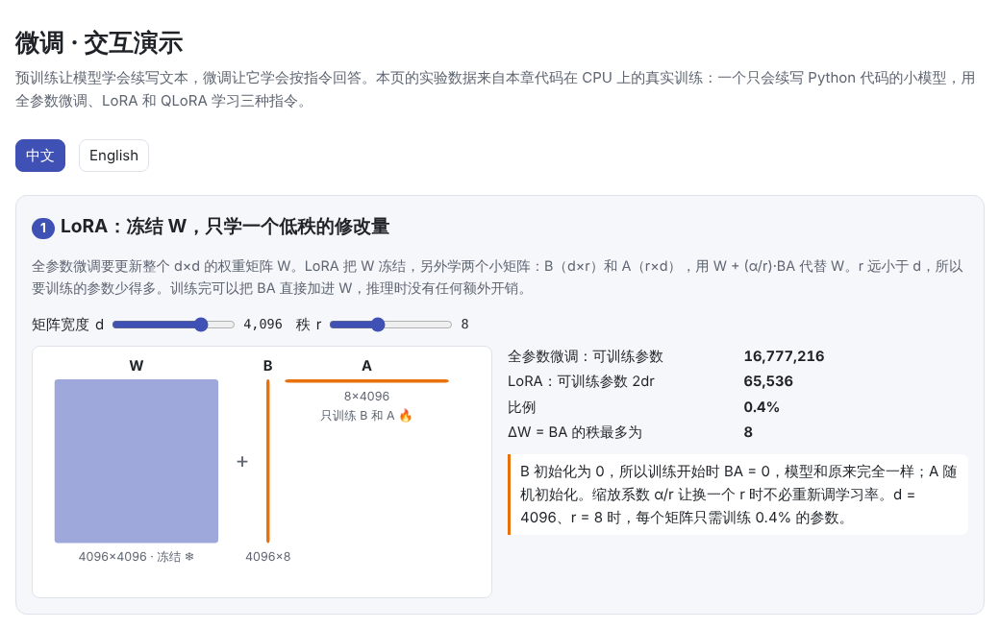
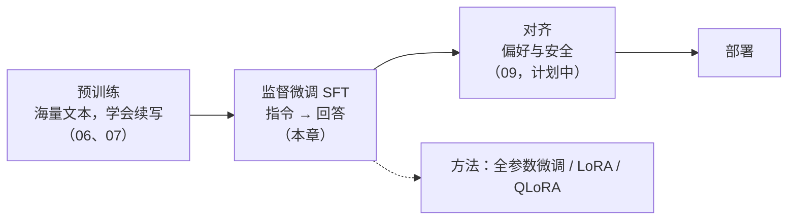
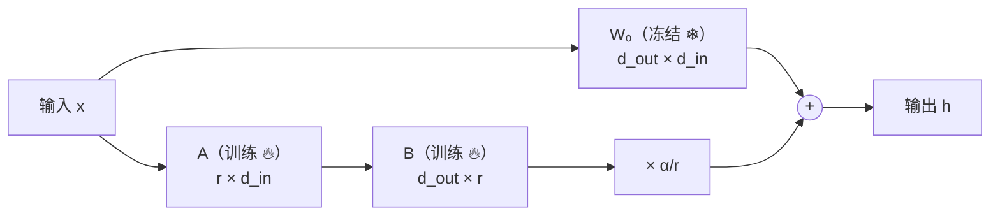

# 微调（Fine-tuning）

> **一句话总结：** 预训练出来的模型只会“接着写”。微调用少量有针对性的数据继续训练，让它学会按指令回答（监督微调，SFT），或者适应某个领域。全参数微调效果好，但非常费显存。LoRA 冻结原有权重，只学一个低秩的修改量，可训练参数和显存都少得多。QLoRA 再把冻结的权重压缩到 4 位，让一张卡也能微调几百亿参数的模型。无论用哪种方法，都要提防“灾难性遗忘”。
>
> 🌐 [English version](README.en.md) · 🎮 **[打开交互演示](interactive/finetune.html?lang=zh)** · 📓 [Notebook](08-finetuning.ipynb)（[在 Colab 中打开](https://colab.research.google.com/github/BaiYuBY/use_token_to_learn/blob/main/docs/08-finetuning/08-finetuning.ipynb)）

[](interactive/finetune.html?lang=zh)

**本章你将学会：**

- SFT 的数据长什么样：对话模板与损失掩码
- 为什么全参数微调这么费显存：每个参数约 16 字节
- LoRA 的原理：低秩分解、初始化、缩放系数与合并
- QLoRA 怎样用 4 位的 NF4 格式进一步节省显存
- 在 CPU 上亲手比较全参数微调、LoRA 和 QLoRA，观察灾难性遗忘，并用 replay 缓解它

---

## 1. 直觉：从“续写”到“回答”

[06 预训练](../06-pretraining/README.md)得到的模型学会了“预测下一个词元”，也就是续写。问它一个问题，它往往不会回答，而是把问题当成一段文本的开头接着写下去。本章实验里的底座模型只在 Python 源码上预训练过，给它 `Reverse: lambda`，它输出的是 `#`，因为在它看来，这像是一行代码，后面该接注释了。

**微调**（fine-tuning）就是在预训练模型的基础上，用少量有针对性的数据继续训练。最常见的一步是**监督微调**（SFT，也叫指令微调）：准备大量“指令 → 理想回答”的样本，让模型学会按指令作答。之后通常还有对齐（见 09 对齐，计划中）。



微调与预训练用的是同一个目标（预测下一个词元）、同一套训练循环，区别在于**数据**（少而精，格式固定）和**规模**（词元数通常小几个数量级）。真正的难点在于两件事：

1. **显存**：全参数微调一个 7B 模型就需要上百 GB 显存，普通人没有这样的硬件。
2. **遗忘**：在新数据上训练太猛，模型会忘掉原来会的东西。

LoRA 和 QLoRA 主要解决第一个问题，本章的实验会告诉你，它们并不能自动解决第二个问题。

## 2. 图解

全参数微调、LoRA、QLoRA 需要多少可训练参数和显存（按 Llama 2 7B 和 LLaMA 65B 的结构计算）：


本章在 CPU 上做的实验：一个只会续写 Python 代码的小模型，用不同方法学习三种指令。左图是正确率与可训练参数的关系，右图是遗忘程度：


> **🎮 动手试试**
>
> 在[交互演示](interactive/finetune.html?lang=zh)中，你可以：
>
> 1. 调整矩阵宽度 d 和秩 r，看 LoRA 省下多少参数
> 2. 拖动秩 r，用低秩矩阵逼近本章实验中真实的 ΔW
> 3. 输入任意单词，看 SFT 样本的模板和损失掩码
> 4. 浏览本章 39 次真实微调的结果，对比各方法在没见过的单词上的回答
> 5. 用显存计算器估算微调 Llama 各型号需要几张卡
> 6. 对比 NF4 与 INT4 的量化误差，调整块大小，看离群值的影响

## 3. 原理

### 3.1 SFT 的数据：模板与损失掩码

每条样本由指令和回答组成，按固定的**模板**拼成一段文本。本章用的是 Alpaca 风格：

```text
### Instruction:
Reverse: lambda
### Response:
adbmal
```

实际的对话模型用各自的**对话模板**（chat template），用特殊词元标出每一轮是谁在说话，例如 ChatML：`<|im_start|>user ... <|im_end|><|im_start|>assistant ...`。推理时必须使用与训练时相同的模板，否则效果会明显变差。Hugging Face 的分词器用 `apply_chat_template` 自动处理这件事。

训练目标仍然是交叉熵，但通常只在**回答部分**计算损失（**损失掩码**）：

$$
\mathcal{L} = -\frac{1}{|R|} \sum_{t \in R} \log p_\theta(x_t \mid x_{<t})
$$

其中 $R$ 是回答部分（包括结束符）的位置。提问部分仍然作为输入，模型能看到它，只是不要求模型学会生成它。结束符也要学：模型要学会**何时停下**。PyTorch 中只要把提问部分的目标设为 `-100`，`F.cross_entropy` 就会忽略它们。

数据的**质量**往往比数量更重要。LIMA（Zhou 等，2023）只用 1000 条精心挑选的样本微调 65B 模型，就得到了很好的对话能力。他们因此认为：模型的知识和能力主要来自预训练，SFT 主要教会它回答的格式和风格。

### 3.2 全参数微调的显存账

用混合精度 AdamW 训练时，每个参数要存：

| 内容 | 精度 | 字节/参数 |
| --- | --- | --- |
| 权重 | BF16 | 2 |
| 梯度 | BF16 | 2 |
| 主权重（更新时用的高精度副本） | FP32 | 4 |
| Adam 的一阶、二阶动量 $m, v$ | FP32 | 8 |
| **合计** | | **16** |

Llama 2 7B 有 67.4 亿参数，全参数微调光这些就要约 108 GB，还没算激活值。一张 80 GB 的 A100 或 H100 都放不下。这就是参数高效微调（PEFT）的出发点：**大部分参数不动，只训练很少一部分**。

### 3.3 LoRA：只学一个低秩的修改量

微调学到的，其实是权重的一个变化量 $\Delta W$。LoRA（Hu 等，2021）假设这个变化量是**低秩**的，于是直接把它写成两个小矩阵的乘积：

$$
h = W_0 x + \frac{\alpha}{r} B A x, \qquad W_0 \in \mathbb{R}^{d_{\text{out}} \times d_{\text{in}}}\ \text{冻结},\quad B \in \mathbb{R}^{d_{\text{out}} \times r},\ A \in \mathbb{R}^{r \times d_{\text{in}}}
$$

- **参数量**：每个矩阵只需训练 $r(d_{\text{in}} + d_{\text{out}})$ 个参数。$d = 4096$、$r = 8$ 时只有原矩阵的 0.4%。
- **初始化**：$B = 0$、$A$ 随机。这样训练开始时 $BA = 0$，模型与原来完全相同。$A$ 不能也是 0，否则 $B$ 的梯度为 0，两者都学不动。
- **缩放** $\alpha / r$：调整 $r$ 时不必重新调学习率。常见设置是 $\alpha = 16$ 或 $\alpha = 2r$。
- **合并**：训练完可以算出 $W = W_0 + \frac{\alpha}{r} BA$，换回普通的线性层，**推理时没有任何额外开销**。也可以不合并，让一个底座模型同时挂多个 LoRA，分别服务不同任务。
- **加在哪些层**：原论文只加在注意力的 $W_q$、$W_v$ 上。QLoRA 论文发现，要达到全参数微调的效果，需要加在**所有线性层**上（包括前馈网络）。



为什么低秩就够了？Aghajanyan 等（2020）发现，微调大模型时，只在一个很低维的子空间里优化，就能达到接近全参数微调的效果（“内在维度”很低）。本章也直接检查了全参数微调得到的 $\Delta W$：它的能量明显集中在少数几个方向上，比随机矩阵集中得多：


但也不要夸大这一点：在本章这个很小的模型上，秩为 8 的近似只保留了 ΔW 约一半的能量，LoRA 也需要较大的秩才接近全参数微调的正确率（见 3.5）。

LoRA 原论文在 GPT-3 175B 上，把可训练参数减少到约万分之一，训练显存减少到约三分之一，效果与全参数微调相当。其他参数高效方法还包括 Adapter（在层间插入小网络）、Prefix / Prompt Tuning（只学一段“虚拟提示”）、DoRA（把权重分成大小和方向分别更新）等。LoRA 因为简单、可合并、效果稳定而最为常用。

### 3.4 QLoRA：把冻结的权重压到 4 位

LoRA 之后，显存的大头变成了**冻结的权重本身**（7B 模型 BF16 约 13.5 GB）。QLoRA（Dettmers 等，2023）把它们**量化**成 4 位存储，计算时临时反量化回 BF16，LoRA 部分仍用 BF16 训练：

1. **NF4（4 位 NormalFloat）**：4 位只能表示 16 个值。量化时先把每 64 个权重分成一块，除以块内最大绝对值缩放到 $[-1, 1]$，再取最近的等级。神经网络的权重大致呈正态分布，NF4 把 16 个等级放在正态分布的分位点上，0 附近更密，误差比均匀的 INT4 小。本章代码从正态分位数重新算出了 NF4 表，与 bitsandbytes 中的数值完全一致。
2. **双重量化**：每块要多存一个 32 位的缩放常数，平均每个参数多 0.5 位。把这些常数再量化成 8 位，可以降到约 0.127 位。
3. **分页优化器**：显存不够时，把优化器状态临时换到 CPU 内存，避免偶发的显存峰值导致训练中断。


这样，65B 模型的权重只需约 34 GB。QLoRA 论文在一张 48 GB 的 GPU 上微调了 65B 模型，效果与 16 位全参数微调相当。

### 3.5 本章的实验

- **底座模型**：3 层、宽度 96 的字符级 GPT（约 36 万参数），在 Python 标准库源码上预训练 2000 步，代码上的验证损失为 0.54
- **任务**：对单词做三种操作：`Upper`（转大写）、`Reverse`（倒序）、`Length`（长度）。单词取自源码中的小写标识符，训练、验证、测试的单词互不重叠
- **方法**：全参数微调；LoRA（$r$ = 1 到 32，加在每层的 4 个线性层上，$\alpha = 2r$）；QLoRA（$r = 8$，底座用本章自己实现的 NF4）；作为对照，同样结构从随机权重开始训练
- **公平比较**：每种方法都训练 600 步，并从 4 个学习率中按验证集正确率挑出最好的，最后在 300 个测试单词上报告正确率

结果（测试集，三个任务平均）：

| 方法 | 可训练参数 | 学习率 | 正确率 | 代码上的损失（微调前 0.54） |
| --- | --- | --- | --- | --- |
| 全参数微调 | 357,216 | 0.003 | 99% | 7.98 |
| LoRA r=1 | 4,608 | 0.03 | 31% | 5.67 |
| LoRA r=2 | 9,216 | 0.01 | 34% | 5.98 |
| LoRA r=4 | 18,432 | 0.01 | 48% | 6.58 |
| LoRA r=8 | 36,864 | 0.01 | 79% | 5.97 |
| LoRA r=16 | 73,728 | 0.01 | 77% | 7.51 |
| LoRA r=32 | 147,456 | 0.003 | 95% | 5.47 |
| QLoRA r=8 | 36,864 | 0.01 | 69% | 6.20 |
| 从零训练（对照） | 357,216 | 0.003 | 53% | 8.61 |
| 全参数，不加损失掩码 | 357,216 | 0.003（沿用） | 88% | 7.24 |
| 全参数 + replay | 357,216 | 0.003（沿用） | 96% | 1.33 |
| LoRA r=8 + replay | 36,864 | 0.01（沿用） | 75% | 0.79 |

几点发现：

1. **预训练很有用**：同样的结构和步数，从零训练只有 53%，从预训练模型出发可以达到 99%。
2. **秩越大，大体上学得越多**：LoRA 的正确率从 $r = 1$ 的 31% 升到 $r = 32$ 的 95%（中间有波动，$r = 16$ 略低于 $r = 8$）。这个模型很小（宽度只有 96），$r = 8$ 时 LoRA 的参数已占全部参数的 10%，远不像大模型上那样只占不到 1%。
3. **QLoRA 稍差一些**：同样 $r = 8$，QLoRA 为 69%，LoRA 为 79%。4 位量化会引入误差（`lora.py` 中，一个量化后的线性层的输出与原层相差约 9%），这么小的模型可能对此更敏感；QLoRA 论文在大模型上报告的是与 16 位微调相当。
4. **损失掩码有帮助**：在同样的学习率下，不加掩码的全参数微调为 88%，加掩码为 99%。
5. **严重遗忘，LoRA 也不例外**：微调后代码上的损失从 0.54 升到 7.98（全参数）和 5.97（LoRA $r = 8$），模型几乎忘光了怎么写代码。
6. **replay 很有效**：每批额外混入 16 段预训练文本，全参数微调的正确率为 96%，代码上的损失只有 1.33。

第 5 点与一些大模型上的研究不同：Biderman 等（2024）发现，在大模型上 LoRA “学得少，也忘得少”。本章的模型极小、微调数据又与预训练数据完全不同，LoRA 的参数占比也高得多，所以不能直接类比。但它提醒我们：**少训练一些参数，并不能自动防止遗忘**。另外，每种设置只用一个随机种子跑了一次，相差几个百分点的结果（如 $r = 8$ 与 $r = 16$）不必过度解读。

### 3.6 灾难性遗忘与对策

在新数据上训练时，模型会朝着“只做好新任务”的方向调整，原来的能力可能被覆盖，这叫**灾难性遗忘**。常见的对策有：

- **混入原来的数据（replay）**：在微调数据中混入一部分预训练数据或通用指令数据，是最直接有效的方法。InstructGPT 在强化学习阶段也混入了预训练数据的梯度（PPO-ptx）。
- **少训练一点**：更小的学习率、更少的步数。本章交互演示第 4 节可以看到，学习率越大，通常忘得越多。
- **参数高效方法**：在一些大模型研究中，LoRA 遗忘较少（但也学得较少），本章的小实验没有看到这个优势。
- **按需切换**：LoRA 不合并时，可以只在需要时挂上适配器，底座模型保持不变。

## 4. 最小代码实现

完整代码在 [`code/lora.py`](code/lora.py)（LoRA、QLoRA、NF4 与显存估算，几秒）和 [`code/sft.py`](code/sft.py)（预训练 + SFT 快速版，约 1 分钟）。完整实验在 [`figures/finetune_figures.py`](figures/finetune_figures.py) 中，在笔记本 CPU 上约需 18 分钟。

LoRA 层：

```python
class LoRALinear(nn.Module):
    def __init__(self, base: nn.Linear, r: int, alpha: float):
        super().__init__()
        self.base = base
        self.base.requires_grad_(False)                       # W 冻结
        self.r, self.scale = r, alpha / r
        self.A = nn.Parameter(torch.empty(r, base.in_features))
        self.B = nn.Parameter(torch.zeros(base.out_features, r))   # B = 0：起点与原模型相同
        nn.init.kaiming_uniform_(self.A, a=math.sqrt(5))

    def forward(self, x):
        return self.base(x) + self.scale * (x @ self.A.T) @ self.B.T
```

代码中还用 PyTorch 自带的 `torch.nn.utils.parametrize` 实现了同样的层，并验证两者输出一致、合并后输出不变。

SFT 样本与损失掩码：

```python
prompt = TEMPLATE.format(task=task, word=word)
ids = corpus.encode(prompt + TASKS[task](word) + END)
x, y = ids[:-1], ids[1:]
y = [-100] * (len(prompt) - 1) + y[len(prompt) - 1:]     # 提问部分不计入损失
loss = F.cross_entropy(logits.flatten(0, 1), targets.flatten(), ignore_index=-100)
```

NF4 量化：

```python
def quantize(weight, table, block=64):
    flat = weight.reshape(-1, block)
    absmax = flat.abs().amax(dim=1, keepdim=True)            # 每块一个缩放常数
    codes = ((flat / absmax).unsqueeze(-1) - table).abs().argmin(dim=-1).to(torch.uint8)
    return codes, absmax
```

实际项目中通常使用 Hugging Face 的 `peft`（LoRA）和 `bitsandbytes`（4 位量化），原理与这里相同。

## 5. 常见误区

- **“LoRA 会让推理变慢”**：训练完可以把 $BA$ 合并进 $W$，推理时与原模型完全相同。
- **“LoRA 能防止遗忘”**：本章实验中，不加 replay 时 LoRA 也几乎忘光了原来的能力。
- **“QLoRA 训练出的是 4 位模型”**：只有冻结的底座以 4 位存储，LoRA 权重是 16 位的；部署时可以合并到反量化后的底座上。
- **“SFT 能可靠地教会模型新知识”**：SFT 主要教格式和风格。用微调灌输模型原本不知道的事实效果有限，还可能增加幻觉（Gekhman 等，2024）。
- **“微调数据越多越好”**：质量往往比数量更重要（LIMA），低质量数据反而会教坏模型。

## 6. 自测题

1. 一个 13B 模型用混合精度 AdamW 全参数微调，不算激活值大约需要多少显存？
2. LoRA 为什么把 $B$ 初始化为 0，而不是把 $A$ 和 $B$ 都初始化为 0？
3. 在 $d_{\text{in}} = d_{\text{out}} = 4096$ 的矩阵上加 $r = 16$ 的 LoRA，可训练参数是原矩阵的百分之几？

<details>
<summary>参考答案</summary>

1. $13 \times 10^9 \times 16$ 字节 ≈ 208 GB，至少需要 3 张 80 GB 的卡。
2. $B = 0$ 让训练从原模型出发。如果 $A$ 也是 0，那么 $B$ 的梯度（正比于 $Ax$）和 $A$ 的梯度（正比于 $B$）都为 0，参数永远不会更新。
3. $16 \times (4096 + 4096) / 4096^2 \approx 0.78\%$。

</details>

## 7. 延伸阅读

- Hu et al., 2021. [LoRA: Low-Rank Adaptation of Large Language Models](https://arxiv.org/abs/2106.09685)
- Dettmers et al., 2023. [QLoRA: Efficient Finetuning of Quantized LLMs](https://arxiv.org/abs/2305.14314)
- Aghajanyan et al., 2020. [Intrinsic Dimensionality Explains the Effectiveness of Language Model Fine-Tuning](https://arxiv.org/abs/2012.13255)
- Ouyang et al., 2022. [Training language models to follow instructions with human feedback](https://arxiv.org/abs/2203.02155)（InstructGPT）
- Taori et al., 2023. [Stanford Alpaca](https://github.com/tatsu-lab/stanford_alpaca)（本章使用的模板风格）
- Zhou et al., 2023. [LIMA: Less Is More for Alignment](https://arxiv.org/abs/2305.11206)
- Biderman et al., 2024. [LoRA Learns Less and Forgets Less](https://arxiv.org/abs/2405.09673)
- Gekhman et al., 2024. [Does Fine-Tuning LLMs on New Knowledge Encourage Hallucinations?](https://arxiv.org/abs/2405.05904)
- Houlsby et al., 2019. [Parameter-Efficient Transfer Learning for NLP](https://arxiv.org/abs/1902.00751)（Adapter）
- Liu et al., 2024. [DoRA: Weight-Decomposed Low-Rank Adaptation](https://arxiv.org/abs/2402.09353)
- Hugging Face. [PEFT](https://github.com/huggingface/peft) · [bitsandbytes](https://github.com/bitsandbytes-foundation/bitsandbytes)
