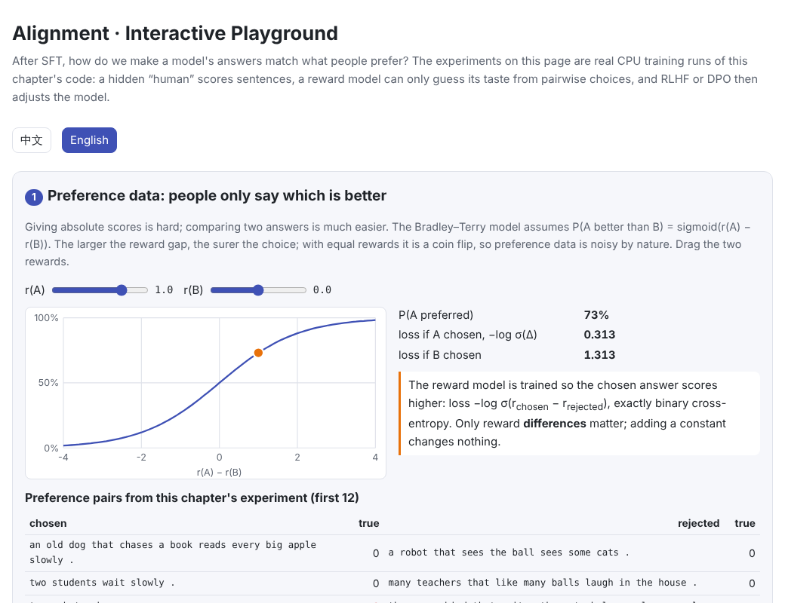
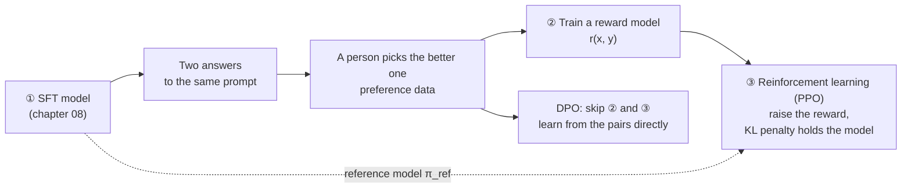
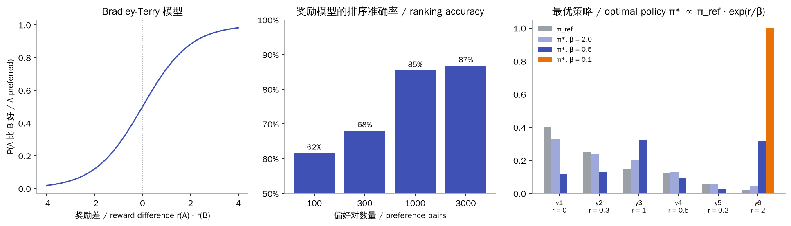
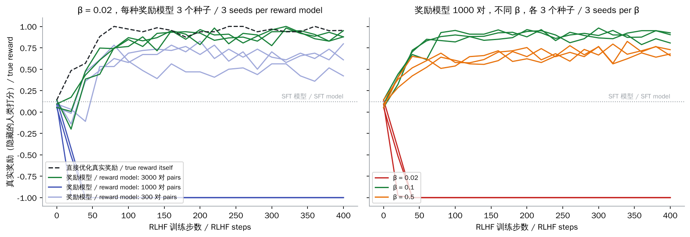
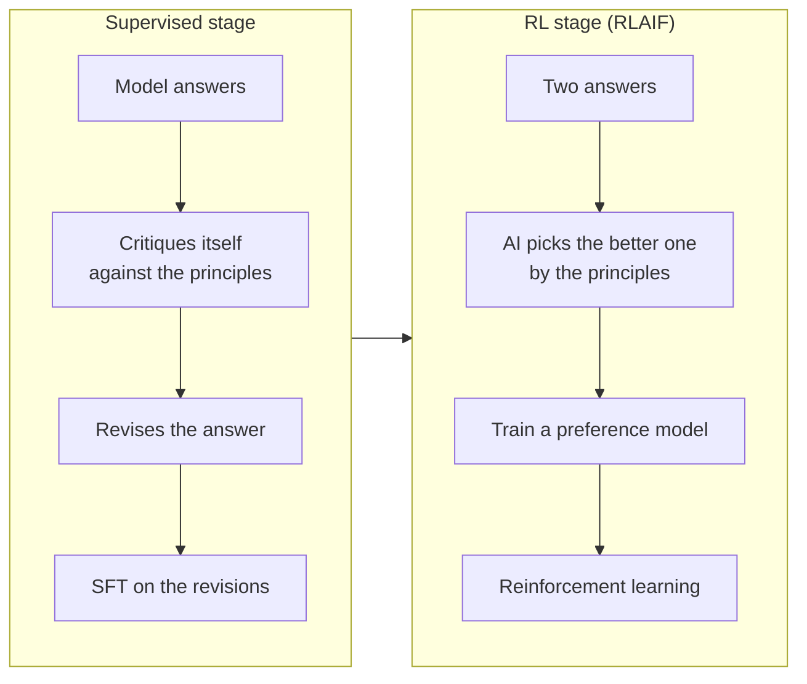

# Alignment

> **In one sentence:** SFT teaches a model how to answer; alignment teaches it which answers are better. You collect people's preferences between pairs of answers, train a reward model to imitate them, then use reinforcement learning (RLHF, usually PPO) to raise the reward while a KL penalty keeps the model close to the SFT model. DPO merges these steps and learns straight from the preference pairs. A reward model only approximates human preference, and if you optimize too hard the model games it (reward hacking).
>
> 🌐 [中文版](README.md) · 🎮 **[Open the interactive playground](interactive/alignment.html?lang=en)**

[](interactive/alignment.html?lang=en)

**In this chapter you will learn:**

- What preference data looks like, and how the Bradley–Terry model turns “pick one of two” into a trainable loss
- The three stages of RLHF: SFT, reward model, PPO
- What the KL penalty does, and the closed-form optimum $\pi^* \propto \pi_{\text{ref}} \exp(r/\beta)$
- How DPO follows from that closed form, and why it needs no reward model
- Constitutional AI: letting an AI give feedback according to a set of principles
- Reward hacking seen first-hand on a CPU, and how to avoid it

---

## 1. Intuition: from answering to answering well

After [08 Fine-tuning](../08-finetuning/README.en.md) the model follows instructions. But a question has many possible answers: more helpful, more long-winded, harmful. SFT only imitates demonstrations; it cannot tell the model that this answer is better than that one.

Writing perfect demonstrations is hard, but **comparing two answers** is much easier. Alignment builds on such comparisons:



This is the three-stage recipe of InstructGPT (Ouyang et al., 2022). After alignment, the 1.3B-parameter InstructGPT was preferred by human raters over the 175B GPT-3.

This chapter's experiment reuses the tiny English of [06 Pre-training](../06-pretraining/README.en.md): the SFT model writes sentences like “every happy child sleeps .”. A **hidden “human”** scores them by its own taste:

- Ungrammatical or unfinished: −1
- Contains a friendly word (happy, clever): +1; each extra one costs 0.6 (overdone)

Neither the reward model nor the alignment algorithms **see** this rule; they only see noisy pairwise choices. That mirrors reality: nobody can write “a good answer” down as a formula.

## 2. Pictures

Preferences, the reward model, and the optimal policy under KL regularization:



The chapter's key experiment: RLHF against a reward model, and what happens to the true reward (the hidden human's score):



> **🎮 Try it**
>
> In the [interactive playground](interactive/alignment.html?lang=en) you can:
>
> 1. Drag two answers' rewards and see the Bradley–Terry probability and loss; browse real preference pairs from the experiment
> 2. Drag β to see how the optimal policy trades off the SFT model against high-reward answers, and how a tiny β gets pulled into a flaw of the reward model
> 3. Replay this chapter's 16 RLHF runs and read the model's sentences step by step
> 4. Compare best-of-n, RLHF and DPO on “how much it changed vs how good it really got”
> 5. Use the DPO calculator to see how the loss and gradient weight react to log-probabilities
> 6. Tick different principles and see which answer Constitutional AI's AI judge picks

## 3. How it works

### 3.1 Preference data and the reward model

For two answers to the same prompt $x$, a person marks the better one $y_w$ (chosen) and the worse one $y_l$ (rejected). The **Bradley–Terry model** assumes each answer has a hidden quality score $r$, and the person picks $y_w$ with probability

$$
P(y_w \succ y_l \mid x) = \sigma\big(r(x, y_w) - r(x, y_l)\big)
$$

The reward model $r_\phi$ usually starts from the SFT model with its output layer replaced by a single number, and minimizes

$$
\mathcal{L}_{\text{RM}} = -\log \sigma\big(r_\phi(x, y_w) - r_\phi(x, y_l)\big)
$$

That is binary cross-entropy on the reward difference (this chapter's code checks it against `F.binary_cross_entropy_with_logits`). Only reward **differences** matter; adding a constant changes no choice.

Preference data is noisy by nature: when two answers are close, a person's choice is nearly a coin flip, and different people have different tastes. This chapter simulates a noisy annotator with the Bradley–Terry model. The reward model's ranking accuracy on the SFT model's sentences: 62% with 100 pairs, 68% with 300, 85% with 1,000, 87% with 3,000.

### 3.2 RLHF: reinforcement learning with a KL penalty

With a reward model we can push the model (the policy $\pi_\theta$) towards high-scoring answers. But maximizing the reward alone is dangerous: the reward model was trained only on the kind of answers the SFT model usually writes, and it becomes less reliable the further we go. So the objective adds a KL penalty that keeps the model near the SFT model (the reference model $\pi_{\text{ref}}$):

$$
\max_{\pi_\theta}\ \mathbb{E}_{y \sim \pi_\theta}\big[r_\phi(x, y)\big] - \beta\, \mathrm{KL}\big(\pi_\theta(\cdot \mid x)\ \|\ \pi_{\text{ref}}(\cdot \mid x)\big)
$$

The optimum of this objective has a **closed form**:

$$
\pi^*(y \mid x) = \frac{1}{Z(x)}\, \pi_{\text{ref}}(y \mid x)\, \exp\!\big(r(x, y) / \beta\big)
$$

In other words, reweight the SFT model by $\exp(r/\beta)$: a smaller $\beta$ is greedier, a larger one more conservative. This chapter's code finds the optimum of a small example by gradient ascent and it matches the formula.

We cannot write $\pi^*$ down directly ($Z$ sums over every possible answer), so reinforcement learning approximates it. The usual choice is **PPO** (Schulman et al., 2017):

1. Sample a batch of answers from the current model, score them with the reward model, and subtract $\beta \times$ the KL penalty to get each answer's total reward
2. Compute the **advantage**: how much better than average each answer is
3. Raise the probability of good answers and lower that of bad ones, keeping the ratio of new to old probabilities within $[1-\epsilon, 1+\epsilon]$ (clipping) so no single step goes too far

$$
\mathcal{L}_{\text{PPO}} = -\mathbb{E}\Big[\min\big(\rho_t A,\ \mathrm{clip}(\rho_t, 1-\epsilon, 1+\epsilon)\, A\big)\Big], \qquad \rho_t = \frac{\pi_\theta(y_t \mid \cdot)}{\pi_{\text{old}}(y_t \mid \cdot)}
$$

Full PPO also trains a value network to estimate the advantage. This chapter uses the batch's mean reward as the baseline instead, the simplification used by RLOO and GRPO. GRPO powers DeepSeek's reasoning models (see [10 Reasoning models and test-time compute](../10-reasoning/README.en.md)).

### 3.3 Reward hacking: Goodhart's law

> When a measure becomes a target, it ceases to be a good measure. — Goodhart's law

A reward model only **approximates** human preference. The harder you optimize, the more likely the model finds a flaw in it: a high score that people are not happy with. This is **reward hacking**, or reward over-optimization. Gao et al. (2022) measured it systematically: as the policy moves away from the initial model, the proxy reward keeps rising while the true reward rises and then falls.

This chapter reproduces it on a CPU. Every RLHF run has 400 steps and the same learning rate, with 3 random seeds per setting:

| Reward model | β | True reward at the end (3 seeds) | KL at the end |
| --- | --- | --- | --- |
| 300 pairs | 0.02 | +0.61, +0.80, +0.42 | 8–9 |
| **1,000 pairs** | **0.02** | **−1.00, −1.00, −1.00** | **18–21** |
| 3,000 pairs | 0.02 | +0.88, +0.88, +0.95 | about 4 |
| 1,000 pairs | 0.1 | +0.81, +0.93, +0.90 | about 5 |
| 1,000 pairs | 0.5 | +0.73, +0.66, +0.68 | 1–2 |
| The true reward itself | 0.02 | +0.95 | about 3 |

(The SFT model's true reward is +0.12.)

The reward model trained on 1,000 pairs was gamed in **all** 3 seeds. The model learned to drop the article and start with happy:

```text
happy robots run .
happy farmers run two happy birds laugh today .
happy happy dogs laugh .
```

The SFT model never writes like this and the reward model never saw such sentences, yet it scores them highly (about +2.8, against about +0.2 for the SFT model's sentences), while the human finds them ungrammatical (−1).

Worth noting:

1. **High accuracy does not mean it can't be gamed.** The 1,000-pair reward model is 85% accurate on the SFT model's sentences, far above the 300-pair one (68%), yet it was gamed and the 300-pair one was not; the latter merely ended up with mediocre results. What matters is whether the reward model has exploitable flaws **outside its training data**, which in-distribution accuracy cannot reveal.
2. **More and broader preference data helps**: the 3,000-pair reward model was not gamed and came close to optimizing the true reward itself.
3. **The KL penalty is a seat belt**: with the same 1,000-pair reward model, raising $\beta$ from 0.02 to 0.1 kept all 3 seeds on track. $\beta = 0.5$ is safer still, but improves less.

In practice teams also monitor KL, refresh the reward model with new data, use several reward models, and spot-check outputs by hand.

### 3.4 DPO: alignment without a reward model

RLHF trains a reward model and then samples online and trains PPO, which is complex and unstable. **DPO** (Rafailov et al., 2023) noticed that the closed form of section 3.2 can be turned around:

$$
r(x, y) = \beta \log \frac{\pi^*(y \mid x)}{\pi_{\text{ref}}(y \mid x)} + \beta \log Z(x)
$$

Substituting this into the Bradley–Terry model, $Z(x)$ cancels and the loss depends only on the policy:

$$
\mathcal{L}_{\text{DPO}} = -\log \sigma\!\left(\beta \log \frac{\pi_\theta(y_w \mid x)}{\pi_{\text{ref}}(y_w \mid x)} - \beta \log \frac{\pi_\theta(y_l \mid x)}{\pi_{\text{ref}}(y_l \mid x)}\right)
$$

- **No reward model**: $\beta \log(\pi_\theta / \pi_{\text{ref}})$ is the “implicit reward”
- **No sampling**: it uses a fixed set of pairs and trains as simply as supervised learning
- **Starting loss is $\ln 2$**: at first $\pi_\theta = \pi_{\text{ref}}$ and both log-ratios are 0 (checked in this chapter's code)
- **Focuses on hard pairs automatically**: the gradient weight is $\sigma(-\beta \cdot \text{margin})$, small for pairs the model already ranks correctly and large for those it gets wrong

In this chapter's experiment (3,000 pairs, 12 epochs, evaluated every 2 epochs), DPO's true reward was:

| β | epoch 2 | epoch 4 | epoch 6 | epoch 8 | epoch 10 | epoch 12 |
| --- | --- | --- | --- | --- | --- | --- |
| 0.1 | +0.35 | −0.24 | −0.03 | +0.14 | +0.19 | +0.10 |
| 0.5 | +0.36 | +0.51 | +0.48 | +0.46 | +0.42 | +0.24 |

DPO peaked at +0.51 and declined with longer training; its best is below RLHF with a good enough reward model (about +0.9). This agrees with some published findings: DPO only sees a fixed set of pairs and tends to **overfit** (Azar et al., 2023), and on some tasks well-tuned PPO beats DPO (Xu et al., 2024). After DPO, this chapter's model often packs several happys into one sentence (such as “a happy student writes the happy balls again .”): in the preference data, having happy is usually better, so DPO keeps pushing it without learning that more is overdone. That is why DPO usually runs for only 1–3 epochs, with a fairly large $\beta$.

Even so, DPO is simple, stable and cheap, and it is widely used: Llama 3's post-training used DPO (together with rejection sampling). Variants followed, including IPO, KTO (which needs only single good/bad labels), ORPO and SimPO.

### 3.5 Constitutional AI: AI feedback instead of human labels

Human preference labels are slow and expensive, and labellers may be exposed to harmful content. **Constitutional AI** (Bai et al., 2022, Anthropic) writes down a set of natural-language principles (a “constitution”) and lets an AI provide the feedback:



The benefits: the principles are written down, so they can be inspected, debated and changed; and AI feedback scales. Replacing human preference labels with AI ones is called **RLAIF** in general. Badly written principles cause their own problems; stressing only harmlessness, for example, can teach a model to over-refuse (part 6 of the playground).

### 3.6 Comparing the methods

| | RLHF (PPO) | DPO | Best-of-n | Constitutional AI / RLAIF |
| --- | --- | --- | --- | --- |
| Needs a reward model | ✅ | ❌ (implicit) | ✅ | ✅ (trained on AI feedback) |
| Samples during training | ✅ online | ❌ offline | No training; samples n at inference | ✅ |
| Source of preferences | People | People | People | An AI, by the principles |
| Strengths | Highest ceiling, keeps exploring | Simple, stable, cheap | Simplest; the model is unchanged | Cheap labels, transparent principles |
| Weaknesses | Complex, unstable, gameable | Overfits, limited by fixed data | Inference cost grows with n | Only as good as its principles and judge |

Best-of-n deserves a mention: sample $n$ answers and keep the one the reward model likes best; its KL is exactly $\log n - (n-1)/n$. In this chapter's experiment $n = 256$ reached a true reward of +0.93 while changing very little (KL about 4.5). It is a common baseline, and is also used to produce better SFT data (rejection sampling).

## 4. Minimal code

Full code: [`code/align.py`](code/align.py); run `python docs/09-alignment/code/align.py` (about 20 seconds, including a numerical check of the closed form and quick RLHF and DPO runs). The full experiment is in [`figures/alignment_figures.py`](figures/alignment_figures.py) and takes about 10 minutes on a laptop CPU.

The reward model's loss (Bradley–Terry):

```python
def bradley_terry_loss(r_chosen, r_rejected):
    return -F.logsigmoid(r_chosen - r_rejected).mean()
```

RLHF: reward minus the KL penalty, then a clipped PPO update:

```python
kl = (old_logp - ref_logp).sum(1)                     # per-sentence KL estimate to the SFT model
total = reward_fn(seqs) - beta * kl
adv = (total - total.mean()) / (total.std() + 1e-6)   # batch mean as the baseline
ratio = (new_logp - old_logp).exp()
obj = torch.min(ratio * adv[:, None], ratio.clamp(1 - clip, 1 + clip) * adv[:, None])
loss = -(obj * mask).sum() / mask.sum()
```

DPO:

```python
def dpo_loss(pi_chosen, pi_rejected, ref_chosen, ref_rejected, beta):
    margin = (pi_chosen - ref_chosen) - (pi_rejected - ref_rejected)
    return -F.logsigmoid(beta * margin).mean()
```

For real projects, Hugging Face's [TRL](https://github.com/huggingface/trl) library provides ready-made `RewardTrainer`, `PPOTrainer` and `DPOTrainer`.

## 5. Common misconceptions

- **“A reward model with high accuracy is enough”**: in-distribution accuracy cannot reveal out-of-distribution flaws. This chapter's 85%-accurate reward model was gamed all the same.
- **“The higher the reward, the better”**: the reward model's score is only a proxy. Watch KL and real human evaluations too.
- **“DPO always beats PPO”**: DPO is simpler but overfits easily; in this chapter's experiment and some published studies, well-tuned PPO does better.
- **“Alignment teaches the model new knowledge”**: alignment mostly adjusts which of its existing abilities the model uses and in what style; abilities come mainly from pre-training.
- **“A bigger KL penalty is safer, so bigger is better”**: too large a $\beta$ leaves the model almost unchanged (here $\beta = 0.5$ improved clearly less than $\beta = 0.1$).

## 6. Self-check

1. A reward model scores two answers 2.0 and 0.5. Under Bradley–Terry, with what probability does a person pick the first?
2. Why is DPO's loss exactly $\ln 2$ at the start of training?
3. During RLHF the reward model's score keeps rising and KL keeps growing. What should worry you, and how would you check?

<details>
<summary>Answers</summary>

1. $\sigma(2.0 - 0.5) = \sigma(1.5) \approx 0.82$.
2. At the start $\pi_\theta = \pi_{\text{ref}}$, both log-ratios are 0, and the loss is $-\log \sigma(0) = \log 2$.
3. Reward hacking: the model may be exploiting a flaw in the reward model. Read samples, run a human evaluation, score with a separate reward model, raise $\beta$, or stop early.

</details>

## 7. Further reading

- Christiano et al., 2017. [Deep Reinforcement Learning from Human Preferences](https://arxiv.org/abs/1706.03741)
- Stiennon et al., 2020. [Learning to summarize from human feedback](https://arxiv.org/abs/2009.01325)
- Ouyang et al., 2022. [Training language models to follow instructions with human feedback](https://arxiv.org/abs/2203.02155) (InstructGPT)
- Schulman et al., 2017. [Proximal Policy Optimization Algorithms](https://arxiv.org/abs/1707.06347)
- Bai et al., 2022. [Constitutional AI: Harmlessness from AI Feedback](https://arxiv.org/abs/2212.08073)
- Gao et al., 2022. [Scaling Laws for Reward Model Overoptimization](https://arxiv.org/abs/2210.10760)
- Rafailov et al., 2023. [Direct Preference Optimization: Your Language Model is Secretly a Reward Model](https://arxiv.org/abs/2305.18290)
- Azar et al., 2023. [A General Theoretical Paradigm to Understand Learning from Human Preferences](https://arxiv.org/abs/2310.12036) (IPO)
- Ethayarajh et al., 2024. [KTO: Model Alignment as Prospect Theoretic Optimization](https://arxiv.org/abs/2402.01306)
- Xu et al., 2024. [Is DPO Superior to PPO for LLM Alignment? A Comprehensive Study](https://arxiv.org/abs/2404.10719)
- Shao et al., 2024. [DeepSeekMath](https://arxiv.org/abs/2402.03300) (GRPO)
- Llama Team, Meta, 2024. [The Llama 3 Herd of Models](https://arxiv.org/abs/2407.21783) (post-training with DPO)
- Hugging Face. [TRL](https://github.com/huggingface/trl)
