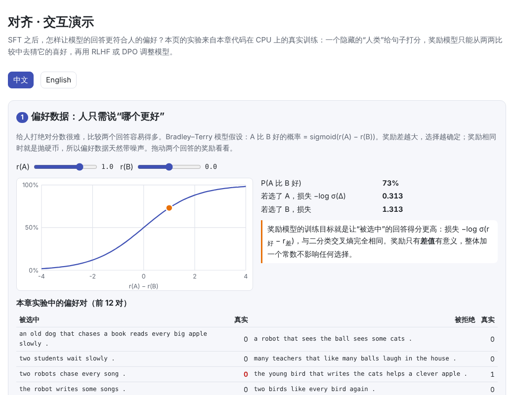
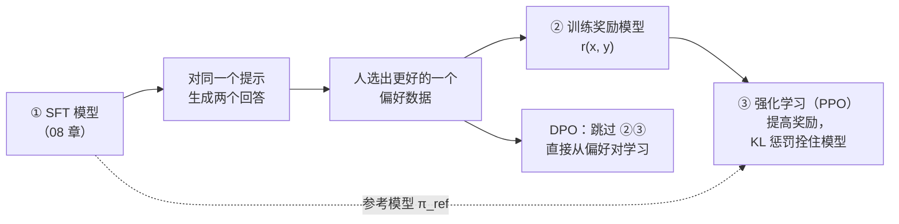
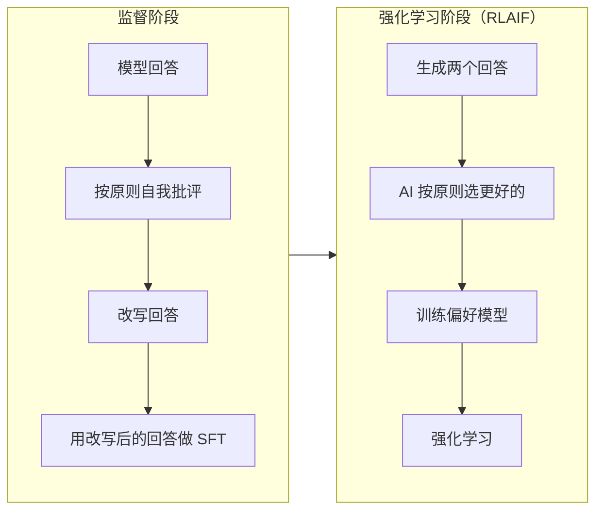

# 对齐（Alignment）

> **一句话总结：** SFT 教会模型“怎么回答”，对齐教它“哪种回答更好”。做法是收集人对两个回答的偏好，训练一个奖励模型去模仿这种偏好，再用强化学习（RLHF，常用 PPO）提高奖励，同时用 KL 惩罚把模型拴在 SFT 模型附近。DPO 把这两步合成一步，直接从偏好对学习。奖励模型只是人类偏好的近似，优化得太狠，模型会钻它的空子（奖励黑客）。
>
> 🌐 [English version](README.en.md) · 🎮 **[打开交互演示](interactive/alignment.html?lang=zh)** · 📓 [Notebook](09-alignment.ipynb)（[在 Colab 中打开](https://colab.research.google.com/github/BaiYuBY/use_token_to_learn/blob/main/docs/09-alignment/09-alignment.ipynb)）

[](interactive/alignment.html?lang=zh)

**本章你将学会：**

- 偏好数据长什么样，以及 Bradley–Terry 模型怎样把“二选一”变成可训练的损失
- RLHF 的三个阶段：SFT、奖励模型、PPO
- KL 惩罚的作用，以及最优策略的闭式解 $\pi^* \propto \pi_{\text{ref}} \exp(r/\beta)$
- DPO 怎样从这个闭式解推出来，为什么不需要奖励模型
- Constitutional AI：用一组原则让 AI 代替人给反馈
- 在 CPU 上亲眼看到“奖励黑客”，以及怎样避免它

---

## 1. 直觉：从“会回答”到“答得好”

[08 微调](../08-finetuning/README.md)之后，模型学会了按指令回答。但同一个问题可以有很多种回答：有的更有帮助，有的更啰嗦，有的有害。SFT 只是模仿示范数据，没法直接告诉模型“这个比那个好”。

让人写出完美的示范回答很难，但让人**比较两个回答哪个更好**要容易得多。对齐就是利用这种比较：



这正是 InstructGPT（Ouyang 等，2022）的三阶段流程。经过对齐，1.3B 参数的 InstructGPT 在人工评估中比 175B 的 GPT-3 更受欢迎。

本章的实验沿用 [06 预训练](../06-pretraining/README.md)的小英语：SFT 模型会写 “every happy child sleeps .” 这样的句子。一个**隐藏的“人类”**按自己的口味打分：

- 语法错误或句子没写完：−1
- 含一个友好的词（happy、clever）：+1；每多一个扣 0.6（太过了）

奖励模型和对齐算法都**看不到**这条规则，只能看到带噪声的两两比较。这正是现实的写照：没有人能把“好回答”写成公式。

## 2. 图解

偏好、奖励模型和 KL 正则下的最优策略：


本章最重要的实验：用奖励模型做 RLHF，真实奖励（隐藏人类的打分）怎样变化：


> **🎮 动手试试**
>
> 在[交互演示](interactive/alignment.html?lang=zh)中，你可以：
>
> 1. 拖动两个回答的奖励，看 Bradley–Terry 概率和损失；浏览实验中真实的偏好对
> 2. 拖动 β，看最优策略怎样在 SFT 模型和高奖励回答之间取舍，以及 β 太小时怎样被奖励模型的漏洞吸引
> 3. 回放本章 16 次 RLHF 训练，逐步查看模型写出的句子
> 4. 比较 best-of-n、RLHF 和 DPO 在“改动大小 vs 真实效果”上的表现
> 5. 用 DPO 计算器看损失和梯度权重怎样随对数概率变化
> 6. 勾选不同的原则，看 Constitutional AI 的 AI 评审会选哪个回答

## 3. 原理

### 3.1 偏好数据与奖励模型

对同一个提示 $x$ 的两个回答，人选出更好的 $y_w$（chosen）和较差的 $y_l$（rejected）。**Bradley–Terry 模型**假设每个回答有一个隐含的“质量分” $r$，人选 $y_w$ 的概率为

$$
P(y_w \succ y_l \mid x) = \sigma\big(r(x, y_w) - r(x, y_l)\big)
$$

奖励模型 $r_\phi$ 通常从 SFT 模型初始化，把输出层换成一个标量，然后最小化

$$
\mathcal{L}_{\text{RM}} = -\log \sigma\big(r_\phi(x, y_w) - r_\phi(x, y_l)\big)
$$

这就是在奖励差上做二分类交叉熵（本章代码验证了它与 `F.binary_cross_entropy_with_logits` 完全一致）。只有奖励的**差值**有意义，整体加一个常数不影响任何选择。

偏好数据天然有噪声：两个回答差不多时，人的选择接近抛硬币；不同的人口味也不同。本章用 Bradley–Terry 模型模拟带噪声的标注者。奖励模型在 SFT 模型生成的句子上的排序准确率：100 对时 62%，300 对 68%，1000 对 85%，3000 对 87%。

### 3.2 RLHF：带 KL 惩罚的强化学习

有了奖励模型，就可以让模型（策略 $\pi_\theta$）多生成高分回答。但只最大化奖励很危险：奖励模型只在 SFT 模型平时会写的那类回答上训练过，离得越远越不可靠。所以目标中加了一项 KL 惩罚，把模型拴在 SFT 模型（参考模型 $\pi_{\text{ref}}$）附近：

$$
\max_{\pi_\theta}\ \mathbb{E}_{y \sim \pi_\theta}\big[r_\phi(x, y)\big] - \beta\, \mathrm{KL}\big(\pi_\theta(\cdot \mid x)\ \|\ \pi_{\text{ref}}(\cdot \mid x)\big)
$$

这个目标的最优解有**闭式**：

$$
\pi^*(y \mid x) = \frac{1}{Z(x)}\, \pi_{\text{ref}}(y \mid x)\, \exp\!\big(r(x, y) / \beta\big)
$$

也就是在 SFT 模型的基础上，按 $\exp(r/\beta)$ 重新加权：$\beta$ 越小越“贪心”，越大越保守。本章代码用梯度上升在一个小例子上求最优解，结果与这个公式一致。

但我们无法直接写出 $\pi^*$（$Z$ 要对所有可能的回答求和），所以用强化学习去逼近。最常用的是 **PPO**（Schulman 等，2017）：

1. 用当前模型采样一批回答，奖励模型打分，减去 $\beta \times$ KL 惩罚，得到每个回答的总奖励
2. 计算**优势**：这个回答比平均水平好多少
3. 按优势提高好回答的概率、降低差回答的概率，并把新旧概率之比限制在 $[1-\epsilon, 1+\epsilon]$ 内（截断），防止一步走太远

$$
\mathcal{L}_{\text{PPO}} = -\mathbb{E}\Big[\min\big(\rho_t A,\ \mathrm{clip}(\rho_t, 1-\epsilon, 1+\epsilon)\, A\big)\Big], \qquad \rho_t = \frac{\pi_\theta(y_t \mid \cdot)}{\pi_{\text{old}}(y_t \mid \cdot)}
$$

完整的 PPO 还要训练一个价值网络来估计优势。本章用“这一批的平均奖励”作为基线来代替价值网络，这是 RLOO、GRPO 等方法采用的简化。GRPO 用在了 DeepSeek 的推理模型中（见 [10 推理模型与测试时计算](../10-reasoning/README.md)）。

### 3.3 奖励黑客：Goodhart 定律

> 当一个指标变成目标，它就不再是一个好指标。—— Goodhart 定律

奖励模型只是人类偏好的**近似**。优化压力越大，模型越可能找到奖励模型的漏洞：分数很高，但人并不满意。这叫**奖励黑客**（reward hacking）或**奖励过度优化**。Gao 等（2022）系统测量了这种现象：随着策略离初始模型越来越远，代理奖励一直上升，真实奖励先升后降。

本章在 CPU 上复现了它。所有 RLHF 训练都是 400 步，学习率相同，每种设置 3 个随机种子：

| 奖励模型 | β | 结束时真实奖励（3 个种子） | 结束时 KL |
| --- | --- | --- | --- |
| 300 对 | 0.02 | +0.61、+0.80、+0.42 | 8–9 |
| **1000 对** | **0.02** | **−1.00、−1.00、−1.00** | **18–21** |
| 3000 对 | 0.02 | +0.88、+0.88、+0.95 | 约 4 |
| 1000 对 | 0.1 | +0.81、+0.93、+0.90 | 约 5 |
| 1000 对 | 0.5 | +0.73、+0.66、+0.68 | 1–2 |
| 真实奖励本身 | 0.02 | +0.95 | 约 3 |

（SFT 模型的真实奖励为 +0.12。）

用 1000 对偏好训练的奖励模型，在 3 个种子中**全部**被钻了空子。模型学会了省掉冠词、直接用 happy 开头：

```text
happy robots run .
happy farmers run two happy birds laugh today .
happy happy dogs laugh .
```

SFT 模型从不这样写，奖励模型也没见过这样的句子，却给了很高的分数（这个奖励模型给它们约 +2.8 分，给 SFT 模型的句子只有约 +0.2 分），而人类认为它们语法错误（−1）。

几点值得注意：

1. **准确率高不代表不会被钻空子**。1000 对的奖励模型在 SFT 模型的句子上准确率 85%，比 300 对的（68%）高得多，却被钻了空子；300 对的反而没有，只是最终效果一般。关键在于奖励模型在**训练数据之外**有没有可被利用的漏洞，而在分布内测得的准确率看不出这一点。
2. **更多、更全面的偏好数据有帮助**：3000 对的奖励模型没有被钻空子，效果接近直接优化真实奖励。
3. **KL 惩罚是安全带**：同样是 1000 对的奖励模型，把 $\beta$ 从 0.02 调到 0.1，3 个种子全部正常。$\beta$ 再大到 0.5 更安全，但提升也更少。

实践中，人们还会监控 KL、定期用新数据更新奖励模型、同时使用多个奖励模型，并对输出做人工抽查。

### 3.4 DPO：不需要奖励模型的对齐

RLHF 要训练奖励模型，还要在线采样、训练 PPO，流程复杂且不稳定。**DPO**（Rafailov 等，2023）注意到，3.2 节的闭式解可以反过来写：

$$
r(x, y) = \beta \log \frac{\pi^*(y \mid x)}{\pi_{\text{ref}}(y \mid x)} + \beta \log Z(x)
$$

把它代入 Bradley–Terry 模型，$Z(x)$ 正好抵消，得到只依赖策略本身的损失：

$$
\mathcal{L}_{\text{DPO}} = -\log \sigma\!\left(\beta \log \frac{\pi_\theta(y_w \mid x)}{\pi_{\text{ref}}(y_w \mid x)} - \beta \log \frac{\pi_\theta(y_l \mid x)}{\pi_{\text{ref}}(y_l \mid x)}\right)
$$

- **不需要奖励模型**：$\beta \log(\pi_\theta / \pi_{\text{ref}})$ 就是“隐式奖励”
- **不需要采样**：只用固定的偏好对，训练起来像监督学习一样简单
- **起点损失是 $\ln 2$**：开始时 $\pi_\theta = \pi_{\text{ref}}$，两项都为 0（本章代码验证了这一点）
- **自动聚焦难样本**：梯度权重是 $\sigma(-\beta \cdot \text{margin})$，模型已经分对的偏好对权重小，分错的权重大

在本章实验中（3000 对，训练 12 轮，每 2 轮评估一次），DPO 的真实奖励：

| β | 第 2 轮 | 第 4 轮 | 第 6 轮 | 第 8 轮 | 第 10 轮 | 第 12 轮 |
| --- | --- | --- | --- | --- | --- | --- |
| 0.1 | +0.35 | −0.24 | −0.03 | +0.14 | +0.19 | +0.10 |
| 0.5 | +0.36 | +0.51 | +0.48 | +0.46 | +0.42 | +0.24 |

DPO 最好到 +0.51，之后随训练变长而下降，最好的结果不如奖励模型足够好的 RLHF（约 +0.9）。这和一些研究的结论一致：DPO 只看固定的偏好对，容易**过拟合**（Azar 等，2023）；在一些任务上，调好的 PPO 可以超过 DPO（Xu 等，2024）。本章 DPO 训练后的模型常把好几个 happy 塞进一句话（如 “a happy student writes the happy balls again .”）：偏好数据里“有 happy”通常更好，DPO 就一路加强，却没学到“多了就过头”。所以 DPO 通常只训练 1–3 轮，并选用较大的 $\beta$。

尽管如此，DPO 简单、稳定、省资源，已经被广泛使用：Llama 3 的后训练就用了 DPO（配合拒绝采样）。之后还出现了 IPO、KTO（只需要“好/不好”的单个标注）、ORPO、SimPO 等变体。

### 3.5 Constitutional AI：用 AI 反馈代替人工

人工标注偏好又贵又慢，标注者还可能接触有害内容。**Constitutional AI**（Bai 等，2022，Anthropic）写下一组自然语言的原则（“宪法”），让 AI 来提供反馈：



这样做的好处是：原则是明确写出来的，可以检查、讨论和修改；AI 反馈也可以大规模生成。用 AI 代替人工给偏好的做法统称 **RLAIF**。原则写得不好也会出问题，例如只强调“无害”时，模型可能学会过度拒绝（交互演示第 6 节）。

### 3.6 方法对比

| | RLHF（PPO） | DPO | best-of-n | Constitutional AI / RLAIF |
| --- | --- | --- | --- | --- |
| 需要奖励模型 | ✅ | ❌（隐式） | ✅ | ✅（由 AI 反馈训练） |
| 训练时采样 | ✅ 在线 | ❌ 离线 | 不训练，推理时采样 n 个 | ✅ |
| 偏好来源 | 人 | 人 | 人 | AI 按原则 |
| 优点 | 效果上限高，可持续探索 | 简单、稳定、省资源 | 最简单，不改模型 | 标注便宜，原则透明 |
| 缺点 | 复杂、不稳定、易被钻空子 | 易过拟合，受限于固定数据 | 推理成本随 n 增长 | 依赖原则和评审模型的质量 |

best-of-n 也值得一提：采样 $n$ 个回答，留奖励模型最喜欢的那个，KL 恰好为 $\log n - (n-1)/n$。本章实验中 $n = 256$ 时真实奖励达到 +0.93，改动却很小（KL 约 4.5）。它常被用作基线，或用来生成更好的 SFT 数据（拒绝采样）。

## 4. 最小代码实现

完整代码：[`code/align.py`](code/align.py)，运行 `python docs/09-alignment/code/align.py`（约 20 秒，包含闭式解的数值验证和一个快速的 RLHF、DPO 实验）。完整实验在 [`figures/alignment_figures.py`](figures/alignment_figures.py) 中，在笔记本 CPU 上约需 10 分钟。

奖励模型的损失（Bradley–Terry）：

```python
def bradley_terry_loss(r_chosen, r_rejected):
    return -F.logsigmoid(r_chosen - r_rejected).mean()
```

RLHF：奖励减去 KL 惩罚，再做 PPO 截断更新：

```python
kl = (old_logp - ref_logp).sum(1)                     # 每句与 SFT 模型的 KL 估计
total = reward_fn(seqs) - beta * kl
adv = (total - total.mean()) / (total.std() + 1e-6)   # 以本批平均为基线
ratio = (new_logp - old_logp).exp()
obj = torch.min(ratio * adv[:, None], ratio.clamp(1 - clip, 1 + clip) * adv[:, None])
loss = -(obj * mask).sum() / mask.sum()
```

DPO：

```python
def dpo_loss(pi_chosen, pi_rejected, ref_chosen, ref_rejected, beta):
    margin = (pi_chosen - ref_chosen) - (pi_rejected - ref_rejected)
    return -F.logsigmoid(beta * margin).mean()
```

实际项目中可以使用 Hugging Face 的 [TRL](https://github.com/huggingface/trl) 库，它提供了 `RewardTrainer`、`PPOTrainer`、`DPOTrainer` 等现成的实现。

## 5. 常见误区

- **“奖励模型的准确率高就够了”**：分布内的准确率测不出分布外的漏洞。本章 85% 准确率的奖励模型照样被钻了空子。
- **“奖励越高越好”**：奖励模型的分数只是代理。要同时监控 KL 和真实的人工评估。
- **“DPO 总是比 PPO 好”**：DPO 更简单，但容易过拟合；本章实验和一些研究中，调好的 PPO 效果更好。
- **“对齐让模型学会了新知识”**：对齐主要调整模型在已有能力中的选择和风格，能力主要来自预训练。
- **“KL 惩罚越大越安全，所以越大越好”**：太大的 $\beta$ 会让模型几乎不变（本章 $\beta = 0.5$ 时提升明显少于 $\beta = 0.1$）。

## 6. 自测题

1. 奖励模型对两个回答的打分分别是 2.0 和 0.5，按 Bradley–Terry 模型，人选第一个的概率是多少？
2. 为什么 DPO 训练开始时的损失恰好是 $\ln 2$？
3. 一个 RLHF 训练中，奖励模型的分数一直上升，KL 也一直变大，你应该担心什么？怎么检查？

<details>
<summary>参考答案</summary>

1. $\sigma(2.0 - 0.5) = \sigma(1.5) \approx 0.82$。
2. 开始时 $\pi_\theta = \pi_{\text{ref}}$，两个对数比都是 0，损失为 $-\log \sigma(0) = \log 2$。
3. 担心奖励黑客：模型可能在利用奖励模型的漏洞。可以抽查生成的回答、做人工评估、用另一个独立的奖励模型打分，或调大 $\beta$、提前停止。

</details>

## 7. 延伸阅读

- Christiano et al., 2017. [Deep Reinforcement Learning from Human Preferences](https://arxiv.org/abs/1706.03741)
- Stiennon et al., 2020. [Learning to summarize from human feedback](https://arxiv.org/abs/2009.01325)
- Ouyang et al., 2022. [Training language models to follow instructions with human feedback](https://arxiv.org/abs/2203.02155)（InstructGPT）
- Schulman et al., 2017. [Proximal Policy Optimization Algorithms](https://arxiv.org/abs/1707.06347)
- Bai et al., 2022. [Constitutional AI: Harmlessness from AI Feedback](https://arxiv.org/abs/2212.08073)
- Gao et al., 2022. [Scaling Laws for Reward Model Overoptimization](https://arxiv.org/abs/2210.10760)
- Rafailov et al., 2023. [Direct Preference Optimization: Your Language Model is Secretly a Reward Model](https://arxiv.org/abs/2305.18290)
- Azar et al., 2023. [A General Theoretical Paradigm to Understand Learning from Human Preferences](https://arxiv.org/abs/2310.12036)（IPO）
- Ethayarajh et al., 2024. [KTO: Model Alignment as Prospect Theoretic Optimization](https://arxiv.org/abs/2402.01306)
- Xu et al., 2024. [Is DPO Superior to PPO for LLM Alignment? A Comprehensive Study](https://arxiv.org/abs/2404.10719)
- Shao et al., 2024. [DeepSeekMath](https://arxiv.org/abs/2402.03300)（GRPO）
- Llama Team, Meta, 2024. [The Llama 3 Herd of Models](https://arxiv.org/abs/2407.21783)（后训练使用 DPO）
- Hugging Face. [TRL](https://github.com/huggingface/trl)
