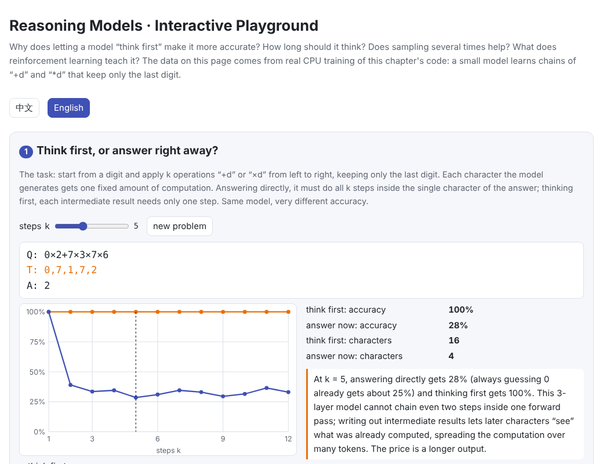
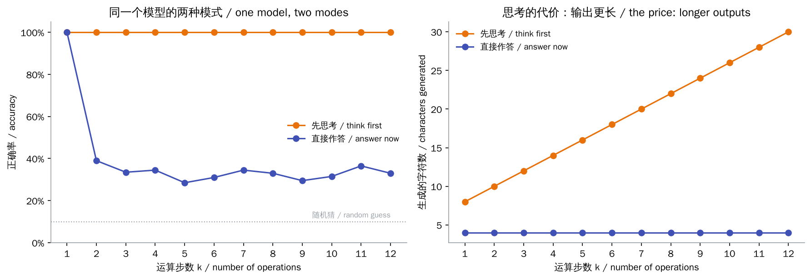
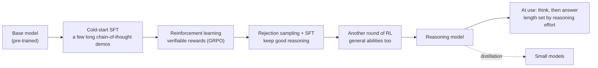
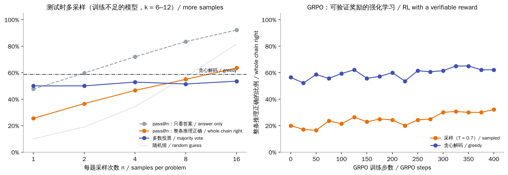
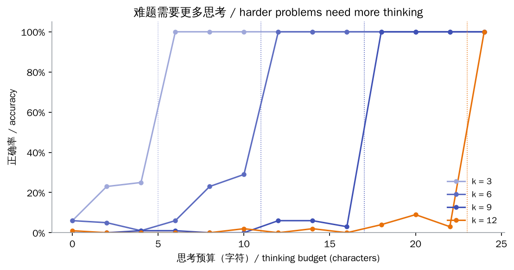

# Reasoning Models and Test-time Compute

> **In one sentence:** Each token a model generates gets one fixed amount of computation. Letting it write out its reasoning first (a chain of thought) splits a hard problem into many steps and spreads the work over many tokens. Reasoning models are models trained specifically to think before answering: they learn longer, more reliable reasoning through reinforcement learning on problems that can be checked automatically (such as DeepSeek-R1's GRPO). Longer thinking gets hard problems right more often but is slower and costlier; that is the trade-off behind test-time compute and reasoning effort.
>
> 🌐 [中文版](README.md) · 🎮 **[Open the interactive playground](interactive/reasoning.html?lang=en)** · 📓 [Notebook](10-reasoning.ipynb) ([open in Colab](https://colab.research.google.com/github/BaiYuBY/use_token_to_learn/blob/main/docs/10-reasoning/10-reasoning.ipynb))

[](interactive/reasoning.html?lang=en)

**In this chapter you will learn:**

- Why thinking first makes a model more accurate: compute per token is fixed
- Ways to spend test-time compute: longer thinking, majority voting over samples, picking with a verifier
- How a thinking budget is controlled, and the trade-off behind reasoning effort (low / medium / high)
- Reinforcement learning with verifiable rewards: GRPO and DeepSeek-R1's training recipe
- How to check each of these on a CPU yourself, including what reinforcement learning can and cannot do

---

## 1. Intuition: a few more characters, a few more steps

[05 Transformer block](../05-transformer/README.en.md) showed that every generated token runs through all the layers once, costing about $2N$ operations (see [How LLM compute is counted](../qa/compute.en.md)). That amount is **fixed**: however hard the problem, one token gets only that much computation.

If the answer takes many steps of derivation, one forward pass may not be enough. But the model can **write the intermediate results down**: later tokens “see” them through attention and build on them. Every written token is an extra share of computation.

This chapter's experiment makes the point plain. The task is a chain of single-digit operations: start from a digit and apply $k$ operations “+d” or “×d” from left to right, keeping only the last digit each time. For example:

```text
Q:7*3+4*9+2
T:1,5,5,7        ← thinking: each step's result (7×3=21→1, 1+4=5, 5×9=45→5, 5+2=7)
A:7
```

One small model (3 layers, about 360K parameters) learned both modes: after the question, `A:` means answer now and `T:` means think first. The result:



- **Think first**: every problem from 1 to 12 steps right (200 problems each)
- **Answer now**: 1-step problems all right, but from **2 steps on** only 28%–39%. Multiplication often drives the result to 0, so about 25% of answers are 0 and always guessing 0 scores about 25%; answering directly is only slightly better than that

This tiny model cannot chain even two steps inside one forward pass; with intermediate results written out, each character needs only one step. The price is a longer output: a 12-step problem generates 26 more characters.

That is the root reason **chain of thought** (Wei et al., 2022) works. Theory agrees: a fixed-depth Transformer can compute only so much directly, and allowing it to write enough intermediate steps greatly extends what it can do (Feng et al., 2023; Merrill & Sabharwal, 2023).

## 2. Pictures

How reasoning models are trained and used:



This is DeepSeek-R1's recipe (DeepSeek-AI, 2025). The next section starts with spending more compute at use time; section 3.4 covers training.

> **🎮 Try it**
>
> In the [interactive playground](interactive/reasoning.html?lang=en) you can:
>
> 1. Change the number of steps and compare thinking first with answering directly, with the model's real outputs
> 2. Drag the thinking budget and see what happens when thinking is cut short
> 3. Compare majority voting with sampling plus a verifier
> 4. Flip answers in a GRPO group between right and wrong to see how advantages are computed, and see this chapter's GRPO results
> 5. Pick a reasoning effort (none / low / medium / high) and see the trade-off between accuracy, output length and latency

## 3. How it works

### 3.1 Three ways to spend test-time compute

A trained model can still improve at use time (test time) by spending more compute:

| Method | How | What it needs |
| --- | --- | --- |
| **Longer thinking** (sequential) | Write a longer reasoning process: check, backtrack, try another approach | A model that has learned to think usefully (section 3.4) |
| **Sampling + voting** (parallel) | Sample $n$ times and take the most common answer (self-consistency, Wang et al., 2022) | Nothing extra |
| **Sampling + a verifier** (parallel) | Sample $n$ times and let a verifier pick the best (best-of-n) | A reliable verifier: unit tests, a maths checker, or a trained reward model |

Verifiers come in two kinds: an **outcome reward model** (ORM) looks only at the final answer, while a **process reward model** (PRM) checks each step. Lightman et al. (2023) found process supervision more effective than outcome supervision on maths problems.

When OpenAI released o1 it showed performance improving steadily with both **training-time** RL compute and **test-time** thinking compute (roughly with the log of compute). Snell et al. (2024) found that allocating test-time compute well can sometimes beat a model more than ten times larger, provided the base model already has some success on that kind of problem.

### 3.2 This chapter's experiment: does sampling more always help?

With a lightly trained model (59% on hard 6–12-step problems with greedy decoding), sampling each problem 16 times at temperature 0.7:



- **With a verifier** (solved if any of the $n$ chains is fully correct): from 25% at $n = 1$ to 64% at $n = 16$, beating greedy decoding.
- **Majority vote**: only 54% at $n = 16$, **below greedy decoding**. A likely reason is that the model's mistakes are systematic: samples of the same problem often go wrong at the same step, so a wrong answer becomes the majority. Voting only helps when errors are independent.
- **Answer-only pass@n is inflated**: with only ten possible answers, answer-only pass@16 reaches 92%, while 16 random guesses would hit the answer 81% of the time. That is why this chapter judges whole chains, and a reminder that **a verifier must be strict enough**, or lucky guesses count as correct.

### 3.3 Thinking budgets and reasoning effort

Reasoning-model APIs usually offer reasoning effort levels (low / medium / high; see the [reasoning effort Q&A](../qa/reasoning-effort.en.md)), which mainly set **how long the model thinks**. A direct way to control it is **budget forcing** from the s1 paper (Muennighoff et al., 2025): once thinking exceeds the budget, end it and force an answer; to make the model think more, append “Wait” when it tries to stop.

This chapter does the same: keep only the first $B$ characters of thinking, then force `A:`. A $k$-step problem needs $2k - 1$ characters to finish:



- With enough budget, accuracy jumps to 100%; without, it is 0%–29%, often **below random guessing**, because the model takes an unfinished intermediate result as its answer
- More steps need a larger budget: **harder problems need longer thinking**

Real reasoning models face problems of mixed difficulty, so ideally thinking is **allocated by difficulty**: little for easy problems, more for hard ones. Thinking too much is a problem too: re-checking and second-guessing easy problems wastes compute and can introduce mistakes, known as *overthinking* (Chen et al., 2024).

### 3.4 Reinforcement learning with verifiable rewards: GRPO and DeepSeek-R1

How does a model learn to think **usefully**? The most direct way is reinforcement learning on **problems that can be checked automatically** (maths has reference answers, code can run tests): reward right answers, not wrong ones. This is **reinforcement learning with verifiable rewards** (RLVR). It needs no reward model from [09 Alignment](../09-alignment/README.en.md), so there is no reward model to game, but it only applies where answers can be checked.

**GRPO** (Group Relative Policy Optimization, Shao et al., 2024), used by DeepSeek-R1, samples a group of $G$ answers to the same problem and replaces PPO's value network with a comparison inside the group:

$$
A_i = \frac{r_i - \mathrm{mean}(r_1, \dots, r_G)}{\mathrm{std}(r_1, \dots, r_G)}
$$

It then applies a clipped update as in PPO, plus a KL penalty to the reference model. Key points:

- **No value network**: saves a model as large as the policy
- **No learning signal when a group is all right or all wrong**: every advantage is 0, so training problems should be moderately hard
- **The reward rule must be strict**: in this chapter answers have only 10 possible values. When we first checked only the final answer, wrong reasoning that guessed the right digit was rewarded and training got worse; checking the whole chain fixed it

**DeepSeek-R1-Zero** ran GRPO directly on the base model with just two rule-based rewards: is the answer right, and is the format right (thinking inside the designated tags). During training its answers grew longer on their own and began to show reflection and re-checking; AIME 2024 pass@1 rose from 15.6% to 71.0%, and 86.7% with majority voting. But R1-Zero's output was hard to read and mixed languages, so the released **DeepSeek-R1** first does a cold-start SFT on a small set of long chains of thought, then RL, rejection sampling and a second round of RL (the diagram in section 2). Fine-tuning small models on reasoning data generated by R1 (**distillation**) worked clearly better than running RL on the small models directly.

This chapter reproduces a mini version on a CPU: starting from the lightly trained model, 400 steps of GRPO (16 problems × 8 answers per step):

| | Before GRPO | After GRPO |
| --- | --- | --- |
| Greedy decoding | 59% | 64% |
| Fully right in one sample (pass@1) | 25% | 40% |
| Right at least once in 16 samples (pass@16) | 64% | 66% |
| Majority vote (16 samples) | 54% | 66% |

pass@1 rises clearly while pass@16 barely moves. In other words, reinforcement learning mainly makes the model **take the right path more reliably** rather than teaching it something it could not do at all. This matches what Yue et al. (2025) found on large models: RL with verifiable rewards raises pass@1 substantially, but at large $k$ the base model's pass@k is often no worse than the RL model's. Also, in DeepSeek-R1-Zero answers grew much longer during training; in this chapter the number of steps is fixed, so thinking length did not change.

### 3.5 Can the reasoning be trusted?

The reasoning a model writes is not necessarily its real “thought process”. Turpin et al. (2023) found that a misleading hint in the prompt can sway a model while the reasons it writes never mention the hint. So written reasoning improves accuracy and helps inspection, but it should not be taken as a faithful record of the model's internal computation. This connects to [24 Safety and interpretability](../24-safety-interpretability/README.en.md).

## 4. Minimal code

Full code: [`code/reasoning.py`](code/reasoning.py); run `python docs/10-reasoning/code/reasoning.py` (about two minutes, including a check of the pass@k estimator, the GRPO advantage, and a quick training run). The full experiment is in [`figures/reasoning_figures.py`](figures/reasoning_figures.py) and takes about 11 minutes on a laptop CPU.

Training data for the two modes:

```python
def target_of(problem, cot):
    thinking = "T:" + ",".join(map(str, steps_of(problem))) + "\n" if cot else ""
    return thinking + f"A:{answer_of(problem)}\n"
```

A thinking budget (budget forcing):

```python
thoughts = complete(model, [prompt_of(p) + "T:" for p in problems])
cut = [t.split("\n")[0][:budget] for t in thoughts]                  # keep the first `budget` characters
forced = [prompt_of(p) + "T:" + c + "\nA:" for p, c in zip(problems, cut)]   # force an answer
```

GRPO's advantage and update:

```python
r = rewards.view(-1, group)
adv = ((r - r.mean(1, keepdim=True)) / (r.std(1, keepdim=True) + 1e-4)).flatten()
ratio = (new - old).exp()
surrogate = torch.min(ratio * adv[:, None], ratio.clamp(1 - clip, 1 + clip) * adv[:, None])
kl = (ref_lp - new).exp() - (ref_lp - new) - 1                       # the KL estimator GRPO uses
loss = -((surrogate - beta * kl) * mask).sum() / mask.sum()
```

The unbiased pass@k estimator (Chen et al., 2021), checked in the code against enumerating every subset:

```python
def pass_at_k(n, c, k):
    return 1.0 if n - c < k else 1.0 - math.comb(n - c, k) / math.comb(n, k)
```

## 5. Common misconceptions

- **“Longer thinking is always better”**: overthinking easy problems wastes compute and can introduce mistakes. In this chapter, once the budget is enough, more adds nothing.
- **“Majority voting always helps”**: it cannot when errors are correlated; here majority voting did worse than greedy decoding.
- **“Reinforcement learning teaches new abilities”**: both this chapter and Yue et al. (2025) find that it mainly raises the chance of getting it right in one go; the ceiling of a model's ability comes mainly from pre-training and distillation.
- **“The written reasoning is the model's real thinking”**: it does not necessarily reflect the internal computation faithfully.
- **“If the answer is right, the reward is fine”**: with a small answer space, wrong reasoning that guesses right gets rewarded too.

## 6. Self-check

1. Why can the same model solve a problem by writing out its steps when it fails answering directly?
2. In GRPO, a group of 8 answers has 2 right and 6 wrong. Is the advantage of a right answer positive or negative? What if all 8 are right?
3. Users of a reasoning model in production complain that even simple questions take a long time. What would you change?

<details>
<summary>Answers</summary>

1. Compute per token is fixed. Answering directly means finishing every step inside one token; with intermediate results written out, later tokens read them through attention and each token needs only one step.
2. Positive for right answers (above the group mean), negative for wrong ones. If all 8 are right the standard deviation is 0, every advantage is 0, and the group gives no learning signal.
3. Lower the reasoning effort or thinking budget, or judge difficulty first and only enable long thinking for hard problems; simple questions can turn thinking off entirely.

</details>

## 7. Further reading

- Wei et al., 2022. [Chain-of-Thought Prompting Elicits Reasoning in Large Language Models](https://arxiv.org/abs/2201.11903)
- Kojima et al., 2022. [Large Language Models are Zero-Shot Reasoners](https://arxiv.org/abs/2205.11916) (“Let's think step by step”)
- Nye et al., 2021. [Show Your Work: Scratchpads for Intermediate Computation with Language Models](https://arxiv.org/abs/2112.00114)
- Feng et al., 2023. [Towards Revealing the Mystery behind Chain of Thought: A Theoretical Perspective](https://arxiv.org/abs/2305.15408)
- Merrill & Sabharwal, 2023. [The Expressive Power of Transformers with Chain of Thought](https://arxiv.org/abs/2310.07923)
- Wang et al., 2022. [Self-Consistency Improves Chain of Thought Reasoning in Language Models](https://arxiv.org/abs/2203.11171)
- Cobbe et al., 2021. [Training Verifiers to Solve Math Word Problems](https://arxiv.org/abs/2110.14168) (GSM8K and verifiers)
- Lightman et al., 2023. [Let's Verify Step by Step](https://arxiv.org/abs/2305.20050)
- OpenAI, 2024. [Learning to reason with LLMs](https://openai.com/index/learning-to-reason-with-llms/)
- Snell et al., 2024. [Scaling LLM Test-Time Compute Optimally can be More Effective than Scaling Model Parameters](https://arxiv.org/abs/2408.03314)
- Shao et al., 2024. [DeepSeekMath](https://arxiv.org/abs/2402.03300) (GRPO)
- DeepSeek-AI, 2025. [DeepSeek-R1: Incentivizing Reasoning Capability in LLMs via Reinforcement Learning](https://arxiv.org/abs/2501.12948)
- Muennighoff et al., 2025. [s1: Simple test-time scaling](https://arxiv.org/abs/2501.19393)
- Yue et al., 2025. [Does Reinforcement Learning Really Incentivize Reasoning Capacity in LLMs Beyond the Base Model?](https://arxiv.org/abs/2504.13837)
- Chen et al., 2024. [Do NOT Think That Much for 2+3=? On the Overthinking of o1-Like LLMs](https://arxiv.org/abs/2412.21187)
- Turpin et al., 2023. [Language Models Don't Always Say What They Think](https://arxiv.org/abs/2305.04388)
- Chen et al., 2021. [Evaluating Large Language Models Trained on Code](https://arxiv.org/abs/2107.03374) (the unbiased pass@k estimator)
