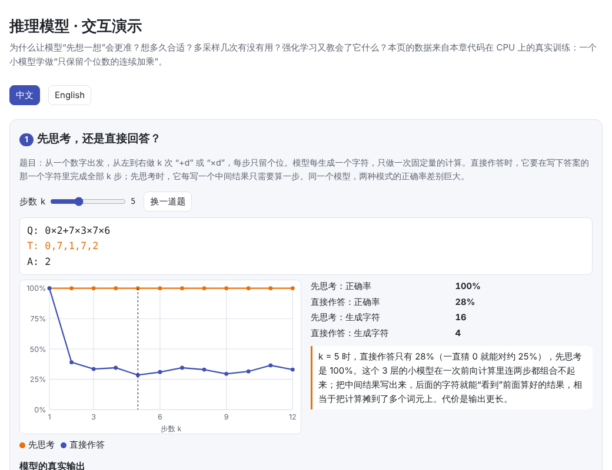
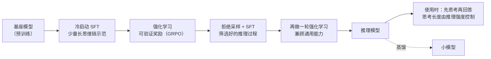

# 推理模型与测试时计算（Reasoning Models and Test-time Compute）

> **一句话总结：** 模型每生成一个词元，只做一次固定量的计算。让它先写出思考过程（思维链），等于把一道难题拆成很多步、把计算分摊到很多词元上。推理模型就是专门练过“先想再答”的模型：它们用可以自动判对错的题目做强化学习（如 DeepSeek-R1 的 GRPO），学会写更长、更可靠的思考过程。思考越长，难题答得越对，但也越慢、越贵；这就是“测试时计算”和“推理强度”的取舍。
>
> 🌐 [English version](README.en.md) · 🎮 **[打开交互演示](interactive/reasoning.html?lang=zh)** · 📓 [Notebook](10-reasoning.ipynb)（[在 Colab 中打开](https://colab.research.google.com/github/BaiYuBY/use_token_to_learn/blob/main/docs/10-reasoning/10-reasoning.ipynb)）

[](interactive/reasoning.html?lang=zh)

**本章你将学会：**

- 为什么“先想一想”能让模型更准：每个词元的计算量是固定的
- 测试时计算的几种用法：更长的思考、多次采样投票、用验证器挑选
- 思考预算怎样控制，以及推理强度（low / medium / high）背后的取舍
- 可验证奖励的强化学习：GRPO 和 DeepSeek-R1 的训练流程
- 在 CPU 上亲手验证以上每一点，包括强化学习“能做什么、不能做什么”

---

## 1. 直觉：多写几个字，就多算几步

[05 Transformer 结构](../05-transformer/README.md)告诉我们：每生成一个词元，模型都要把所有层完整地算一遍，计算量约为 $2N$（见[大模型的算力怎么算](../qa/compute.md)）。这个量是**固定**的，题目再难，一个词元也只能分到这么多计算。

如果答案需要很多步推导，一次前向计算可能根本做不完。但模型可以**把中间结果写出来**：后面的词元通过注意力“看到”前面写下的结果，就能在它的基础上继续算。写下的每一个词元，都是额外的一份计算。

本章的实验把这一点做得一目了然。题目是“只保留个位数的连续加乘”：从一个数字出发，从左到右做 $k$ 次 “+d” 或 “×d”，每步只留个位。例如：

```text
Q:7*3+4*9+2
T:1,5,5,7        ← 思考：每一步的结果（7×3=21→1，1+4=5，5×9=45→5，5+2=7）
A:7
```

同一个小模型（3 层，约 36 万参数）同时学会了两种模式：问题后面接 `A:` 就直接作答，接 `T:` 就先思考。结果：


- **先思考**：1 到 12 步的题全部答对（各 200 题）
- **直接作答**：1 步的题全对，**2 步及以上**只剩 28%–39%。由于乘法常让结果变成 0，这道题约 25% 的答案是 0，一直猜 0 就能对约 25%，所以直接作答只比这种瞎猜好一点

这个小模型在一次前向计算里连两步都组合不起来；写出中间结果后，每个字符只需要算一步。代价是输出变长：12 步的题要多生成 26 个字符。

这就是**思维链**（chain of thought，Wei 等，2022）有效的根本原因。理论研究也表明：固定深度的 Transformer 能直接算的问题有限，允许它写出足够长的中间步骤后，能力会显著增强（Feng 等，2023；Merrill & Sabharwal，2023）。

## 2. 图解

推理模型的训练和使用：



这是 DeepSeek-R1 的流程（DeepSeek-AI，2025）。下一节从“使用时怎么多花算力”讲起，第 3.4 节再讲训练。

> **🎮 动手试试**
>
> 在[交互演示](interactive/reasoning.html?lang=zh)中，你可以：
>
> 1. 调整题目步数，对比“先思考”和“直接作答”的正确率，查看模型的真实输出
> 2. 拖动思考预算，看想到一半被打断会怎样
> 3. 比较多数投票和带验证器的多次采样
> 4. 点击切换 GRPO 一组回答的对错，看优势怎么计算；查看本章 GRPO 训练的结果
> 5. 选择推理强度（none / low / medium / high），看正确率、输出长度和延迟的取舍

## 3. 原理

### 3.1 测试时计算的三种用法

训练好的模型，使用时（测试时）还可以通过多花算力来提高效果：

| 方法 | 做法 | 需要什么 |
| --- | --- | --- |
| **更长的思考**（串行） | 让模型写出更长的推理过程，检查、回溯、换思路 | 模型要学会有效地思考（3.4 节） |
| **多次采样 + 投票**（并行） | 同一题采样 $n$ 次，选出现最多的答案（self-consistency，Wang 等，2022） | 不需要额外组件 |
| **多次采样 + 验证器**（并行） | 采样 $n$ 次，用验证器挑出最好的（best-of-n） | 可靠的验证器：单元测试、数学判题器，或训练出的奖励模型 |

验证器又分两种：只看最终答案的**结果奖励模型**（ORM），和逐步检查推理过程的**过程奖励模型**（PRM）。Lightman 等（2023）发现，在数学题上过程监督比结果监督更有效。

OpenAI 在发布 o1 时展示：效果随**训练时**的强化学习算力和**测试时**的思考算力都稳定提升（大致随算力的对数增长）。Snell 等（2024）发现，合理分配测试时计算，有时比把模型放大十几倍更划算，前提是基础模型对这类题目已经有一定的成功率。

### 3.2 本章实验：多采样一定有用吗？

用一个训练得较少的模型（贪心解码时，6–12 步的难题答对 59%），每题以温度 0.7 采样 16 次：


- **带验证器**（只要 $n$ 条推理中有一条完全正确就算对）：从 $n = 1$ 的 25% 升到 $n = 16$ 的 64%，超过了贪心解码。
- **多数投票**：$n = 16$ 时只有 54%，**还不如贪心解码**。一个可能的原因是这个模型的错误是系统性的：同一道题的几次采样常错在同一步，错误答案反而成了“多数”。投票只在错误彼此独立时才有效。
- **只看答案的 pass@n 会被高估**：答案只有 0–9 十种可能，$n = 16$ 时“只看答案”的 pass@n 达到 92%，而纯随机猜 16 次也有 81% 的机会猜中。所以本章用“整条推理完全正确”来判断，这也提醒我们：**验证器必须足够严格**，否则蒙对的答案也会被当成正确的。

### 3.3 思考预算与推理强度

推理模型的 API 通常提供“推理强度”档位（low / medium / high，见[推理强度问答](../qa/reasoning-effort.md)），本质上是在调**思考的长度**。一个直接的控制方法是 s1 论文（Muennighoff 等，2025）的 **budget forcing**：思考超过预算就强制结束、开始作答；想让模型多想，就在它准备结束时追加 “Wait”。

本章用同样的办法：只保留前 $B$ 个思考字符，然后强制写 `A:` 作答。$k$ 步的题需要 $2k - 1$ 个字符才能想完：


- 预算够了，正确率跳到 100%；不够时只有 0%–29%，常常**低于瞎猜**，因为模型会把没想完的中间结果当成答案
- 步数越多，需要的预算越大：**难题需要更长的思考**

真实的推理模型面对的题目难度各不相同，所以理想的做法是**按难度分配思考**：简单题少想，难题多想。想得太多也有问题：在简单题上反复验证、来回推翻，既浪费又可能出错，这被称为 *overthinking*（Chen 等，2024）。

### 3.4 可验证奖励的强化学习：GRPO 与 DeepSeek-R1

怎样让模型学会**有效地**思考？最直接的办法是用**能自动判对错的题目**（数学题有标准答案，代码可以跑测试）做强化学习：答对给奖励，答错不给。这叫**可验证奖励的强化学习**（RLVR）。它不需要 [09 对齐](../09-alignment/README.md)中的奖励模型，所以不怕奖励模型被钻空子，但只适用于答案能被检查的任务。

DeepSeek-R1 使用的 **GRPO**（Group Relative Policy Optimization，Shao 等，2024）对同一道题采样一组 $G$ 个回答，用组内比较代替 PPO 的价值网络：

$$
A_i = \frac{r_i - \mathrm{mean}(r_1, \dots, r_G)}{\mathrm{std}(r_1, \dots, r_G)}
$$

然后像 PPO 一样做截断更新，并加一个与参考模型的 KL 惩罚。要点：

- **不需要价值网络**：省下一个和策略一样大的模型
- **组内全对或全错时没有学习信号**：优势全为 0，所以训练题要难度适中
- **奖励规则要严格**：本章的答案只有 10 种可能，最初只看最终答案时，推理错了但蒙对答案的回答也会得到奖励，训练反而变差；改成检查整条推理后才正常学习

**DeepSeek-R1-Zero** 直接在基座模型上做 GRPO，奖励只有两条规则：答案是否正确、格式是否正确（思考写在指定的标签里）。在训练过程中，模型的回答自发地越来越长，并出现了反思和回头检查的行为；AIME 2024 的 pass@1 从 15.6% 升到 71.0%，多数投票后达到 86.7%。但 R1-Zero 的输出可读性差、会混杂多种语言，所以正式的 **DeepSeek-R1** 先用少量长思维链数据做冷启动 SFT，再做强化学习、拒绝采样和第二轮强化学习（第 2 节的流程图）。用 R1 生成的推理数据去微调（**蒸馏**）小模型，效果明显好于直接在小模型上做强化学习。

本章在 CPU 上复现了一个迷你版：从训练不足的模型出发，做 400 步 GRPO（每步 16 题 × 8 个回答）：

| | GRPO 前 | GRPO 后 |
| --- | --- | --- |
| 贪心解码 | 59% | 64% |
| 采样 1 次就完全正确（pass@1） | 25% | 40% |
| 采样 16 次至少对一次（pass@16） | 64% | 66% |
| 多数投票（16 次） | 54% | 66% |

pass@1 明显提升，pass@16 几乎不变。也就是说，强化学习主要让模型**更稳定地走对的路**，而不是学会它原本完全不会的东西。这与 Yue 等（2025）在大模型上的发现一致：可验证奖励的强化学习显著提高 pass@1，但在 $k$ 很大时，基座模型的 pass@k 往往不比强化学习后的模型差。另外，在 DeepSeek-R1-Zero 中，回答长度随训练明显增长；本章的任务步数固定，思考长度没有变化。

### 3.5 思考过程可信吗？

模型写出的思考过程，不一定就是它真正的“想法”。Turpin 等（2023）发现，在提示中加入误导性的暗示，模型会被带偏，但它写出的理由却不提这个暗示。所以思考过程有助于提高正确率，也方便检查，但不能把它当作模型内部计算的忠实记录。这和 [24 安全与可解释性](../24-safety-interpretability/README.md) 讨论的问题相关。

## 4. 最小代码实现

完整代码：[`code/reasoning.py`](code/reasoning.py)，运行 `python docs/10-reasoning/code/reasoning.py`（约 2 分钟，包含 pass@k 估计的校验、GRPO 优势的计算和一个快速训练）。完整实验在 [`figures/reasoning_figures.py`](figures/reasoning_figures.py) 中，在笔记本 CPU 上约需 11 分钟。

两种模式的训练数据：

```python
def target_of(problem, cot):
    thinking = "T:" + ",".join(map(str, steps_of(problem))) + "\n" if cot else ""
    return thinking + f"A:{answer_of(problem)}\n"
```

思考预算（budget forcing）：

```python
thoughts = complete(model, [prompt_of(p) + "T:" for p in problems])
cut = [t.split("\n")[0][:budget] for t in thoughts]                  # 只保留前 budget 个字符
forced = [prompt_of(p) + "T:" + c + "\nA:" for p, c in zip(problems, cut)]   # 强制作答
```

GRPO 的优势与更新：

```python
r = rewards.view(-1, group)
adv = ((r - r.mean(1, keepdim=True)) / (r.std(1, keepdim=True) + 1e-4)).flatten()
ratio = (new - old).exp()
surrogate = torch.min(ratio * adv[:, None], ratio.clamp(1 - clip, 1 + clip) * adv[:, None])
kl = (ref_lp - new).exp() - (ref_lp - new) - 1                       # GRPO 使用的 KL 估计
loss = -((surrogate - beta * kl) * mask).sum() / mask.sum()
```

pass@k 的无偏估计（Chen 等，2021），代码中与枚举所有组合的结果做了对比：

```python
def pass_at_k(n, c, k):
    return 1.0 if n - c < k else 1.0 - math.comb(n - c, k) / math.comb(n, k)
```

## 5. 常见误区

- **“思考过程越长越好”**：简单题上想太多既浪费又可能出错（overthinking）。本章的实验里，预算一旦够用，再多也没有收益。
- **“多采样投票一定有用”**：错误不独立时，投票帮不上忙；本章的多数投票还不如贪心解码。
- **“强化学习教会了模型新能力”**：本章和 Yue 等（2025）的结果都表明，它主要提高了“一次就答对”的概率，模型能力的上限主要来自预训练和蒸馏。
- **“思考过程就是模型的真实想法”**：它不一定忠实反映内部计算。
- **“只要答案对，奖励就没问题”**：答案空间小的时候，蒙对的错误推理也会得到奖励。

## 6. 自测题

1. 为什么同一个模型，直接作答做不对的题，先写出步骤就能做对？
2. GRPO 中，一组 8 个回答有 2 个对、6 个错，答对的回答优势为正还是负？如果 8 个全对呢？
3. 一个推理模型在线上服务，用户抱怨“简单问题也要等很久”，你会怎么调整？

<details>
<summary>参考答案</summary>

1. 每个词元的计算量是固定的。直接作答要在一个词元里完成所有步骤；写出中间结果后，后面的词元可以通过注意力读到前面的结果，每个词元只需要算一步。
2. 答对的优势为正（高于组内平均），答错的为负。8 个全对时标准差为 0，优势全为 0，这组没有学习信号。
3. 降低推理强度或思考预算，或者先判断问题难度、只对难题启用长思考；也可以对简单问题直接关闭思考模式。

</details>

## 7. 延伸阅读

- Wei et al., 2022. [Chain-of-Thought Prompting Elicits Reasoning in Large Language Models](https://arxiv.org/abs/2201.11903)
- Kojima et al., 2022. [Large Language Models are Zero-Shot Reasoners](https://arxiv.org/abs/2205.11916)（“Let's think step by step”）
- Nye et al., 2021. [Show Your Work: Scratchpads for Intermediate Computation with Language Models](https://arxiv.org/abs/2112.00114)
- Feng et al., 2023. [Towards Revealing the Mystery behind Chain of Thought: A Theoretical Perspective](https://arxiv.org/abs/2305.15408)
- Merrill & Sabharwal, 2023. [The Expressive Power of Transformers with Chain of Thought](https://arxiv.org/abs/2310.07923)
- Wang et al., 2022. [Self-Consistency Improves Chain of Thought Reasoning in Language Models](https://arxiv.org/abs/2203.11171)
- Cobbe et al., 2021. [Training Verifiers to Solve Math Word Problems](https://arxiv.org/abs/2110.14168)（GSM8K 与验证器）
- Lightman et al., 2023. [Let's Verify Step by Step](https://arxiv.org/abs/2305.20050)
- OpenAI, 2024. [Learning to reason with LLMs](https://openai.com/index/learning-to-reason-with-llms/)
- Snell et al., 2024. [Scaling LLM Test-Time Compute Optimally can be More Effective than Scaling Model Parameters](https://arxiv.org/abs/2408.03314)
- Shao et al., 2024. [DeepSeekMath](https://arxiv.org/abs/2402.03300)（GRPO）
- DeepSeek-AI, 2025. [DeepSeek-R1: Incentivizing Reasoning Capability in LLMs via Reinforcement Learning](https://arxiv.org/abs/2501.12948)
- Muennighoff et al., 2025. [s1: Simple test-time scaling](https://arxiv.org/abs/2501.19393)
- Yue et al., 2025. [Does Reinforcement Learning Really Incentivize Reasoning Capacity in LLMs Beyond the Base Model?](https://arxiv.org/abs/2504.13837)
- Chen et al., 2024. [Do NOT Think That Much for 2+3=? On the Overthinking of o1-Like LLMs](https://arxiv.org/abs/2412.21187)
- Turpin et al., 2023. [Language Models Don't Always Say What They Think](https://arxiv.org/abs/2305.04388)
- Chen et al., 2021. [Evaluating Large Language Models Trained on Code](https://arxiv.org/abs/2107.03374)（pass@k 的无偏估计）
