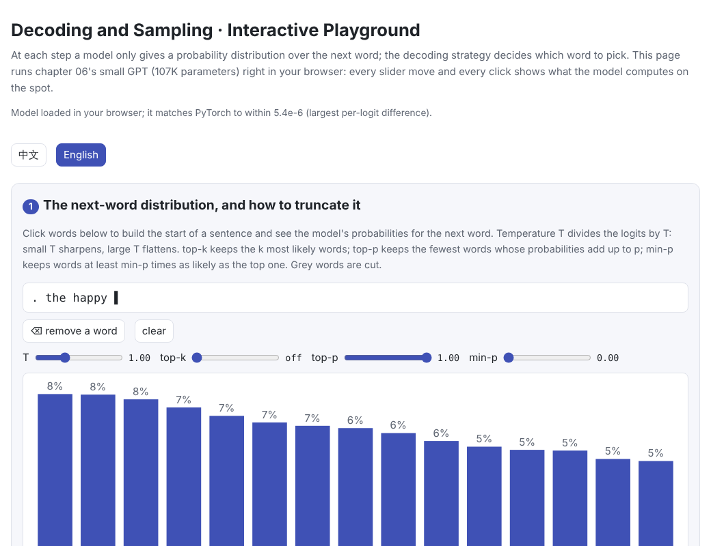
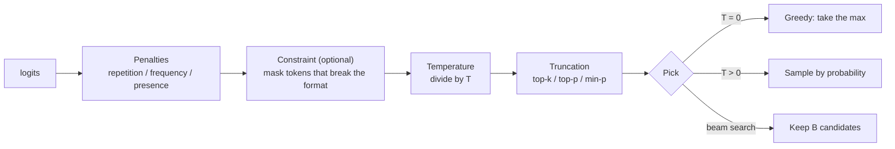

# Decoding and Sampling

> **In one sentence:** At each step a language model only outputs a probability distribution over the next token; the **decoding strategy** decides which one to pick. Greedy decoding and beam search chase high probability: safe but monotonous, and prone to repetition. Sampling brings variety: temperature sets how sharp the distribution is, and top-k, top-p and min-p cut off the unreliable long tail. Repetition penalties break loops. Constrained decoding compiles format rules into a state machine and guarantees the output follows the format.
>
> 🌐 [中文版](README.md) · 🎮 **[Open the interactive playground](interactive/decoding.html?lang=en)** (the model runs right in your browser) · 📓 [Notebook](11-decoding.ipynb) ([open in Colab](https://colab.research.google.com/github/BaiYuBY/use_token_to_learn/blob/main/docs/11-decoding/11-decoding.ipynb))

[](interactive/decoding.html?lang=en)

**In this chapter you will learn:**

- How greedy decoding, beam search and sampling differ, and what goes wrong with each
- How temperature, top-k, top-p (nucleus sampling) and min-p reshape the distribution
- Why models fall into repetition, and how repetition, frequency and presence penalties work
- How constrained decoding (structured output) guarantees formats such as JSON
- The quality–diversity trade-off, measured on a small model

---

## 1. Intuition: the model gives probabilities, the strategy picks

The last layer in [05 Transformer block](../05-transformer/README.en.md) outputs a vector as long as the vocabulary (the logits), and softmax turns it into a distribution over the next token. Generating text repeats this: pick a token, append it, compute the next distribution.

Which token to pick sounds like a detail, but it changes the result a lot:



This chapter uses the GPT trained on the tiny English of [06 Pre-training](../06-pretraining/README.en.md) (107K parameters) and checks every generated sentence with the grammar rules from [09 Alignment](../09-alignment/README.en.md). The playground exports this model's weights and reimplements the forward pass in JavaScript, so it runs right in the browser; its largest per-logit difference from PyTorch is about $5 \times 10^{-6}$.

## 2. Pictures

After “two clever students” the verb must be plural. The higher the temperature, the more probability goes to ungrammatical options (singular verbs and so on); top-p cuts off that long tail:


The chapter's key experiment: 300 sentences sampled per setting, diversity on the x-axis, the share of grammatical sentences on the y-axis:


> **🎮 Try it**
>
> In the [interactive playground](interactive/decoding.html?lang=en) (the model runs live in your browser) you can:
>
> 1. Click words to build the start of a sentence and drag temperature, top-k, top-p and min-p to see how the next-word distribution changes
> 2. Generate sentences with the current settings and see how many are grammatical and how varied they are
> 3. Browse the quality–diversity results
> 4. Change the beam width and length penalty and step through the candidates beam search keeps
> 5. Generate 60 words of text and break repetition with penalties
> 6. Turn on the grammar constraint and still get only legal sentences at a very high temperature

## 3. How it works

### 3.1 Greedy decoding and beam search

**Greedy decoding** picks the most likely token at every step. It is deterministic: the same input always gives the same output.

**Beam search** keeps the $B$ highest-scoring candidates at every step, scoring them by summed log-probability $\sum_t \log p(y_t \mid y_{<t})$. A beam width of $B = 1$ is greedy decoding (checked in this chapter's code). It finds sequences that are more likely overall and is common in tasks with a right answer, such as machine translation and speech recognition.

But most likely is not best. In this chapter's experiment:

- Beam width 4 finds a sentence with log-probability −19.01, slightly above greedy decoding's −19.04
- Beam widths 8 and 16 find that the “most likely sentence” is **empty**: a full stop right away, with log-probability −9.68, higher than any complete sentence

Every extra word lowers the log-probability, so the more thorough the search, the more likely it finds a short and useless output. Stahlberg & Byrne (2019) found that in machine translation the exact best translation is often the empty one. The usual fix is a **length penalty**: divide the score by $|y|^\alpha$ (GNMT uses $((5 + |y|)/6)^\alpha$). In this chapter's playground, beam width 8 with $\alpha = 1$ finds an 11-word sentence with log-probability −17.58, more likely than greedy decoding's.

In long text, chasing high probability also brings **repetition**. Letting greedy decoding write 60 words in a row, 68% of the 4-word sequences repeat earlier text:

```text
the red student that finds the red song sleeps . the red farmer that finds the red song sings .
the red student that finds the red song sings . the red ...
```


Holtzman et al. (2019) pointed out that human text is not the most likely text, and that maximizing probability in open-ended generation tends to give bland, repetitive output: “text degeneration”.

### 3.2 Sampling and temperature

**Sampling** picks words at random by their probability, giving more varied output. **Temperature** $T$ divides the logits by $T$ before softmax:

$$
p_i = \frac{\exp(z_i / T)}{\sum_j \exp(z_j / T)}
$$

- $T < 1$: sharper, closer to greedy; $T \to 0$ is greedy
- $T > 1$: flatter, boosting unlikely words

In this chapter's experiment (300 sentences per setting):

| Temperature | 0.2 | 0.6 | 1.0 | 1.5 | 2.0 | 3.0 |
| --- | --- | --- | --- | --- | --- | --- |
| Grammatical | 100% | 100% | 96% | 67% | 30% | 3% |
| Diversity (distinct-2) | 0.18 | 0.30 | 0.33 | 0.36 | 0.43 | 0.57 |

Varying temperature alone trades quality for diversity.

### 3.3 Truncation: top-k, top-p, min-p

The trouble is the **long tail**: each wrong option is unlikely on its own, but together they are not, especially at high temperature. Truncation samples only among reliable candidates:

| Method | Rule | Behaviour |
| --- | --- | --- |
| **top-k** (Fan et al., 2018) | Keep the $k$ most likely words | $k$ is fixed whether the distribution is sharp or flat |
| **top-p / nucleus** (Holtzman et al., 2019) | Keep the fewest words whose probabilities add up to $p$ | Keeps few words when sharp, many when flat |
| **min-p** (Nguyen et al., 2024) | Keep words at least min-p times as likely as the top one | The threshold scales with the top probability |

Compared at $T = 2$ (only 30% grammatical with temperature alone):

| Setting (T = 2) | Grammatical | Diversity |
| --- | --- | --- |
| No truncation | 30% | 0.43 |
| top-k = 5 | 98% | 0.17 |
| top-k = 10 | 85% | 0.33 |
| top-p = 0.8 | 97% | 0.32 |
| min-p = 0.1 | 97% | 0.33 |

top-p and min-p remove most mistakes while keeping the variety; top-k's $k$ does not adapt to the distribution, so it is either too conservative (low diversity) or lets wrong options in. Common settings in practice are $T \approx 0.7$–$1.0$ with top-p $\approx 0.9$–$0.95$, or min-p.

### 3.4 Repetition penalties

Another way to fight repetition is to penalize tokens that already appeared:

| Penalty | What it does | Source |
| --- | --- | --- |
| Repetition $r$ | For seen tokens: divide positive logits by $r$, multiply negative ones by $r$ | CTRL (Keskar et al., 2019); Hugging Face's `repetition_penalty` |
| Frequency $f$ | Subtract $f \times$ the count | OpenAI API's `frequency_penalty` |
| Presence $p$ | Subtract $p$ once a token has appeared | OpenAI API's `presence_penalty` |

In this chapter's experiment, a repetition penalty of 1.3 or a frequency penalty of 0.5 cut greedy decoding's repeated 4-grams from 68% to 0. But too strong a penalty also hits words that should repeat, such as the full stop or “the”, and sentences start to break (try it in part 5 of the playground).

### 3.5 Constrained decoding: guaranteeing the format

Many applications need valid JSON, SQL or another fixed format. **Constrained decoding** compiles the format rules (a regular expression, a JSON Schema, a grammar) into a **state machine**; at each step only tokens the machine accepts are allowed, the other logits are set to $-\infty$, and sampling proceeds as usual:

```python
mask = allowed_mask(words)                         # the state machine: which words are allowed now
logits = logits.masked_fill(~mask, float("-inf"))  # the rest can never be picked
```

This chapter writes the tiny English grammar as a state machine and checks it both ways: every step of every corpus sentence is allowed, and 2,000 random walks through the machine all produce grammatical sentences. The effect:

| Temperature | No constraint | With the grammar constraint |
| --- | --- | --- |
| 1.0 | 96% | 100% |
| 2.0 | 30% | 100% |
| 3.0 | 3% | 100% |

The constraint guarantees the **format**, not sensible content: at high temperature the sentences are legal but may be odd. In real systems this is how OpenAI's Structured Outputs, Outlines (Willard & Louf, 2023) and llama.cpp's GBNF grammars work. The hard part is speed: with a vocabulary of a hundred thousand tokens, the allowed set must be computed quickly at every step, so these libraries precompute how the state machine maps onto the vocabulary.

### 3.6 Practical details

- **T = 0 is not always fully deterministic**: on a server, different batching and floating-point summation order can change the logits slightly and occasionally the chosen token.
- **Stopping**: stop at the end token, at a maximum length, or at given stop sequences.
- **Speculative decoding** does not change the output distribution; it only makes generation faster. See 12 Inference optimization (planned).

## 4. Minimal code

Full code: [`code/decoding.py`](code/decoding.py); run `python docs/11-decoding/code/decoding.py` (about 20 seconds). The full experiment is in [`figures/decoding_figures.py`](figures/decoding_figures.py), which also exports the model weights for the playground.

Temperature and truncation:

```python
def top_p_filter(logits, p):
    sorted_logits, order = logits.sort(dim=-1, descending=True)
    cum = sorted_logits.softmax(-1).cumsum(-1)
    drop = cum - sorted_logits.softmax(-1) >= p       # the mass before this token already reaches p
    drop = drop.scatter(-1, order, drop)
    return logits.masked_fill(drop, float("-inf"))

def min_p_filter(logits, min_p):
    probs = logits.softmax(-1)
    return logits.masked_fill(probs < min_p * probs.max(-1, keepdim=True).values, float("-inf"))

logits = min_p_filter(top_p_filter(top_k_filter(logits / T, k), p), m)
token = torch.multinomial(logits.softmax(-1), 1)
```

Beam search:

```python
for words, score in beams:
    logp = next_logits(model, [END] + [STOI[w] for w in words]).log_softmax(-1)
    top = logp.topk(beam)
    for lp, tok in zip(top.values.tolist(), top.indices.tolist()):
        candidates.append((words + [VOCAB[tok]], score + lp))
candidates.sort(key=lambda c: c[1], reverse=True)    # keep the best `beam`
```

## 5. Common misconceptions

- **“Lower temperature is always better”**: low temperature is safer but has no variety and repeats in long text; creative writing and brainstorming need higher temperatures.
- **“Beam search always gives better results”**: it gives more likely results, and the most likely may be an empty sentence or repetitive text.
- **“top-k and top-p are about the same”**: top-k does not adapt to the distribution; it can let wrong options in when the distribution is sharp, and cut right ones when it is flat.
- **“Constrained decoding guarantees correct answers”**: it only guarantees the format.
- **“T = 0 is always exactly reproducible”**: batching and floating-point arithmetic on a server can introduce small differences.

## 6. Self-check

1. With logits $[2, 1, 0]$ and $T = 0.5$, what probability does the top token get?
2. A distribution's top probability is 0.6 and the rest are 0.2, 0.1, 0.05, 0.05. How many words does top-p = 0.85 keep? And min-p = 0.2?
3. Why does beam search find an empty sentence with a large beam? How do you fix it?

<details>
<summary>Answers</summary>

1. Dividing by 0.5 gives $[4, 2, 0]$; after softmax the top one gets about $e^4 / (e^4 + e^2 + 1) \approx 0.87$.
2. top-p: the running totals are 0.6, 0.8, 0.9, first reaching 0.85 at the third word, so 3 are kept. min-p: the threshold is $0.2 \times 0.6 = 0.12$, keeping 0.6 and 0.2, so 2.
3. The score is a sum of log-probabilities and every extra word lowers it, so shorter outputs have a built-in advantage; the wider the beam, the more likely it finds the highest-scoring “stop right away”. Fix it with a length penalty (divide by the length to the power $\alpha$) or a minimum length.

</details>

## 7. Further reading

- Holtzman et al., 2019. [The Curious Case of Neural Text Degeneration](https://arxiv.org/abs/1904.09751) (nucleus sampling)
- Fan et al., 2018. [Hierarchical Neural Story Generation](https://arxiv.org/abs/1805.04833) (top-k sampling)
- Nguyen et al., 2024. [Turning Up the Heat: Min-p Sampling for Creative and Coherent LLM Outputs](https://arxiv.org/abs/2407.01082)
- Keskar et al., 2019. [CTRL: A Conditional Transformer Language Model for Controllable Generation](https://arxiv.org/abs/1909.05858) (repetition penalty)
- Wu et al., 2016. [Google's Neural Machine Translation System](https://arxiv.org/abs/1609.08144) (length penalty)
- Stahlberg & Byrne, 2019. [On NMT Search Errors and Model Errors: Cat Got Your Tongue?](https://arxiv.org/abs/1908.10090)
- Willard & Louf, 2023. [Efficient Guided Generation for Large Language Models](https://arxiv.org/abs/2307.09702) (Outlines)
- OpenAI. [Structured Outputs](https://platform.openai.com/docs/guides/structured-outputs) · [Chat API: frequency_penalty and presence_penalty](https://platform.openai.com/docs/api-reference/chat)
- Hugging Face. [Text generation strategies](https://huggingface.co/docs/transformers/generation_strategies)
