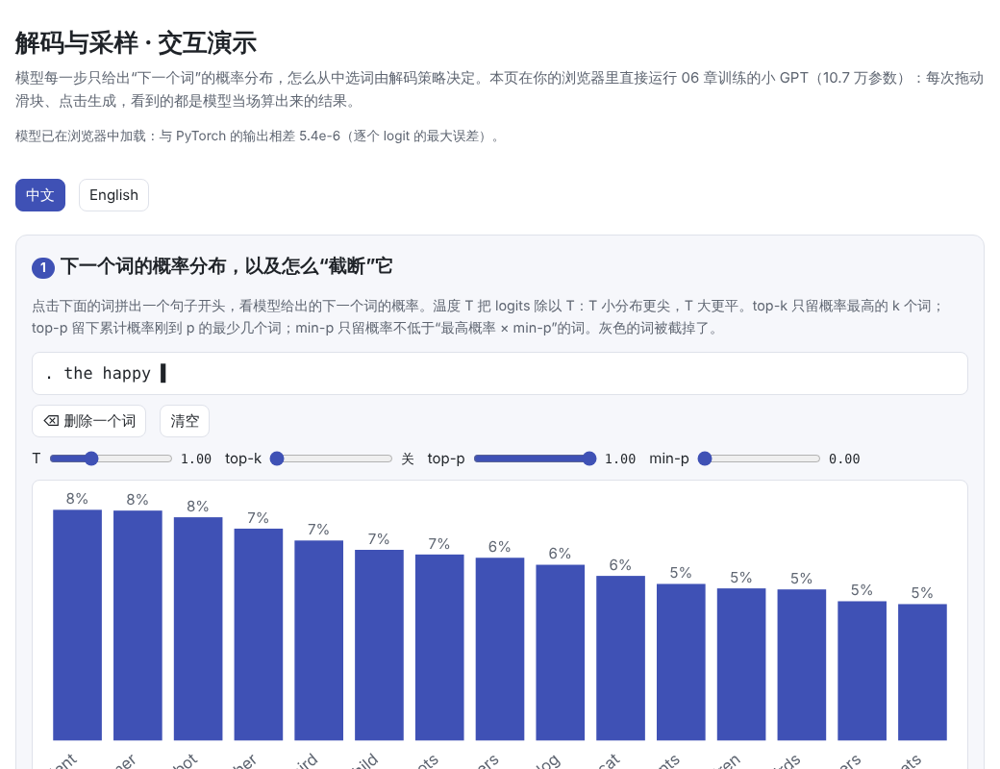
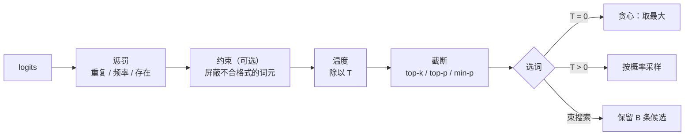
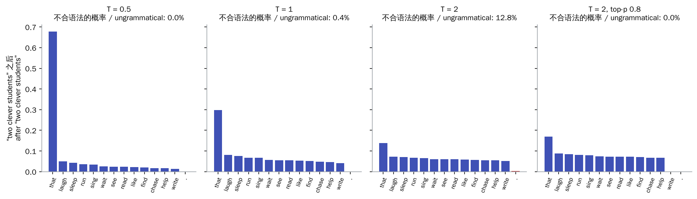
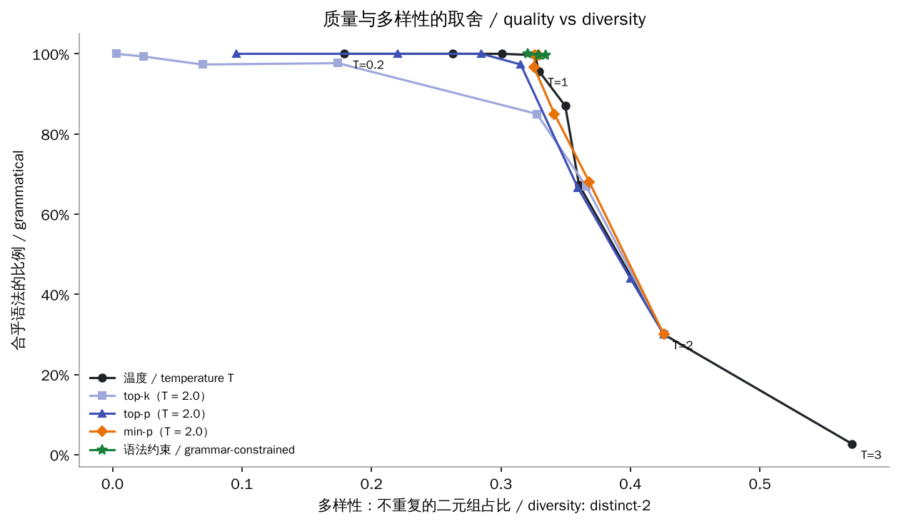
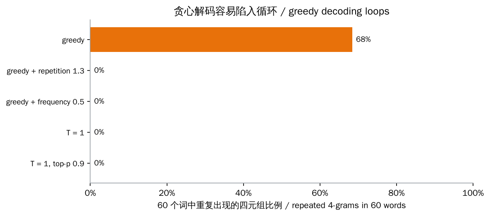

# 解码与采样（Decoding and Sampling）

> **一句话总结：** 语言模型每一步只输出“下一个词元”的概率分布，怎么从中挑一个词由**解码策略**决定。贪心解码和束搜索追求高概率，稳妥但单调，还容易重复；采样带来多样性，温度控制分布的尖锐程度，top-k、top-p、min-p 砍掉不可靠的“长尾”；重复惩罚打破循环；约束解码把格式规则编译成状态机，保证输出一定合乎格式。
>
> 🌐 [English version](README.en.md) · 🎮 **[打开交互演示](interactive/decoding.html?lang=zh)**（模型直接在浏览器里运行） · 📓 [Notebook](11-decoding.ipynb)（[在 Colab 中打开](https://colab.research.google.com/github/BaiYuBY/use_token_to_learn/blob/main/docs/11-decoding/11-decoding.ipynb)）

[](interactive/decoding.html?lang=zh)

**本章你将学会：**

- 贪心解码、束搜索和采样的区别，以及各自的问题
- 温度、top-k、top-p（核采样）、min-p 怎样改变分布
- 为什么模型会陷入重复，以及重复惩罚、频率惩罚、存在惩罚怎么用
- 约束解码（结构化输出）怎样保证输出合乎 JSON 之类的格式
- 用一个小模型实测“质量与多样性”的取舍

---

## 1. 直觉：模型只给概率，选词靠策略

[05 Transformer 结构](../05-transformer/README.md)的最后一层输出一个长度为词表大小的向量（logits），经过 softmax 变成下一个词元的概率分布。生成文本就是反复做这件事：选一个词元、接到末尾、再算下一个分布。

“选哪个词”看似小事，结果却差别很大：



本章使用 [06 预训练](../06-pretraining/README.md)中在小英语上训练的 GPT（10.7 万参数），并用 [09 对齐](../09-alignment/README.md)中的语法规则检查每个生成的句子是否合乎语法。交互页把这个模型的权重导出，用 JavaScript 重写了前向计算，在浏览器里直接运行；它与 PyTorch 的输出逐个 logit 的最大误差约为 $5 \times 10^{-6}$。

## 2. 图解

在 “two clever students” 之后，动词必须用复数形式。温度越高，不合语法的选项（单数动词等）概率越大；top-p 把这些“长尾”砍掉：



本章最重要的实验：每种设置采样 300 个句子，横轴是多样性，纵轴是合乎语法的比例：



> **🎮 动手试试**
>
> 在[交互演示](interactive/decoding.html?lang=zh)中（模型在你的浏览器里实时运行），你可以：
>
> 1. 点击词语拼出句子开头，拖动温度、top-k、top-p、min-p，看下一个词的分布怎样变化
> 2. 用当前设置生成句子，看合乎语法的比例和多样性
> 3. 浏览质量与多样性的实验结果
> 4. 调整束宽和长度惩罚，逐步查看束搜索保留的候选
> 5. 生成 60 个词的长文本，用惩罚打破重复
> 6. 打开语法约束，在很高的温度下仍然只生成合法的句子

## 3. 原理

### 3.1 贪心解码与束搜索

**贪心解码**每一步都选概率最高的词元。它是确定性的：同样的输入永远得到同样的输出。

**束搜索**（beam search）每一步保留得分最高的 $B$ 条候选，得分是累计的对数概率 $\sum_t \log p(y_t \mid y_{<t})$。束宽 $B = 1$ 就是贪心解码（本章代码验证了这一点）。它能找到整体概率更高的序列，在机器翻译、语音识别这类“有标准答案”的任务中很常用。

但“概率最高”不等于“最好”。本章实验中：

- 束宽 4 找到的句子对数概率为 −19.01，略高于贪心解码的 −19.04
- 束宽 8 和 16 找到的“最可能的句子”竟然是**空句**：一开始就输出句号，对数概率 −9.68，比任何完整的句子都高

这是因为每多写一个词，对数概率就再减一点，搜索越充分，越容易找到“短而无用”的输出。Stahlberg & Byrne（2019）在机器翻译中发现，精确搜索得到的最优译文常常就是空句。常用的修正是**长度惩罚**：把得分除以 $|y|^\alpha$（GNMT 中用 $((5 + |y|)/6)^\alpha$）。本章交互页中，束宽 8 配合 $\alpha = 1$ 找到了一个 11 个词、对数概率 −17.58 的句子，比贪心解码的概率更高。

写长文本时，追求高概率还会带来**重复**。本章让贪心解码连续写 60 个词，68% 的四词组合都是在重复前文：

```text
the red student that finds the red song sleeps . the red farmer that finds the red song sings .
the red student that finds the red song sings . the red ...
```



Holtzman 等（2019）指出，人写的文本并不是“最可能”的文本，用最大化概率的方法生成开放式文本，容易得到平淡、重复的结果，即“文本退化”。

### 3.2 采样与温度

**采样**按概率随机选词，结果更多样。**温度** $T$ 先把 logits 除以 $T$ 再做 softmax：

$$
p_i = \frac{\exp(z_i / T)}{\sum_j \exp(z_j / T)}
$$

- $T < 1$：分布更尖，接近贪心；$T \to 0$ 就是贪心
- $T > 1$：分布更平，低概率的词被放大

本章实验中（每种设置 300 句）：

| 温度 | 0.2 | 0.6 | 1.0 | 1.5 | 2.0 | 3.0 |
| --- | --- | --- | --- | --- | --- | --- |
| 合乎语法 | 100% | 100% | 96% | 67% | 30% | 3% |
| 多样性（distinct-2） | 0.18 | 0.30 | 0.33 | 0.36 | 0.43 | 0.57 |

只调温度时，质量和多样性此消彼长。

### 3.3 截断：top-k、top-p、min-p

问题出在**长尾**：每个错误选项单独看概率都很小，但它们加起来不小，温度一高就更明显。截断方法只在“可靠”的候选里采样：

| 方法 | 规则 | 特点 |
| --- | --- | --- |
| **top-k**（Fan 等，2018） | 只保留概率最高的 $k$ 个词 | $k$ 固定，不管分布尖还是平 |
| **top-p / 核采样**（Holtzman 等，2019） | 保留累计概率刚好达到 $p$ 的最少几个词 | 分布尖时留得少，平时留得多 |
| **min-p**（Nguyen 等，2024） | 保留概率不低于“最高概率 × min-p”的词 | 阈值随最高概率自动缩放 |

本章在 $T = 2$（只调温度时只有 30% 合乎语法）下比较：

| 设置（T = 2） | 合乎语法 | 多样性 |
| --- | --- | --- |
| 不截断 | 30% | 0.43 |
| top-k = 5 | 98% | 0.17 |
| top-k = 10 | 85% | 0.33 |
| top-p = 0.8 | 97% | 0.32 |
| min-p = 0.1 | 97% | 0.33 |

top-p 和 min-p 在保持多样性的同时砍掉了大部分错误；top-k 的 $k$ 不随分布调整，要么太保守（多样性低），要么放进了错误选项。实践中常见的组合是 $T \approx 0.7$–$1.0$ 加 top-p $\approx 0.9$–$0.95$，或者使用 min-p。

### 3.4 重复惩罚

另一种对抗重复的办法是直接惩罚已经出现过的词元：

| 惩罚 | 做法 | 出处 |
| --- | --- | --- |
| 重复惩罚 $r$ | 出现过的词元：正的 logit 除以 $r$，负的乘以 $r$ | CTRL（Keskar 等，2019），Hugging Face 的 `repetition_penalty` |
| 频率惩罚 $f$ | logit 减去 $f \times$ 出现次数 | OpenAI API 的 `frequency_penalty` |
| 存在惩罚 $p$ | 只要出现过就减去 $p$ | OpenAI API 的 `presence_penalty` |

本章实验中，贪心解码加上重复惩罚 1.3 或频率惩罚 0.5，重复的四元组都从 68% 降到 0。但惩罚太重会误伤句号、“the”这类本来就该反复出现的词，句子开始出错（交互演示第 5 节可以试）。

### 3.5 约束解码：保证输出合乎格式

很多应用要求模型输出合法的 JSON、SQL 或特定格式。**约束解码**把格式规则（正则表达式、JSON Schema、语法）编译成**状态机**，每一步只允许状态机接受的词元，其余词元的 logit 设为 $-\infty$，然后照常采样：

```python
mask = allowed_mask(words)                         # 状态机：当前允许哪些词
logits = logits.masked_fill(~mask, float("-inf"))  # 其余词元不可能被选中
```

本章把小英语的语法写成了一个状态机，并做了双向验证：语料中每个句子的每一步都被允许，在状态机上随机走 2000 次得到的句子也全部合乎语法。效果：

| 温度 | 不加约束 | 加语法约束 |
| --- | --- | --- |
| 1.0 | 96% | 100% |
| 2.0 | 30% | 100% |
| 3.0 | 3% | 100% |

约束只保证**格式**，不保证内容合理：温度很高时，句子合法但可能很奇怪。实际系统中，这就是 OpenAI 的 Structured Outputs、Outlines（Willard & Louf，2023）、llama.cpp 的 GBNF 语法等功能的原理。难点在于效率：词表有十几万个词元，每一步都要快速算出哪些词元合法，所以这些库会预先把状态机与词表对应好。

### 3.6 其他实用细节

- **T = 0 也不一定完全确定**：在服务端，批处理方式和浮点运算顺序不同，可能让 logits 出现细微差异，偶尔改变最终选词。
- **停止条件**：遇到结束符、达到最大长度，或者出现指定的停止字符串（stop sequences）时停止。
- **投机解码**不改变输出分布，只是让生成更快，见 12 推理优化（计划中）。

## 4. 最小代码实现

完整代码：[`code/decoding.py`](code/decoding.py)，运行 `python docs/11-decoding/code/decoding.py`（约 20 秒）。完整实验在 [`figures/decoding_figures.py`](figures/decoding_figures.py) 中，它还会导出模型权重供交互页使用。

温度与截断：

```python
def top_p_filter(logits, p):
    sorted_logits, order = logits.sort(dim=-1, descending=True)
    cum = sorted_logits.softmax(-1).cumsum(-1)
    drop = cum - sorted_logits.softmax(-1) >= p       # 之前的累计已经达到 p
    drop = drop.scatter(-1, order, drop)
    return logits.masked_fill(drop, float("-inf"))

def min_p_filter(logits, min_p):
    probs = logits.softmax(-1)
    return logits.masked_fill(probs < min_p * probs.max(-1, keepdim=True).values, float("-inf"))

logits = min_p_filter(top_p_filter(top_k_filter(logits / T, k), p), m)
token = torch.multinomial(logits.softmax(-1), 1)
```

束搜索：

```python
for words, score in beams:
    logp = next_logits(model, [END] + [STOI[w] for w in words]).log_softmax(-1)
    top = logp.topk(beam)
    for lp, tok in zip(top.values.tolist(), top.indices.tolist()):
        candidates.append((words + [VOCAB[tok]], score + lp))
candidates.sort(key=lambda c: c[1], reverse=True)    # 保留得分最高的 beam 条
```

## 5. 常见误区

- **“温度越低越好”**：温度低更稳，但没有多样性，写长文容易重复；创作、头脑风暴等任务需要较高的温度。
- **“束搜索总能得到更好的结果”**：它只能得到概率更高的结果；概率最高的可能是空句或重复的文本。
- **“top-k 和 top-p 差不多”**：top-k 不随分布调整，分布很尖时可能放进错误选项，很平时又可能砍掉正确选项。
- **“约束解码能保证答案正确”**：它只保证格式。
- **“T = 0 一定完全可复现”**：服务端的批处理和浮点计算可能带来细微差异。

## 6. 自测题

1. logits 为 $[2, 1, 0]$，温度 $T = 0.5$ 时概率最高的词元占多少概率？
2. 一个分布中最高概率为 0.6，其余词元依次为 0.2、0.1、0.05、0.05。top-p = 0.85 保留几个词？min-p = 0.2 呢？
3. 为什么束搜索在大束宽时会找到空句？怎么修正？

<details>
<summary>参考答案</summary>

1. logits 除以 0.5 得 $[4, 2, 0]$，softmax 后最高的约为 $e^4 / (e^4 + e^2 + 1) \approx 0.87$。
2. top-p：累计 0.6、0.8、0.9，到第 3 个时首次达到 0.85，保留 3 个。min-p：阈值 $0.2 \times 0.6 = 0.12$，保留 0.6 和 0.2 两个。
3. 得分是对数概率之和，每多一个词都会让得分变低，所以更短的输出天然占优；束越宽，越可能找到“立刻结束”这种得分最高的输出。用长度惩罚（除以长度的 $\alpha$ 次方）或设置最短长度来修正。

</details>

## 7. 延伸阅读

- Holtzman et al., 2019. [The Curious Case of Neural Text Degeneration](https://arxiv.org/abs/1904.09751)（核采样）
- Fan et al., 2018. [Hierarchical Neural Story Generation](https://arxiv.org/abs/1805.04833)（top-k 采样）
- Nguyen et al., 2024. [Turning Up the Heat: Min-p Sampling for Creative and Coherent LLM Outputs](https://arxiv.org/abs/2407.01082)
- Keskar et al., 2019. [CTRL: A Conditional Transformer Language Model for Controllable Generation](https://arxiv.org/abs/1909.05858)（重复惩罚）
- Wu et al., 2016. [Google's Neural Machine Translation System](https://arxiv.org/abs/1609.08144)（长度惩罚）
- Stahlberg & Byrne, 2019. [On NMT Search Errors and Model Errors: Cat Got Your Tongue?](https://arxiv.org/abs/1908.10090)
- Willard & Louf, 2023. [Efficient Guided Generation for Large Language Models](https://arxiv.org/abs/2307.09702)（Outlines）
- OpenAI. [Structured Outputs](https://platform.openai.com/docs/guides/structured-outputs) · [Chat API：frequency_penalty 与 presence_penalty](https://platform.openai.com/docs/api-reference/chat)
- Hugging Face. [Text generation strategies](https://huggingface.co/docs/transformers/generation_strategies)
