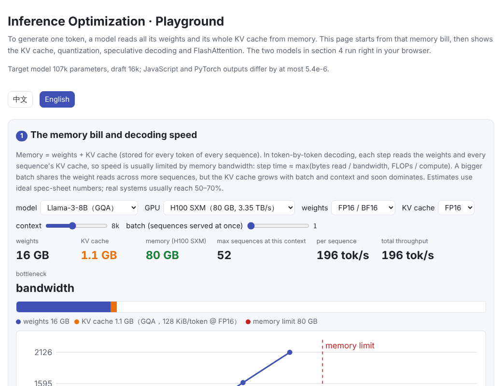
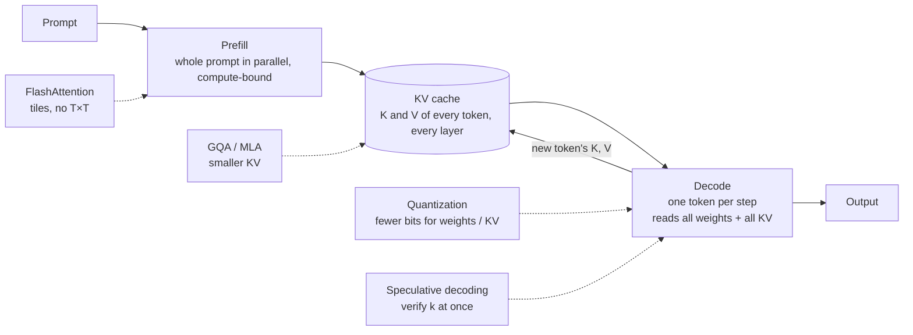
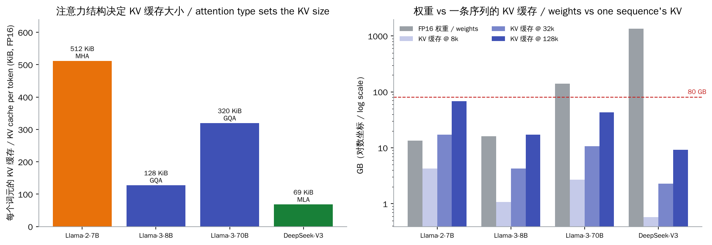
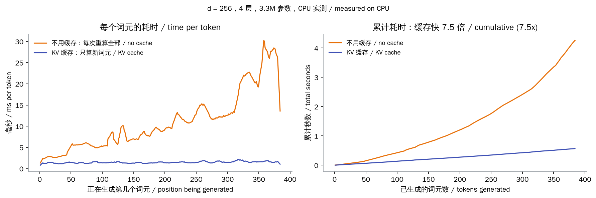
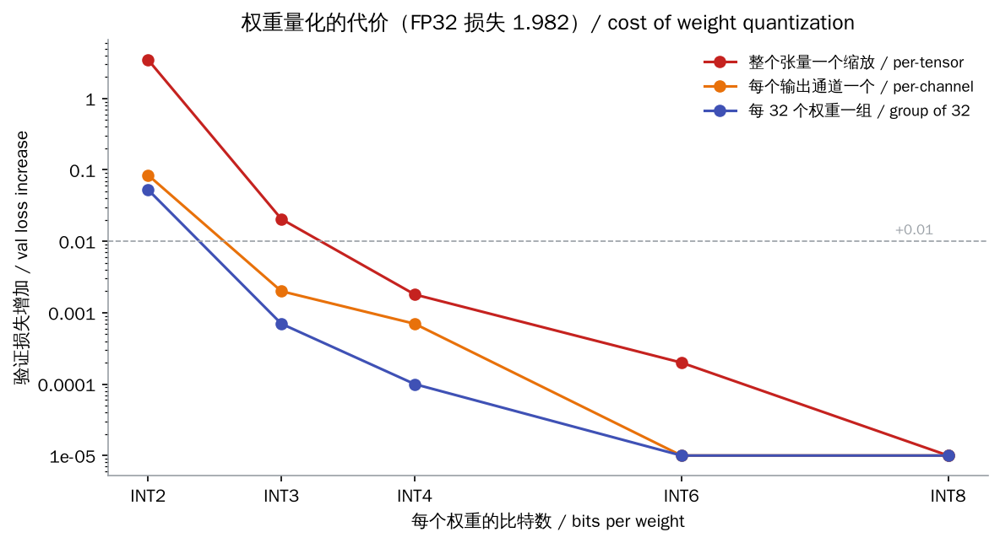
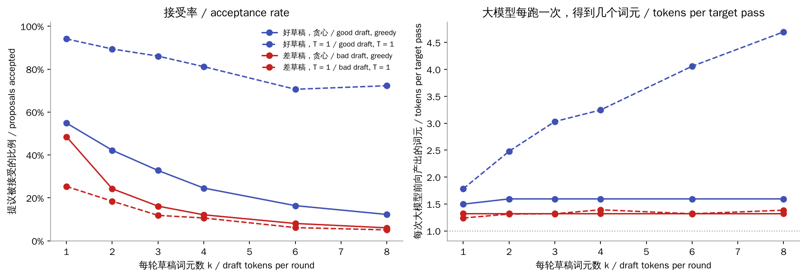

# Inference Optimization

> **In one sentence:** an LLM generates text one token at a time, and every token requires reading **all the weights and the whole KV cache** from GPU memory, so inference is usually limited by **memory capacity and bandwidth**, not by compute. The optimizations all follow from this. The **KV cache** avoids recomputation; **GQA / MLA** shrink the KV cache; **quantization** stores weights in fewer bits; **speculative decoding** lets the big model confirm several tokens in one pass; **FlashAttention** computes attention in tiles without storing the T × T score matrix.
>
> 🌐 [中文版](README.md) · 🎮 **[Open the interactive playground](interactive/inference.html?lang=en)** (the target and draft models run in your browser) · 📓 [Notebook](12-inference-optimization.ipynb) ([open in Colab](https://colab.research.google.com/github/BaiYuBY/use_token_to_learn/blob/main/docs/12-inference-optimization/12-inference-optimization.ipynb))

[](interactive/inference.html?lang=en)

**In this chapter you will learn:**

- why token-by-token decoding is bound by memory bandwidth, and how to estimate memory use and decoding speed
- how the KV cache works, and how MHA, GQA, MQA and MLA make it smaller
- weight quantization: INT8, INT4 and FP8, and per-tensor vs per-channel vs group-wise scales
- speculative decoding: why “a small model drafts, the big model verifies” leaves the output distribution unchanged
- FlashAttention: how an online softmax computes exactly the same result as standard attention, tile by tile

The model is still [chapter 06](../06-pretraining/README.en.md)'s small GPT (the target), plus an even smaller GPT as the draft model for speculative decoding.

## 1. Intuition: inference is slow at reading, not computing

In training, every position of a batch is computed at once and the GPU's compute is well used. Inference has two phases:

- **Prefill** runs the whole prompt through the model at once. Like training, it is parallel and mostly compute-bound.
- **Decode** then generates one token per step. A token costs about $2N$ floating-point operations ($N$ = number of parameters), but all $N$ parameters must be read from memory.

Take Llama-3-8B on an H100 at batch size 1:

- The FP16 weights are about 16 GB. At the H100's ~3.35 TB/s memory bandwidth, reading them once takes ~4.8 ms, so the ceiling is about 200 tokens per second.
- The step's ~16 GFLOP of compute would take only ~0.016 ms at the H100's compute rate.

So the GPU mostly waits for data: decoding is **memory-bound**. That suggests several directions:

| Idea | How | In this chapter |
| --- | --- | --- |
| Compute less | Cache the K and V already computed instead of recomputing them | KV cache (§3.1) |
| Store and read less | Fewer KV heads, or compress KV into one small vector | GQA / MQA / MLA (§3.2) |
| Store and read less | Fewer bits for weights and KV | Quantization (§3.3) |
| Get several tokens per read | Let the big model verify several guesses at once | Speculative decoding (§3.4) |
| Move fewer intermediates | Compute attention in tiles; never store T × T | FlashAttention (§3.5) |
| Read weights once for many requests | Batch many requests together | [13 Serving systems](../13-serving/README.en.md) |

## 2. Pictures





> **🎮 Try it**
>
> In the [playground](interactive/inference.html?lang=en) you can:
>
> 1. Pick a model, GPU, precision, context length and batch size, and see whether it fits and how many tokens per second to expect
> 2. Generate tokens step by step and compare the positions computed with and without a KV cache
> 3. Quantize real weights to INT2–INT8, switch the scale granularity, and add an outlier to see what happens
> 4. Run speculative decoding with both models in your browser, round by round, seeing which drafts are accepted and which rejected
> 5. Step through FlashAttention tile by tile and watch the online softmax's running max and sum update

## 3. How it works

### 3.1 The KV cache

In causal attention, position $t$'s output depends only on $q_t$ and the earlier positions' $k_1..k_t$ and $v_1..v_t$. The earlier $k$ and $v$ were computed in earlier steps and never change (the causal mask means earlier tokens never see later ones). So:

- **Without a cache**, generating token $t$ recomputes all $t$ positions; $n$ tokens cost about $n^2/2$ positions.
- **With a cache**, every layer's $k$ and $v$ are stored, and each step computes only the new token's position; $n$ tokens cost $n$ positions.

[`forward_cached`](code/inference.py) feeds only the new tokens, reads the earlier K and V from the cache, concatenates them, and writes the new K and V back. Logits computed token by token match a full forward pass (max difference about 3e-6). Generating 28 tokens with the small model takes 490 positions without the cache and 31 with it.



The figure shows measured time per token on a wider GPT (d = 256, 4 layers):

- **Without a cache**, the time grows linearly with position.
- **With the cache**, it stays flat.
- **Over 384 tokens**, the cache is 7.5× faster.

The price is memory: every token stores one K and one V in every layer,

$$
\text{KV cache} = 2 \times \text{layers} \times \text{KV heads} \times \text{head dim} \times \text{context} \times \text{batch} \times \text{bytes per value}
$$

For Llama-2-7B (32 layers, 32 heads, head dimension 128, FP16), each token takes $2 \times 32 \times 32 \times 128 \times 2$ bytes = 512 KiB. One 128k-token sequence needs 64 GiB, far more than its 13.5 GB of weights.

### 3.2 Shrinking the KV cache: MHA, GQA, MQA, MLA

| Structure | How | KV per token (FP16) | Example |
| --- | --- | --- | --- |
| **MHA** multi-head attention | Each query head has its own K and V | 512 KiB | Llama-2-7B (32 KV heads) |
| **GQA** grouped-query attention | Several query heads share one K, V | 128 KiB | Llama-3-8B (32 query heads, 8 KV heads) |
| **MQA** multi-query attention | All query heads share one K, V | 16 KiB (if applied to Llama-3-8B) | PaLM, Falcon |
| **MLA** multi-head latent attention | Cache one low-dimensional compressed vector, expand it when used | ~69 KiB (61 layers) | DeepSeek-V2 / V3 |

GQA is today's most common compromise: nearly MHA quality with a fraction of the KV cache (Ainslie et al., 2023). MLA caches only a 512-dimensional compressed vector plus a 64-dimensional position vector per layer (DeepSeek-AI, 2024). So DeepSeek-V3, with 671B parameters and 61 layers, needs only ~69 KiB of KV cache per token, much less than Llama-2-7B. Some models also use **sliding-window attention** in some layers, caching only the most recent tokens; see 14 Long context (planned).

### 3.3 Quantization

**Quantization** stores weights (and sometimes the KV cache and activations) in fewer bits. The simplest symmetric scheme is

$$
s = \frac{\max |w|}{2^{b-1}-1}, \qquad \hat w = s \cdot \operatorname{round}\!\left(\frac{w}{s}\right)
$$

with $b$ bits and scale $s$. The key question is **how many weights share one scale**:

- **Per tensor**: one $s$ for the whole matrix. A single large weight makes $s$ large and squeezes all other weights onto a few levels.
- **Per channel**: one $s$ per output channel (a row of the matrix).
- **Per group**: one $s$ per 32 or 128 consecutive weights. INT4 with groups is the usual setting in GPTQ, AWQ and llama.cpp. The cost is storing more scales: one FP16 scale per 32 weights adds 0.5 bits per weight.



Quantizing all Transformer-layer weights of chapter 06's small model changes the validation loss as follows (FP32 loss 1.982):

| Bits | per-tensor | per-channel | group of 32 |
| --- | --- | --- | --- |
| INT2 | +3.49 | +0.085 | +0.053 |
| INT3 | +0.021 | +0.0020 | +0.0007 |
| INT4 | +0.0018 | +0.0007 | +0.0001 |
| INT8 | +0.0000 | +0.0000 | +0.0000 |

- **INT8, FP8 and group-wise INT4** cost almost nothing (INT6 and INT8 change the loss by less than 0.0001, drawn at the bottom of the plot).
- **At very low bit widths the granularity decides everything**: per-tensor INT2 breaks the model, while group-wise INT2 loses only a little.
- **Outliers**: add one weight 20× larger than the rest to a matrix, and the relative error of per-tensor INT4 jumps from about 0.23 to 0.76, while group-wise INT4 barely changes (0.08).

In real LLMs the outliers sit mostly in a few dimensions of the **activations**, which is why quantizing activations is hard:

- LLM.int8() (Dettmers et al., 2022) computes the outlier dimensions separately in FP16.
- SmoothQuant (Xiao et al., 2023) shifts the difficulty from activations to weights.
- GPTQ (Frantar et al., 2022) and AWQ (Lin et al., 2023) use a little calibration data to compensate for or protect important weights.

**FP8** is a different approach. Instead of evenly spaced integer levels it is a floating-point number with an exponent (E4M3: 4 exponent bits, 3 mantissa bits), with dense levels near zero and sparse ones for large values. GPUs such as the H100 multiply in FP8 natively, so FP8 saves memory and also speeds up computation; DeepSeek-V3 was even trained in FP8.

Quantization saves more than memory: decoding is bandwidth-bound, so going from 16 to 4 bits cuts the bytes read per step by about 4×, and the speed improves with it.

### 3.4 Speculative decoding

During decoding most of the GPU's compute sits idle, so verifying several tokens in one forward pass of the big model costs almost no extra time. **Speculative decoding** (Leviathan et al., 2023; Chen et al., 2023) works like this:

1. A small **draft model** guesses $k$ tokens $x_1..x_k$ in a row, recording the probability $q_i(x_i)$ it gave each.
2. The **target model** runs **one** forward pass over “sequence + $k$ guesses” and gets each position's distribution $p_i$.
3. Starting from $i = 1$, accept $x_i$ with probability $\min(1, p_i(x_i)/q_i(x_i))$.
4. At the first rejection, sample one token from $\max(0, p_i - q_i)$ (normalized) and end the round.
5. If all $k$ are accepted, take one more token from $p_{k+1}$ for free.

This acceptance rule guarantees that **the output distribution is exactly the target model's**. The intuition:

- Tokens the draft over-weights ($q > p$) are rejected in proportion.
- Tokens it under-weights ($p > q$) are made up for when resampling.

The code checks this with a barely trained draft model: the distribution of the 2nd token differs from the target's exact distribution no more than sampling noise alone. **The draft affects only the speed, never the quality.**



Measured over 60 sentences, with a draft about 1/7 the size of the target (16k vs 107k parameters):

- **At temperature 1**, the good draft's proposals are accepted 81% of the time (k = 4). Each forward pass of the big model yields 3.25 tokens on average, and 4.7 at k = 8.
- **Greedy decoding accepts less**, yielding only about 1.6 tokens per pass. Greedy compares only the argmax. In this small language many positions have several nearly equally likely words (which adjective, which noun), so the two models' argmaxes differ almost arbitrarily. At $T = 1$ the whole distributions are compared, and they are in fact close. In practice, acceptance is highest on “low-entropy” text such as code, fixed formats and quoted material.
- **A barely trained draft** yields only about 1.3 tokens per pass.

The real speed-up must subtract the draft's cost: each round runs the draft $k$ times, so larger $k$ is not always better; common values are 3–8. Variants include:

- **Medusa** (Cai et al., 2024): extra prediction heads on the big model, with no separate draft model.
- **EAGLE** (Li et al., 2024): drafts from the big model's hidden states.
- **MTP**: the multi-token prediction module DeepSeek-V3 trains alongside the model, usable for drafting at inference.
- **Lookahead decoding**, drafting from n-grams in the prompt, and others.

### 3.5 FlashAttention: attention in tiles

Standard attention computes the full $T \times T$ score matrix and writes it to memory. It reads it back for the softmax, writes the result, and reads it again to multiply by $V$. Doubling the length makes that matrix, and the traffic, 4× larger.

**FlashAttention** (Dao et al., 2022) moves one small block of $Q$ and one of $K$, $V$ at a time into the GPU's fast but small on-chip SRAM, finishes the work there, and never writes the score matrix to memory. The difficulty is that the softmax needs each row's maximum and total. The solution is an **online softmax**: each row keeps a running max $m$, a running sum $\ell = \sum e^{s - m}$ and an unnormalized output, updated with each new tile of scores:

$$
m' = \max(m, \max_j s_j), \qquad \ell' = \ell\, e^{m - m'} + \sum_j e^{s_j - m'}, \qquad \text{acc}' = \text{acc}\, e^{m - m'} + \sum_j e^{s_j - m'} v_j
$$

After the last tile, the output is acc / ℓ.

- **The result is exact**: it equals standard attention up to floating-point rounding, not an approximation. In the code, [`attention_tiled`](code/inference.py) differs from the standard version by about 5e-7 at most.
- **It is faster because it reads and writes less, not because it computes less**: the FLOPs are the same. It speeds up training and prefill and saves a lot of memory, and almost every inference framework uses it.

FlashAttention-2/3 improved the parallelism further and use the H100's newer hardware features.

### 3.6 Summary: what each optimization saves

| Optimization | Memory | Bandwidth (faster decoding) | Compute | Changes the output? |
| --- | --- | --- | --- | --- |
| KV cache | ✗ (uses more) | — | ✓✓ | No |
| GQA / MQA / MLA | ✓✓ (KV) | ✓ | — | Different architecture; must be trained that way |
| Weight quantization | ✓✓ | ✓✓ | FP8 / INT8 have hardware support | Small error |
| KV cache quantization | ✓ (KV) | ✓ | — | Small error |
| Speculative decoding | ✗ (an extra draft model) | ✓✓ | ✗ (some extra compute) | No |
| FlashAttention | ✓✓ (no T × T) | ✓✓ | — | No |

## 4. Minimal code

Full code: [`code/inference.py`](code/inference.py); run `python docs/12-inference-optimization/code/inference.py` (about 30 seconds). The full experiments are in [`figures/inference_figures.py`](figures/inference_figures.py), which also exports both models' weights for the playground.

A cached forward pass computes only the new tokens in each layer:

```python
q, k, v = F.linear(layer.norm1(x), attn.in_proj_weight, attn.in_proj_bias).split(d, dim=-1)
q, k, v = (z.view(B, t, H, d // H).transpose(1, 2) for z in (q, k, v))
if cache[i] is not None:                     # earlier positions: read them
    k, v = torch.cat([cache[i][0], k], dim=2), torch.cat([cache[i][1], v], dim=2)
cache[i] = (k, v)
mask = torch.ones(t, start + t, dtype=torch.bool).tril(diagonal=start)
a = F.scaled_dot_product_attention(q, k, v, attn_mask=mask)
```

Group-wise quantization:

```python
g = w.reshape(out, inp // group, group)
scale = g.abs().amax(dim=-1, keepdim=True) / (2 ** (bits - 1) - 1)
w_hat = ((g / scale).round().clamp(-qmax - 1, qmax) * scale).reshape(out, inp)
```

The speculative acceptance rule:

```python
for i, x in enumerate(proposal):
    if torch.rand(1) < torch.clamp(p[i][x] / q[i][x], max=1.0):
        out.append(x)                                  # accepted
        continue
    residual = torch.clamp(p[i] - q[i], min=0)         # rejected: resample from the difference
    out.append(int(torch.multinomial(residual / residual.sum(), 1)))
    return out
out.append(int(torch.multinomial(p[k], 1)))           # all accepted: one for free
```

The online softmax:

```python
m_new = torch.maximum(m, s.amax(-1))
fix = torch.exp(m - m_new)                             # rescale what we had
e = torch.exp(s - m_new[..., None])
l = l * fix + e.sum(-1)
acc = acc * fix[..., None] + e @ v_block
```

## 5. Common misconceptions

- **“Inference is slow because there isn't enough compute.”** At small batch sizes, decoding is almost always bound by memory bandwidth. Faster memory, fewer bytes (quantization, GQA) and bigger batches are what help. Prefill and large batches lean more on compute.
- **“The KV cache is an approximation.”** It is exact; it just doesn't recompute what was already computed.
- **“Speculative decoding lowers quality.”** With the correct acceptance rule, the output distribution is exactly the target's. Quality drops only with “approximate speed-ups” that skip verification.
- **“4-bit quantization always hurts noticeably.”** Group-wise INT4 with methods like GPTQ / AWQ usually costs large models little. Below that, granularity and method matter a great deal, and small models and reasoning-heavy tasks tend to be more sensitive, so evaluate on your own tasks before shipping.
- **“FlashAttention is approximate attention.”** It computes standard attention exactly; what it saves is memory traffic.
- **“If the weights fit, it fits.”** With long contexts and large batches, the KV cache is often bigger than the weights.

## 6. Self-check

1. How large is Llama-3-70B's FP16 KV cache per token (80 layers, 8 KV heads, head dimension 128)? For a 32k-token sequence?
2. At batch size 1, how many tokens per second can an FP16 7B model generate at most on a GPU with 2 TB/s of bandwidth? In INT4?
3. Why are group-wise scales better than per-tensor ones? What do they cost?
4. In speculative decoding, if the draft model were identical to the target, what would the acceptance rate be, and how many tokens would each target pass yield?
5. In the online softmax, why must the old running sum be multiplied by $e^{m - m'}$ when the max grows?

<details>
<summary>Answers</summary>

1. $2 \times 80 \times 8 \times 128 \times 2$ = 327,680 bytes = 320 KiB; about 10 GiB for 32k tokens.
2. About 14 GB read per token, so 2 TB/s ÷ 14 GB ≈ 143 tokens/s; INT4 (about 4.5 bits) is about 4 GB, so about 500 tokens/s (ideal, ignoring the KV cache and overheads).
3. Each group fits its own range, so an outlier affects only its group; the cost is storing more scales (one FP16 scale per 32 weights adds 0.5 bits per weight).
4. With $p = q$ every proposal is accepted, and each pass yields $k + 1$ tokens. But the draft costs as much as the target, so there is no speed-up.
5. The earlier $e^{s - m}$ were computed relative to the old max; with the new max $m'$, $e^{s - m'} = e^{s - m} \cdot e^{m - m'}$, so that factor makes the final result equal to the one-shot computation.

</details>

## 7. Further reading

- Pope et al., 2022. [Efficiently Scaling Transformer Inference](https://arxiv.org/abs/2211.05102) (memory, bandwidth and parallelism analysis of inference)
- Shazeer, 2019. [Fast Transformer Decoding: One Write-Head is All You Need](https://arxiv.org/abs/1911.02150) (MQA)
- Ainslie et al., 2023. [GQA: Training Generalized Multi-Query Transformer Models from Multi-Head Checkpoints](https://arxiv.org/abs/2305.13245)
- DeepSeek-AI, 2024. [DeepSeek-V2: A Strong, Economical, and Efficient Mixture-of-Experts Language Model](https://arxiv.org/abs/2405.04434) (MLA)
- DeepSeek-AI, 2024. [DeepSeek-V3 Technical Report](https://arxiv.org/abs/2412.19437) (FP8 training, MTP)
- Dettmers et al., 2022. [LLM.int8(): 8-bit Matrix Multiplication for Transformers at Scale](https://arxiv.org/abs/2208.07339)
- Frantar et al., 2022. [GPTQ: Accurate Post-Training Quantization for Generative Pre-trained Transformers](https://arxiv.org/abs/2210.17323)
- Xiao et al., 2023. [SmoothQuant: Accurate and Efficient Post-Training Quantization for Large Language Models](https://arxiv.org/abs/2211.10438)
- Lin et al., 2023. [AWQ: Activation-aware Weight Quantization for LLM Compression and Acceleration](https://arxiv.org/abs/2306.00978)
- Micikevicius et al., 2022. [FP8 Formats for Deep Learning](https://arxiv.org/abs/2209.05433)
- Leviathan et al., 2023. [Fast Inference from Transformers via Speculative Decoding](https://arxiv.org/abs/2211.17192)
- Chen et al., 2023. [Accelerating Large Language Model Decoding with Speculative Sampling](https://arxiv.org/abs/2302.01318)
- Cai et al., 2024. [Medusa: Simple LLM Inference Acceleration Framework with Multiple Decoding Heads](https://arxiv.org/abs/2401.10774)
- Li et al., 2024. [EAGLE: Speculative Sampling Requires Rethinking Feature Uncertainty](https://arxiv.org/abs/2401.15077)
- Dao et al., 2022. [FlashAttention: Fast and Memory-Efficient Exact Attention with IO-Awareness](https://arxiv.org/abs/2205.14135); Dao, 2023. [FlashAttention-2](https://arxiv.org/abs/2307.08691); Shah et al., 2024. [FlashAttention-3](https://arxiv.org/abs/2407.08608)
- Milakov & Gimelshein, 2018. [Online normalizer calculation for softmax](https://arxiv.org/abs/1805.02867) (online softmax)
- Related Q&A: [How LLM compute is counted](../qa/compute.en.md), [What is DeepInfer](../qa/deepinfer.en.md)
