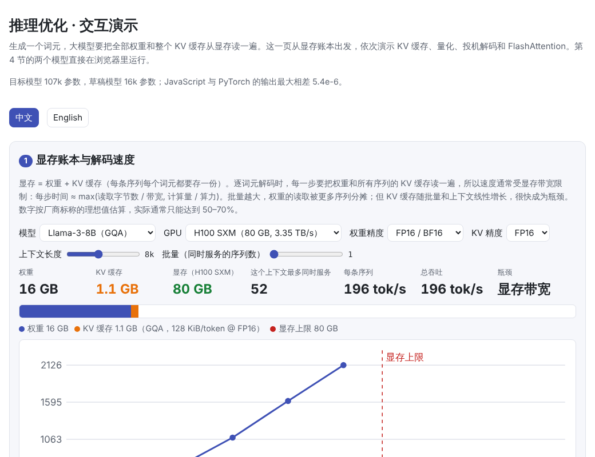
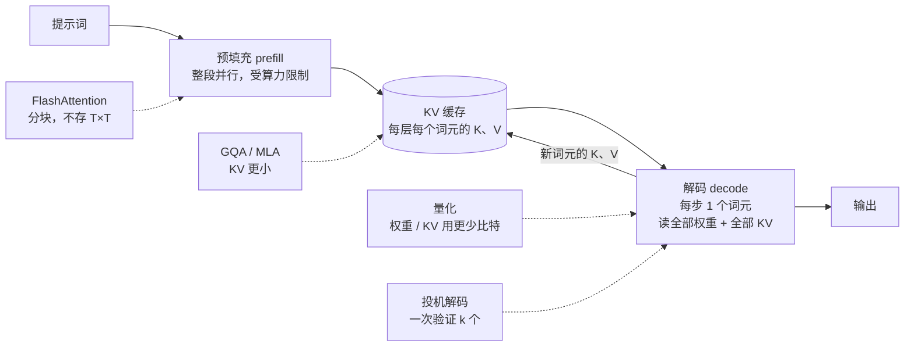

# 推理优化（Inference Optimization）

> **一句话总结：** 大模型生成文本是一个词元一个词元地进行的，每生成一个词元，都要把**全部权重和整个 KV 缓存**从显存里读一遍，所以推理通常卡在**显存容量和带宽**上，而不是算力上。推理优化的思路都围绕这一点：**KV 缓存**避免重复计算；**GQA / MLA** 让 KV 缓存变小；**量化**用更少的比特存权重；**投机解码**让大模型一次前向确认好几个词元；**FlashAttention** 分块计算注意力，不存 T × T 的分数矩阵。
>
> 🌐 [English version](README.en.md) · 🎮 **[打开交互演示](interactive/inference.html?lang=zh)**（目标模型和草稿模型都在浏览器里运行） · 📓 [Notebook](12-inference-optimization.ipynb)（[在 Colab 中打开](https://colab.research.google.com/github/BaiYuBY/use_token_to_learn/blob/main/docs/12-inference-optimization/12-inference-optimization.ipynb)）

[](interactive/inference.html?lang=zh)

**本章你将学会：**

- 为什么逐词元解码受显存带宽限制，怎样估算显存占用和解码速度
- KV 缓存的原理，以及 MHA、GQA、MQA、MLA 怎样让它变小
- 权重量化：INT8、INT4、FP8，以及按张量、按通道、按组设缩放因子的区别
- 投机解码：为什么“小模型起草、大模型验证”不会改变输出分布
- FlashAttention：怎样用在线 softmax 分块算出与标准注意力完全相同的结果

本章的模型仍是 [06 章](../06-pretraining/README.md)训练的小 GPT（目标模型），外加一个更小的 GPT 作为投机解码的草稿模型。

## 1. 直觉：推理慢在“读”，不在“算”

训练时，一批数据的所有位置可以同时计算，GPU 的算力被充分利用。推理分两个阶段：

- **预填充（prefill）**：把整段提示词一次性送进模型，和训练一样可以并行，主要受算力限制。
- **解码（decode）**：之后每一步只生成一个词元。生成一个词元大约需要 $2N$ 次浮点运算（$N$ 是参数量），却要把 $N$ 个参数全部从显存读一遍。

以 Llama-3-8B 在 H100 上、批量为 1 为例：

- FP16 权重约 16 GB。H100 的显存带宽约 3.35 TB/s，读一遍要约 4.8 毫秒，所以每秒最多约 200 个词元。
- 这一步的计算量只有约 16 GFLOP，按 H100 的算力只需约 0.016 毫秒。

所以 GPU 大部分时间在等数据。这就是“解码受显存带宽限制”（memory-bound）。由此可以推出几条优化思路：

| 思路 | 做法 | 本章 |
| --- | --- | --- |
| 少算 | 缓存已经算过的 K、V，不再重算 | KV 缓存（§3.1） |
| 少存、少读 | 减少 KV 头数，或把 KV 压缩成一个小向量 | GQA / MQA / MLA（§3.2） |
| 少存、少读 | 用更少的比特存权重和 KV | 量化（§3.3） |
| 一次读，多出几个词元 | 让大模型一次验证多个猜测 | 投机解码（§3.4） |
| 少读写中间结果 | 分块计算注意力，不存 T × T 矩阵 | FlashAttention（§3.5） |
| 读一次权重，服务很多请求 | 把很多请求拼成一个批量 | 13 推理服务系统（计划中） |

## 2. 图解




> **🎮 动手试试**
>
> 在[交互演示](interactive/inference.html?lang=zh)中，你可以：
>
> 1. 选择模型、GPU、精度、上下文长度和批量，看显存够不够、每秒能生成多少词元
> 2. 一步步生成词元，对比有无 KV 缓存时要计算的位置数
> 3. 对真实的权重做 INT2–INT8 量化，切换缩放粒度，加一个离群值看看会怎样
> 4. 运行投机解码：目标模型和草稿模型都在浏览器里运行，逐轮查看哪些草稿被接受、哪些被拒
> 5. 一块一块地执行 FlashAttention，观察在线 softmax 的最大值和累加和怎样更新

## 3. 原理

### 3.1 KV 缓存

在因果注意力中，第 $t$ 个位置的输出只依赖 $q_t$ 和前面所有位置的 $k_1..k_t$、$v_1..v_t$。前面位置的 $k$、$v$ 在之前的步骤里已经算过，而且不会再变（因果掩码保证前面的词元看不到后面的）。所以：

- **不缓存**：生成第 $t$ 个词元时，要把整段 $t$ 个位置重新算一遍，生成 $n$ 个词元共要算约 $n^2/2$ 个位置。
- **缓存**：把每层每个位置的 $k$、$v$ 存下来，每一步只算新词元这一个位置，生成 $n$ 个词元共算 $n$ 个位置。

代码 [`forward_cached`](code/inference.py) 只把新词元送进模型，从缓存中读出前面的 K、V 拼起来，再把新的 K、V 写回缓存。逐个词元算出的 logits 与一次完整前向的结果一致（最大误差约 3e-6）。小模型生成 28 个词元，不缓存要算 490 个位置，缓存只要 31 个。


上图是在一个更宽的 GPT（d = 256，4 层）上实测的每个词元耗时：

- **不缓存**：耗时随位置线性增长。
- **缓存**：耗时基本恒定。
- **生成 384 个词元**：缓存快 7.5 倍。

代价是显存：每个词元在每一层都要存一份 K 和一份 V，

$$
\text{KV 缓存} = 2 \times \text{层数} \times \text{KV 头数} \times \text{头维度} \times \text{上下文长度} \times \text{批量} \times \text{每个数的字节数}
$$

以 Llama-2-7B（32 层、32 个头、头维度 128、FP16）为例，每个词元要 $2 \times 32 \times 32 \times 128 \times 2$ 字节 = 512 KiB。一条 128k 词元的序列就要 64 GiB，比 13.5 GB 的权重还大得多。

### 3.2 让 KV 缓存变小：MHA、GQA、MQA、MLA

| 结构 | 做法 | 每词元 KV（FP16） | 例子 |
| --- | --- | --- | --- |
| **MHA** 多头注意力 | 每个查询头有自己的 K、V | 512 KiB | Llama-2-7B（32 个 KV 头） |
| **GQA** 分组查询注意力 | 几个查询头共享一组 K、V | 128 KiB | Llama-3-8B（32 个查询头，8 个 KV 头） |
| **MQA** 多查询注意力 | 所有查询头共享一组 K、V | 16 KiB（若用于 Llama-3-8B） | PaLM、Falcon |
| **MLA** 多头潜在注意力 | 把 K、V 压缩成一个低维向量缓存，用时再展开 | 约 69 KiB（61 层） | DeepSeek-V2 / V3 |

GQA 是目前最常见的折中：效果接近 MHA，KV 缓存只有几分之一（Ainslie 等，2023）。MLA 每层只缓存一个 512 维的压缩向量和一个 64 维的位置向量（DeepSeek-AI，2024）。所以 DeepSeek-V3 虽然有 671B 参数、61 层，每个词元的 KV 缓存却只有约 69 KiB，比 Llama-2-7B 还小得多。另外，有的模型对部分层使用**滑动窗口注意力**，只缓存最近的若干个词元，详见 14 长上下文（计划中）。

### 3.3 量化

**量化**用更少的比特表示权重（有时也包括 KV 缓存和激活值）。最简单的对称量化：

$$
s = \frac{\max |w|}{2^{b-1}-1}, \qquad \hat w = s \cdot \operatorname{round}\!\left(\frac{w}{s}\right)
$$

$b$ 是比特数，$s$ 是缩放因子。关键问题是**多少个权重共用一个缩放因子**：

- **按张量**：整个矩阵一个 $s$。只要有一个很大的权重，$s$ 就很大，其余权重都被挤到少数几个格点上。
- **按通道**：每个输出通道（矩阵的一行）一个 $s$。
- **按组**：每 32 或 128 个连续权重一组。INT4 按组量化是 GPTQ、AWQ、llama.cpp 等工具的常用设置。代价是要多存缩放因子：每 32 个权重一个 FP16 缩放，平均每个权重多 0.5 比特。


在 06 章的小模型上，把所有 Transformer 层的权重量化后，验证损失的变化如下（FP32 损失 1.982）：

| 比特数 | 按张量 | 按通道 | 每 32 个一组 |
| --- | --- | --- | --- |
| INT2 | +3.49 | +0.085 | +0.053 |
| INT3 | +0.021 | +0.0020 | +0.0007 |
| INT4 | +0.0018 | +0.0007 | +0.0001 |
| INT8 | +0.0000 | +0.0000 | +0.0000 |

- **INT8、FP8 和 INT4 按组**几乎没有损失（INT6、INT8 的变化小于 0.0001，图中画在最底下）。
- **比特很少时，粒度决定成败**：INT2 按张量量化让模型完全失效，按组量化却只损失一点点。
- **离群值的影响**：在一个权重矩阵里放一个 20 倍大的离群值，INT4 按张量量化的相对误差从约 0.23 升到 0.76，按组量化几乎不受影响（0.08）。

真实的大模型里，离群值主要出现在**激活值**的少数几个维度上，这正是激活值量化难做的原因。LLM.int8()（Dettmers 等，2022）把离群维度单独用 FP16 计算；SmoothQuant（Xiao 等，2023）把激活值的难度“转移”到权重上；GPTQ（Frantar 等，2022）和 AWQ（Lin 等，2023）在量化时利用少量校准数据，补偿或保护重要的权重。

**FP8** 是另一种思路：它不是均匀的整数格点，而是带指数的浮点数（E4M3：4 位指数、3 位尾数），小数值附近格点密、大数值附近格点疏。H100 等 GPU 原生支持 FP8 矩阵乘法，所以 FP8 不仅省显存，还能直接加速计算。DeepSeek-V3 甚至用 FP8 做了训练。

量化省的不只是显存：解码受带宽限制，权重从 16 位降到 4 位，每一步要读的字节就少了约 4 倍，速度也随之提高。

### 3.4 投机解码

解码时 GPU 的算力大量闲置。让大模型一次前向验证好几个词元，几乎不增加耗时。**投机解码**（Leviathan 等，2023；Chen 等，2023）的做法是：

1. 一个小的**草稿模型**连续猜 $k$ 个词元 $x_1..x_k$，记下它给每个词元的概率 $q_i(x_i)$。
2. **目标模型**对“原序列 + $k$ 个猜测”做**一次**前向，得到每个位置的分布 $p_i$。
3. 从 $i = 1$ 开始，以概率 $\min(1, p_i(x_i)/q_i(x_i))$ 接受 $x_i$。
4. 第一次被拒时，从 $\max(0, p_i - q_i)$（归一化后）重新采样一个词元，本轮结束。
5. 如果 $k$ 个都被接受，再从 $p_{k+1}$ 白拿一个词元。

这个接受规则保证：**输出的分布与只用目标模型采样完全相同**。直觉是：

- 草稿给得太多的词元（$q > p$），按比例拒掉一些。
- 草稿给得太少的词元（$p > q$），在重新采样时补回来。

代码用一个几乎没训练的草稿模型验证了这一点：第 2 个词元的分布与目标模型的精确分布之间的差别，和纯抽样噪声一样小。**草稿模型只影响速度，不影响质量。**


实测（60 句话，草稿模型的参数约为目标模型的 1/7（16k 对 107k））：

- **温度 1 时**，好的草稿模型的提议有 81% 被接受（k = 4）。大模型每前向一次平均得到 3.25 个词元，k = 8 时达到 4.7 个。
- **贪心解码时**接受率反而低，每次前向只得到约 1.6 个词元。原因是贪心只比较 argmax：这个小语言里很多位置有好几个词差不多一样可能（选哪个形容词、哪个名词），两个模型的 argmax 很容易“随意地”不同；而 $T = 1$ 时比较的是整个分布，两个模型的分布其实很接近。真实场景中，代码、固定格式、复述原文这类“低熵”内容的接受率最高。
- **几乎没训练的草稿模型**，每次前向只能得到约 1.3 个词元。

实际加速比还要扣除草稿模型的开销：每轮要多跑 $k$ 次草稿模型。所以 $k$ 不是越大越好，常见取值是 3–8。变体有：

- **Medusa**（Cai 等，2024）：在大模型上加几个额外的预测头，不需要单独的草稿模型。
- **EAGLE**（Li 等，2024）：用大模型的隐藏状态来起草。
- **MTP**：DeepSeek-V3 训练时附带的多词元预测模块，推理时可以用来起草。
- **前瞻解码**、用提示词中的 n-gram 起草等。

### 3.5 FlashAttention：分块计算注意力

标准注意力先算出完整的 $T \times T$ 分数矩阵，写回显存，再读出来做 softmax，再写回、再读出来乘 $V$。序列长度翻倍，这个矩阵变为 4 倍，读写也变为 4 倍。

**FlashAttention**（Dao 等，2022）每次只把一小块 $Q$ 和一小块 $K$、$V$ 搬进 GPU 片上很快但很小的 SRAM，在里面算完，不把分数矩阵写回显存。难点在于 softmax 需要整行的最大值和总和。解决办法是**在线 softmax**：每行维护当前最大值 $m$、累加和 $\ell = \sum e^{s - m}$ 和未归一化的输出。来了新的一块分数，就更新：

$$
m' = \max(m, \max_j s_j), \qquad \ell' = \ell\, e^{m - m'} + \sum_j e^{s_j - m'}, \qquad \text{acc}' = \text{acc}\, e^{m - m'} + \sum_j e^{s_j - m'} v_j
$$

全部块处理完后，输出 = acc / ℓ。

- **结果精确**：与标准注意力完全相同（只有浮点舍入差异），不是近似。代码中 [`attention_tiled`](code/inference.py) 与标准实现的最大误差约 5e-7。
- **快的原因是读写少，不是计算少**：计算量其实一样。训练和预填充时它能明显提速并省下大量显存，几乎所有推理框架都在用。

后续的 FlashAttention-2/3 进一步优化了并行方式，并利用了 H100 的新硬件特性。

### 3.6 小结：各种优化分别省了什么

| 优化 | 省显存 | 省带宽（解码更快） | 省计算 | 是否改变输出 |
| --- | --- | --- | --- | --- |
| KV 缓存 | ✗（反而多占） | — | ✓✓ | 不变 |
| GQA / MQA / MLA | ✓✓（KV） | ✓ | — | 模型结构不同，需要训练时就采用 |
| 权重量化 | ✓✓ | ✓✓ | FP8 / INT8 有硬件加速 | 有少量误差 |
| KV 缓存量化 | ✓（KV） | ✓ | — | 有少量误差 |
| 投机解码 | ✗（多一个草稿模型） | ✓✓ | ✗（多做一些计算） | 不变 |
| FlashAttention | ✓✓（不存 T × T） | ✓✓ | — | 不变 |

## 4. 最小代码实现

完整代码：[`code/inference.py`](code/inference.py)，运行 `python docs/12-inference-optimization/code/inference.py`（约 30 秒）。完整实验在 [`figures/inference_figures.py`](figures/inference_figures.py) 中，它还会导出两个模型的权重供交互页使用。

带缓存的前向，每层只算新词元：

```python
q, k, v = F.linear(layer.norm1(x), attn.in_proj_weight, attn.in_proj_bias).split(d, dim=-1)
q, k, v = (z.view(B, t, H, d // H).transpose(1, 2) for z in (q, k, v))
if cache[i] is not None:                     # 之前的位置：直接读取
    k, v = torch.cat([cache[i][0], k], dim=2), torch.cat([cache[i][1], v], dim=2)
cache[i] = (k, v)
mask = torch.ones(t, start + t, dtype=torch.bool).tril(diagonal=start)
a = F.scaled_dot_product_attention(q, k, v, attn_mask=mask)
```

按组量化：

```python
g = w.reshape(out, inp // group, group)
scale = g.abs().amax(dim=-1, keepdim=True) / (2 ** (bits - 1) - 1)
w_hat = ((g / scale).round().clamp(-qmax - 1, qmax) * scale).reshape(out, inp)
```

投机解码的接受规则：

```python
for i, x in enumerate(proposal):
    if torch.rand(1) < torch.clamp(p[i][x] / q[i][x], max=1.0):
        out.append(x)                                  # 接受
        continue
    residual = torch.clamp(p[i] - q[i], min=0)         # 被拒：从差额中重采样
    out.append(int(torch.multinomial(residual / residual.sum(), 1)))
    return out
out.append(int(torch.multinomial(p[k], 1)))           # 全部接受：白送一个
```

在线 softmax：

```python
m_new = torch.maximum(m, s.amax(-1))
fix = torch.exp(m - m_new)                             # 修正之前的累加量
e = torch.exp(s - m_new[..., None])
l = l * fix + e.sum(-1)
acc = acc * fix[..., None] + e @ v_block
```

## 5. 常见误区

- **“推理慢是因为算力不够”**：批量小时，解码几乎总是受显存带宽限制。更快的显存、更少的字节（量化、GQA）、更大的批量才是关键。预填充和大批量时，才更多受算力限制。
- **“KV 缓存是一种近似”**：它是精确的，只是不重复计算已经算过的东西。
- **“投机解码会降低质量”**：按正确的接受规则，输出分布与目标模型完全相同。降低质量的是一些不做验证的“近似加速”方法。
- **“量化到 4 位一定会明显变差”**：INT4 按组量化加上 GPTQ / AWQ 等方法，大模型通常只损失很少。但比特更低时，粒度和方法非常关键，而且小模型、推理密集型任务往往更敏感，上线前要在自己的任务上评测。
- **“FlashAttention 是近似注意力”**：它精确计算标准注意力，省的是显存读写。
- **“显存够放下权重就行”**：长上下文和大批量时，KV 缓存往往比权重还大。

## 6. 自测题

1. Llama-3-70B（80 层、8 个 KV 头、头维度 128）每个词元的 FP16 KV 缓存是多少？一条 32k 的序列呢？
2. 批量为 1 时，一个 FP16 的 7B 模型在 2 TB/s 带宽的 GPU 上，每秒最多生成多少词元？换成 INT4 呢？
3. 为什么按组量化比按张量量化好？它的额外代价是什么？
4. 投机解码中，如果草稿模型和目标模型完全相同，接受率是多少？每次目标模型前向能得到几个词元？
5. 在线 softmax 中，为什么最大值变大时要把旧的累加和乘以 $e^{m - m'}$？

<details>
<summary>参考答案</summary>

1. $2 \times 80 \times 8 \times 128 \times 2$ = 327,680 字节 = 320 KiB；32k 词元约 10 GiB。
2. 每个词元约读 14 GB，2 TB/s ÷ 14 GB ≈ 143 个/秒；INT4（约 4.5 比特）约 4 GB，约 500 个/秒（理想值，未计 KV 缓存和开销）。
3. 每组按自己的数值范围取格点，一个离群值只影响它所在的组；代价是要存更多缩放因子（每 32 个权重一个 FP16 缩放，平均每个权重多 0.5 比特）。
4. $p = q$，接受率 100%，每次得到 $k + 1$ 个词元。但草稿模型和目标模型一样贵，没有加速。
5. 之前的 $e^{s - m}$ 是相对旧的最大值算的；换成新的最大值 $m'$ 后，$e^{s - m'} = e^{s - m} \cdot e^{m - m'}$，所以要乘这个因子，最后的结果才与一次性计算相同。

</details>

## 7. 延伸阅读

- Pope et al., 2022. [Efficiently Scaling Transformer Inference](https://arxiv.org/abs/2211.05102)（推理的显存、带宽与并行分析）
- Shazeer, 2019. [Fast Transformer Decoding: One Write-Head is All You Need](https://arxiv.org/abs/1911.02150)（MQA）
- Ainslie et al., 2023. [GQA: Training Generalized Multi-Query Transformer Models from Multi-Head Checkpoints](https://arxiv.org/abs/2305.13245)
- DeepSeek-AI, 2024. [DeepSeek-V2: A Strong, Economical, and Efficient Mixture-of-Experts Language Model](https://arxiv.org/abs/2405.04434)（MLA）
- DeepSeek-AI, 2024. [DeepSeek-V3 Technical Report](https://arxiv.org/abs/2412.19437)（FP8 训练、MTP）
- Dettmers et al., 2022. [LLM.int8(): 8-bit Matrix Multiplication for Transformers at Scale](https://arxiv.org/abs/2208.07339)
- Frantar et al., 2022. [GPTQ: Accurate Post-Training Quantization for Generative Pre-trained Transformers](https://arxiv.org/abs/2210.17323)
- Xiao et al., 2023. [SmoothQuant: Accurate and Efficient Post-Training Quantization for Large Language Models](https://arxiv.org/abs/2211.10438)
- Lin et al., 2023. [AWQ: Activation-aware Weight Quantization for LLM Compression and Acceleration](https://arxiv.org/abs/2306.00978)
- Micikevicius et al., 2022. [FP8 Formats for Deep Learning](https://arxiv.org/abs/2209.05433)
- Leviathan et al., 2023. [Fast Inference from Transformers via Speculative Decoding](https://arxiv.org/abs/2211.17192)
- Chen et al., 2023. [Accelerating Large Language Model Decoding with Speculative Sampling](https://arxiv.org/abs/2302.01318)
- Cai et al., 2024. [Medusa: Simple LLM Inference Acceleration Framework with Multiple Decoding Heads](https://arxiv.org/abs/2401.10774)
- Li et al., 2024. [EAGLE: Speculative Sampling Requires Rethinking Feature Uncertainty](https://arxiv.org/abs/2401.15077)
- Dao et al., 2022. [FlashAttention: Fast and Memory-Efficient Exact Attention with IO-Awareness](https://arxiv.org/abs/2205.14135)；Dao, 2023. [FlashAttention-2](https://arxiv.org/abs/2307.08691)；Shah et al., 2024. [FlashAttention-3](https://arxiv.org/abs/2407.08608)
- Milakov & Gimelshein, 2018. [Online normalizer calculation for softmax](https://arxiv.org/abs/1805.02867)（在线 softmax）
- 相关问答：[大模型的算力怎么算](../qa/compute.md)、[DeepInfer 是什么](../qa/deepinfer.md)
