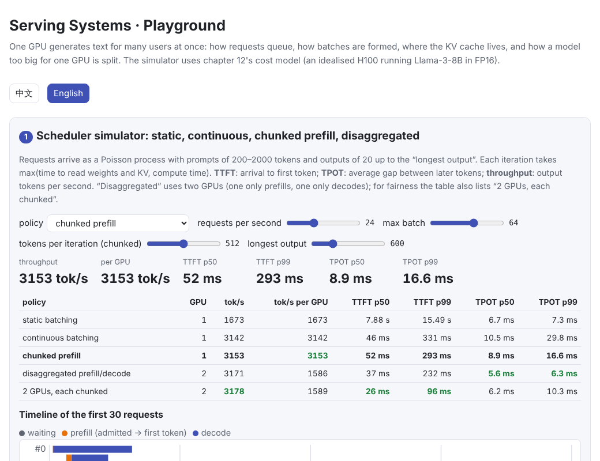
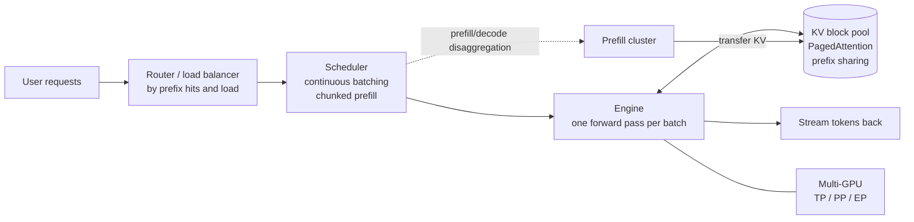

# Serving Systems

> **In one sentence:** the hard part of deploying a model as a service is not a single generation but **serving many users at once**:
>
> - **Continuous batching** lets requests come and go freely, so the GPU never idles on finished ones.
> - **PagedAttention** manages the KV cache in blocks, like OS memory pages, so one GPU serves several times more requests and identical prefixes can be shared.
> - **Chunked prefill and prefill/decode disaggregation** keep long prompts from stalling users who are mid-generation.
> - **Tensor, pipeline and expert parallelism** run models too big for one GPU.
>
> All of it is measured by time to first token (TTFT), time per output token (TPOT) and throughput.
>
> 🌐 [中文版](README.md) · 🎮 **[Open the interactive playground](interactive/serving.html?lang=en)** · 📓 [Notebook](13-serving.ipynb) ([open in Colab](https://colab.research.google.com/github/BaiYuBY/use_token_to_learn/blob/main/docs/13-serving/13-serving.ipynb))

[](interactive/serving.html?lang=en)

**In this chapter you will learn:**

- the metrics of a serving system: TTFT, TPOT, throughput, and “goodput” that meets latency targets
- static vs continuous batching (iteration-level scheduling)
- PagedAttention: why the KV cache is managed in blocks, and how prefix caching reuses shared prefixes
- the conflict between prefill and decode, and its two fixes: chunked prefill and prefill/decode disaggregation
- what tensor, pipeline, data and expert parallelism each split, and what they cost in communication

The chapter has two pieces of code:

- A **tiny engine that really runs**: it implements a paged KV cache, continuous batching and prefix caching for [chapter 06](../06-pretraining/README.en.md)'s small GPT, and checks that its outputs match generating each request on its own.
- A **scheduler simulator**: it uses [chapter 12](../12-inference-optimization/README.en.md)'s bandwidth/compute cost model of an H100 running Llama-3-8B in FP16.

## 1. Intuition: from one user to many at once

[Chapter 12](../12-inference-optimization/README.en.md) showed that in token-by-token decoding the GPU spends most of its time reading weights. At batch size 1, reading 16 GB of weights produces one token; producing one token each for 64 users reads the same weights and yields 64 times as much. **Batching is the most important tool in serving.**

But real requests don't arrive or finish together: some ask one sentence, others want an essay; prompts are long and short; requests come at any moment. Hence these problems:

| Problem | Fix |
| --- | --- |
| Short requests in a batch finish, but the GPU waits for the longest | **Continuous batching**: requests can leave and join every iteration |
| How much KV memory to reserve per request? Too much wastes, too little runs out | **PagedAttention**: allocate in blocks as needed |
| Many requests share a system prompt, computed and stored over and over | **Prefix caching**: compute and store a shared prefix's KV once |
| While a long prompt is prefilled, every decoding user waits | **Chunked prefill**, **prefill/decode disaggregation** |
| The model doesn't fit one GPU | **Tensor, pipeline and expert parallelism** |

The metrics of service quality:

- **TTFT** (time to first token): from arrival to the first word, mostly queueing plus prefill.
- **TPOT** (time per output token, also ITL): the gap between later words, i.e. the “typing speed”. People read roughly 5–10 words a second, so a few tens of milliseconds is enough.
- **Throughput**: total output tokens per second, which sets the cost.
- **Goodput**: the throughput of requests that meet latency targets, e.g. TTFT < 1 s and TPOT < 50 ms (Zhong et al., 2024). Chasing throughput alone can push latency beyond what users accept.

## 2. Pictures




> **🎮 Try it**
>
> In the [playground](interactive/serving.html?lang=en) you can:
>
> 1. Adjust the request rate, maximum batch, chunk size and output length, and compare the throughput, TTFT and TPOT of five scheduling schemes, with a timeline of the first 30 requests and the time of every iteration
> 2. Watch the KV block pool fill up under “reserve the max length”, “paged” and “paged + prefix sharing”
> 3. Pick a model, tensor- and pipeline-parallel degrees and an interconnect, and estimate per-GPU memory, communication time and the pipeline bubble

## 3. How it works

### 3.1 Continuous batching (iteration-level scheduling)

**Static batching** gathers a batch, prefills it together and decodes until the longest request finishes, then starts the next batch. It has two problems:

- **Finished short requests keep their slots**: the hatched area on the left of the figure, where the GPU spins for nothing.
- **New requests wait for the whole batch to finish**: TTFT is long.

**Continuous batching** (Orca, Yu et al., 2022) schedules at the granularity of **one forward pass**:

- At the start of each iteration, newly arrived requests join if there is room.
- At the end of each iteration, requests that produced an end token or hit their length limit leave at once.

For the same 8 requests (right of the figure), everything finishes at step 12 instead of 17, and late arrivals don't queue for long.

The tiny engine [`serve`](code/serving.py) works exactly like this:

- New requests' whole prompts and running requests' single new tokens go into **one batch** and one forward pass (different lengths are handled with padding and an attention mask).
- With 12 requests arriving over time, the batch size varies between 1 and 6.
- Every logit each request gets matches a plain full forward pass over it (max difference about 3e-6).


### 3.2 PagedAttention: the KV cache in blocks

A request's KV cache grows as it generates, and its final length is unknown in advance. Early systems reserved one contiguous region **of the maximum length** per request, which wasted a great deal:

- **Internal fragmentation**: room for 4096 tokens reserved, a few hundred used.
- **External fragmentation**: the free memory is scattered and no contiguous region is long enough.

**PagedAttention** (vLLM, Kwon et al., 2023) borrows virtual memory from operating systems:

- KV memory is cut into fixed-size **blocks** (say 16 tokens each).
- Each request has a **block table** saying where in physical memory its i-th block lives. New blocks are allocated as the sequence grows and returned the moment it finishes.
- Attention reads K and V through the block table.

The waste is less than one block per sequence.


With this chapter's workload (Llama-3-8B on 80 GB, room for about 490k tokens of KV after the weights):

- **Reserving 4096 tokens per request** serves only 119 requests at once, with 76% of the reserved space unused.
- **16-token blocks** serve 516, wasting under 1%.

More concurrent requests means bigger batches and higher throughput.

**Prefix caching** goes further:

- Many requests start the same way (a system prompt, the same document, earlier turns of a conversation). Blocks of a shared prefix are computed and stored once and shared by several requests through **reference counts**.
- SGLang's **RadixAttention** (Zheng et al., 2023) keeps every cached prefix in a radix tree; vLLM's automatic prefix caching hashes block contents.
- In the code, 12 requests starting with the same prefix arrive one after another; with prefix caching on, prefill computes 16 tokens instead of 60, with identical outputs.

### 3.3 Prefill versus decode

Prefill handles hundreds or thousands of tokens at once and is **compute-bound**; decode handles one token per request and is **bandwidth-bound**. When both share an iteration, a long prompt makes that iteration long, every decoding user waits, and TPOT spikes. There are two fixes:

- **Chunked prefill** (Sarathi-Serve, Agrawal et al., 2024):
  - Each iteration gets a token budget (say 512). Decode requests go in first and the rest of the budget goes to prefill.
  - Long prompts are finished over several iterations, so every iteration takes about the same time.
- **Prefill/decode disaggregation** (DistServe, Zhong et al., 2024; Splitwise, Patel et al., 2023; Mooncake, Qin et al., 2024):
  - Prefill and decode run on **different GPUs** (even different machines), and the KV cache is sent to the decode GPU after prefill.
  - Neither phase disturbs the other, and each can use the parallelism and hardware that suit it.
  - The price is moving the KV, and matching the number of each kind of GPU to the load.


Simulated at 32 requests per second, with prompts of 200–2000 tokens and outputs of 20–600:

| Scheme | GPUs | Throughput tok/s | TTFT median | TPOT p99 |
| --- | --- | --- | --- | --- |
| Static batching | 1 | 1,713 | 17.6 s | 7.7 ms |
| Continuous batching | 1 | 3,803 | 1.67 s | 47.5 ms |
| Continuous + chunked prefill | 1 | 4,256 | 0.43 s | 16.6 ms |
| Prefill/decode disaggregation | 2 | 4,575 | 0.06 s | 6.6 ms |
| 2 GPUs, each chunked (baseline) | 2 | 4,596 | 0.03 s | 11.7 ms |

- **Continuous batching** doubles throughput and cuts TTFT from over ten seconds to one or two.
- **Chunked prefill** brings the TPOT tail down from 47.5 ms to 16.6 ms.
- **Disaggregation** gives the steadiest TPOT, because no prefill ever lands on the decode GPU. But it uses two GPUs, so the fair baseline is “2 GPUs, each chunked”:
  - Total throughput is similar, and disaggregation has the lower TPOT p99.
  - At 64 requests per second, disaggregation's single prefill GPU becomes the bottleneck (TTFT rises to 3 s) while the baseline stays at 0.1 s.
  - Real systems therefore tune the ratio of prefill to decode GPUs to the load, which is exactly what DistServe and similar work study.

The simulator is idealized: it ignores scheduling overhead, differences in attention-kernel efficiency, network latency and more. Its purpose is to show the direction of each trade-off, not to predict any particular system's performance.

### 3.4 Multi-GPU parallelism

When a model doesn't fit one GPU, or one GPU is too slow, it is split:

| Kind | What is split | Communication | Suits |
| --- | --- | --- | --- |
| **Data parallelism (DP)** | Nothing; several full replicas | None (each serves different requests) | Scaling out when the model fits one GPU |
| **Tensor parallelism (TP)** | Each layer's matrices, by rows or columns | 2 all-reduces per layer | Inside one machine (NVLink) |
| **Pipeline parallelism (PP)** | Different layers on different GPUs | Activations between neighbouring stages | Across machines; has “bubbles” |
| **Expert parallelism (EP)** | Different MoE experts on different GPUs | All-to-all token dispatch | MoE models; see [15 MoE](../15-moe/README.en.md) |

The classic tensor-parallel split (Megatron-LM, Shoeybi et al., 2019):

- The feed-forward layer's first matrix is split by **columns**, so each GPU owns some hidden units and applies GELU locally. The second matrix is split by **rows**, each GPU computes a partial output, and one **all-reduce** (a sum) combines them.
- Attention is split by heads and likewise needs one all-reduce.
- [`tensor_parallel_ffn`](code/serving.py) checks that splitting into 2 or 4 parts gives the original result.

Communication:

- Each layer does two all-reduces, and each GPU sends about $2\frac{n-1}{n} \times$ tokens $\times d \times 2$ bytes per all-reduce.
- For Llama-3-8B at TP = 8 that is about 896 KiB per token per GPU, only about 2 µs of NVLink time.
- But each all-reduce also has a fixed latency of a few microseconds, and a step needs 64 of them, so **at small batch sizes latency dominates**. This is also why TP rarely crosses machines.

Pipeline parallelism suffers from **bubbles**: with $p$ stages and $m$ micro-batches, a fraction $\frac{p-1}{m+p-1}$ of the time some GPU is idle.

DeepSeek-V3's deployment combines several of these techniques (DeepSeek-AI, 2024):

- Prefill and decode are disaggregated, each with its own parallel configuration.
- Attention uses TP with DP, and the MoE layers use large-scale expert parallelism.

### 3.5 Other practical details

- **Preemption**: when memory runs out, pause some requests and free their KV blocks; later recompute them, or swap the KV out to CPU memory and back.
- **Tiered KV storage**: keep rarely used prefix caches in CPU memory, SSD or remote storage, and bring them back to the GPU on a hit. Mooncake designs its whole system around the KV cache.
- **Scheduling goals**: first-come-first-served is simplest; schedulers can also order by predicted length, priority or SLO.
- **Routing**: with several replicas, sending requests that share a prefix to the same replica raises the prefix-cache hit rate.
- **Common frameworks**: vLLM, SGLang, TensorRT-LLM and DeepInfer (see the [Q&A](../qa/deepinfer.en.md)) implement most of this chapter's mechanisms.

## 4. Minimal code

Full code: [`code/serving.py`](code/serving.py); run `python docs/13-serving/code/serving.py` (about 20 seconds). Experiments and figures are in [`figures/serving_figures.py`](figures/serving_figures.py).

Block pool and block table: each position's K and V go into the right slot of the block that holds it:

```python
p = s.n_cached + j                                   # the token's position in the sequence
pool.k[li, s.table[p // bs], :, p % bs] = k[i, :, j]  # the block table maps logical to physical
pool.v[li, s.table[p // bs], :, p % bs] = v[i, :, j]
blocks = s.table[:math.ceil(total / bs)]              # read the whole sequence back
K = pool.k[li, blocks].transpose(0, 1).reshape(H, -1, dh)[:, :total]
```

The continuous-batching loop:

```python
while waiting or running:
    while waiting and waiting[0].arrival <= it and admit(pool, waiting[0], use_prefix):
        running.append(waiting.pop(0))                # admit while there is room
    logits = forward_paged(model, pool, running)      # new prompts and old requests in one batch
    for s, lg in zip(running, logits):
        s.tokens.append(int(lg.argmax()))
    for s in [s for s in running if len(s.generated) == s.max_new]:
        running.remove(s)                             # finished requests leave at once
        for b in s.table:
            pool.release(b)                           # return blocks (when the ref count hits 0)
```

Chunked prefill: decode requests first, the remaining budget to prefill:

```python
budget = chunk - len(decoding)
for r in running:
    if r["prefilled"] < r["prompt"] and budget > 0:
        take = min(r["prompt"] - r["prefilled"], budget)
        r["prefilled"] += take
        budget -= take
```

## 5. Common misconceptions

- **“The bigger the batch, the better.”** Bigger batches raise throughput but make each iteration slower, so TPOT rises, and the KV cache fills memory. Look for the highest goodput that meets the latency targets.
- **“High throughput means good service.”** Users feel TTFT and TPOT. Averages are not enough either; p99 tail latency often matters more.
- **“PagedAttention makes attention compute faster.”** It mainly saves memory, which allows bigger batches; reading non-contiguous blocks actually needs specially optimized kernels.
- **“Prefill/decode disaggregation is always better.”** It steadies latency, but adds a KV transfer, and the ratio of the two kinds of GPU must follow the load or one side sits idle.
- **“More tensor parallelism is always faster.”** Every layer needs an all-reduce, so more splits mean more communication and synchronization; with fewer KV heads than the TP degree, the KV must also be replicated.

## 6. Self-check

1. A static batch holds three requests with output lengths 10, 20 and 500. How many decode iterations does the batch run, and how many “slot × iteration” units are wasted?
2. With 16-token blocks, a request ends at 1000 tokens. How many token slots does PagedAttention waste? And with a 4096-token reservation?
3. Why does prefilling a long prompt worsen other users' TPOT? How does chunked prefill help?
4. At TP = 8, how many all-reduces does an 80-layer model do per decoding step? At a fixed 8 µs each, how much time is latency alone?
5. With 4 pipeline stages and 8 micro-batches, how large is the bubble?

<details>
<summary>Answers</summary>

1. 500 iterations. The three requests hold 3 × 500 = 1500 slot-iterations but use 10 + 20 + 500 = 530, wasting 970.
2. ⌈1000/16⌉ = 63 blocks = 1008 slots, wasting 8; a 4096-token reservation wastes 3096.
3. That iteration processes hundreds or thousands of tokens and takes longer, and every decoding request in the batch waits for it. Chunked prefill caps the tokens per iteration and spreads a long prompt over several, so each iteration takes about the same time.
4. Two per layer, 160 in all, about 1.3 ms. For a 70B model at TP = 8, each GPU holds 17.6 GB of weights, about 5 ms to read on an H100, so communication latency alone adds roughly a quarter of that. At small batch sizes, communication eats part of TP's gain.
5. (4 − 1) / (8 + 4 − 1) = 3/11 ≈ 27%.

</details>

## 7. Further reading

- Yu et al., 2022. [Orca: A Distributed Serving System for Transformer-Based Generative Models](https://www.usenix.org/conference/osdi22/presentation/yu) (continuous batching / iteration-level scheduling)
- Kwon et al., 2023. [Efficient Memory Management for Large Language Model Serving with PagedAttention](https://arxiv.org/abs/2309.06180) (vLLM)
- Zheng et al., 2023. [SGLang: Efficient Execution of Structured Language Model Programs](https://arxiv.org/abs/2312.07104) (RadixAttention prefix caching)
- Agrawal et al., 2024. [Taming Throughput-Latency Tradeoff in LLM Inference with Sarathi-Serve](https://arxiv.org/abs/2403.02310) (chunked prefill)
- Zhong et al., 2024. [DistServe: Disaggregating Prefill and Decoding for Goodput-optimized Large Language Model Serving](https://arxiv.org/abs/2401.09670)
- Patel et al., 2023. [Splitwise: Efficient Generative LLM Inference Using Phase Splitting](https://arxiv.org/abs/2311.18677)
- Qin et al., 2024. [Mooncake: A KVCache-centric Disaggregated Architecture for LLM Serving](https://arxiv.org/abs/2407.00079)
- Shoeybi et al., 2019. [Megatron-LM: Training Multi-Billion Parameter Language Models Using Model Parallelism](https://arxiv.org/abs/1909.08053) (tensor parallelism)
- Huang et al., 2018. [GPipe: Efficient Training of Giant Neural Networks using Pipeline Parallelism](https://arxiv.org/abs/1811.06965) (pipeline parallelism)
- DeepSeek-AI, 2024. [DeepSeek-V3 Technical Report](https://arxiv.org/abs/2412.19437) (deployment: prefill/decode disaggregation, expert parallelism)
- Related Q&A: [What is DeepInfer](../qa/deepinfer.en.md), [How LLM compute is counted](../qa/compute.en.md)
