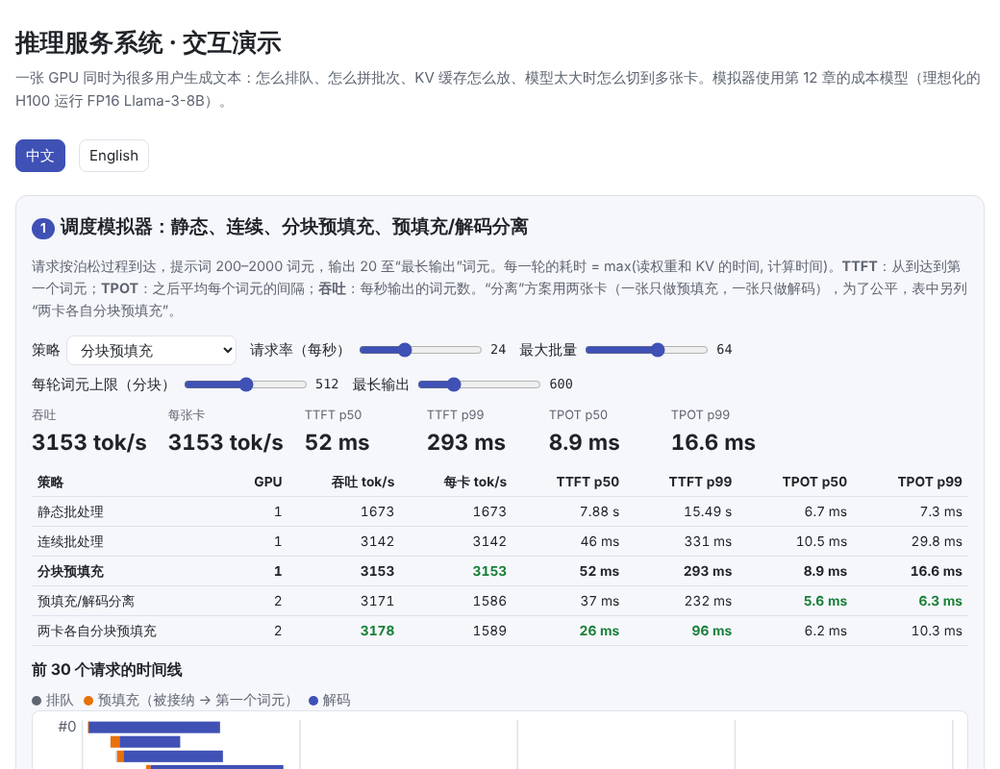
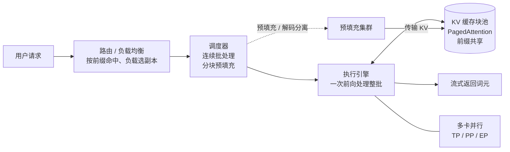
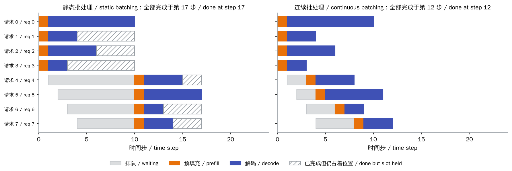
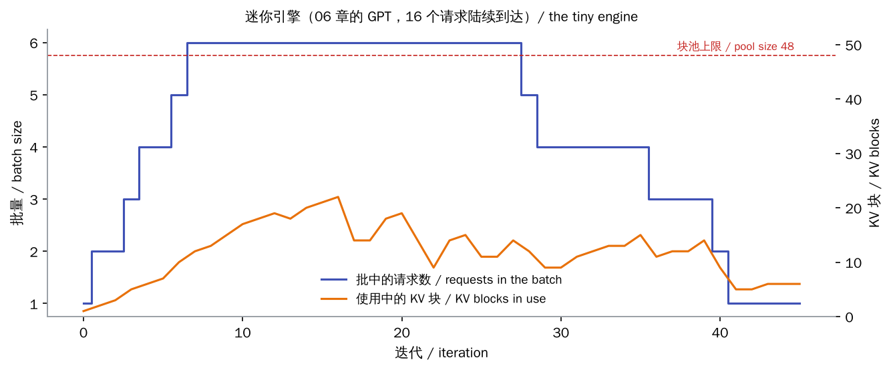
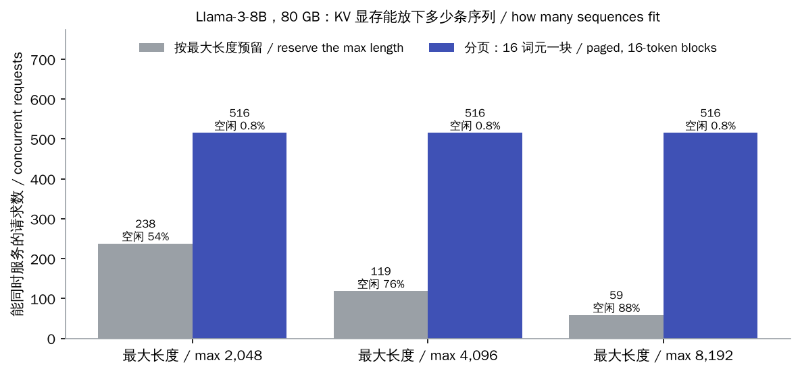
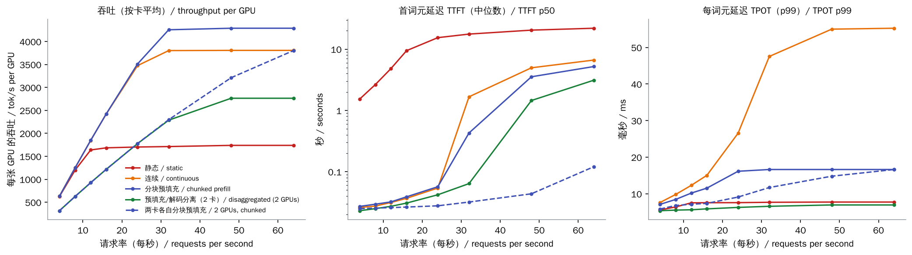

# 推理服务系统（Serving Systems）

> **一句话总结：** 把模型部署成服务，难点不在单次生成，而在**同时服务很多用户**：
>
> - **连续批处理**：让请求随到随走，GPU 不为已完成的请求空转。
> - **PagedAttention**：像操作系统分页一样按块管理 KV 缓存，同一张卡能多服务好几倍的请求，还能在请求间共享相同的前缀。
> - **分块预填充、预填充/解码分离**：避免长提示词打断正在解码的用户。
> - **张量并行、流水线并行、专家并行**：让放不下一张卡的大模型跑起来。
>
> 衡量这一切的指标是首词元延迟（TTFT）、每词元延迟（TPOT）和吞吐。
>
> 🌐 [English version](README.en.md) · 🎮 **[打开交互演示](interactive/serving.html?lang=zh)** · 📓 [Notebook](13-serving.ipynb)（[在 Colab 中打开](https://colab.research.google.com/github/BaiYuBY/use_token_to_learn/blob/main/docs/13-serving/13-serving.ipynb)）

[](interactive/serving.html?lang=zh)

**本章你将学会：**

- 衡量推理服务的指标：TTFT、TPOT、吞吐和满足延迟要求的“有效吞吐”（goodput）
- 静态批处理与连续批处理（迭代级调度）的区别
- PagedAttention：KV 缓存为什么要分块管理，前缀缓存怎样复用相同的前缀
- 预填充与解码的冲突，以及分块预填充、预填充/解码分离两种解法
- 张量并行、流水线并行、数据并行、专家并行分别切的是什么，通信代价如何

本章有两部分代码：

- 一个**真实运行的迷你引擎**：用 [06 章](../06-pretraining/README.md)的小 GPT 实现分页 KV 缓存、连续批处理和前缀缓存，并验证它的输出与逐条单独生成一致。
- 一个**调度模拟器**：用 [12 章](../12-inference-optimization/README.md)的“带宽 / 算力”成本模型，模拟一张 H100 运行 FP16 的 Llama-3-8B。

## 1. 直觉：从“一个人用”到“很多人同时用”

[第 12 章](../12-inference-optimization/README.md)讲过，逐词元解码时 GPU 大部分时间在读权重。批量为 1 时，读一遍 16 GB 的权重只生成 1 个词元；如果同时为 64 个用户各生成一个词元，读的权重是同一份，产出却多了 64 倍。所以**批处理是推理服务最重要的手段**。

但真实的请求不会整齐地一起到达、一起结束：有人问一句话，有人要写一篇长文；提示词有长有短；请求随时到来。于是有了这些问题：

| 问题 | 解法 |
| --- | --- |
| 一批请求里，短的做完了，GPU 还在等最长的那个 | **连续批处理**：每一轮都可以让完成的离开、新的加入 |
| 每个请求的 KV 缓存要预留多大？预留太多浪费，太少不够 | **PagedAttention**：按块分配，用多少分多少 |
| 很多请求有相同的系统提示词，重复计算和存储 | **前缀缓存**：相同前缀的 KV 只算一次、只存一份 |
| 一个长提示词做预填充时，正在解码的用户都要等 | **分块预填充**、**预填充/解码分离** |
| 模型太大，一张卡放不下 | **张量并行、流水线并行、专家并行** |

衡量服务质量的指标：

- **TTFT**（time to first token，首词元延迟）：从请求到达到看到第一个字，主要由排队和预填充决定。
- **TPOT**（time per output token，每词元延迟，也叫 ITL）：之后每个字出现的间隔，决定“打字速度”。人的阅读速度大约是每秒 5–10 个词，所以 TPOT 在几十毫秒以内就够了。
- **吞吐**：每秒总共输出多少词元，决定成本。
- **有效吞吐**（goodput）：满足延迟要求（例如 TTFT < 1 秒、TPOT < 50 毫秒）的请求的吞吐（Zhong 等，2024）。只追求吞吐，延迟可能高到用户无法接受。

## 2. 图解





> **🎮 动手试试**
>
> 在[交互演示](interactive/serving.html?lang=zh)中，你可以：
>
> 1. 调节请求率、最大批量、分块大小和输出长度，比较五种调度方案的吞吐、TTFT 和 TPOT，查看前 30 个请求的时间线和每一轮的耗时
> 2. 在“按最大长度预留”“分页”“分页 + 前缀共享”三种模式下，看 KV 块池怎样被占用
> 3. 选择模型、张量并行度、流水线并行度和互联方式，估算每卡显存、通信耗时和流水线气泡

## 3. 原理

### 3.1 连续批处理（迭代级调度）

**静态批处理**凑够一批请求，一起预填充、一起解码，直到最长的那个完成，再处理下一批。问题有两个：

- **短请求完成后，位置仍被占着**：上图左侧的斜线部分，GPU 在为它们空转。
- **新请求要等整批结束才能开始**：TTFT 很长。

**连续批处理**（Orca，Yu 等，2022）以**每一轮前向**为调度单位：

- 每一轮开始时，检查有没有新到达的请求，有空位就加入。
- 每一轮结束时，生成了结束符或达到长度上限的请求立即离开。

上图右侧同样 8 个请求，全部完成从第 17 步提前到第 12 步，后来的请求也不用排长队。

代码中的迷你引擎 [`serve`](code/serving.py) 就是这样工作的：

- 新请求的整段提示词和老请求的一个新词元，拼成**同一个批次**做一次前向（不同长度靠填充和注意力掩码处理）。
- 12 个请求陆续到达，批量在 1–6 之间变化。
- 每个请求得到的 logits 都与对它单独做一次完整前向的结果一致（最大误差约 3e-6）。



### 3.2 PagedAttention：分块管理 KV 缓存

每个请求的 KV 缓存随生成不断变长，最终长度事先不知道。早期系统按**最大长度**为每个请求预留一段连续的显存，造成严重浪费：

- **内部碎片**：预留了 4096 个词元的位置，实际只用了几百个。
- **外部碎片**：剩下的空闲显存东一块西一块，凑不出一段足够长的连续空间。

**PagedAttention**（vLLM，Kwon 等，2023）借鉴操作系统的虚拟内存：

- 把 KV 显存切成固定大小的**块**（如每块 16 个词元）。
- 每个请求有一张**块表**，记录它的第几个块放在物理显存的哪里。序列变长时再分配新块，用完立即归还。
- 注意力计算时按块表把 K、V 读出来。

浪费最多不到一个块。



用本章的负载估算（Llama-3-8B，80 GB，扣除权重后约能放 49 万个词元的 KV）：

- **按 4096 个词元预留**：只能同时服务 119 个请求，预留的空间有 76% 没用上。
- **按 16 词元一块分配**：能服务 516 个，浪费不到 1%。

能同时服务的请求越多，批量越大，吞吐越高。

**前缀缓存**更进一步：

- 很多请求开头相同（系统提示词、同一篇文档、多轮对话的历史），相同前缀的块只算一次、只存一份，多个请求通过**引用计数**共享。
- SGLang 的 **RadixAttention**（Zheng 等，2023）用基数树管理所有缓存过的前缀；vLLM 用块内容的哈希实现自动前缀缓存。
- 在代码中，12 个以同一段前缀开头的请求陆续到达，开启前缀缓存后，预填充只算了 16 个词元，而不是 60 个，输出完全相同。

### 3.3 预填充与解码的冲突

预填充一次处理几百上千个词元，**受算力限制**；解码每个请求只处理一个词元，**受带宽限制**。两者混在同一轮里时，长提示词会让这一轮变得很长，所有正在解码的用户都要等，TPOT 出现尖峰。有两种解法：

- **分块预填充**（Sarathi-Serve，Agrawal 等，2024）：
  - 每一轮设一个词元上限（如 512），先放所有解码请求，剩下的额度给预填充。
  - 长提示词分几轮做完，每一轮的耗时都比较稳定。
- **预填充/解码分离**（DistServe，Zhong 等，2024；Splitwise，Patel 等，2023；Mooncake，Qin 等，2024）：
  - 预填充和解码放在**不同的 GPU**（甚至不同的机器）上，预填充完把 KV 缓存传给解码卡。
  - 两边互不干扰，还可以分别选择最合适的并行方式和硬件。
  - 代价是 KV 的传输，以及要按负载调配两类卡的数量。



模拟器的结果（每秒 32 个请求，提示词 200–2000、输出 20–600 词元）：

| 方案 | GPU | 吞吐 tok/s | TTFT 中位数 | TPOT p99 |
| --- | --- | --- | --- | --- |
| 静态批处理 | 1 | 1,713 | 17.6 s | 7.7 ms |
| 连续批处理 | 1 | 3,803 | 1.67 s | 47.5 ms |
| 连续批处理 + 分块预填充 | 1 | 4,256 | 0.43 s | 16.6 ms |
| 预填充/解码分离 | 2 | 4,575 | 0.06 s | 6.6 ms |
| 两卡各自分块预填充（对照） | 2 | 4,596 | 0.03 s | 11.7 ms |

- **连续批处理**让吞吐翻倍，首词元延迟从十几秒降到一两秒。
- **分块预填充**把 TPOT 的尾部从 47.5 ms 压到 16.6 ms。
- **分离方案**的 TPOT 最稳：解码卡上从来不插入预填充。但它用了两张卡，公平的对照是“两卡各自分块预填充”：
  - 两者总吞吐相近，分离方案的 TPOT p99 更低。
  - 请求率继续升高到每秒 64 个时，分离方案唯一的预填充卡成了瓶颈（TTFT 升到 3 秒），而对照组仍能保持 0.1 秒。
  - 所以真实系统要按负载调配预填充卡和解码卡的比例，这正是 DistServe 等工作研究的问题。

模拟器是理想化的：没有计入调度开销、注意力算子的效率差异和网络延迟等。它的目的是展示不同方案的取舍方向，而不是精确预测某个系统的性能。

### 3.4 多卡并行

模型放不下一张卡，或者一张卡太慢时，要把它切开：

| 方式 | 切什么 | 通信 | 适合 |
| --- | --- | --- | --- |
| **数据并行（DP）** | 不切，放多份完整副本 | 无（各自服务不同请求） | 模型放得下一张卡时扩容 |
| **张量并行（TP）** | 每层的矩阵按行或列切开 | 每层 2 次 all-reduce | 同一台机器内（NVLink） |
| **流水线并行（PP）** | 不同的层放在不同的卡上 | 相邻阶段间传激活值 | 跨机器；有“气泡” |
| **专家并行（EP）** | MoE 的不同专家放在不同的卡上 | all-to-all 分发词元 | MoE 模型，见 [15 MoE](../15-moe/README.md) |

张量并行的经典切法（Megatron-LM，Shoeybi 等，2019）：

- 前馈层第一个矩阵按**列**切，每张卡负责一部分隐藏单元，GELU 在卡内各自计算；第二个矩阵按**行**切，每张卡算出部分结果，一次 **all-reduce**（求和）合并。
- 注意力按头切分，同样只需一次 all-reduce。
- 代码 [`tensor_parallel_ffn`](code/serving.py) 验证了切成 2 份、4 份的结果与原始计算一致。

通信量：

- 每层两次 all-reduce，每次每张卡约发送 $2\frac{n-1}{n} \times$ 词元数 $\times d \times 2$ 字节。
- Llama-3-8B 在 TP = 8 时，每个词元每张卡约 896 KiB。数据量本身在 NVLink 上只要约 2 微秒。
- 但每次 all-reduce 还有几微秒的固定延迟，一步要做 64 次，所以**小批量时延迟占大头**。这也是 TP 很少跨机器使用的原因。

流水线并行的问题是**气泡**：$p$ 个阶段、$m$ 个微批次时，有 $\frac{p-1}{m+p-1}$ 的时间有卡在空等。

DeepSeek-V3 的部署是组合各种手段的例子（DeepSeek-AI，2024）：

- 预填充和解码分离，两边使用不同的并行配置。
- 注意力部分用 TP 加 DP，MoE 部分用大规模的专家并行。

### 3.5 其他实用细节

- **抢占**：显存不够时，可以暂停一些请求，释放它们的 KV 块；之后重新计算，或把 KV 换出到 CPU 内存再换回。
- **KV 缓存分层存储**：把不常用的前缀缓存放到 CPU 内存、SSD 或远端存储，命中时再搬回 GPU。Mooncake 就以 KV 缓存为中心设计整个系统。
- **调度目标**：先来先服务最简单；也可以按预计长度、优先级或 SLO 调度。
- **路由**：多个副本时，把共享前缀的请求发到同一个副本，能提高前缀缓存的命中率。
- **常见框架**：vLLM、SGLang、TensorRT-LLM、DeepInfer（见[问答](../qa/deepinfer.md)）等，它们都实现了本章的大部分机制。

## 4. 最小代码实现

完整代码：[`code/serving.py`](code/serving.py)，运行 `python docs/13-serving/code/serving.py`（约 20 秒）。实验与配图在 [`figures/serving_figures.py`](figures/serving_figures.py) 中。

块池与块表：每个位置的 K、V 写进“它所在的块”的对应槽位：

```python
p = s.n_cached + j                                   # 这个词元在序列中的位置
pool.k[li, s.table[p // bs], :, p % bs] = k[i, :, j]  # 块表把逻辑位置映射到物理块
pool.v[li, s.table[p // bs], :, p % bs] = v[i, :, j]
blocks = s.table[:math.ceil(total / bs)]              # 读回整条序列
K = pool.k[li, blocks].transpose(0, 1).reshape(H, -1, dh)[:, :total]
```

连续批处理的主循环：

```python
while waiting or running:
    while waiting and waiting[0].arrival <= it and admit(pool, waiting[0], use_prefix):
        running.append(waiting.pop(0))                # 有空位就接纳
    logits = forward_paged(model, pool, running)      # 新提示词与老请求拼成一批
    for s, lg in zip(running, logits):
        s.tokens.append(int(lg.argmax()))
    for s in [s for s in running if len(s.generated) == s.max_new]:
        running.remove(s)                             # 完成的立即退出
        for b in s.table:
            pool.release(b)                           # 归还块（引用计数为 0 时）
```

分块预填充：每轮先放解码请求，剩下的额度给预填充：

```python
budget = chunk - len(decoding)
for r in running:
    if r["prefilled"] < r["prompt"] and budget > 0:
        take = min(r["prompt"] - r["prefilled"], budget)
        r["prefilled"] += take
        budget -= take
```

## 5. 常见误区

- **“批量越大越好”**：批量大，吞吐高，但每一轮更慢，TPOT 上升；KV 缓存也会占满显存。要在延迟要求下找最大的有效吞吐。
- **“吞吐高就说明服务好”**：用户感受到的是 TTFT 和 TPOT。只看平均值也不够，p99 尾部延迟往往更重要。
- **“PagedAttention 让注意力算得更快”**：它主要省的是显存，因而能放下更大的批量；读取不连续的块反而需要专门优化的算子。
- **“预填充/解码分离一定更好”**：它让延迟更稳定，但要多一份 KV 传输，两类卡的比例要随负载调整，配错了会有一边闲置。
- **“张量并行切得越多越快”**：每层都要 all-reduce，切得越多，通信和同步越多；KV 头数少于 TP 度时，KV 还要复制。

## 6. 自测题

1. 静态批处理中，一批里有输出长度分别为 10、20、500 的三个请求。这批要跑多少轮解码？其中有多少“位置 × 轮”被浪费？
2. 每块 16 个词元，一个请求最终长度为 1000 个词元。PagedAttention 下它浪费了多少个词元位置？如果按 4096 预留呢？
3. 为什么一个长提示词的预填充会让其他用户的 TPOT 变差？分块预填充怎样缓解？
4. TP = 8 时，一个 80 层的模型每生成一步要做多少次 all-reduce？若每次固定延迟 8 微秒，仅延迟就占多少时间？
5. 4 个流水线阶段、8 个微批次，气泡占多少？

<details>
<summary>参考答案</summary>

1. 500 轮。三个请求共占 3 × 500 = 1500 个“位置 × 轮”，实际只用了 10 + 20 + 500 = 530，浪费 970。
2. ⌈1000/16⌉ = 63 块 = 1008 个位置，浪费 8 个；按 4096 预留浪费 3096 个。
3. 那一轮要处理成百上千个词元，耗时变长，同一批里的所有解码请求都要等这一轮结束。分块预填充限制每轮的词元数，把长提示词分几轮做完，每轮耗时稳定。
4. 每层 2 次，共 160 次，约 1.3 毫秒。以 70B 模型为例，TP = 8 时每卡权重 17.6 GB，在 H100 上读一遍约 5 毫秒，通信延迟就占了它的四分之一左右。所以批量小时，TP 的收益会被通信抵消一部分。
5. (4 − 1) / (8 + 4 − 1) = 3/11 ≈ 27%。

</details>

## 7. 延伸阅读

- Yu et al., 2022. [Orca: A Distributed Serving System for Transformer-Based Generative Models](https://www.usenix.org/conference/osdi22/presentation/yu)（连续批处理 / 迭代级调度）
- Kwon et al., 2023. [Efficient Memory Management for Large Language Model Serving with PagedAttention](https://arxiv.org/abs/2309.06180)（vLLM）
- Zheng et al., 2023. [SGLang: Efficient Execution of Structured Language Model Programs](https://arxiv.org/abs/2312.07104)（RadixAttention 前缀缓存）
- Agrawal et al., 2024. [Taming Throughput-Latency Tradeoff in LLM Inference with Sarathi-Serve](https://arxiv.org/abs/2403.02310)（分块预填充）
- Zhong et al., 2024. [DistServe: Disaggregating Prefill and Decoding for Goodput-optimized Large Language Model Serving](https://arxiv.org/abs/2401.09670)
- Patel et al., 2023. [Splitwise: Efficient Generative LLM Inference Using Phase Splitting](https://arxiv.org/abs/2311.18677)
- Qin et al., 2024. [Mooncake: A KVCache-centric Disaggregated Architecture for LLM Serving](https://arxiv.org/abs/2407.00079)
- Shoeybi et al., 2019. [Megatron-LM: Training Multi-Billion Parameter Language Models Using Model Parallelism](https://arxiv.org/abs/1909.08053)（张量并行）
- Huang et al., 2018. [GPipe: Efficient Training of Giant Neural Networks using Pipeline Parallelism](https://arxiv.org/abs/1811.06965)（流水线并行）
- DeepSeek-AI, 2024. [DeepSeek-V3 Technical Report](https://arxiv.org/abs/2412.19437)（推理部署：预填充/解码分离、专家并行）
- 相关问答：[DeepInfer 是什么](../qa/deepinfer.md)、[大模型的算力怎么算](../qa/compute.md)
