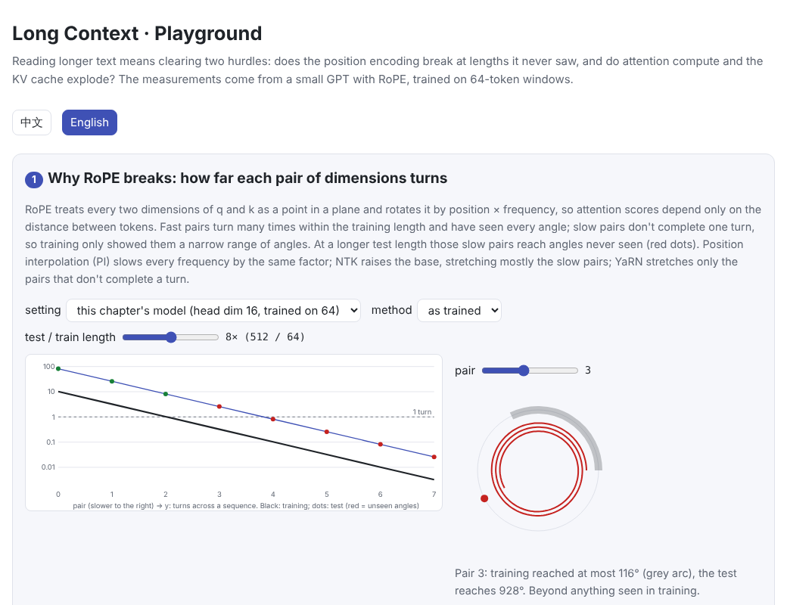
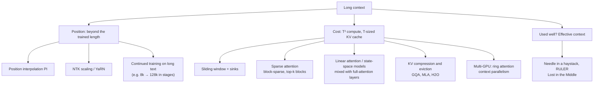

# Long Context

> **In one sentence:** reading longer text means clearing two hurdles.
>
> 1. **Can the position encoding extrapolate?** A model trained on short sequences with RoPE meets unseen angles in its slowly rotating dimensions at longer lengths, and quality drops fast. Position interpolation, NTK scaling and YaRN “stretch” RoPE, followed by a little long-text training.
> 2. **Can we afford it?** Attention compute grows with the square of the length and the KV cache grows linearly. Sliding windows, attention sinks, sparse attention, linear attention and state-space models, KV compression and ring attention each attack the cost from a different side.
>
> Finally, “supports 128k” is not the same as “uses 128k well”: test the effective context with needle-in-a-haystack, RULER and similar benchmarks.
>
> 🌐 [中文版](README.md) · 🎮 **[Open the interactive playground](interactive/long_context.html?lang=en)** · 📓 [Notebook](14-long-context.ipynb) ([open in Colab](https://colab.research.google.com/github/BaiYuBY/use_token_to_learn/blob/main/docs/14-long-context/14-long-context.ipynb))

[](interactive/long_context.html?lang=en)

**In this chapter you will learn:**

- why RoPE can *run* at any length but cannot *work well* at any length
- how position interpolation (PI), NTK scaling and YaRN stretch RoPE, and why they still need a little fine-tuning
- what sliding windows, attention sinks and sparse attention save, and what they give up
- how to estimate the compute and memory cost of long context
- how to check how much context a model can really use

The experimental model is [chapter 06](../06-pretraining/README.en.md)'s small GPT switched to [RoPE](../03-positional-encoding/README.en.md) positions, trained only on **64-token** windows and then tested on 512 tokens.

## 1. Intuition: two hurdles

**Hurdle one: position.**

- [Chapter 03](../03-positional-encoding/README.en.md) showed that RoPE treats every two dimensions of q and k as a point in a plane and rotates it by position × frequency, so attention scores depend only on the distance between tokens.
- The dimension pairs rotate at different speeds. Fast ones turn many times within the training length and have seen every angle; slow ones don't complete a single turn, so training showed them only a narrow range of angles.
- Past the training length, those slow pairs reach **angles never seen**, and attention scores become unpredictable.
- Chapter 06's learned position vectors are worse still: beyond the training length there is no vector at all.

**Hurdle two: cost.**

- Every new token attends to all earlier ones, so the compute per generated token grows linearly with the context, and a whole prefill grows with the **square** of the length.
- The KV cache grows linearly: Llama-3-8B needs 128 KiB per token, so one 128k sequence takes 16 GiB (see [12 Inference optimization](../12-inference-optimization/README.en.md)).
- Even with compute and memory solved, the model may not really “read” that far: little training data needs long-range dependencies, and information in the middle is especially easy to miss.

## 2. Pictures




The x-axis shows RoPE's 8 dimension pairs (this model's head dimension is 16); the y-axis shows how many turns each makes across a sequence.

- **The black line** is training on 64 tokens: pairs 0 and 1 turn several times, pair 2 about once, the rest less than once.
- **The red dots** use RoPE unchanged on 512 tokens: from pair 2 on, every pair reaches angles training never showed.
- **Position interpolation (PI)** divides every frequency by 8 and lands exactly on the black line, but it also slows the fast pairs, so neighbouring positions become hard to tell apart.
- **NTK and YaRN** mostly leave the fast pairs alone and stretch the slow ones.

> **🎮 Try it**
>
> In the [playground](interactive/long_context.html?lang=en) you can:
>
> 1. Switch between “this chapter's model” and a “Llama-3-like” setting, change the length factor and stretching method, and see which pairs reach unseen angles
> 2. Tick methods to compare measured loss curves and agreement accuracy
> 3. Browse six attention patterns and see how many scores each computes and how far it reaches after several layers
> 4. Estimate the attention share of compute, the KV cache and the prefill time at long context

## 3. How it works

### 3.1 Beyond the trained length: measured


Trained on 64 tokens and tested on 512, the average loss by position is:

| Method | Positions 0–64 (trained range) | Positions 256–512 |
| --- | --- | --- |
| RoPE as trained | 1.99 | 2.57 |
| Position interpolation PI ×8, no fine-tuning | 2.84 | 2.97 |
| NTK ×8 | 2.00 | 2.33 |
| YaRN ×8 | 2.20 | 2.24 |
| PI ×8 + 100 fine-tuning steps at length 512 | 2.06 | 2.04 |
| Sliding window 64 (plain RoPE throughout) | 1.99 | 1.97 |

- **Plain RoPE** loses quality steadily once it passes the trained length.
- **Position interpolation without fine-tuning is the worst.** Every distance is squeezed 8×, and the model never saw neighbouring tokens only 1/8 of a position apart, so even short distances look strange. The original method (Chen et al., 2023) includes a little fine-tuning; here 100 steps bring the loss back to the trained-range level.
- **NTK scaling** holds to about position 300 without any training, then degrades. As the previous figure shows, pairs 3 and 4 are still out of range at 512.
- **YaRN** trails NTK here because its parameters were designed for “about 4k training tokens and head dimension 128”. With only 64 training tokens and head dimension 16, even the fastest pair makes only ~10 turns, so few pairs can be left alone (the code scales β from 32 to 8 accordingly). YaRN's paper also reports its results mainly after fine-tuning.
- **The sliding window** never has trouble: relative distances never exceed 64, and this small language only has short dependencies.


Loss is an average and shows little detail. The left panel places chapter 06's agreement test (“the cat that chases the dogs ___”) after unrelated text, to see whether the model still picks the right verb at far positions:

- **Plain RoPE** is at 100% within the trained length and drops to 62% at position 448.
- **NTK** holds 96% at 256, but also falls to 62% farther out.
- **Interpolation plus fine-tuning** has recovered its loss, yet reaches only about 75%. 100 steps are enough to restore the average loss, but not to fully repair precise attention.
- **The sliding window** stays at about 100% throughout.

These accuracies vary a lot between training runs: retrain the same code from different random initial weights and plain RoPE's accuracy around position 300 can land anywhere from 60% to 95%, while NTK stays above 85%. So in this small experiment “plain RoPE gets worse far away” is only a tendency; the loss curves above are the steadier evidence.

The right panel shows the effect of window size:

- **Windows of 1–2** see only the nearest noun, whose number is the opposite, so accuracy is 50% or lower.
- **A window of 3** sometimes reaches the relative clause's verb (e.g. chases), which carries the subject's number.
- **4 or more** is enough.

**The window must reach the clue.** In real text the clue can be thousands of tokens back (a name defined earlier, a function in code), which is exactly where a pure sliding window fails.

### 3.2 Ways to stretch RoPE

Let the training length be $L$ and the target length $sL$. RoPE pair $i$ rotates at $\theta_i = b^{-2i/d}$ (usually $b = 10000$):

| Method | How | Character |
| --- | --- | --- |
| **Position interpolation PI** (Chen et al., 2023) | $\theta_i \to \theta_i / s$ | All angles back in the trained range, but neighbouring positions lose $s$× resolution; needs fine-tuning |
| **NTK scaling** (bloc97, 2023) | $b \to b \cdot s^{d/(d-2)}$ | Fast pairs barely change, slow pairs stretch by almost $s$; some effect without training |
| **YaRN** (Peng et al., 2023) | Pairs that make many turns are left alone, those under one turn are interpolated like PI, with a smooth ramp; attention logits are multiplied by $(0.1\ln s + 1)^2$ | Keeps short-range resolution and extends long range; best with a little fine-tuning |
| **Larger base plus continued training** | Use a larger $b$ (Llama 3 uses 500,000) and keep training on long text | What large models do: extend from 8k to 128k in stages (Llama 3, 2024) |
| **ALiBi** (Press et al., 2021) | No position vectors; subtract a linear penalty by distance from attention scores | Naturally favours nearby tokens and extrapolates more stably, but weakens distant information |

Real models usually combine a stretching method with continued training on long text, so “how long it supports” depends largely on how long, and how much, long text it was trained on.

### 3.3 Cheaper attention structures

| Method | How | Compute / memory | Cost |
| --- | --- | --- | --- |
| **Sliding window** (Longformer, Beltagy et al., 2020; Mistral 7B) | Each token sees only the last $w$ | Linear in $T$; cache keeps only $w$ | Beyond the window, information only hops through layers; $L$ layers reach about $L(w-1)$ |
| **Attention sinks** (StreamingLLM, Xiao et al., 2023) | Also keep the first few tokens | As above | Keeps the model stable as the window slides, but dropped middle content stays invisible |
| **Local + global mix** (e.g. Gemma 3) | Most layers use a window; every few layers one has full attention | Much smaller KV cache | Long-range information rests on a few full-attention layers |
| **Block-sparse** (Sparse Transformer, BigBird) | Local + a few global tokens + random blocks | Near linear | A fixed pattern may miss the truly relevant positions |
| **Top-k block selection** (MoBA; NSA, Yuan et al., 2025) | Score each block roughly; each query attends only to the most relevant few | Near linear | Content decides where to look; needs dedicated training and kernels |
| **Linear attention / state-space models** (Mamba etc.) | A fixed-size state replaces the KV cache | Linear in $T$, constant memory | Limited state capacity, weaker exact recall; often mixed with full-attention layers |
| **KV compression and eviction** (GQA, MLA; H2O, SnapKV) | Fewer KV per token, or drop unimportant tokens | Less memory | Dropped information can't be recovered |
| **Ring attention / context parallelism** (Liu et al., 2023) | Split one long sequence across GPUs and rotate KV between them | Less memory per GPU | Needs many GPUs and communication |


At Llama-3-8B's scale, the per-token compute breaks down like this:

- The weight part is fixed at about $2 \times 8$ billion FLOPs, while attention grows with the context.
- Attention is about 14% of the compute at 4k, 57% at 32k, 84% at 128k and 98% at 1M.
- With a 4k sliding window it stays at about 14% however long the text.

That is why nearly every long-context model uses windows or sparse attention in some layers.

### 3.4 Effective context: running is not reading

A model's advertised context length only says it can *run* that long. Whether it uses it well must be tested:

- **Needle in a haystack** (Kamradt, 2023): insert an unrelated fact somewhere in a long text and ask about it. It is the most basic retrieval test, and most current models pass.
- **RULER** (Hsieh et al., 2024): harder tasks such as multi-needle retrieval, multi-hop tracing and aggregation. Many models' “effective length” is clearly shorter than advertised.
- **Lost in the Middle** (Liu et al., 2023): answers at the start or end of a long text are found most easily; in the middle, accuracy drops markedly.

In practice:

- Put the most important information at the start or the end.
- Rather than pasting a whole book, retrieve the most relevant passages first (RAG; see [19 RAG and vector databases](../19-rag/README.en.md)).
- Test how well it works at different lengths on your own task.

## 4. Minimal code

Full code: [`code/long_context.py`](code/long_context.py); run `python docs/14-long-context/code/long_context.py` (about 30 seconds). Experiments and figures are in [`figures/long_context_figures.py`](figures/long_context_figures.py).

RoPE and three ways to stretch it:

```python
inv = 1.0 / base ** (torch.arange(0, dim, 2).float() / dim)       # each pair's frequency
if method == "pi":
    inv = inv / factor                                             # slow everything down
elif method == "ntk":
    inv = 1.0 / (base * factor ** (dim / (dim - 2))) ** (torch.arange(0, dim, 2).float() / dim)
elif method == "yarn":
    turns = train_len * inv / (2 * math.pi)                         # turns made in training
    keep = ((turns - 1) / (beta - 1)).clamp(0, 1)                   # keep fast pairs, interpolate slow ones
    inv = keep * inv + (1 - keep) * inv / factor

def rotate(x, pos, inv):
    ang = pos[:, None] * inv[None]
    x1, x2 = x[..., 0::2], x[..., 1::2]
    return torch.stack([x1 * ang.cos() - x2 * ang.sin(), x1 * ang.sin() + x2 * ang.cos()], -1).flatten(-2)
```

A sliding window and sinks are just a different attention mask:

```python
i, j = torch.arange(T)[:, None], torch.arange(T)[None, :]
mask = j <= i                                                      # causal
mask = mask & ((i - j < window) | (j < sink))                      # last `window` + first `sink`
```

## 5. Common misconceptions

- **“With RoPE, any length works.”** It runs, but quality drops beyond the trained length; it needs stretching and continued training on long text.
- **“Position interpolation works without training.”** Interpolating alone is often worse; the original method includes a little fine-tuning. NTK-style methods do relatively better untrained.
- **“Longer context is always better.”** Longer means costlier and slower, and the model may not use it well; retrieving the relevant passages is often more accurate and cheaper.
- **“A sliding-window model can't see beyond its window.”** Stacked layers do reach farther indirectly, but details fade at each hop; exact recall beyond the window remains hard.
- **“Advertised 128k means reliable 128k.”** The effective context is often shorter; verify with tests like RULER and with your own task.

## 6. Self-check

1. RoPE with head dimension 128 and $b = 10000$ is trained on 4096 tokens. How many turns does the slowest pair make within the training length?
2. Why does position interpolation without fine-tuning hurt even positions inside the trained length?
3. How far back can a 4-layer model with a 1024-token sliding window “see” indirectly?
4. How large is Llama-3-8B's KV cache for one 128k sequence? And with a 4k sliding window?
5. Why is information in the middle of a long text easier to miss, and what can you do about it?

<details>
<summary>Answers</summary>

1. The lowest frequency is about $10000^{-126/128} \approx 1.15 \times 10^{-4}$, so $4096 \times 1.15 \times 10^{-4} / 2\pi \approx 0.075$ turns, far from one. These pairs are the first to break when extrapolating.
2. Interpolation shrinks every relative distance by $s$, so the angle between neighbouring tokens becomes a small value never seen in training, which also scrambles the model's sense of short distances.
3. About $4 \times (1024 - 1) \approx 4092$ positions.
4. 128k × 128 KiB = 16 GiB; a 4k window keeps only 4096 tokens, 0.5 GiB.
5. Training data and attention patterns tend to favour the beginning and the end, so the middle gets the least attention. Put key information at the start or end, shorten the context with retrieval, and point the model to the relevant part in the question.

</details>

## 7. Further reading

- Su et al., 2021. [RoFormer: Enhanced Transformer with Rotary Position Embedding](https://arxiv.org/abs/2104.09864) (RoPE)
- Press et al., 2021. [Train Short, Test Long: Attention with Linear Biases Enables Input Length Extrapolation](https://arxiv.org/abs/2108.12409) (ALiBi)
- Chen et al., 2023. [Extending Context Window of Large Language Models via Positional Interpolation](https://arxiv.org/abs/2306.15595)
- Peng et al., 2023. [YaRN: Efficient Context Window Extension of Large Language Models](https://arxiv.org/abs/2309.00071) (also describes bloc97's NTK scaling)
- Meta, 2024. [The Llama 3 Herd of Models](https://arxiv.org/abs/2407.21783) (extending context to 128k in stages)
- Beltagy et al., 2020. [Longformer: The Long-Document Transformer](https://arxiv.org/abs/2004.05150)
- Zaheer et al., 2020. [Big Bird: Transformers for Longer Sequences](https://arxiv.org/abs/2007.14062)
- Child et al., 2019. [Generating Long Sequences with Sparse Transformers](https://arxiv.org/abs/1904.10509)
- Jiang et al., 2023. [Mistral 7B](https://arxiv.org/abs/2310.06825) (sliding-window attention)
- Xiao et al., 2023. [Efficient Streaming Language Models with Attention Sinks](https://arxiv.org/abs/2309.17453) (StreamingLLM)
- Gemma Team, 2025. [Gemma 3 Technical Report](https://arxiv.org/abs/2503.19786) (alternating local / global layers)
- Yuan et al., 2025. [Native Sparse Attention: Hardware-Aligned and Natively Trainable Sparse Attention](https://arxiv.org/abs/2502.11089) (NSA)
- Lu et al., 2025. [MoBA: Mixture of Block Attention for Long-Context LLMs](https://arxiv.org/abs/2502.13189)
- Gu & Dao, 2023. [Mamba: Linear-Time Sequence Modeling with Selective State Spaces](https://arxiv.org/abs/2312.00752)
- Zhang et al., 2023. [H2O: Heavy-Hitter Oracle for Efficient Generative Inference of Large Language Models](https://arxiv.org/abs/2306.14048)
- Liu et al., 2023. [Ring Attention with Blockwise Transformers for Near-Infinite Context](https://arxiv.org/abs/2310.01889)
- Hsieh et al., 2024. [RULER: What's the Real Context Size of Your Long-Context Language Models?](https://arxiv.org/abs/2404.06654)
- Liu et al., 2023. [Lost in the Middle: How Language Models Use Long Contexts](https://arxiv.org/abs/2307.03172)
- Kamradt, 2023. [Needle In A Haystack](https://github.com/gkamradt/LLMTest_NeedleInAHaystack)
