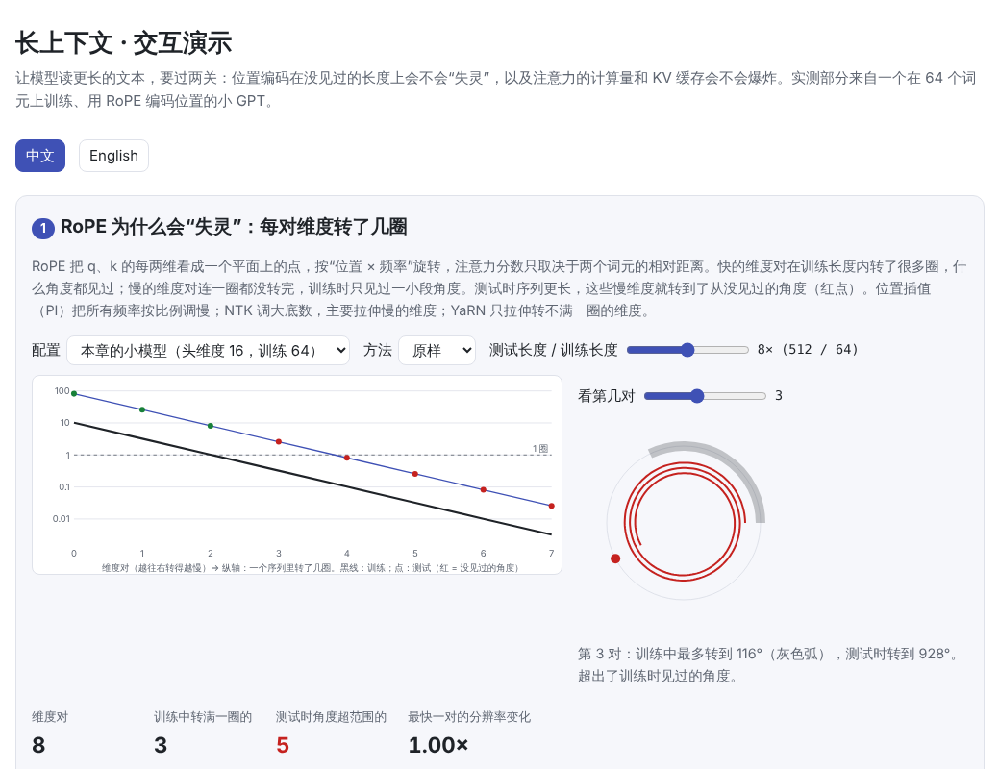
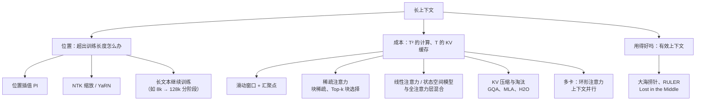
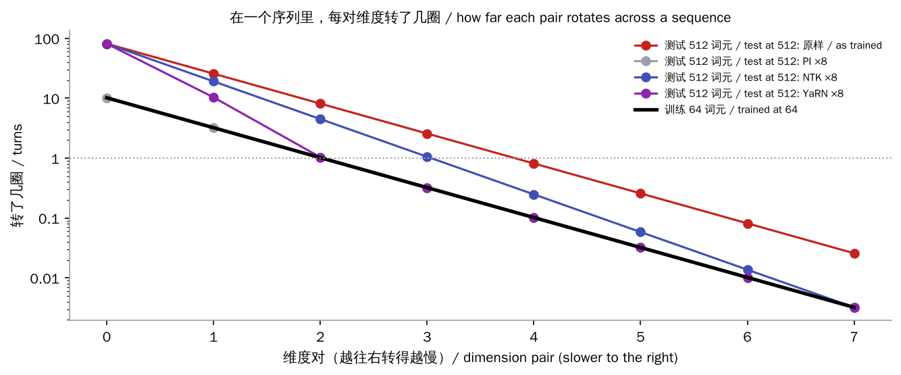
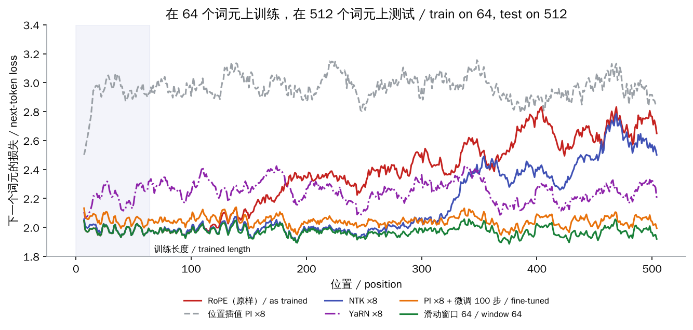
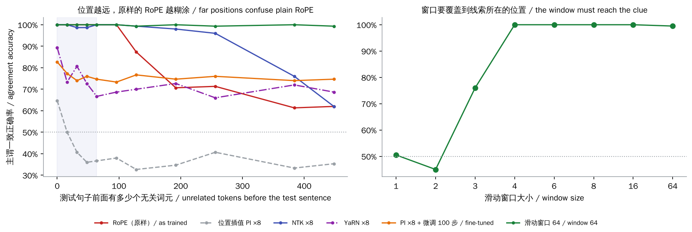
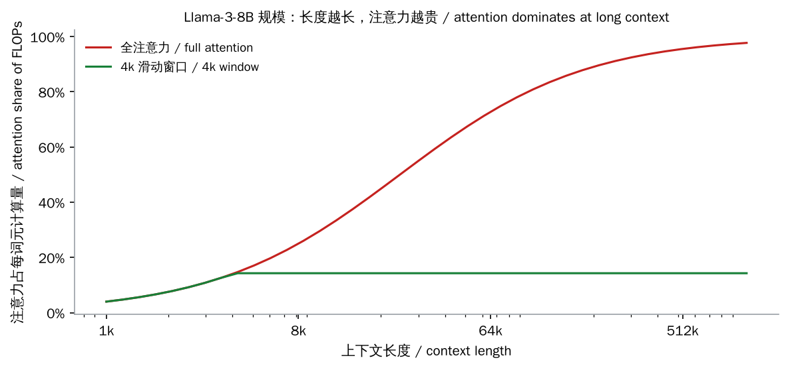

# 长上下文（Long Context）

> **一句话总结：** 让模型读更长的文本要过两关。
>
> 1. **位置编码能不能外推**：用 RoPE 在短序列上训练的模型，到了没见过的长度，慢转的维度会转到没见过的角度，效果迅速变差。位置插值、NTK 缩放、YaRN 通过“拉伸”RoPE，再加少量长文本训练来解决。
> 2. **成本能不能承受**：注意力的计算量随长度平方增长，KV 缓存随长度线性增长。滑动窗口、注意力汇聚点、稀疏注意力、线性注意力与状态空间模型、KV 压缩、环形注意力，从不同角度降低成本。
>
> 最后，“支持 128k”不等于“用得好 128k”，要用大海捞针、RULER 这类测试检验有效上下文。
>
> 🌐 [English version](README.en.md) · 🎮 **[打开交互演示](interactive/long_context.html?lang=zh)** · 📓 [Notebook](14-long-context.ipynb)（[在 Colab 中打开](https://colab.research.google.com/github/BaiYuBY/use_token_to_learn/blob/main/docs/14-long-context/14-long-context.ipynb)）

[](interactive/long_context.html?lang=zh)

**本章你将学会：**

- RoPE 为什么能“运行”在任意长度，却不能“用好”任意长度
- 位置插值（PI）、NTK 缩放、YaRN 分别怎样拉伸 RoPE，为什么还需要少量微调
- 滑动窗口、注意力汇聚点、稀疏注意力分别省了什么，又丢了什么
- 长上下文的计算和显存成本怎样估算
- 怎样检验一个模型真正能用多长的上下文

本章的实验模型：把 [06 章](../06-pretraining/README.md)的小 GPT 改用 [RoPE](../03-positional-encoding/README.md) 编码位置，只在 **64 个词元**的片段上训练，然后在 512 个词元上测试。

## 1. 直觉：两道关

**第一关：位置。**

- [03 章](../03-positional-encoding/README.md)讲过，RoPE 把 q、k 的每两维看成平面上的一个点，按“位置 × 频率”旋转，于是注意力分数只取决于两个词元的相对距离。
- 不同的维度对转得快慢不同：快的在训练长度内转了很多圈，什么角度都见过；慢的连一圈都没转完，训练时只见过一小段角度。
- 序列一旦超出训练长度，这些慢维度就转到了**从没见过的角度**，注意力分数变得不可预测。
- 06 章那种“可学习的位置向量”更糟：超出训练长度就根本没有对应的向量。

**第二关：成本。**

- 每个新词元要和前面所有词元做注意力，所以生成一个词元的计算量随上下文线性增长，整段预填充随长度**平方**增长。
- KV 缓存随长度线性增长：Llama-3-8B 每个词元 128 KiB，一条 128k 的序列就是 16 GiB（见 [12 推理优化](../12-inference-optimization/README.md)）。
- 即使计算和显存都解决了，模型也未必真的“读”得了那么长：训练数据中真正需要长距离依赖的样本很少，放在中间的信息尤其容易被忽略。

## 2. 图解





上图横轴是 RoPE 的 8 个维度对（本章模型的头维度为 16），纵轴是在一个序列中转了几圈。

- **黑线**：在 64 个词元上训练时的圈数。第 0、1 对转了好几圈，第 2 对约一圈，之后的都不到一圈。
- **红点**：原样用到 512 个词元时，第 2 对以后都转到了训练时没见过的角度。
- **位置插值（PI）**：把所有频率除以 8，于是完全落回黑线上。但连快的维度也被调慢了，相邻位置变得难以区分。
- **NTK 和 YaRN**：快的维度基本不动，主要拉伸慢的维度。

> **🎮 动手试试**
>
> 在[交互演示](interactive/long_context.html?lang=zh)中，你可以：
>
> 1. 切换“本章小模型”和“Llama-3 式”配置，调节长度倍数和拉伸方法，看哪些维度对转到了没见过的角度
> 2. 勾选不同方法，比较实测的损失曲线和主谓一致正确率
> 3. 浏览六种注意力模式，看要算多少分数、多层之后能“看”多远
> 4. 估算长上下文的计算比例、KV 缓存和预填充时间

## 3. 原理

### 3.1 超出训练长度：实测



在 64 个词元上训练、在 512 个词元上测试，各位置的平均损失：

| 方法 | 位置 0–64（训练长度内） | 位置 256–512 |
| --- | --- | --- |
| RoPE 原样 | 1.99 | 2.57 |
| 位置插值 PI ×8，不微调 | 2.84 | 2.97 |
| NTK ×8 | 2.00 | 2.33 |
| YaRN ×8 | 2.20 | 2.24 |
| PI ×8 + 在 512 长度上微调 100 步 | 2.06 | 2.04 |
| 滑动窗口 64（全程用原始 RoPE） | 1.99 | 1.97 |

- **原样的 RoPE**：一过训练长度，损失就逐渐升高。
- **位置插值不微调反而最差**：所有距离都被压缩了 8 倍，模型在训练中从没见过“相邻词元只差 1/8 个位置”的情况，连短距离也变得陌生。原论文（Chen 等，2023）的做法本来就是“插值 + 少量微调”。这里微调 100 步，损失就回到了训练长度内的水平。
- **NTK 缩放**：不训练也能撑到约 300 个位置，再远仍会变差。对照上一张图，第 3、4 对维度在 512 时仍超出了训练范围。
- **YaRN**：在这里不如 NTK，因为它的参数是为“训练长度约 4k、头维度 128”设计的。本章的模型训练长度只有 64、头维度只有 16，最快的维度也只转了约 10 圈，能“保持不动”的维度很少（代码中已按比例把 β 从 32 调到 8）。YaRN 论文中的结果也主要是在拉伸后再微调得到的。
- **滑动窗口**：始终没问题，因为相对距离永远不超过 64，而这个小语言的依赖都很短。



损失是平均值，能看到的细节有限。左图把 06 章的主谓一致测试（“the cat that chases the dogs ___”）放在一段无关文字之后，看位置变远时模型还能不能用对动词：

- **原样的 RoPE**：训练长度内 100%，到位置 448 降到 62%。
- **NTK**：撑到 256 仍有 96%，再远也降到 62%。
- **插值 + 微调**：损失已经恢复，正确率却只有约 75%。100 步微调足以把平均损失拉回来，却不足以把精细的注意力完全修好。
- **滑动窗口**：始终约 100%。

这组正确率在不同的训练中波动较大：同样的代码只换一组随机初始权重重新训练，位置 300 附近原样 RoPE 的正确率可以在 60% 到 95% 之间，NTK 则稳定在 85% 以上。所以“原样 RoPE 在远处变差”在这个小实验里只是一种趋势；更稳定的证据是上面的损失曲线。

右图是窗口大小的影响：

- **窗口为 1–2**：只能看到离得最近、单复数相反的那个名词，正确率在 50% 甚至更低。
- **窗口为 3**：部分时候能看到从句里的动词（如 chases，它带有主语的单复数）。
- **窗口为 4 以上**：就够了。

**窗口必须覆盖到线索所在的位置。** 真实文本中，线索可能在几千个词元之前（前文定义的人名、代码里的函数），这正是纯滑动窗口的弱点。

### 3.2 拉伸 RoPE 的几种方法

设训练长度为 $L$，目标长度为 $sL$。RoPE 第 $i$ 对维度的频率是 $\theta_i = b^{-2i/d}$（$b$ 通常为 10000）：

| 方法 | 做法 | 特点 |
| --- | --- | --- |
| **位置插值 PI**（Chen 等，2023） | $\theta_i \to \theta_i / s$ | 所有角度回到训练范围，但相邻位置的分辨率降低 $s$ 倍；需要微调 |
| **NTK 缩放**（bloc97，2023） | $b \to b \cdot s^{d/(d-2)}$ | 快的维度几乎不变，慢的维度拉伸接近 $s$ 倍；不训练也有一定效果 |
| **YaRN**（Peng 等，2023） | 转满很多圈的维度不动，转不满一圈的按 PI 插值，中间平滑过渡；并把注意力 logits 乘以 $(0.1\ln s + 1)^2$ | 兼顾短距离分辨率和长距离外推；配合少量微调效果最好 |
| **调大基数后继续训练** | 直接用更大的 $b$（如 Llama 3 用 500,000）在长文本上继续训练 | 主流大模型的做法：分阶段把上下文从 8k 扩到 128k（Llama 3，2024） |
| **ALiBi**（Press 等，2021） | 不用位置向量，按距离给注意力分数减一个线性惩罚 | 天然偏向近处，外推较稳，但远处信息被削弱 |

实际的大模型通常是“拉伸方法 + 在长文本上继续训练”一起用。所以“支持多长”很大程度上取决于训练时用了多长、多少长文本。

### 3.3 降低成本的注意力结构

| 方法 | 做法 | 计算 / 显存 | 代价 |
| --- | --- | --- | --- |
| **滑动窗口**（Longformer，Beltagy 等，2020；Mistral 7B） | 每个词元只看最近 $w$ 个 | 与 $T$ 成线性；缓存只保留 $w$ 个 | 窗口外只能靠多层间接传递，$L$ 层最远约 $L(w-1)$ |
| **注意力汇聚点**（StreamingLLM，Xiao 等，2023） | 窗口之外再保留开头几个词元 | 同上 | 让窗口滑动时模型不崩，但仍看不到中间被丢掉的内容 |
| **局部 + 全局混合**（如 Gemma 3） | 多数层用滑动窗口，每隔几层放一层全注意力 | KV 缓存大幅减小 | 远距离信息只能由少数全注意力层负责 |
| **块稀疏**（Sparse Transformer、BigBird） | 局部 + 少数全局词元 + 随机块 | 近似线性 | 固定的模式，未必看到真正相关的位置 |
| **Top-k 块选择**（MoBA；NSA，Yuan 等，2025） | 先粗略给每个块打分，每个查询只看最相关的几个块 | 近似线性 | 看哪里由内容决定，需要专门训练和算子 |
| **线性注意力 / 状态空间模型**（Mamba 等） | 用固定大小的状态代替 KV 缓存 | 与 $T$ 成线性，显存恒定 | 状态容量有限，精确回忆较弱；常与全注意力层混合 |
| **KV 压缩与淘汰**（GQA、MLA；H2O、SnapKV） | 减少每个词元的 KV，或丢掉不重要的词元 | 显存减小 | 丢掉的信息找不回来 |
| **环形注意力 / 上下文并行**（Liu 等，2023） | 把一条长序列切到多张卡上，KV 在卡间轮转 | 单卡显存减小 | 需要多卡和通信 |



以 Llama-3-8B 的规模估算每个词元的计算量：

- 权重部分固定，约 $2 \times 80$ 亿次运算；注意力部分随上下文线性增长。
- 4k 时注意力只占约 14%，32k 时约 57%，128k 时约 84%，1M 时约 98%。
- 换成 4k 的滑动窗口后，无论多长都保持在约 14%。

这就是为什么长上下文模型几乎都会在部分层上使用窗口或稀疏注意力。

### 3.4 有效上下文：能读不等于会读

模型标称的上下文长度，只说明它“能运行”这么长。是否真的用得好，要专门测：

- **大海捞针**（Needle in a Haystack，Kamradt，2023）：在长文中某个位置插入一句无关的事实，再提问。这是最基本的检索测试，现在的模型大多能通过。
- **RULER**（Hsieh 等，2024）：包含多针检索、多跳追踪、聚合统计等更难的任务。很多模型的“有效长度”明显短于标称长度。
- **Lost in the Middle**（Liu 等，2023）：答案放在长文开头或结尾时最容易找到，放在中间时正确率明显下降。

实际使用时的建议：

- 把最重要的信息放在开头或结尾。
- 与其塞进整本书，不如先检索出最相关的几段（RAG，见 19 RAG 与向量数据库，计划中）。
- 在自己的任务上测试不同长度下的效果。

## 4. 最小代码实现

完整代码：[`code/long_context.py`](code/long_context.py)，运行 `python docs/14-long-context/code/long_context.py`（约 30 秒）。实验与配图在 [`figures/long_context_figures.py`](figures/long_context_figures.py) 中。

RoPE 与三种拉伸：

```python
inv = 1.0 / base ** (torch.arange(0, dim, 2).float() / dim)       # 每对维度的频率
if method == "pi":
    inv = inv / factor                                             # 全部调慢
elif method == "ntk":
    inv = 1.0 / (base * factor ** (dim / (dim - 2))) ** (torch.arange(0, dim, 2).float() / dim)
elif method == "yarn":
    turns = train_len * inv / (2 * math.pi)                         # 训练中转了几圈
    keep = ((turns - 1) / (beta - 1)).clamp(0, 1)                   # 转得多的保持，不到一圈的插值
    inv = keep * inv + (1 - keep) * inv / factor

def rotate(x, pos, inv):
    ang = pos[:, None] * inv[None]
    x1, x2 = x[..., 0::2], x[..., 1::2]
    return torch.stack([x1 * ang.cos() - x2 * ang.sin(), x1 * ang.sin() + x2 * ang.cos()], -1).flatten(-2)
```

滑动窗口与汇聚点只是注意力掩码的不同：

```python
i, j = torch.arange(T)[:, None], torch.arange(T)[None, :]
mask = j <= i                                                      # 因果
mask = mask & ((i - j < window) | (j < sink))                      # 最近 window 个 + 开头 sink 个
```

## 5. 常见误区

- **“用了 RoPE 就能处理任意长度”**：能运行，但超出训练长度后效果会变差，需要拉伸并在长文本上继续训练。
- **“位置插值不用训练就能用”**：直接插值往往更差，原方法本来就包含少量微调；NTK 类方法不训练时相对好一些。
- **“上下文越长越好”**：更长意味着更贵、更慢，而且模型未必用得好；检索出相关段落往往更准、更便宜。
- **“滑动窗口模型看不到窗口外的内容”**：多层叠加后可以间接看到更远，但细节会逐层丢失；窗口外的精确回忆仍然困难。
- **“标称 128k，就能可靠地使用 128k”**：有效上下文常常更短，要用 RULER 这类测试和自己的任务验证。

## 6. 自测题

1. 头维度 128、$b = 10000$ 的 RoPE，在 4096 个词元上训练。频率最低的那对维度，在训练长度内转了多少圈？
2. 为什么位置插值不微调时，连训练长度以内的位置效果都会变差？
3. 4 层、窗口 1024 的滑动窗口模型，最远能间接“看到”多少个位置之前？
4. Llama-3-8B 在 128k 上下文时，一条序列的 KV 缓存多大？如果改用 4k 滑动窗口呢？
5. 为什么长文中间的信息更容易被忽略？实际使用时可以怎么应对？

<details>
<summary>参考答案</summary>

1. 最低频率约为 $10000^{-126/128} \approx 1.15 \times 10^{-4}$，$4096 \times 1.15 \times 10^{-4} / 2\pi \approx 0.075$ 圈，远不到一圈。所以外推时这些维度最先出问题。
2. 插值把所有相对距离都缩小了 $s$ 倍，相邻词元之间的角度差变成训练时从未出现过的小值，模型对“短距离”的判断也被打乱了。
3. 约 $4 \times (1024 - 1) \approx 4092$ 个位置。
4. 128k × 128 KiB = 16 GiB；4k 窗口只需保留 4096 个词元，即 0.5 GiB。
5. 训练数据和注意力模式往往偏向开头和结尾，中间的信息得到的注意力最少。可以把关键信息放在开头或结尾、先用检索缩短上下文、在提问时明确指出要看的部分。

</details>

## 7. 延伸阅读

- Su et al., 2021. [RoFormer: Enhanced Transformer with Rotary Position Embedding](https://arxiv.org/abs/2104.09864)（RoPE）
- Press et al., 2021. [Train Short, Test Long: Attention with Linear Biases Enables Input Length Extrapolation](https://arxiv.org/abs/2108.12409)（ALiBi）
- Chen et al., 2023. [Extending Context Window of Large Language Models via Positional Interpolation](https://arxiv.org/abs/2306.15595)
- Peng et al., 2023. [YaRN: Efficient Context Window Extension of Large Language Models](https://arxiv.org/abs/2309.00071)（也介绍了 bloc97 的 NTK 缩放）
- Meta, 2024. [The Llama 3 Herd of Models](https://arxiv.org/abs/2407.21783)（分阶段把上下文扩展到 128k）
- Beltagy et al., 2020. [Longformer: The Long-Document Transformer](https://arxiv.org/abs/2004.05150)
- Zaheer et al., 2020. [Big Bird: Transformers for Longer Sequences](https://arxiv.org/abs/2007.14062)
- Child et al., 2019. [Generating Long Sequences with Sparse Transformers](https://arxiv.org/abs/1904.10509)
- Jiang et al., 2023. [Mistral 7B](https://arxiv.org/abs/2310.06825)（滑动窗口注意力）
- Xiao et al., 2023. [Efficient Streaming Language Models with Attention Sinks](https://arxiv.org/abs/2309.17453)（StreamingLLM）
- Gemma Team, 2025. [Gemma 3 Technical Report](https://arxiv.org/abs/2503.19786)（局部 / 全局层交替）
- Yuan et al., 2025. [Native Sparse Attention: Hardware-Aligned and Natively Trainable Sparse Attention](https://arxiv.org/abs/2502.11089)（NSA）
- Lu et al., 2025. [MoBA: Mixture of Block Attention for Long-Context LLMs](https://arxiv.org/abs/2502.13189)
- Gu & Dao, 2023. [Mamba: Linear-Time Sequence Modeling with Selective State Spaces](https://arxiv.org/abs/2312.00752)
- Zhang et al., 2023. [H2O: Heavy-Hitter Oracle for Efficient Generative Inference of Large Language Models](https://arxiv.org/abs/2306.14048)
- Liu et al., 2023. [Ring Attention with Blockwise Transformers for Near-Infinite Context](https://arxiv.org/abs/2310.01889)
- Hsieh et al., 2024. [RULER: What's the Real Context Size of Your Long-Context Language Models?](https://arxiv.org/abs/2404.06654)
- Liu et al., 2023. [Lost in the Middle: How Language Models Use Long Contexts](https://arxiv.org/abs/2307.03172)
- Kamradt, 2023. [Needle In A Haystack](https://github.com/gkamradt/LLMTest_NeedleInAHaystack)
