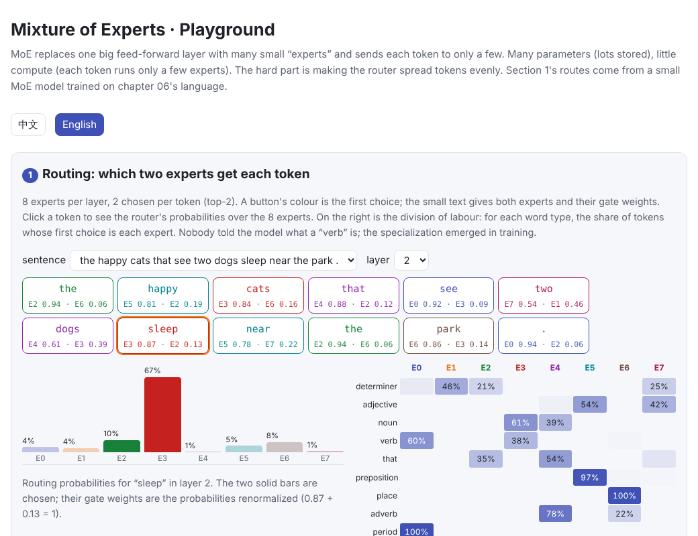
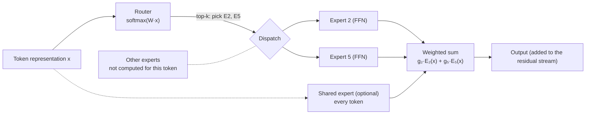

# Mixture of Experts (MoE)

> **In one sentence:** MoE replaces the Transformer's feed-forward layer with many small “experts” plus a **router** that sends each token only to its top $k$ experts. The model can then hold many parameters (store and remember a lot) while each token costs only as much compute as a much smaller model. The price comes in three parts:
>
> - **Load balancing**: the router must not pile tokens onto a few experts.
> - **Memory**: all the parameters must fit.
> - **Communication**: with experts spread over GPUs, tokens shuttle back and forth in every layer.
>
> DeepSeek-V3 (671B parameters, 37B active per token), Mixtral and Qwen3 are all MoE models.
>
> 🌐 [中文版](README.md) · 🎮 **[Open the interactive playground](interactive/moe.html?lang=en)** · 📓 [Notebook](15-moe.ipynb) ([open in Colab](https://colab.research.google.com/github/BaiYuBY/use_token_to_learn/blob/main/docs/15-moe/15-moe.ipynb))

[](interactive/moe.html?lang=en)

**In this chapter you will learn:**

- the structure of an MoE layer: router, top-k selection, gate weights, shared experts
- why MoE gives “many parameters, little compute”, and how total and active parameters are counted
- what load imbalance costs, and two fixes: the auxiliary loss and DeepSeek-V3's auxiliary-loss-free bias adjustment
- that experts specialize on their own
- what makes MoE hard to deploy: memory, expert parallelism and all-to-all communication

## 1. Intuition: call in specialists, but only a few at a time

[Chapter 05](../05-transformer/README.en.md) showed that the feed-forward network (FFN) in each layer holds most of a Transformer's parameters, and much of its knowledge lives there. The direct way to remember more is a bigger FFN, but compute grows in proportion, since every token passes through the whole big matrix.

MoE does this instead:

- It splits one big FFN into $E$ small FFNs (**experts**) plus a tiny **router**.
- The router glances at a token's representation, scores every expert, and sends the token only to the top $k$ (usually $k$ = 1–8).
- The outputs of those $k$ experts are mixed by their scores.

**Parameters** grow with the number of experts $E$, while **compute per token** grows only with $k$. It is like a hospital with many specialists, where each patient sees only a few.

## 2. Pictures




> **🎮 Try it**
>
> In the [playground](interactive/moe.html?lang=en) you can:
>
> 1. See which two experts a trained MoE model picks for every word of a sentence, and how the experts divide the work
> 2. Compare “no balancing”, “auxiliary loss” and “bias adjustment” in a load-balancing simulator, watching the busiest expert and dropped tokens
> 3. Browse measured curves: MoE's memory capacity and the effect of the three balancing methods
> 4. Compute total parameters, active parameters, per-GPU memory and communication for Mixtral, DeepSeek-V3 and Qwen3

## 3. How it works

### 3.1 The MoE layer

For a token representation $x$, the router first computes probabilities over the $E$ experts:

$$
p = \operatorname{softmax}(W_r\,x)
$$

It then picks the $k$ most probable experts, the set $\mathcal{T}$, and outputs

$$
y = \sum_{i \in \mathcal{T}} g_i\, \mathrm{FFN}_i(x), \qquad g_i = \frac{p_i}{\sum_{j \in \mathcal{T}} p_j}\quad(k > 1)
$$

A few details:

- **Don't renormalize when $k = 1$.** The gate would always be 1, so the output wouldn't depend on the routing probabilities and the router would get no gradient at all. Switch Transformer (Fedus et al., 2021) uses the raw probability $p_i$ as the gate. This chapter's code fell into that trap while it was being written: on a 4,096-entry table the top-1 MoE recalled only 63%, and after the fix nearly 100%.
- **Shared experts**: DeepSeekMoE (Dai et al., 2024) cuts experts finer and more numerous, and adds a few shared experts that every token passes through. These hold common knowledge, so the routed experts can specialize.
- **With a single expert**, an MoE layer is just an ordinary FFN. The code uses this to check the implementation.

### 3.2 Many parameters, little compute: measured

To test “capacity” on its own, the code memorizes a random 8,192-entry lookup table (key → value). Keys are **fixed random vectors**, so only the FFN or the experts can store the mapping.


| Model | Parameters | Used per token | Entries recalled |
| --- | --- | --- | --- |
| Dense FFN, hidden 64 | 8,320 | 8,320 | 22% |
| MoE: 16 experts (hidden 64 each), top-1 | 134,144 | 9,344 | 99.8% |
| MoE: 16 experts, top-2 | 134,144 | 17,664 | 100% |
| Dense FFN, hidden 1024 | 132,160 | 132,160 | 100% |

The top-1 MoE computes about as much per token as the small FFN, yet remembers as much as an FFN 16 times larger. That is MoE's core value: **much more capacity for very little extra compute**.

Real models work the same way (previous figure). For Mixtral 8x7B, the code counts parameters from its configuration:

- 8 experts per layer, 176M parameters each, over 32 layers; with attention and embeddings that makes **46.7B**.
- Each token uses only 2 experts, so **12.9B** (28%) are active.

Both numbers match the published ones. DeepSeek-V3 has 256 routed experts plus 1 shared, chooses 8 per token, and activates only 37B of its 671B parameters (about 5.5%).

### 3.3 Load balancing

The router is learned and easily plays favourites: an expert that starts slightly better gets more tokens, learns faster and gets even more. Imbalance costs three things:

- **Under expert parallelism**, experts live on different GPUs, so the busiest GPU sets the time of every step while the rest wait.
- **With a capacity limit** (each expert takes at most “average load × capacity factor” tokens), overflow tokens are **dropped**. They only pass through the residual connection, as if this layer never processed them.
- **At worst, experts collapse**: a few experts do everything while the rest barely train and waste their parameters.

Two common fixes:

- **The auxiliary loss** (Switch Transformer) adds $\alpha \cdot E \sum_i f_i P_i$ to the training objective. Here $f_i$ is the share of tokens actually sent to expert $i$ and $P_i$ the router's average probability for it; the term equals 1 when perfectly balanced. Its drawback is that its gradient interferes with language modelling: too large an $\alpha$ hurts quality, too small fails to balance.
- **Auxiliary-loss-free bias adjustment** (Wang et al., 2024; DeepSeek-V3) gives each expert a bias $b_i$ that is added to its score **only when choosing experts**, never in the gate weights. After each step, $b_i$ goes down for experts above the average load and up for those below. The training objective is untouched. DeepSeek-V3 also keeps a very lightly weighted sequence-level balance loss as a complement.


This chapter's two experiments:

**The lookup-table model** (16 experts, capacity factor 1.25):

| Method | Busiest / average | Tokens dropped |
| --- | --- | --- |
| No balancing | 1.66× | 4% |
| Auxiliary loss | 1.38× | 1% |
| Bias adjustment | 1.07× | 0% |

**The MoE language model on chapter 06's language** (8 experts, top-2):

- Without balancing, the busiest expert stays at 1.4–1.7× the average; both methods bring it to 1.05–1.25×.
- Validation loss is nearly identical for all three (1.989, 1.986, 1.987).

At this small scale, imbalance doesn't yet hurt quality. Its cost shows up mainly in parallel efficiency and in tokens dropped under a capacity limit.

### 3.4 Experts specialize on their own


Nobody told the model what a verb or a preposition is, yet after training layer 2 divides the work very clearly:

- Periods go 100% to E0, and verbs 60% to E0 too (a verb is often followed by a period or an object).
- Prepositions go 97% to E5, place nouns 100% to E6, adverbs 78% to E4.
- Nouns are mostly split between E3 and E4.

Layer 1 divides the work more coarsely, but “that” and the period each have a dedicated expert there as well.

In large models the specialization usually follows **syntax and word forms** (punctuation, numbers, code symbols, words of one language) rather than human topics such as “maths” or “history”. The name “expert” is somewhat misleading.

### 3.5 Deploying MoE: memory, parallelism and communication

MoE makes compute cheap but deployment complicated:

- **Memory follows the total**: even stored in FP8, DeepSeek-V3 needs about 671 GB, so it must span many GPUs or machines.
- **Expert parallelism (EP)** puts different experts on different GPUs. Every MoE layer needs two **all-to-all** exchanges:
  - first sending each token to the GPUs of its chosen experts,
  - then collecting the results.
  - For DeepSeek-V3 these exchanges come to about 13 MiB per token over all MoE layers. To limit cross-machine traffic, it caps each token at 4 nodes.
- **Bigger batches pay off**: when decoding with small batches, each GPU's experts get very few tokens and utilization is poor. MoE depends heavily on [chapter 13](../13-serving/README.en.md)'s continuous batching and large-scale deployment.
- **Balancing continues at inference**: real traffic differs from training, so popular experts can be replicated (e.g. DeepSeek's EPLB).

| Model | Total | Active | Experts |
| --- | --- | --- | --- |
| Mixtral 8x7B | 46.7B | 12.9B | 8, top-2 |
| DeepSeek-V2 | 236B | 21B | 160 routed, top-6 + 2 shared |
| Qwen3-235B-A22B | 235B | 22B | 128, top-8 |
| DeepSeek-V3 | 671B | 37B | 256 routed, top-8 + 1 shared |

### 3.6 Other variants

- **Expert Choice routing** (Zhou et al., 2022): each expert picks the tokens it will process, which balances naturally but doesn't suit autoregressive generation.
- **Dropless MoE** (MegaBlocks, Gale et al., 2022): block-sparse matrix multiplication handles unevenly sized expert batches, so no capacity limit is needed.
- **Router z-loss** (ST-MoE, Zoph et al., 2022): penalizes large router logits for more stable training.
- **Sparse upcycling**: copy a trained dense model's FFN into several experts as a starting point and continue training as an MoE.

## 4. Minimal code

Full code: [`code/moe.py`](code/moe.py); run `python docs/15-moe/code/moe.py` (about 30 seconds). Experiments and figures are in [`figures/moe_figures.py`](figures/moe_figures.py).

The MoE layer (each expert computes only the tokens routed to it):

```python
probs = self.router(x).softmax(-1)                     # (tokens, experts)
scores = probs + self.bias if self.balance == "bias" else probs   # the bias only steers the choice
idx = scores.topk(self.k, dim=-1).indices
gate = probs.gather(-1, idx)
if self.k > 1:
    gate = gate / gate.sum(-1, keepdim=True)            # keep the raw probability for k = 1, or the router gets no gradient
out = torch.zeros_like(x)
for e, expert in enumerate(self.experts):
    rows, slot = (idx == e).nonzero(as_tuple=True)      # the tokens routed to expert e
    if len(rows):
        out[rows] += gate[rows, slot, None] * expert(x[rows])
```

The two balancing methods:

```python
frac = torch.bincount(idx.flatten(), minlength=self.n).float() / idx.numel()
self.aux_loss = self.n * (frac * probs.mean(0)).sum()   # Switch Transformer's auxiliary loss

@torch.no_grad()
def update_bias(self, rate=1e-3):                       # DeepSeek-V3: lower the bias of busy experts
    self.bias -= rate * torch.sign(self.load - self.load.mean())
```

## 5. Common misconceptions

- **“A 671B MoE runs as slowly as a 671B dense model.”** Compute follows the active parameters, roughly like a 37B dense model; but memory must hold everything, and communication is more complex.
- **“An MoE beats a dense model with the same total parameters.”** It usually doesn't, but it is far stronger than a dense model with the same compute. MoE's advantage is quality per unit of compute.
- **“Each expert is an expert in one subject.”** Specialization is mostly syntactic and lexical, not by human topic.
- **“Load imbalance makes the model worse.”** Not necessarily at small scale (this chapter's losses are nearly identical); the main costs are parallel efficiency and dropped tokens, and at larger scale experts can collapse.
- **“Renormalizing the gate is cleaner for top-1 routing.”** It leaves the router with no gradient at all.

## 6. Self-check

1. An MoE layer has 64 experts and routes each token to 4, all experts the same size. Compared with a dense FFN of one expert's size, how many times larger are the parameters and the compute per token?
2. Why must the gate not be renormalized to 1 with top-1 routing?
3. What does the auxiliary loss $E \sum_i f_i P_i$ equal when perfectly balanced, and why does minimizing it balance the load?
4. Why is DeepSeek-V3's bias added only to the scores used for choosing experts, not to the gate weights?
5. Why do small batches during decoding make MoE inefficient under expert parallelism?

<details>
<summary>Answers</summary>

1. 64× the parameters; about 4× the compute (plus a tiny router).
2. With the gate fixed at 1, the output doesn't depend on the routing probabilities, so the loss gives the router's parameters zero gradient and it can't learn how to route. Using the raw probability $p_i$ as the gate lets the gradient reach the router.
3. When balanced, $f_i = P_i = 1/E$, so $E \cdot \sum_i (1/E)^2 = 1$. When load concentrates, a popular expert has both a large $f_i$ and a large $P_i$, so the sum grows; minimizing it pushes the popular experts' probabilities down.
4. The bias should only change *who* processes a token, not how the experts' outputs are mixed. In the gate it would change the model's output and the training objective directly, reintroducing interference.
5. Each expert gets only tokens × k / E of the batch. With small batches, each GPU's experts have almost nothing to do yet still read all their weights, wasting both bandwidth and compute.

</details>

## 7. Further reading

- Shazeer et al., 2017. [Outrageously Large Neural Networks: The Sparsely-Gated Mixture-of-Experts Layer](https://arxiv.org/abs/1701.06538)
- Lepikhin et al., 2020. [GShard: Scaling Giant Models with Conditional Computation and Automatic Sharding](https://arxiv.org/abs/2006.16668)
- Fedus et al., 2021. [Switch Transformers: Scaling to Trillion Parameter Models with Simple and Efficient Sparsity](https://arxiv.org/abs/2101.03961)
- Zoph et al., 2022. [ST-MoE: Designing Stable and Transferable Sparse Expert Models](https://arxiv.org/abs/2202.08906) (router z-loss)
- Zhou et al., 2022. [Mixture-of-Experts with Expert Choice Routing](https://arxiv.org/abs/2202.09368)
- Gale et al., 2022. [MegaBlocks: Efficient Sparse Training with Mixture-of-Experts](https://arxiv.org/abs/2211.15841)
- Komatsuzaki et al., 2022. [Sparse Upcycling: Training Mixture-of-Experts from Dense Checkpoints](https://arxiv.org/abs/2212.05055)
- Jiang et al., 2024. [Mixtral of Experts](https://arxiv.org/abs/2401.04088)
- Dai et al., 2024. [DeepSeekMoE: Towards Ultimate Expert Specialization in Mixture-of-Experts Language Models](https://arxiv.org/abs/2401.06066) (fine-grained and shared experts)
- Wang et al., 2024. [Auxiliary-Loss-Free Load Balancing Strategy for Mixture-of-Experts](https://arxiv.org/abs/2408.15664)
- DeepSeek-AI, 2024. [DeepSeek-V2](https://arxiv.org/abs/2405.04434); [DeepSeek-V3 Technical Report](https://arxiv.org/abs/2412.19437)
- Qwen Team, 2025. [Qwen3 Technical Report](https://arxiv.org/abs/2505.09388)
- Related Q&A: [What is DeepInfer](../qa/deepinfer.en.md) (expert parallelism and load balancing in MoE inference)
