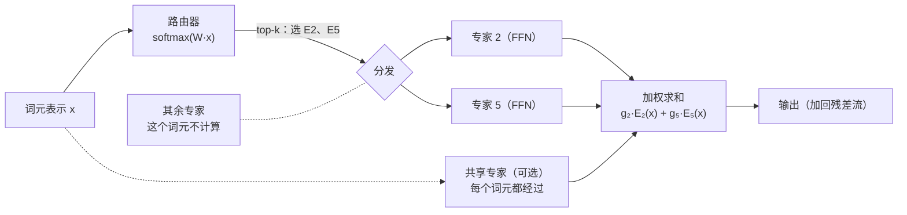
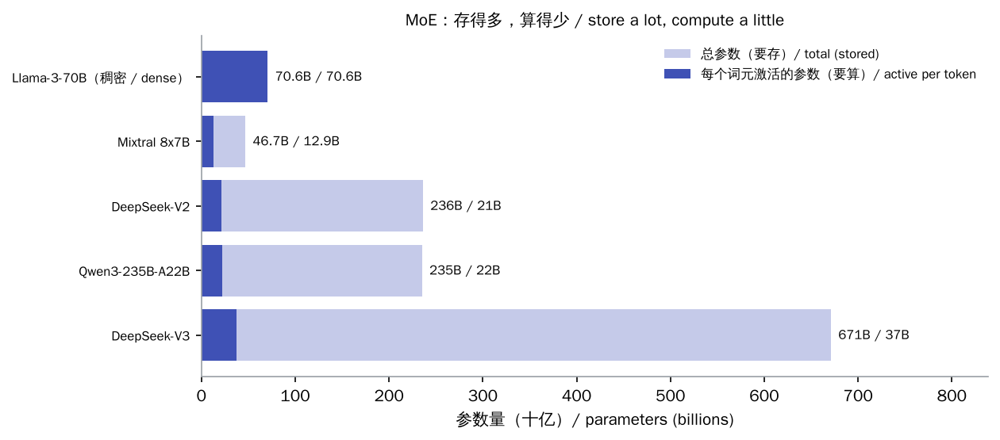
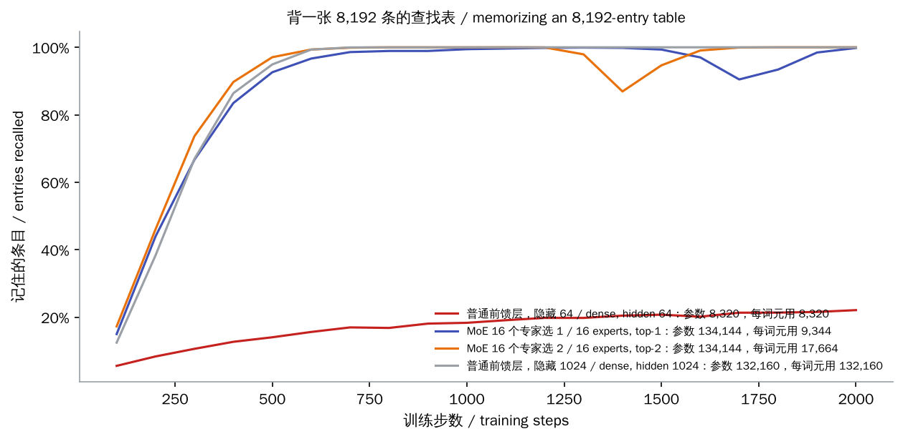
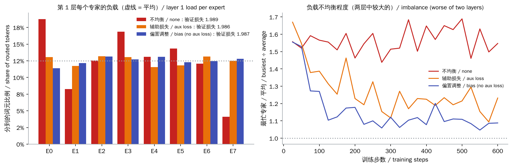
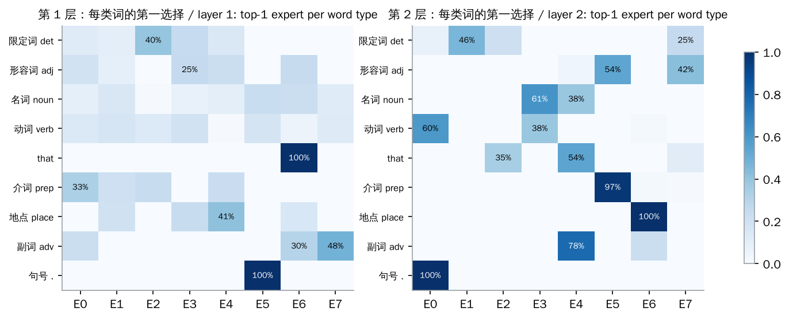

# 混合专家（Mixture of Experts，MoE）

> **一句话总结：** MoE 把 Transformer 里的前馈层换成许多个小“专家”，再加一个**路由器**：每个词元只交给得分最高的 $k$ 个专家处理。于是模型可以有很多参数（存得多、记得多），每个词元的计算量却只相当于一个小得多的模型。代价有三个：
>
> - **负载均衡**：要防止路由器把词元都塞给少数专家。
> - **显存**：要装下全部参数。
> - **通信**：专家分布在多张卡上时，每层都要来回搬运词元。
>
> DeepSeek-V3（671B 参数、每词元激活 37B）、Mixtral、Qwen3 等都是 MoE。
>
> 🌐 [English version](README.en.md) · 🎮 **[打开交互演示](interactive/moe.html?lang=zh)** · 📓 [Notebook](15-moe.ipynb)（[在 Colab 中打开](https://colab.research.google.com/github/BaiYuBY/use_token_to_learn/blob/main/docs/15-moe/15-moe.ipynb)）

[](interactive/moe.html?lang=zh)

**本章你将学会：**

- MoE 层的结构：路由器、top-k 选择、门控权重、共享专家
- 为什么 MoE 能“参数多、计算少”，总参数和激活参数怎么算
- 负载不均衡的代价，以及辅助损失和 DeepSeek-V3 的无辅助损失偏置调整
- 专家会自发形成分工
- 部署 MoE 的难点：显存、专家并行和 all-to-all 通信

## 1. 直觉：请专家会诊，但每次只请几位

[05 章](../05-transformer/README.md)讲过，Transformer 每层的前馈网络（FFN）占了大部分参数，很多知识就存在这里。想让模型记住更多，最直接的办法是把 FFN 做大，但计算量会同比例增加，每个词元都要过一遍整个大矩阵。

MoE 的做法是：

- 把一个大 FFN 拆成 $E$ 个小 FFN（**专家**），再加一个很小的**路由器**。
- 路由器看一眼词元的表示，给每个专家打分，只把词元交给得分最高的 $k$ 个专家（通常 $k$ = 1–8）。
- 这 $k$ 个专家的输出按分数加权求和。

这样，**参数量**随专家数 $E$ 增长，**每个词元的计算量**只随 $k$ 增长。这就像医院里有很多科室的专家，每位病人只看其中几位。

## 2. 图解





> **🎮 动手试试**
>
> 在[交互演示](interactive/moe.html?lang=zh)中，你可以：
>
> 1. 查看训练好的 MoE 模型把例句里的每个词交给了哪两个专家，以及专家的分工
> 2. 在负载均衡模拟器里比较“不均衡”“辅助损失”“偏置调整”，看最忙的专家和被丢弃的词元
> 3. 浏览实测曲线：MoE 的记忆容量，以及三种均衡方式的效果
> 4. 用 Mixtral、DeepSeek-V3、Qwen3 的配置计算总参数、激活参数、每卡显存和通信量

## 3. 原理

### 3.1 MoE 层

对一个词元的表示 $x$，路由器先算出对 $E$ 个专家的概率：

$$
p = \operatorname{softmax}(W_r\,x)
$$

再选出概率最高的 $k$ 个专家，组成集合 $\mathcal{T}$，输出为：

$$
y = \sum_{i \in \mathcal{T}} g_i\, \mathrm{FFN}_i(x), \qquad g_i = \frac{p_i}{\sum_{j \in \mathcal{T}} p_j}\quad(k > 1)
$$

几个细节：

- **$k = 1$ 时不能归一化**：否则门控恒为 1，输出与路由概率无关，路由器收不到任何梯度。Switch Transformer（Fedus 等，2021）直接用原始概率 $p_i$ 作门控。写本章代码时就踩过这个坑：在一张 4,096 条的表上，top-1 的 MoE 只记住了 63%，修正后接近 100%。
- **共享专家**：DeepSeekMoE（Dai 等，2024）把专家切得更细、更多，并加入少量所有词元都经过的共享专家，承担通用知识，让路由专家更专注。
- **只有一个专家时**，MoE 层就是普通的 FFN。代码用这一点验证了实现的正确性。

### 3.2 参数多、计算少：实测

为了单独测试“容量”，代码让模型背一张 8,192 条的随机查找表（键 → 值）。键用**固定的随机向量**表示，所以只能靠 FFN 或专家来记。



| 模型 | 参数 | 每个词元用到的参数 | 记住的条目 |
| --- | --- | --- | --- |
| 普通 FFN，隐藏层 64 | 8,320 | 8,320 | 22% |
| MoE：16 个专家（每个隐藏层 64），选 1 个 | 134,144 | 9,344 | 99.8% |
| MoE：16 个专家，选 2 个 | 134,144 | 17,664 | 100% |
| 普通 FFN，隐藏层 1024 | 132,160 | 132,160 | 100% |

选 1 个专家的 MoE，每个词元的计算量和小 FFN 差不多，记住的内容却和 16 倍大的 FFN 一样多。这就是 MoE 的核心价值：**用很少的额外计算换来大得多的容量**。

真实模型也是如此（上一张图）。以 Mixtral 8x7B 为例，代码按配置逐项计算：

- 每层 8 个专家，每个 1.76 亿参数，32 层；加上注意力和嵌入，共 **46.7B**。
- 每个词元只用其中 2 个专家，激活参数为 **12.9B**（28%）。

两个数字都与官方公布的一致。DeepSeek-V3 有 256 个路由专家加 1 个共享专家，每个词元选 8 个，671B 参数中只激活 37B（约 5.5%）。

### 3.3 负载均衡

路由器是学出来的，很容易“偏心”：一开始稍好的专家拿到更多词元、学得更快，又拿到更多……不均衡有三个代价：

- **专家并行时**，专家分布在不同的 GPU 上，最忙的那张卡决定每一步的耗时，其他卡在空等。
- **设了容量上限时**（每个专家最多接收“平均负载 × 容量系数”个词元），超出的词元被**丢弃**，只经过残差连接，相当于这一层没处理它。
- **严重时**会出现“专家坍塌”：少数专家包揽一切，其余专家几乎没被训练，白白占着参数。

两种常见的解法：

- **辅助损失**（Switch Transformer）：在训练目标里加一项 $\alpha \cdot E \sum_i f_i P_i$。其中 $f_i$ 是实际分给专家 $i$ 的词元比例，$P_i$ 是路由器给它的平均概率；完全均衡时这一项等于 1。缺点是它的梯度会干扰语言建模本身，$\alpha$ 太大影响效果，太小又压不住。
- **无辅助损失的偏置调整**（Wang 等，2024；DeepSeek-V3）：给每个专家一个偏置 $b_i$，**只在选专家时**加到分数上，不进入门控权重。每一步后，负载高于平均的专家 $b_i$ 减小，低于平均的增大。训练目标完全不变。DeepSeek-V3 另外还保留了一个权重很小的序列级均衡损失作为补充。



本章的两个实验：

**查找表模型**（16 个专家，容量系数 1.25）：

| 方法 | 最忙专家 / 平均 | 被丢弃的词元 |
| --- | --- | --- |
| 不均衡 | 1.66 倍 | 4% |
| 辅助损失 | 1.38 倍 | 1% |
| 偏置调整 | 1.07 倍 | 0% |

**06 章语言上的 MoE 语言模型**（8 个专家选 2 个）：

- 不均衡时，最忙专家的负载一直是平均的 1.4–1.7 倍；两种均衡方法都把它压到 1.05–1.25 倍。
- 三者的验证损失几乎一样（1.989、1.986、1.987）。

在这么小的规模上，不均衡还没有伤到模型质量。它的代价主要体现在专家并行的效率和容量上限下被丢弃的词元上。

### 3.4 专家会自发分工



没有人告诉模型什么是“动词”“介词”，但训练后，第 2 层的分工非常清楚：

- 句号 100% 交给 E0，动词 60% 也交给 E0（动词后面常常紧跟句号或宾语）。
- 介词 97% 交给 E5，地点名词 100% 交给 E6，副词 78% 交给 E4。
- 名词主要在 E3 和 E4 之间。

第 1 层的分工粗一些，但“that”和句号也都各有专属专家。

大模型里的分工通常更多按**语法和词形**（标点、数字、代码符号、某种语言的词），而不是按“数学”“历史”这类人类理解的主题。所以“专家”这个名字容易让人误解。

### 3.5 部署 MoE：显存、并行与通信

MoE 让计算变便宜，却让部署变复杂：

- **显存按总参数算**：DeepSeek-V3 即使用 FP8 存储，也需要约 671 GB，必须多卡甚至多机。
- **专家并行（EP）**：把不同的专家放到不同的卡上。每个 MoE 层都要做两次 **all-to-all** 通信：
  - 先把每个词元发给它选中的专家所在的卡；
  - 算完再收回来。
  - DeepSeek-V3 每个词元在全部 MoE 层上的这两次通信约 13 MiB。为了控制跨机通信，它限制每个词元最多发往 4 个节点。
- **批量越大越划算**：解码时如果批量很小，每张卡上的专家只分到很少的词元，GPU 利用率很低。所以 MoE 特别依赖[第 13 章](../13-serving/README.md)的连续批处理和大规模部署。
- **负载均衡要在推理时继续做**：真实请求的分布和训练时不同，热门专家可以多放几份副本（如 DeepSeek 的 EPLB）。

| 模型 | 总参数 | 激活参数 | 专家配置 |
| --- | --- | --- | --- |
| Mixtral 8x7B | 46.7B | 12.9B | 8 个专家选 2 个 |
| DeepSeek-V2 | 236B | 21B | 160 个路由专家选 6 个 + 2 个共享专家 |
| Qwen3-235B-A22B | 235B | 22B | 128 个专家选 8 个 |
| DeepSeek-V3 | 671B | 37B | 256 个路由专家选 8 个 + 1 个共享专家 |

### 3.6 其他变体

- **专家选择路由**（Expert Choice，Zhou 等，2022）：反过来让每个专家挑选它要处理的词元，天然均衡，但不适合自回归生成。
- **无丢弃的 MoE**（MegaBlocks，Gale 等，2022）：用块稀疏矩阵乘法处理大小不一的专家批次，不再需要容量上限。
- **路由器 z-loss**（ST-MoE，Zoph 等，2022）：惩罚过大的路由 logits，提高训练稳定性。
- **稀疏升级**（Sparse Upcycling）：把训练好的稠密模型的 FFN 复制成多个专家作为起点，继续训练成 MoE。

## 4. 最小代码实现

完整代码：[`code/moe.py`](code/moe.py)，运行 `python docs/15-moe/code/moe.py`（约 30 秒）。实验与配图在 [`figures/moe_figures.py`](figures/moe_figures.py) 中。

MoE 层（只计算分到每个专家的词元）：

```python
probs = self.router(x).softmax(-1)                     # (词元, 专家)
scores = probs + self.bias if self.balance == "bias" else probs   # 偏置只影响选择
idx = scores.topk(self.k, dim=-1).indices
gate = probs.gather(-1, idx)
if self.k > 1:
    gate = gate / gate.sum(-1, keepdim=True)            # k = 1 时保留原始概率，否则路由器没有梯度
out = torch.zeros_like(x)
for e, expert in enumerate(self.experts):
    rows, slot = (idx == e).nonzero(as_tuple=True)      # 分到专家 e 的词元
    if len(rows):
        out[rows] += gate[rows, slot, None] * expert(x[rows])
```

两种负载均衡：

```python
frac = torch.bincount(idx.flatten(), minlength=self.n).float() / idx.numel()
self.aux_loss = self.n * (frac * probs.mean(0)).sum()   # Switch Transformer 的辅助损失

@torch.no_grad()
def update_bias(self, rate=1e-3):                       # DeepSeek-V3：负载高就调低偏置
    self.bias -= rate * torch.sign(self.load - self.load.mean())
```

## 5. 常见误区

- **“MoE 671B 的模型运行起来像 671B 的稠密模型一样慢”**：计算量只按激活参数算，约相当于 37B 的稠密模型；但显存要装下全部参数，而且通信更复杂。
- **“MoE 比同样总参数的稠密模型更强”**：通常不如同样总参数的稠密模型，但远强于同样计算量的稠密模型。MoE 的优势在于“每单位计算的效果”。
- **“每个专家对应一个学科”**：专家的分工大多是语法、词形层面的，而不是人类理解的主题。
- **“负载不均衡会让模型变差”**：在小规模上未必（本章的实验损失几乎相同），主要代价是并行效率和被丢弃的词元；规模大了还可能出现专家坍塌。
- **“top-1 路由时把门控归一化更规范”**：这样会让路由器完全没有梯度。

## 6. 自测题

1. 一个 MoE 层有 64 个专家、每个词元选 4 个，每个专家的参数量相同。相比只有一个同样大小专家的普通 FFN，参数量和每个词元的计算量各是多少倍？
2. 为什么 top-1 路由时，门控权重不能归一化成 1？
3. 辅助损失 $E \sum_i f_i P_i$ 在完全均衡时等于多少？为什么最小化它能让负载变均衡？
4. DeepSeek-V3 的偏置为什么只加在“选专家”的分数上，而不进入门控权重？
5. 专家并行时，为什么解码阶段的小批量会让 MoE 效率很低？

<details>
<summary>参考答案</summary>

1. 参数量 64 倍；计算量约 4 倍（另加很小的路由器开销）。
2. 门控恒为 1 时，输出与路由概率无关，损失对路由器参数的梯度为 0，路由器学不会怎样分配。用原始概率 $p_i$ 作门控，梯度就能传回路由器。
3. 均衡时 $f_i = P_i = 1/E$，$E \cdot \sum_i (1/E)^2 = 1$。负载集中时，同一个专家的 $f_i$ 和 $P_i$ 都大，乘积之和变大；最小化它就会压低热门专家的概率。
4. 偏置的作用只是调整“谁来处理”，不应改变专家输出的混合方式。如果进入门控，就会直接改变模型的输出和训练目标，相当于又引入了干扰。
5. 每个专家只分到总词元数 × k / E 个词元。批量小时每张卡上的专家几乎没事做，却仍要读取自己的全部权重，带宽和算力都浪费了。

</details>

## 7. 延伸阅读

- Shazeer et al., 2017. [Outrageously Large Neural Networks: The Sparsely-Gated Mixture-of-Experts Layer](https://arxiv.org/abs/1701.06538)
- Lepikhin et al., 2020. [GShard: Scaling Giant Models with Conditional Computation and Automatic Sharding](https://arxiv.org/abs/2006.16668)
- Fedus et al., 2021. [Switch Transformers: Scaling to Trillion Parameter Models with Simple and Efficient Sparsity](https://arxiv.org/abs/2101.03961)
- Zoph et al., 2022. [ST-MoE: Designing Stable and Transferable Sparse Expert Models](https://arxiv.org/abs/2202.08906)（路由器 z-loss）
- Zhou et al., 2022. [Mixture-of-Experts with Expert Choice Routing](https://arxiv.org/abs/2202.09368)
- Gale et al., 2022. [MegaBlocks: Efficient Sparse Training with Mixture-of-Experts](https://arxiv.org/abs/2211.15841)
- Komatsuzaki et al., 2022. [Sparse Upcycling: Training Mixture-of-Experts from Dense Checkpoints](https://arxiv.org/abs/2212.05055)
- Jiang et al., 2024. [Mixtral of Experts](https://arxiv.org/abs/2401.04088)
- Dai et al., 2024. [DeepSeekMoE: Towards Ultimate Expert Specialization in Mixture-of-Experts Language Models](https://arxiv.org/abs/2401.06066)（细粒度专家、共享专家）
- Wang et al., 2024. [Auxiliary-Loss-Free Load Balancing Strategy for Mixture-of-Experts](https://arxiv.org/abs/2408.15664)
- DeepSeek-AI, 2024. [DeepSeek-V2](https://arxiv.org/abs/2405.04434)；[DeepSeek-V3 Technical Report](https://arxiv.org/abs/2412.19437)
- Qwen Team, 2025. [Qwen3 Technical Report](https://arxiv.org/abs/2505.09388)
- 相关问答：[DeepInfer 是什么](../qa/deepinfer.md)（MoE 推理中的专家并行与负载均衡）
