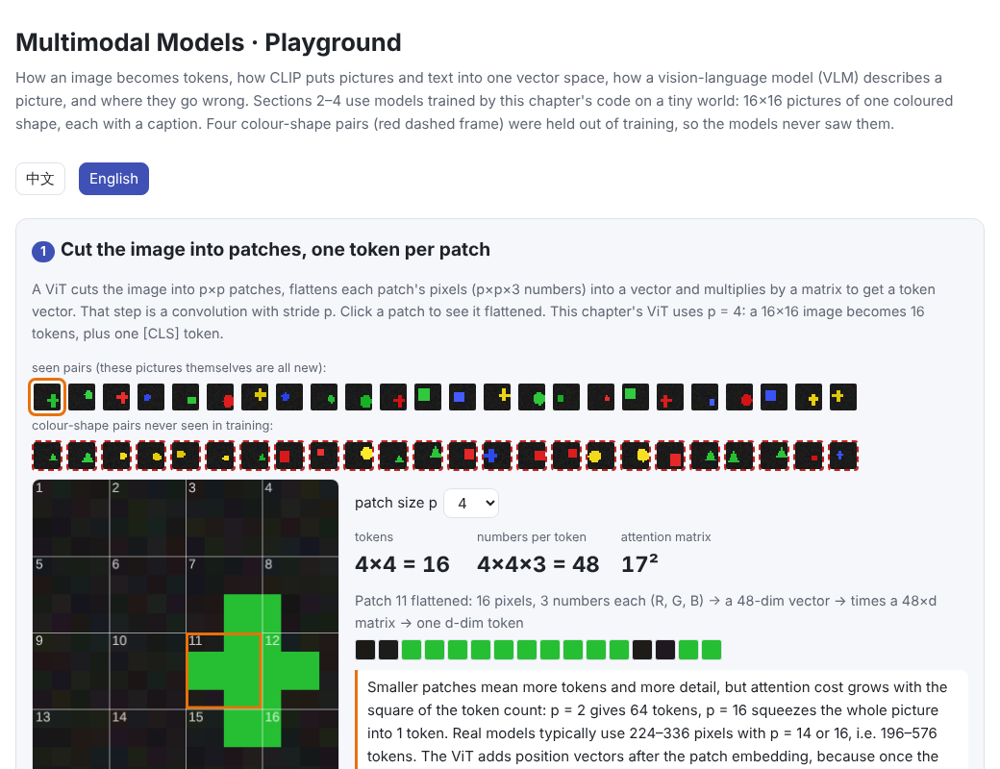
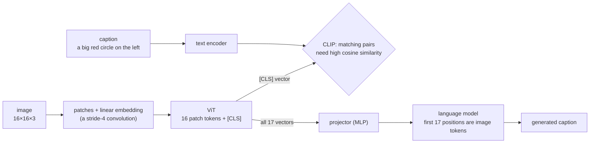

# Multimodal Models

> **In one sentence:** The key to letting a language model “see” is to turn images into a sequence of token vectors too. A **ViT** cuts an image into patches, one token per patch. **CLIP** uses contrastive learning to put pictures and text into one vector space, so text alone can act as a classifier. A **vision-language model (VLM)** then places image tokens in front of a language model so it can talk about what it sees. Its weaknesses come from the same route:
>
> - **Many visual tokens**: one high-resolution image is thousands of tokens, and long video far more.
> - **Poor compositional generalization**: an unseen “colour + shape” combination is mistaken for a seen one.
> - **Hallucination**: saying what was common in training rather than what is in the picture.
>
> 🌐 [中文版](README.md) · 🎮 **[Open the interactive playground](interactive/multimodal.html?lang=en)** · 📓 [Notebook](16-multimodal.ipynb) ([open in Colab](https://colab.research.google.com/github/BaiYuBY/use_token_to_learn/blob/main/docs/16-multimodal/16-multimodal.ipynb))

[](interactive/multimodal.html?lang=en)

**In this chapter you will learn:**

- how a ViT turns an image into tokens, and why the “patch embedding” is a convolution
- CLIP's contrastive loss and temperature, and zero-shot classification with text prompts
- four ways to build a vision-language model: a projector (LLaVA), a Q-Former (BLIP-2), cross-attention (Flamingo) and native multimodality
- how many tokens an image or a video costs, and how to save them
- in a tiny world you fully control, reproducing a failure of compositional generalization and a “seeing it wrong” hallucination

## 1. Intuition: turn everything into tokens

So far the language model has handled one kind of input: text split into tokens ([chapter 01](../01-tokenization/README.en.md)), each looked up as a vector ([chapter 02](../02-embedding/README.en.md)), with a Transformer attending over the sequence ([chapter 05](../05-transformer/README.en.md)).

The Transformer doesn't care where the vectors come from. If images and sound can be turned into “a sequence of vectors”, the same attention can process them:

- **Images**: cut into 14×14 or 16×16-pixel patches; each patch, flattened and multiplied by a matrix, is a token.
- **Audio**: first turned into a mel spectrogram (a kind of “picture of sound”), then cut into patches or compressed into a sequence of vectors by convolutions.
- **Video**: a series of image frames, with neighbouring frames merged.

What remains is making image tokens and text tokens “speak the same language”. CLIP's answer: train two encoders on hundreds of millions of “picture + caption” pairs so that matching pictures and texts point the same way. The VLM's answer: pass the image encoder's output through a small projector straight into a language model, and let it learn to understand from “describe the picture” data.

This chapter does both steps in a tiny world you fully control: 16×16 pictures of one coloured shape, each with a caption such as “a big red circle on the left”. Four colour-shape pairs are held out of training; for example, a green triangle never appears. They test what the models have really learned.

## 2. Diagram




These are test pictures. The four combinations in red (green triangle, yellow circle, blue cross, red square) never appeared in training, yet every attribute was seen on its own: green was seen, and so were triangles (red, blue and yellow ones).

> **🎮 Try it yourself**
>
> In the [interactive playground](interactive/multimodal.html?lang=en) you can:
>
> 1. click a patch of an image to see it flattened into a vector, and compute how many tokens a high-resolution image or a video costs
> 2. view CLIP's similarity matrix for a batch of pictures and captions, drag the temperature and watch the contrastive loss
> 3. classify any test picture zero-shot with 16 text prompts, compare one template with prompt ensembling, and read the confusion matrix
> 4. browse the VLM's captions for 48 test pictures and find where it goes wrong on unseen combinations
> 5. compare four designs: LLaVA, BLIP-2, Flamingo and native multimodal

## 3. How it works

### 3.1 Images become tokens: ViT

The Vision Transformer (ViT) is direct:

1. Cut an $H \times W$ image into $p \times p$ patches, $\frac{H}{p} \cdot \frac{W}{p}$ of them.
2. Each patch has $p \cdot p \cdot 3$ numbers (RGB). Flatten them into a vector and multiply by a $3p^2 \times d$ matrix to get a $d$-dimensional **patch embedding**.
3. Add position vectors (otherwise the model can't tell which patch was top-left) and put a learnable [CLS] token in front.
4. Feed everything to an ordinary Transformer encoder (bidirectional attention, no causal mask). The output at [CLS] represents the whole image.

“Cut into patches, then multiply by a matrix” is the same operation as “a convolution with kernel size = stride = $p$”, so implementations usually write `nn.Conv2d(3, d, kernel_size=p, stride=p)`. This chapter's code also cuts the patches by hand with `F.unfold` and checks that both give the same result.

ViT-B/16 turns a 224×224 image into 14×14 = 196 patch tokens. A ViT lacks the convolutional network's built-in assumption that neighbouring pixels are related, so it needs more data; with enough data (hundreds of millions of images) it overtakes convolutional networks.

### 3.2 CLIP: aligning pictures and text with contrastive learning

CLIP has two encoders. The image encoder (a ViT) turns a picture into a unit vector $u$; the text encoder turns a caption into a unit vector $v$. The training data is 400 million “picture + caption” pairs collected from the web.

A batch of $N$ pairs gives an $N \times N$ similarity matrix $u_i \cdot v_j$. The goal: large on the diagonal (matching pairs), small elsewhere:

$$\mathcal{L} = -\frac{1}{2N}\sum_{i=1}^{N}\left[\log\frac{e^{s\, u_i\cdot v_i}}{\sum_j e^{s\, u_i\cdot v_j}} + \log\frac{e^{s\, u_i\cdot v_i}}{\sum_j e^{s\, u_j\cdot v_i}}\right]$$

The first term says “image $i$ must pick caption $i$ among the $N$ captions”, a softmax cross-entropy along each row; the second says “caption $i$ must pick image $i$”, along each column. This is the **InfoNCE** or contrastive loss. Key points:

- **Negatives come from the rest of the batch**, with no labelling needed. Bigger batches mean more negatives, a harder task and finer representations. CLIP used a batch size of 32,768.
- **Temperature**: $s$ is the inverse temperature and sets how sharp the softmax is. If $s$ is too small, the loss stays near the chance value $\ln N$ even when the diagonal is already the largest, and the gradient is weak. CLIP learns $s$ as a parameter, initialised at $1/0.07 \approx 14.3$ and capped at 100. This chapter's small model learns $s \approx 19$.
- **False negatives**: if two pictures in a batch are both “a small red circle”, each counts as a negative for the other. They get more common with bigger batches but usually matter little.
- **SigLIP** replaces the row and column softmaxes with an independent sigmoid (yes/no) for every pair. Nothing has to be normalized over the whole batch, which saves communication in large distributed training.


After 800 steps with batches of 128 pairs, this chapter's mini CLIP clearly rates matching pictures and captions as most similar (left).

### 3.3 Zero-shot classification and prompt ensembling

A trained CLIP can classify without training any classifier head:

1. Write each class as a prompt, such as “a photo of a dog”.
2. Embed every prompt with the text encoder.
3. Assign the image to the class whose prompt vector is most similar.

The text encoder's outputs are the classifier's weights. A new set of classes needs only a new set of prompts; this is **zero-shot** classification. CLIP's ViT-L/14 (336 px) reaches 76.2% zero-shot on ImageNet, on par with a ResNet-50 trained on ImageNet itself.

**Prompt ensembling**: phrase the same class several ways (“a photo of a big dog”, “a blurry photo of a dog”, …) and average the vectors. The CLIP paper used 80 templates and gained about 3.5 points on ImageNet. This chapter averages 4 templates (size × side) to classify the 16 colour-shape pairs:

| Test pictures (800 each) | One template | 4-template ensemble | Colour right |
|---|---|---|---|
| Seen pairs | 83% | 86% | 100% |
| Unseen pairs | 22% | 25% | 100% |

Seen pairs work well, and the ensemble helps. On unseen pairs the colour is 100% right, but the shape only 25%, exactly chance among 4 shapes. Section 3.6 explains why.

### 3.4 Vision-language models: four designs

CLIP can only compare pictures with text; it can't describe a picture. To have a language model answer questions about an image, image information must be wired into it. There are four main designs:

| Design | Where the image enters | Visual tokens per image | What is trained |
|---|---|---|---|
| **LLaVA**: projector | at the front of the input sequence, like text | every patch (576 for LLaVA-1.5) | stage 1: projector only; stage 2: projector + LLM |
| **BLIP-2**: Q-Former | the input sequence | a fixed 32 queries | only the Q-Former; image encoder and LLM stay frozen |
| **Flamingo**: cross-attention | cross-attention layers inserted between LLM layers | 64, but not in the input sequence | only the new layers, with gates starting at 0 |
| **Native multimodal** (early fusion) | in the input sequence from the first day of pretraining | set by the tokenizer | everything, pretrained together |

- **LLaVA** is the simplest: take all patch vectors from a frozen CLIP image encoder, project them with a two-layer MLP to the language model's embedding size, and put them in front of the text. Stage 1 trains only the projector on about 560K image-caption pairs so the image vectors “land” where the language model can read them; stage 2 trains the projector and the language model together on visual instruction data (visual question answering, conversations). Most open VLMs today (the Qwen-VL series, InternVL and others) are variants of this route.
- **BLIP-2**'s Q-Former has 32 learnable query vectors that “read” the image features through cross-attention, and only those 32 vectors go to the language model. It saves tokens, but 32 vectors are a bottleneck: fine text, counts and similar details get lost.
- **Flamingo** freezes the language model and inserts gated cross-attention layers between its layers, so every few layers the text “looks” at the image. The gate is $\tanh(\alpha)$ with $\alpha$ initialised at 0, so at the start of training the model behaves exactly like the original language model. Images don't take up the input sequence, which suits long interleaved image-text documents. Llama 3.2 Vision also uses cross-attention adapters.
- **Native multimodal** models mix images and text from the start of pretraining. Chameleon quantizes each 512×512 image into 1,024 discrete tokens that share a vocabulary with text, so it can also output images. Gemini and GPT-4o are described as natively multimodal, but their exact architectures are not fully public.

This chapter implements the LLaVA style: the frozen mini-CLIP image encoder outputs 1 + 16 vectors, an MLP projector maps them, and they go in front of a small two-layer language model trained by next-word prediction to write captions.

### 3.5 How many tokens is an image?

To the language model, visual tokens are like text tokens: each costs attention, each takes KV cache ([chapter 12](../12-inference-optimization/README.en.md)), each is billed.

$$\text{tokens} = \left\lceil \frac{H}{p \cdot m} \right\rceil \cdot \left\lceil \frac{W}{p \cdot m} \right\rceil$$

Here $p$ is the patch size and $m$ the merge factor ($m = 2$ merges each 2×2 group of patches into one token).


- 336×336 with patch 14: $24 \times 24 = 576$ tokens (LLaVA-1.5).
- 1024×1024 with patch 16: 4,096 tokens, the length of an article of a few thousand words.
- Video multiplies by the frame count: 64 frames of 448×448 are $64 \times 256 = 16{,}384$ tokens even with 2×2 merging.

Common ways to save:

- **Merge neighbouring patches**: Qwen2-VL uses an MLP to merge each 2×2 group of neighbouring patches into one token (tokens ÷ 4), and for video also merges two neighbouring frames (another ÷ 2).
- **Dynamic resolution**: instead of resizing every image to a fixed size, cut patches at the original aspect ratio, so big images get more tokens and small ones fewer. LLaVA-NeXT's AnyRes splits a high-resolution image into tiles encoded separately, plus one thumbnail.
- **Compress to a fixed number**: BLIP-2's Q-Former, Flamingo's Perceiver resampler.
- **Position encoding**: images are 2-D and video is 3-D. Qwen2-VL's M-RoPE splits rotary position encoding ([chapter 14](../14-long-context/README.en.md)) into time, height and width parts.

### 3.6 What goes wrong: compositional generalization and hallucination

This chapter's tiny world is built to expose one problem: four colour-shape pairs are held out of training. If a model really treated “colour” and “shape” as two independent attributes, it should recognize unseen combinations, since every attribute was seen on its own.

**CLIP zero-shot**: on unseen pairs the colour is 100% right but the shape only 25%. In the confusion matrix on the right of section 3.2, the red rows (unseen pairs) are almost all classified as a seen pair of the same colour.

**A linear probe**: freeze the image encoder and train a linear classifier for shape on seen pairs only. It reaches 92% on seen pairs and just 1% on unseen pairs, far below the 25% of chance. In the image features, shape is entangled with colour: the shape read out is almost always one that this colour had in training. One reason is a correlation in the training data itself: each colour lacks exactly one shape, so colour alone rules out a shape. The model learned the shortcut the data allowed.

**VLM captions**:


| Test pictures (400 each) | Exactly right | Shape right |
|---|---|---|
| Seen pairs | 96% | 96% |
| Unseen pairs | 0.3% | 0.5% |

For unseen pairs the VLM almost always gets colour, size and position right but swaps the shape: the picture shows a green triangle, it writes “a small green circle on the right”. Two causes stack up:

1. The frozen image features already confuse these combinations (the linear probe above).
2. The language model has never written “green triangle”; after “green” it has only seen circle, square or cross.

The result is a fluent, confident, wrong caption. This is one source of multimodal **hallucination**: the model says what was common in its training data rather than what is in the picture.

Real large models have the same problem, at larger scale and less visibly:

- **Composition and relations**: Winoground asks models to tell apart captions with the same words in a different order, such as “there is a mug in some grass” and “there is some grass in a mug”; CLIP-style models score near or even below chance. ARO found CLIP nearly insensitive to word order, almost a “bag of words”, unable to tell “the horse is eating the grass” from “the grass is eating the horse”. One reason: contrastive learning only needs to separate the captions in a batch, and a batch rarely contains negatives that differ only in word order.
- **Object hallucination**: CHAIR counts how many objects a caption mentions that aren't in the image; POPE asks directly, “Is there an X in the image?”. Objects that often co-occur with others (chairs by a dining table, cars on a street) are the most likely to be “seen”.

Common mitigations:

- Add **hard negatives** in training, e.g. shuffle the word order or swap attributes in captions, forcing the model to attend to composition (NegCLIP and others).
- Raise the resolution and keep more visual tokens, so fewer details are lost.
- Train with preference data so the model says “I can't tell” when unsure.
- At inference, have the model list the objects it sees before answering, or use contrastive decoding to weaken what it would say without looking at the image.

### 3.7 Audio, video and image generation

The same “turn it into tokens” idea carries over to other modalities:

- **Speech recognition**: Whisper turns 30 seconds of audio into an 80-channel log-mel spectrogram, compresses its 3,000 frames to 1,500 vectors with two convolution layers, and hands them to an encoder-decoder Transformer that outputs text.
- **Speech and music generation**: neural audio codecs (such as EnCodec and SoundStream) compress waveforms into discrete tokens; a language model generates these tokens one by one like text, and they are decoded back into a waveform.
- **Video understanding**: sample some frames, treat each as an image, and merge neighbouring frames to save tokens.
- **Image generation**: the mainstream is **diffusion**, which starts from pure noise and removes it step by step. Stable Diffusion denoises in a compressed latent space and uses CLIP's text encoder to understand the prompt. Alternatively, as in Chameleon, images become discrete tokens generated one by one by a language model.

## 4. Minimal code

Full code: [`code/multimodal.py`](code/multimodal.py); run `python docs/16-multimodal/code/multimodal.py` (about 30 seconds). Experiments and figures are in [`figures/multimodal_figures.py`](figures/multimodal_figures.py).

ViT (the patch embedding is a convolution with stride $p$):

```python
self.patch_embed = nn.Conv2d(3, d, kernel_size=patch, stride=patch)
...
t = self.patch_embed(x).flatten(2).transpose(1, 2)     # (B, patches, d)
t = torch.cat([self.cls.expand(len(t), -1, -1), t], dim=1) + self.pos
h = self.norm(self.blocks(t))
return h if all_tokens else h[:, 0]                     # [CLS] stands for the whole image
```

CLIP's symmetric contrastive loss:

```python
def clip_loss(img, txt, scale):
    logits = scale * img @ txt.T                         # (N, N) similarity matrix
    labels = torch.arange(len(img))                      # image i goes with caption i
    return (F.cross_entropy(logits, labels) + F.cross_entropy(logits.T, labels)) / 2
```

Zero-shot classification (prompt ensembling):

```python
templates = [(z, d) for z in SIZES for d in SIDES]       # 4 wordings
embs = torch.stack([model.embed_text(encode([["a", z, c, s, "on", "the", d] for c, s in PAIRS]))
                    for z, d in templates])
prompts = F.normalize(embs.mean(0), dim=-1)              # one vector per class
pred = (model.embed_image(images) @ prompts.T).argmax(-1)
```

A LLaVA-style VLM:

```python
with torch.no_grad():
    v = self.vision(images, all_tokens=True)            # frozen image encoder, (B, 1 + 16, d)
h = torch.cat([self.proj(v), self.embed(ids)], dim=1)   # image tokens first, then text
h = self.norm(self.blocks(h + self.pos[:, :T], mask=causal_mask, is_causal=True))
return self.head(h)[:, v.size(1):]                       # predict the next word only at text positions
```

The code's `main()` checks the conclusions with shorter training (CLIP 500 steps): on seen pairs, zero-shot colour 100% and pair above 70%; on unseen pairs, shape around 26%; linear probe about 92% vs 1%; the VLM gets nearly 90% of seen-pair captions exactly right but only 0–1% of unseen-pair shapes. Exact numbers vary slightly with the number of CPU threads.

## 5. Common misconceptions

- **“A multimodal model looks at the pixels directly”**: the language model sees a sequence of vectors from the image encoder; resolution, patch size and merging decide how much detail survives. When small text in an image is misread, the cause is often too few visual tokens rather than a weak language model.
- **“CLIP understands what an image means”**: CLIP learns which pictures and captions tend to go together. It is sensitive to objects and colours but weak on word order, counting, spatial relations and attribute binding.
- **“An image is one token”**: an image is usually hundreds to thousands of tokens, and video far more. They take context, attention and money just like text.
- **“A VLM is wrong because it didn't see”**: this chapter's VLM got colour and position right but swapped the shape for a combination common in training. Hallucinations are often “saw part of it and filled in the rest from the prior”.
- **“Having seen each attribute, a model recognizes new combinations”**: this chapter's models saw green and saw triangles, yet couldn't recognize a green triangle. Compositional generalization needs dedicated support from the data or the training objective.

## 6. Self-check

1. How many patches does a 448×448 image give with patch size 14? And after 2×2 merging?
2. In CLIP's contrastive loss with a batch of $N$ pairs, how many negatives does each image have? Why does the task get harder when the batch grows from 256 to 32,768?
3. With a very small inverse temperature $s$ (say 1), why does the loss stay near $\ln N$ even when the diagonal is already the largest?
4. Why are Flamingo's gates initialised at 0?
5. This chapter's linear probe gets 92% on seen pairs but only 1% on unseen pairs, far below chance. What does that show?

<details>
<summary>Answers</summary>

1. $448 / 14 = 32$, so $32 \times 32 = 1{,}024$ patches; after 2×2 merging, $16 \times 16 = 256$ tokens.
2. $N - 1$ (the other captions in the batch). A bigger batch is more likely to contain negatives close to the positive, so the model must tell finer differences apart to pick correctly.
3. Similarities lie in $[-1, 1]$; multiplied by 1, the softmax inputs differ very little, the probabilities are close to a uniform $1/N$, and the cross-entropy is close to $\ln N$.
4. With the gates at 0 the new cross-attention layers do nothing, so the model starts out exactly like the original language model and its language ability isn't wrecked at the outset; the gates open during training and image information is added gradually.
5. The “shape” the probe reads out is systematically a shape this colour had in training, so the image features entangle shape with colour rather than learning two freely combinable attributes. The correlation between colour and shape in the training data gave the model this shortcut.

</details>

## 7. Further reading

- Dosovitskiy et al., 2020. [An Image is Worth 16x16 Words: Transformers for Image Recognition at Scale](https://arxiv.org/abs/2010.11929) (ViT)
- Radford et al., 2021. [Learning Transferable Visual Models From Natural Language Supervision](https://arxiv.org/abs/2103.00020) (CLIP)
- Zhai et al., 2023. [Sigmoid Loss for Language Image Pre-Training](https://arxiv.org/abs/2303.15343) (SigLIP)
- Alayrac et al., 2022. [Flamingo: a Visual Language Model for Few-Shot Learning](https://arxiv.org/abs/2204.14198)
- Li et al., 2023. [BLIP-2: Bootstrapping Language-Image Pre-training with Frozen Image Encoders and Large Language Models](https://arxiv.org/abs/2301.12597)
- Liu et al., 2023. [Visual Instruction Tuning](https://arxiv.org/abs/2304.08485) (LLaVA); [Improved Baselines with Visual Instruction Tuning](https://arxiv.org/abs/2310.03744) (LLaVA-1.5)
- Wang et al., 2024. [Qwen2-VL: Enhancing Vision-Language Model's Perception of the World at Any Resolution](https://arxiv.org/abs/2409.12191) (dynamic resolution, M-RoPE)
- Chameleon Team, 2024. [Chameleon: Mixed-Modal Early-Fusion Foundation Models](https://arxiv.org/abs/2405.09818)
- Thrush et al., 2022. [Winoground: Probing Vision and Language Models for Visio-Linguistic Compositionality](https://arxiv.org/abs/2204.03162)
- Yuksekgonul et al., 2023. [When and Why Vision-Language Models Behave like Bags-of-Words, and What to Do About It?](https://arxiv.org/abs/2210.01936) (ARO, NegCLIP)
- Hsieh et al., 2023. [SugarCrepe: Fixing Hackable Benchmarks for Vision-Language Compositionality](https://arxiv.org/abs/2306.14610)
- Rohrbach et al., 2018. [Object Hallucination in Image Captioning](https://arxiv.org/abs/1809.02156) (CHAIR)
- Li et al., 2023. [Evaluating Object Hallucination in Large Vision-Language Models](https://arxiv.org/abs/2305.10355) (POPE)
- Radford et al., 2022. [Robust Speech Recognition via Large-Scale Weak Supervision](https://arxiv.org/abs/2212.04356) (Whisper)
- Rombach et al., 2022. [High-Resolution Image Synthesis with Latent Diffusion Models](https://arxiv.org/abs/2112.10752) (Stable Diffusion)
