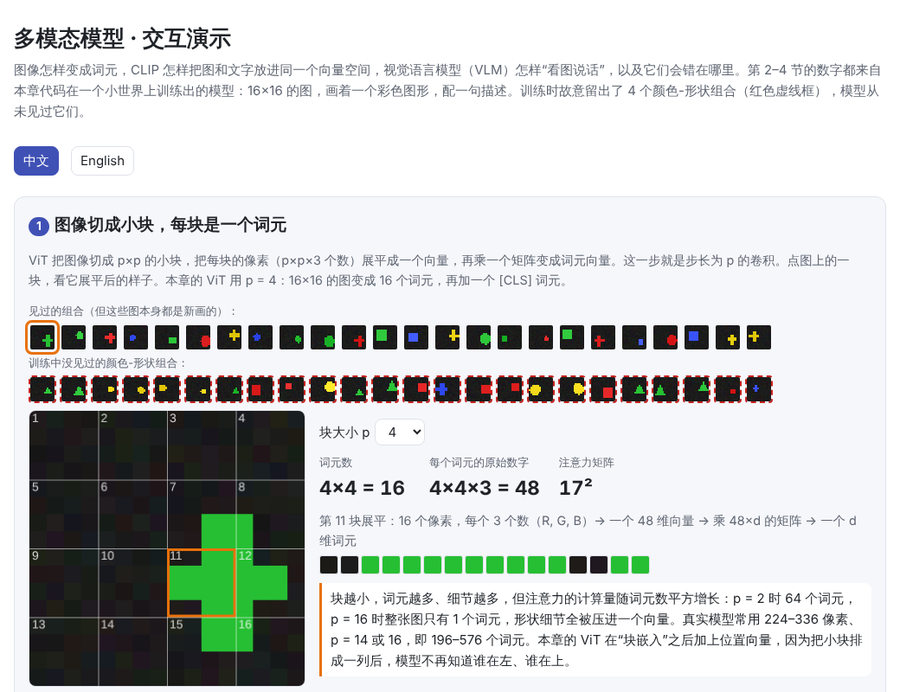
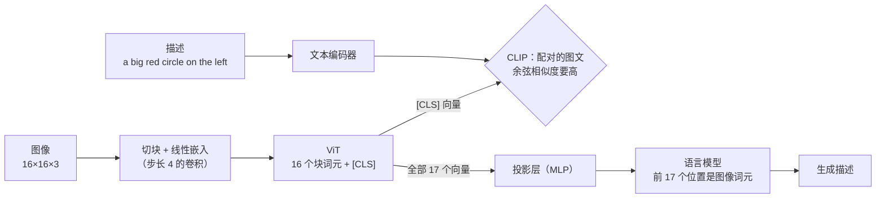
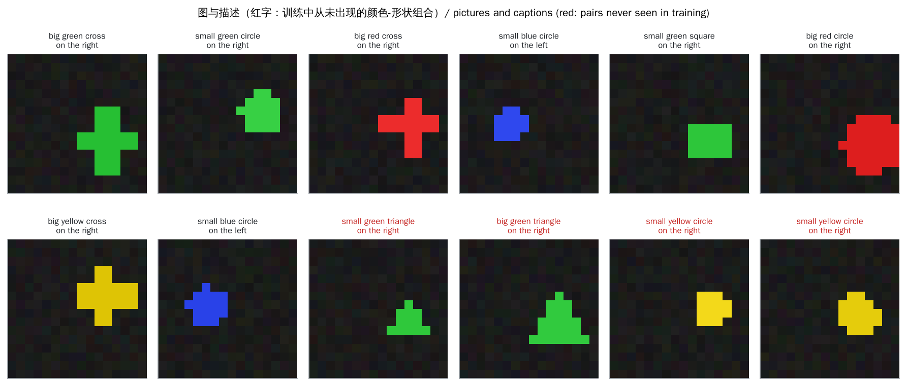
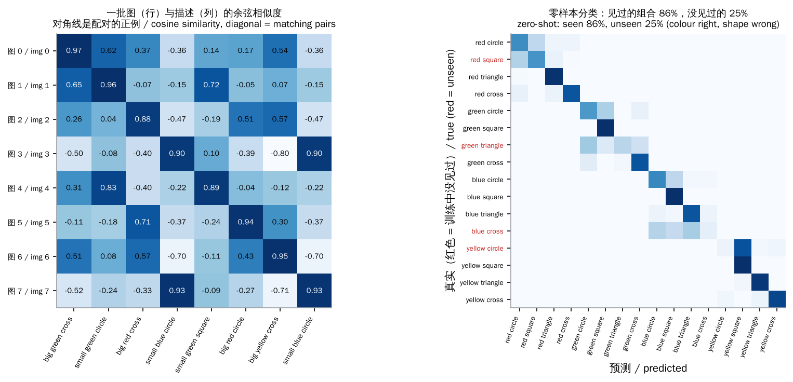
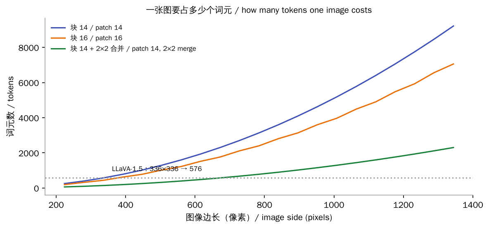
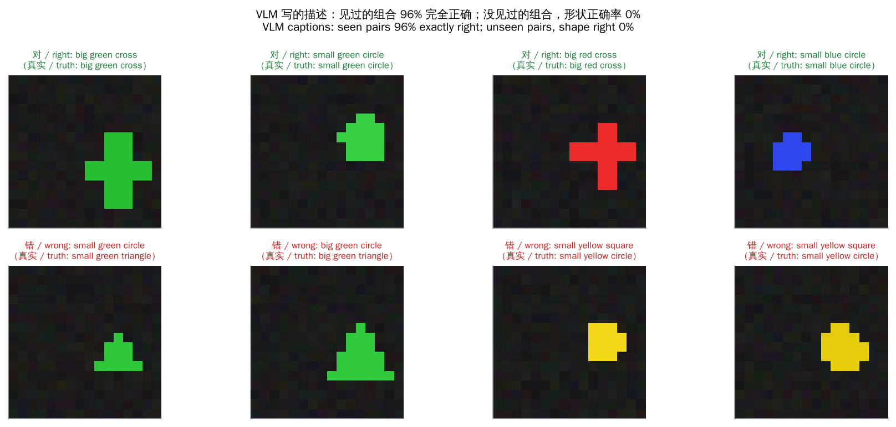

# 多模态模型（Multimodal Models）

> **一句话总结：** 让语言模型“看图”的关键是把图像也变成一串向量词元。**ViT** 把图像切成小块，每块是一个词元。**CLIP** 用对比学习把图和文字放进同一个向量空间，于是可以直接用文字做分类。**视觉语言模型（VLM）** 再把图像词元接到语言模型前面，让它看着图说话。它们的弱点也来自这条路线：
>
> - **视觉词元多**：一张高清图就是几千个词元，长视频更多。
> - **组合泛化差**：没见过的“颜色 + 形状”组合会被认成见过的组合。
> - **幻觉**：说出训练里常见的东西，而不是图里真有的东西。
>
> 🌐 [English version](README.en.md) · 🎮 **[打开交互演示](interactive/multimodal.html?lang=zh)** · 📓 [Notebook](16-multimodal.ipynb)（[在 Colab 中打开](https://colab.research.google.com/github/BaiYuBY/use_token_to_learn/blob/main/docs/16-multimodal/16-multimodal.ipynb)）

[](interactive/multimodal.html?lang=zh)

**本章你将学会：**

- ViT 怎样把图像变成词元，为什么“块嵌入”就是一个卷积
- CLIP 的对比损失、温度，以及用文字提示做零样本分类
- 视觉语言模型的四种接法：投影层（LLaVA）、Q-Former（BLIP-2）、交叉注意力（Flamingo）和原生多模态
- 一张图、一段视频要占多少词元，以及怎么省
- 在一个可以完全控制的小世界里，亲手复现组合泛化失败和“看图说错话”的幻觉

## 1. 直觉：把一切都变成词元

前面的章节里，语言模型只处理一种输入：文字切成的词元（[01 章](../01-tokenization/README.md)），每个词元查表得到一个向量（[02 章](../02-embedding/README.md)），Transformer 在这串向量上做注意力（[05 章](../05-transformer/README.md)）。

Transformer 本身并不关心向量从哪里来。只要能把图像、声音也变成“一串向量”，同一套注意力就能处理它们：

- **图像**：切成 14×14 或 16×16 像素的小块，每块展平后乘一个矩阵，就是一个词元。
- **音频**：先变成梅尔频谱图（一种“声音的图像”），再切块或用卷积压缩成一串向量。
- **视频**：一帧帧的图像，再把相邻帧合并。

剩下的问题是：怎样让图像词元和文字词元“说同一种语言”？CLIP 的回答是用数亿对“图 + 描述”训练两个编码器，让配对的图和文字指向同一个方向。VLM 的回答是把图像编码器的输出接一个小小的投影层，直接喂给语言模型，让它在“看图写话”的数据上学会理解。

本章在一个可以完全控制的小世界里把这两步都做一遍：16×16 的图，画着一个彩色图形，配一句描述，比如 “a big red circle on the left”。训练时故意留出 4 个颜色-形状组合，比如绿色三角形从未出现过，用来检验模型到底学会了什么。

## 2. 图解





上图是测试用的图。红字的四种组合（绿三角、黄圆、蓝十字、红方块）在训练中一次也没出现，但它们的每个属性都单独见过：绿色见过，三角形也见过（红三角、蓝三角、黄三角）。

> **🎮 动手试试**
>
> 在[交互演示](interactive/multimodal.html?lang=zh)中，你可以：
>
> 1. 点击图像上的小块，看它怎样展平成一个向量；用计算器算一张高清图或一段视频要占多少词元
> 2. 看一批图和描述的 CLIP 相似度矩阵，拖动温度，观察对比损失怎么变
> 3. 用 16 个文字提示给任意测试图做零样本分类，比较单个模板和提示词集成，查看混淆矩阵
> 4. 浏览 VLM 给 48 张测试图写的描述，找出它在没见过的组合上说错的地方
> 5. 对比 LLaVA、BLIP-2、Flamingo 和原生多模态四种结构

## 3. 原理

### 3.1 图像变成词元：ViT

ViT（Vision Transformer）的做法很直接：

1. 把 $H \times W$ 的图像切成 $p \times p$ 的小块，共 $\frac{H}{p} \cdot \frac{W}{p}$ 块。
2. 每块有 $p \cdot p \cdot 3$ 个数（RGB），展平成一个向量，乘一个 $3p^2 \times d$ 的矩阵，得到 $d$ 维的**块嵌入**。
3. 加上位置向量（否则模型不知道哪块在左上角），在最前面放一个可学习的 [CLS] 词元。
4. 送进普通的 Transformer 编码器（双向注意力，不需要因果掩码）。[CLS] 位置的输出代表整张图。

“切块再乘矩阵”和“卷积核大小 = 步长 = $p$ 的卷积”是同一个运算，所以实现里通常直接写 `nn.Conv2d(3, d, kernel_size=p, stride=p)`。本章代码用 `F.unfold` 手动切块，验证两者结果一致。

ViT-B/16 处理 224×224 的图得到 14×14 = 196 个块词元。ViT 本身没有卷积网络那种“相邻像素相关”的先验，所以需要更多数据才能训练好；一旦数据足够（数亿张图），它的效果就超过了卷积网络。

### 3.2 CLIP：用对比学习对齐图和文字

CLIP 有两个编码器：图像编码器（ViT）把图变成单位向量 $u$，文本编码器把描述变成单位向量 $v$。训练数据是从网上收集的 4 亿对“图 + 描述”。

一批 $N$ 对数据可以算出一个 $N \times N$ 的相似度矩阵 $u_i \cdot v_j$。目标是让对角线（配对的图文）大，其余（不配对的）小：

$$\mathcal{L} = -\frac{1}{2N}\sum_{i=1}^{N}\left[\log\frac{e^{s\, u_i\cdot v_i}}{\sum_j e^{s\, u_i\cdot v_j}} + \log\frac{e^{s\, u_i\cdot v_i}}{\sum_j e^{s\, u_j\cdot v_i}}\right]$$

第一项是“第 $i$ 张图要在 $N$ 条描述中挑中第 $i$ 条”，按行做 softmax 交叉熵；第二项是“第 $i$ 条描述要挑中第 $i$ 张图”，按列做。这叫 **InfoNCE** 或对比损失。几个要点：

- **负例来自同一批的其他样本**，不需要人工标注。批越大，负例越多，任务越难，学到的表示越细。CLIP 用了 32,768 的批大小。
- **温度**：$s$ 是温度的倒数，决定 softmax 有多尖。$s$ 太小，即使对角线已经最大，损失也接近随机水平 $\ln N$，梯度很弱。CLIP 把 $s$ 当作参数学习，初始为 $1/0.07 \approx 14.3$，上限 100。本章的小模型学到 $s \approx 19$。
- **假负例**：同一批里两张图如果都是“小红圆”，它们彼此也被当成负例。批越大越常见，但影响通常不大。
- **SigLIP** 把按行、按列的 softmax 换成对每一对单独做 sigmoid 二分类。这样不需要在全批上归一化，大批量分布式训练更省通信。



本章的迷你 CLIP 在 800 步、每批 128 对之后，左图里配对的图文明显最相似。

### 3.3 零样本分类和提示词集成

训练好的 CLIP 可以不训练任何分类头，直接做分类：

1. 把每个类别写成一句提示，比如 “a photo of a dog”。
2. 用文本编码器算出每个提示的向量。
3. 图像向量和哪个提示的向量最相似，就归为哪一类。

文本编码器的输出就是分类器的权重。换一组类别只需要换一组提示，这叫**零样本**分类。CLIP 的 ViT-L/14（336 像素）在 ImageNet 上零样本达到 76.2%，与专门在 ImageNet 上训练的 ResNet-50 相当。

**提示词集成**：同一个类别用多种措辞（“a photo of a big dog”、“a blurry photo of a dog”……），把它们的向量取平均。CLIP 论文用了 80 个模板，ImageNet 准确率提高了约 3.5 个百分点。本章把 4 个模板（大小 × 左右）取平均，对 16 个颜色-形状组合分类：

| 测试图（各 800 张） | 单个模板 | 4 个模板集成 | 其中颜色正确 |
|---|---|---|---|
| 见过的组合 | 83% | 86% | 100% |
| 没见过的组合 | 22% | 25% | 100% |

见过的组合效果不错，集成也有帮助。但没见过的组合，颜色 100% 正确，形状只有 25%，正好是 4 选 1 的随机水平。3.6 节解释原因。

### 3.4 视觉语言模型：四种接法

CLIP 只能比较图和文字的相似度，不能“看图说话”。要让语言模型回答关于图像的问题，需要把图像信息接进语言模型。主要有四种做法：

| 结构 | 图像从哪里进入 | 每张图的视觉词元 | 训练什么 |
|---|---|---|---|
| **LLaVA**：投影层 | 输入序列最前面，和文字一样 | 所有块（LLaVA-1.5 是 576） | 阶段 1 只训投影层；阶段 2 训投影层 + 语言模型 |
| **BLIP-2**：Q-Former | 输入序列 | 固定 32 个查询 | 只训 Q-Former，图像编码器和语言模型都冻结 |
| **Flamingo**：交叉注意力 | 在语言模型的层之间插入交叉注意力层 | 64 个，但不占输入序列 | 只训新加的层，门控从 0 开始 |
| **原生多模态**（早期融合） | 从预训练第一天起就在输入序列里 | 由分词器决定 | 全部一起预训练 |

- **LLaVA** 最简单：取冻结的 CLIP 图像编码器输出的所有块向量，经过一个两层 MLP 投影到语言模型的嵌入维度，放在文字前面。第一阶段用约 56 万对图文只训练投影层，让图像向量“落在”语言模型能理解的位置；第二阶段用视觉指令数据（看图问答、对话）同时训练投影层和语言模型。现在多数开源 VLM（Qwen-VL 系列、InternVL 等）都是这条路线的变体。
- **BLIP-2** 的 Q-Former 用 32 个可学习的查询向量，通过交叉注意力去“读”图像特征，只把这 32 个向量交给语言模型。它省词元，但 32 个向量是一个瓶颈，细小的文字和计数等细节容易丢失。
- **Flamingo** 冻结语言模型，在它的层之间插入门控交叉注意力层，让文字每隔几层去“看”一次图。门控用 $\tanh(\alpha)$，$\alpha$ 初始化为 0，所以训练开始时模型的行为和原来的语言模型完全一样。图像不占输入序列，适合图文交错的长文档。Llama 3.2 Vision 也用交叉注意力适配器。
- **原生多模态**模型从预训练开始就把图像和文字混在一起训练。Chameleon 把每张 512×512 的图量化成 1,024 个离散词元，和文字共用一个词表，所以也能输出图像。Gemini、GPT-4o 被描述为原生多模态，但具体结构没有完全公开。

本章实现的是 LLaVA 式：冻结的迷你 CLIP 图像编码器输出 1 + 16 个向量，经过 MLP 投影层，放在一个两层小语言模型的输入最前面，用下一个词预测训练写描述。

### 3.5 一张图要占多少个词元

对语言模型来说，视觉词元和文字词元一样：每个都要算注意力，都占 KV 缓存（[12 章](../12-inference-optimization/README.md)），都按词元计费。

$$\text{词元数} = \left\lceil \frac{H}{p \cdot m} \right\rceil \cdot \left\lceil \frac{W}{p \cdot m} \right\rceil$$

其中 $p$ 是块大小，$m$ 是相邻块合并的倍数（$m = 2$ 表示 2×2 个块合成一个词元）。



- 336×336、块 14：$24 \times 24 = 576$ 个词元（LLaVA-1.5）。
- 1024×1024、块 16：4,096 个词元，相当于几千字的文章。
- 视频按帧数再乘一遍：64 帧 448×448 的视频，即使 2×2 合并，也有 $64 \times 256 = 16{,}384$ 个词元。

几种常见的省法：

- **相邻块合并**：Qwen2-VL 用一个 MLP 把 2×2 个相邻块合并成一个词元（词元数 ÷ 4），视频还把相邻两帧合并（再 ÷ 2）。
- **动态分辨率**：不再把所有图缩放到固定大小，而是按原始比例切块，图大词元多、图小词元少。LLaVA-NeXT 的 AnyRes 把高清图切成几个子图分别编码，再加一张缩略图。
- **压缩成固定数量**：BLIP-2 的 Q-Former、Flamingo 的 Perceiver 重采样器。
- **位置编码**：图像是二维的，视频是三维的。Qwen2-VL 的 M-RoPE 把旋转位置编码（[14 章](../14-long-context/README.md)）拆成时间、高、宽三部分。

### 3.6 会错在哪里：组合泛化与幻觉

本章的小世界专门设计来暴露一个问题：训练中留出了 4 个颜色-形状组合。如果模型真的把“颜色”和“形状”当成两个独立的属性，没见过的组合也应该能认出来，因为每个属性都单独见过。

**CLIP 的零样本分类**：没见过的组合，颜色 100% 正确，形状只有 25%。看 3.2 节右边的混淆矩阵，红色的行（没见过的组合）几乎都被判成了同颜色的某个见过的组合。

**线性探针**：冻结图像编码器，只用见过的组合训练一个线性分类器来预测形状。它在见过的组合上达到 92%，在没见过的组合上只有 1%，比随机的 25% 还低得多。图像特征里的“形状”信息和颜色缠在一起：读出来的形状，几乎总是这个颜色在训练里出现过的某种形状。原因之一是训练数据本身有相关性：每种颜色恰好少一种形状，所以颜色本身就能排除一个形状。模型学会了数据允许的捷径。

**VLM 的描述**：



| 测试图（各 400 张） | 整句全对 | 形状正确 |
|---|---|---|
| 见过的组合 | 96% | 96% |
| 没见过的组合 | 0.3% | 0.5% |

对没见过的组合，VLM 几乎总是把颜色、大小、位置说对，却把形状换掉：画面里是绿三角，它写 “a small green circle on the right”。两个原因叠在一起：

1. 冻结的图像特征本来就分不清这些组合（上面的线性探针）。
2. 语言模型从没写过 “green triangle”，它只见过 green 后面跟 circle、square 或 cross。

结果是一句通顺、笃定、却错了的描述。这就是多模态**幻觉**的一种来源：模型说出训练数据里常见的东西，而不是图里真有的东西。

真实的大模型也有同样的问题，只是规模更大、更隐蔽：

- **组合与关系**：Winoground 要求区分 “草里有个杯子” 和 “杯子里有些草” 这类词相同、顺序不同的描述，CLIP 类模型的成绩接近甚至低于随机水平。ARO 发现 CLIP 对词序很不敏感，几乎像一个“词袋”，分不清“马在吃草”和“草在吃马”。原因之一是对比学习只需要区分同一批里的描述，而一批里很少有只差词序的负例。
- **物体幻觉**：CHAIR 统计描述里提到了多少图中不存在的物体；POPE 直接问 “图里有没有 X？”。经常和别的物体一起出现的东西（餐桌旁的椅子、街道上的汽车）最容易被“看到”。

常见的缓解办法：

- 训练时加入**困难负例**，例如把描述里的词序打乱、换掉属性，迫使模型关注组合（NegCLIP 等）。
- 提高分辨率、保留更多视觉词元，减少细节丢失。
- 用偏好数据训练模型在不确定时说“看不清”。
- 推理时让模型先列出看到的物体，再作答；或者用对比解码，削弱不看图也会说的内容。

### 3.7 音频、视频与图像生成

同样的“变成词元”的思路也适用于其他模态：

- **语音识别**：Whisper 把 30 秒音频变成 80 维的对数梅尔频谱图，用两层卷积把 3,000 帧压成 1,500 个向量，交给编码器-解码器 Transformer 输出文字。
- **语音和音乐生成**：神经音频编解码器（如 EnCodec、SoundStream）把波形压缩成离散词元，语言模型像写文字一样逐个生成这些词元，再解码回波形。
- **视频理解**：抽取若干帧，每帧按图像处理，再合并相邻帧以节省词元。
- **图像生成**：主流是**扩散模型**，从纯噪声开始，一步步去噪得到图像。Stable Diffusion 在压缩过的隐空间里去噪，并用 CLIP 的文本编码器理解提示词。也可以像 Chameleon 那样把图像变成离散词元，用语言模型逐个生成。

## 4. 最小代码实现

完整代码：[`code/multimodal.py`](code/multimodal.py)，运行 `python docs/16-multimodal/code/multimodal.py`（约 30 秒）。实验与配图在 [`figures/multimodal_figures.py`](figures/multimodal_figures.py) 中。

ViT（块嵌入就是步长为 $p$ 的卷积）：

```python
self.patch_embed = nn.Conv2d(3, d, kernel_size=patch, stride=patch)
...
t = self.patch_embed(x).flatten(2).transpose(1, 2)     # (B, 块数, d)
t = torch.cat([self.cls.expand(len(t), -1, -1), t], dim=1) + self.pos
h = self.norm(self.blocks(t))
return h if all_tokens else h[:, 0]                     # [CLS] 代表整张图
```

CLIP 的对称对比损失：

```python
def clip_loss(img, txt, scale):
    logits = scale * img @ txt.T                         # (N, N) 相似度矩阵
    labels = torch.arange(len(img))                      # 第 i 张图配第 i 条描述
    return (F.cross_entropy(logits, labels) + F.cross_entropy(logits.T, labels)) / 2
```

零样本分类（提示词集成）：

```python
templates = [(z, d) for z in SIZES for d in SIDES]       # 4 种措辞
embs = torch.stack([model.embed_text(encode([["a", z, c, s, "on", "the", d] for c, s in PAIRS]))
                    for z, d in templates])
prompts = F.normalize(embs.mean(0), dim=-1)              # 每个类别一个向量
pred = (model.embed_image(images) @ prompts.T).argmax(-1)
```

LLaVA 式 VLM：

```python
with torch.no_grad():
    v = self.vision(images, all_tokens=True)            # 冻结的图像编码器，(B, 1 + 16, d)
h = torch.cat([self.proj(v), self.embed(ids)], dim=1)   # 图像词元在前，文字在后
h = self.norm(self.blocks(h + self.pos[:, :T], mask=causal_mask, is_causal=True))
return self.head(h)[:, v.size(1):]                       # 只在文字位置预测下一个词
```

代码里的 `main()` 用较短的训练（CLIP 500 步）检查结论：见过的组合零样本颜色 100%、组合 70% 以上；没见过的组合形状 26% 左右；线性探针约 92% 对 1%；VLM 在见过的组合上近 90% 整句全对，没见过的组合形状只有 0–1%。具体数字随 CPU 线程数略有浮动。

## 5. 常见误区

- **“多模态模型直接‘看’像素”**：语言模型看到的是图像编码器输出的一串向量，分辨率、块大小和合并方式决定了它能看到多少细节。图里的小字看不清，往往是视觉词元不够，而不是语言模型不够聪明。
- **“CLIP 理解了图像的含义”**：CLIP 学到的是“哪些图和哪些描述常一起出现”。它对物体和颜色很敏感，对词序、数量、空间关系和属性绑定却很弱。
- **“图像只占一个词元”**：一张图通常是几百到几千个词元，视频更多。它们和文字一样占上下文、算注意力、计费。
- **“VLM 说错是因为没看见”**：本章的 VLM 颜色、位置全对，形状却换成了训练里常见的组合。幻觉往往是“看到了一部分，剩下的按先验补全”。
- **“分开见过每个属性，就能认出新组合”**：本章的模型分别见过绿色和三角形，却认不出绿三角。组合泛化需要数据或训练目标的专门支持。

## 6. 自测题

1. 用块大小 14 处理 448×448 的图，有多少个块？2×2 合并后呢？
2. CLIP 的对比损失里，一批 $N$ 对样本中，每张图有几个负例？批大小从 256 增加到 32,768，任务为什么变难？
3. 把温度倒数 $s$ 设得很小（比如 1），即使对角线已经最大，损失为什么仍然接近 $\ln N$？
4. Flamingo 的门控为什么要初始化为 0？
5. 本章的线性探针在见过的组合上 92%，没见过的组合上只有 1%，比随机还低得多。这说明了什么？

<details>
<summary>参考答案</summary>

1. $448 / 14 = 32$，$32 \times 32 = 1{,}024$ 个块；2×2 合并后 $16 \times 16 = 256$ 个词元。
2. $N - 1$ 个（同一批里其他描述）。批越大，越可能出现和正例很像的负例，模型必须分辨更细的差别才能挑对。
3. 相似度在 $[-1, 1]$ 之间，乘以 1 后 softmax 的输入差别很小，概率接近均匀的 $1/N$，所以交叉熵接近 $\ln N$。
4. 门控为 0 时新加的交叉注意力层不起作用，模型开始时和原来的语言模型完全一样，不会一上来就破坏语言能力；训练中门控逐渐打开，图像信息慢慢加入。
5. 探针读出的“形状”系统性地错成了这个颜色在训练里出现过的形状，说明图像特征里形状和颜色缠在一起，没有学成两个可以自由组合的属性。训练数据里颜色和形状的相关性给了模型这条捷径。

</details>

## 7. 延伸阅读

- Dosovitskiy et al., 2020. [An Image is Worth 16x16 Words: Transformers for Image Recognition at Scale](https://arxiv.org/abs/2010.11929)（ViT）
- Radford et al., 2021. [Learning Transferable Visual Models From Natural Language Supervision](https://arxiv.org/abs/2103.00020)（CLIP）
- Zhai et al., 2023. [Sigmoid Loss for Language Image Pre-Training](https://arxiv.org/abs/2303.15343)（SigLIP）
- Alayrac et al., 2022. [Flamingo: a Visual Language Model for Few-Shot Learning](https://arxiv.org/abs/2204.14198)
- Li et al., 2023. [BLIP-2: Bootstrapping Language-Image Pre-training with Frozen Image Encoders and Large Language Models](https://arxiv.org/abs/2301.12597)
- Liu et al., 2023. [Visual Instruction Tuning](https://arxiv.org/abs/2304.08485)（LLaVA）；[Improved Baselines with Visual Instruction Tuning](https://arxiv.org/abs/2310.03744)（LLaVA-1.5）
- Wang et al., 2024. [Qwen2-VL: Enhancing Vision-Language Model's Perception of the World at Any Resolution](https://arxiv.org/abs/2409.12191)（动态分辨率、M-RoPE）
- Chameleon Team, 2024. [Chameleon: Mixed-Modal Early-Fusion Foundation Models](https://arxiv.org/abs/2405.09818)
- Thrush et al., 2022. [Winoground: Probing Vision and Language Models for Visio-Linguistic Compositionality](https://arxiv.org/abs/2204.03162)
- Yuksekgonul et al., 2023. [When and Why Vision-Language Models Behave like Bags-of-Words, and What to Do About It?](https://arxiv.org/abs/2210.01936)（ARO、NegCLIP）
- Hsieh et al., 2023. [SugarCrepe: Fixing Hackable Benchmarks for Vision-Language Compositionality](https://arxiv.org/abs/2306.14610)
- Rohrbach et al., 2018. [Object Hallucination in Image Captioning](https://arxiv.org/abs/1809.02156)（CHAIR）
- Li et al., 2023. [Evaluating Object Hallucination in Large Vision-Language Models](https://arxiv.org/abs/2305.10355)（POPE）
- Radford et al., 2022. [Robust Speech Recognition via Large-Scale Weak Supervision](https://arxiv.org/abs/2212.04356)（Whisper）
- Rombach et al., 2022. [High-Resolution Image Synthesis with Latent Diffusion Models](https://arxiv.org/abs/2112.10752)（Stable Diffusion）
