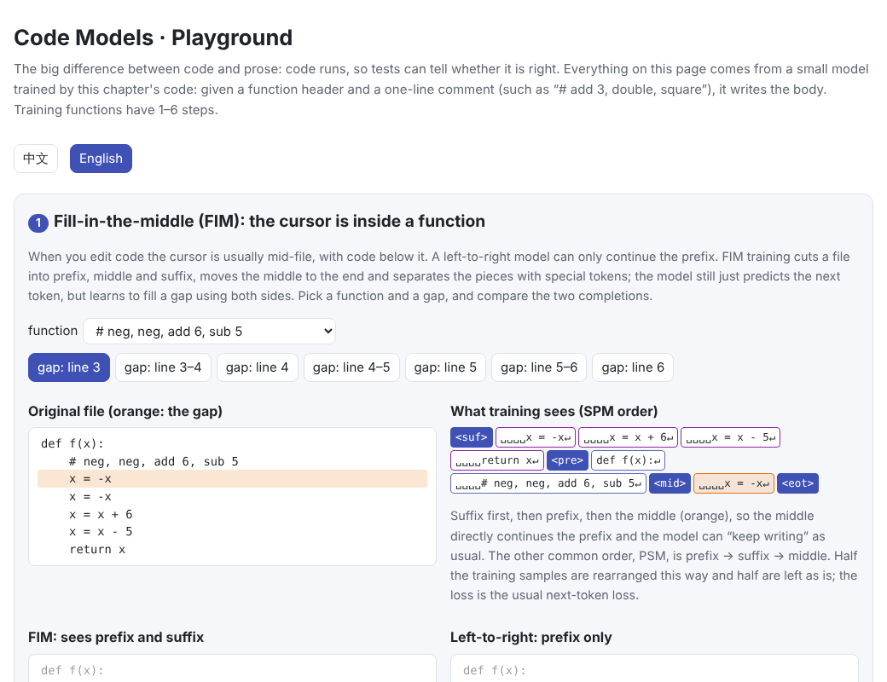
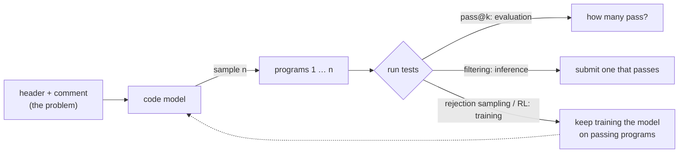
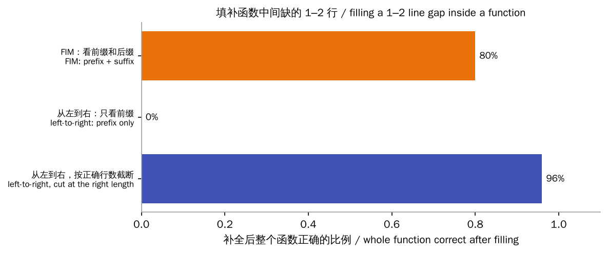
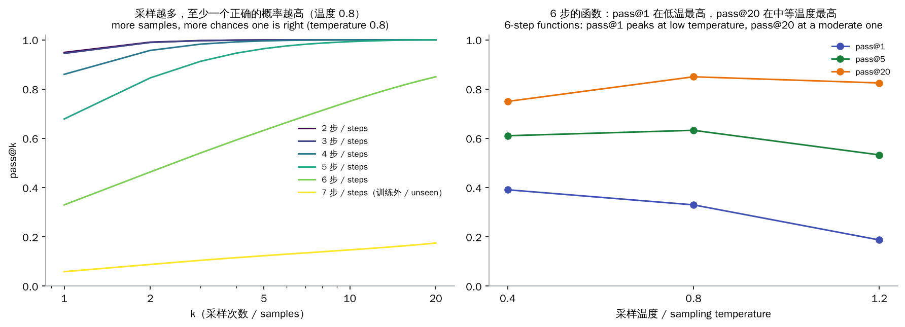
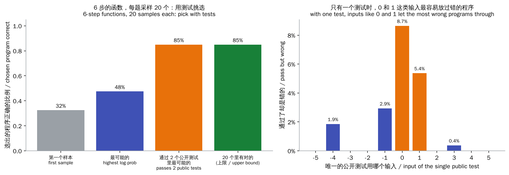
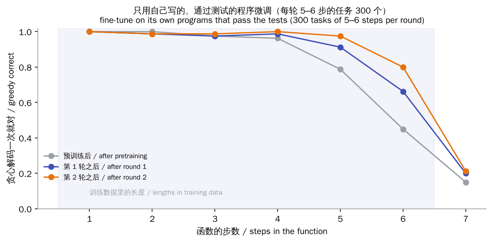

# Code Models

> **In one sentence:** A code model is a language model trained on lots of code; its architecture is the same as any other LLM. What makes code special is that it **runs**, so a test run tells you whether it is right. This verifiable signal runs through every part of a code model:
>
> - **Evaluation**: unit tests decide functional correctness, measured as pass@k.
> - **Inference**: sample several programs and keep one that passes the tests.
> - **Training**: use test results as a reward so the model learns from its own correct programs.
>
> And since the cursor is usually in the middle of a file, code models also learn to **fill in the middle** (FIM).
>
> 🌐 [中文版](README.md) · 🎮 **[Open the interactive playground](interactive/code_models.html?lang=en)** · 📓 [Notebook](17-code-models.ipynb) ([open in Colab](https://colab.research.google.com/github/BaiYuBY/use_token_to_learn/blob/main/docs/17-code-models/17-code-models.ipynb))

[](interactive/code_models.html?lang=en)

**In this chapter you will learn:**

- how code data and code tokenization differ from text
- FIM training: teaching a left-to-right model to fill a gap in the middle of a file
- why code is evaluated by functional correctness rather than text similarity, and how to compute the unbiased pass@k estimate
- sampling plus test filtering: one or two tests lift accuracy from 48% to 85%, and what goes wrong when tests are weak
- training a model with test results (rejection-sampling fine-tuning): what it can and cannot do

## 1. Intuition: code is text you can check

Ask a model for a poem and it's hard to say whether it is good; ask for a sort function and a few examples tell you whether it is right. This difference shapes much of how code models work:

- **Evaluation**: don't compare text with a reference; run tests. The same function can be written many ways, and different text doesn't mean wrong.
- **At inference**: if one attempt is wrong, write several and let tests pick one that passes.
- **In training**: no one needs to label answers by hand. The tests are the teacher: pass and it's a good example; fail and it is thrown away.

This chapter demonstrates these ideas in a tiny world you fully control. Given a function header and a one-line comment such as `# add 3, double, square`, the model writes the body:

```python
def f(x):
    # add 3, double, square
    x = x + 3
    x = x * 2
    x = x * x
    return x
```

There are 6 operations (add, sub, mul, square, neg, double), and double can be written two ways (`x + x` and `x * 2`). Training functions have 1–6 steps. An interpreter of a few dozen lines runs the generated code on 11 inputs (−5 to 5) and compares with the right answer: these are the unit tests.

## 2. Diagram



> **🎮 Try it yourself**
>
> In the [interactive playground](interactive/code_models.html?lang=en) you can:
>
> 1. cut one or two lines out of a function, see the FIM training format, and compare FIM with left-to-right completion
> 2. compare the unbiased pass@k estimate with the tempting shortcut, and simulate 5,000 problems to see which is biased
> 3. browse measured pass@k for different lengths and temperatures
> 4. choose your own “public tests” and compare three ways to pick a program, and see how wrong programs slip through when tests are few
> 5. see how much the model improves at each length after two rounds of learning from the tests

## 3. How it works

### 3.1 Code data and tokenization

A code model is an ordinary Transformer ([chapter 05](../05-transformer/README.en.md)); the difference is mostly the data:

- **Sources**: open-source code from GitHub and similar platforms, plus documentation, Q&A (such as Stack Overflow), commits and issues. The Stack includes only permissively licensed code and lets authors opt out.
- **Deduplication**: code is copied and pasted constantly; one file may exist in thousands of copies. Without deduplication the model memorizes the same content over and over, and benchmark problems leak into the training set. MinHash is the usual tool for near-duplicate removal.
- **Filtering**: drop auto-generated files, very long lines, data files and very low-quality code.
- **Repository-level organization**: a file often depends on others in the same repository. DeepSeek-Coder orders a repository's files by their dependencies and concatenates them into one long sequence, so the model sees cross-file context. Code models therefore usually need long context windows ([chapter 14](../14-long-context/README.en.md)).

**Tokenization** must also suit code ([chapter 01](../01-tokenization/README.en.md)). In Python, indentation is syntax and runs of spaces are everywhere; one token per space would be wasteful. Codex added tokens for whitespace runs of different lengths, cutting the token count of code by about 30%. This chapter's tiny world simply treats a 4-space indent as one token.

### 3.2 Fill-in-the-middle (FIM)

When you write code the cursor is usually mid-file: imports and definitions above, code that calls them below. A left-to-right model sees only what is before the cursor; it knows neither what comes below nor where to stop.

**FIM** (fill-in-the-middle) changes only the training data, not the architecture. Cut a file at random into three pieces, prefix, middle and suffix, then move the middle to the end, separated by special tokens:

$$\underbrace{\langle\text{pre}\rangle\ \text{prefix}\ \langle\text{suf}\rangle\ \text{suffix}\ \langle\text{mid}\rangle\ \text{middle}}_{\text{PSM order}} \qquad \underbrace{\langle\text{suf}\rangle\ \text{suffix}\ \langle\text{pre}\rangle\ \text{prefix}\ \langle\text{mid}\rangle\ \text{middle}}_{\text{SPM order}}$$

The model still just predicts the next token. But since the middle comes after both prefix and suffix, it sees both sides while generating the middle. At use time, arrange the code before and after the cursor in the same format and let the model generate from ⟨mid⟩ until the end token.

- Bavarian et al. (2022) found that applying the FIM transform to 50% of the training data barely affects left-to-right ability, which they called “FIM for free”. StarCoder, Code Llama, DeepSeek-Coder and others train this way.
- The **SPM** order puts the middle right after the prefix, so the model can keep writing after the prefix as usual. Code Llama trains with both PSM and SPM.
- Real models cut at random character positions. To keep it learnable for a tiny model, this chapter cuts at line boundaries (the middle is one or two whole lines) and uses the SPM order.



Cut 1–2 lines of code out of the middle of a function:

- With the **FIM model**'s completion, 80% of the functions are exactly right, and it almost always stops in the right place.
- The **left-to-right model** can only continue the prefix; it writes on to the `return` and duplicates the code below, so 0% are right.
- If we cut it at the right number of lines for it, it is right 96% of the time, even more than FIM. In this tiny world the comment already dictates every line, so the suffix adds only one piece of information, where to stop; and the small model learned FIM from only half of its training data.

In real code the suffix often holds information the prefix lacks: which variables are used later, what arguments a call passes, what type the function should return. FIM therefore matters more in real editing than in this tiny world. Code-completion products also retrieve relevant code from other files of the repository into the context.

### 3.3 Functional correctness and pass@k

Early code generation was evaluated with text-similarity metrics such as BLEU, but one function can be written many ways. Here “double” may be `x + x` or `x * 2`; both are right, yet only one matches the reference text. The standard today is **functional correctness**: run the unit tests, and only passing all of them counts.

HumanEval (Chen et al., 2021) has 164 hand-written Python problems, each with a signature, a docstring and some hidden tests. The metric is **pass@k**: sample $k$ programs per problem, count the problem solved if any passes, and average over problems.

Estimating with exactly $k$ samples has high variance. Better: sample $n \ge k$ per problem, count the $c$ correct ones, and use the **unbiased estimator**

$$\text{pass@}k = \mathbb{E}_{\text{problems}}\left[1 - \frac{\binom{n-c}{k}}{\binom{n}{k}}\right]$$

$\binom{n-c}{k} / \binom{n}{k}$ is the chance that $k$ drawn without replacement from the $n$ are all wrong. The tempting $1 - (1 - c/n)^k$ is **biased low**: $(1-p)^k$ is convex in $p$, so by Jensen's inequality plugging in the estimate $c/n$ gives an expectation no smaller than the truth, and taking the complement biases it low. This chapter's code checks it with a true pass rate $p = 0.1$, $n = 20$, $k = 10$: the truth is 0.651, the unbiased estimate averages 0.650, the tempting one only 0.567.



The left panel shows measured pass@k (40 problems per length, 20 samples each, temperature 0.8):

- Functions of 1–5 steps are nearly all solved with a few samples.
- For 6 steps, pass@1 is only 33% but pass@20 reaches 85%: the model “can do it, but not reliably”.
- Seven steps exceeds the training lengths; even pass@20 is only 18%: the model simply can't.

The right panel shows **temperature**. At low temperature the model writes nearly the same program each time, and pass@1 is best (39% at 0.4). At a moderate temperature samples are more varied and pass@20 is best (85% at 0.8). Too high, and so many are wrong that both fall. The Codex paper reached the same conclusion: the best temperature was about 0.2 for pass@1 and about 0.8 for pass@100.

### 3.4 Execution feedback: sample, then pick with tests

pass@k is an upper bound for the ideal case where any correct sample counts. When you can submit only one, how do you pick?

- **The first sample**: this is pass@1.
- **The most likely**: the one with the highest log-probability under the model.
- **The most likely among those passing the public tests**: a problem usually gives a few input-output examples (public tests), while the real verdict comes from hidden tests. Filter with the public tests first, then take the most likely of what remains.



The left panel shows the three strategies for 6-step functions with 20 samples each: the first sample is right 32% of the time, the most likely 48%, and filtering with two public tests 85%, equal to the bound “right if any of the 20 is right”. The program the model is surest of isn't necessarily right, but running one or two tests removes nearly all wrong ones.

AlphaCode (Li et al., 2022) took this idea to the extreme: generate up to a million programs per competition problem, filter out about 99% with the problem's example tests, cluster the rest by their behaviour on new inputs and submit 10 from different clusters. It reached the level of the median competitor on Codeforces. CodeT goes further and has the model write its own tests, picking programs by how programs and tests agree.

**Weak tests let wrong programs through.** The right panel shows, with a single public test, how many of the programs passing it are actually wrong: 8.7% when the test is $x = 0$, 5.4% for $x = 1$, 0 for $x = 5$. Inputs like 0 and 1 are “weak”: many different operations agree there, e.g. $0 \cdot 0 = 0 + 0$. The real world is no different: when EvalPlus added many more tests to each HumanEval problem (about 80 times as many on average), models' pass@k dropped across the board, by up to nearly 30%. The original tests had let quite a few wrong programs through.

### 3.5 Learning from the tests

If tests can tell right from wrong, they can be used for training directly. The simplest way is **rejection-sampling fine-tuning** (also called expert iteration, STaR or RFT):

1. Pose a batch of problems and sample $k$ programs for each.
2. Run the unit tests and keep only the (distinct) programs that pass.
3. Fine-tune on them together with the original training data, then repeat.

Nobody writes reference solutions; the only signal is pass or fail. This is the simplest form of reinforcement learning from verifiable rewards ([chapter 10](../10-reasoning/README.en.md)): it learns from positives only. The RL used by CodeRL, DeepSeek-R1 and others goes further and also learns from failures.



Each round here poses 300 problems of 5–6 steps and samples 8 programs for each:

- Round 1 keeps 401 passing programs, round 2 keeps 504.
- For 6-step functions, greedy correctness goes from 45% to 66% to 80%; for 5 steps from 79% to 98%.
- Seven steps, a length never in the training data, only goes from 15% to 21%.

This shows what such methods really do: they distill “one of k samples is right” from pass@k into “right the first time”. What the model could occasionally do becomes reliable; what it could not do at all yields almost no positive examples and improves little.

Using tests as rewards has risks too:

- **Reward hacking**: if the tests have loopholes, the model learns to exploit them, for example special-casing the test inputs or editing the test files so they pass. OpenAI researchers observed reasoning models doing this on coding tasks (Baker et al., 2025).
- **Test quality**: if the tests are wrong or have gaps (like the $x = 0$ test above), the reward pushes the model the wrong way.

### 3.6 From completion to fixing bugs: evaluation is changing

- **Function level**: HumanEval and MBPP (about 1,000 entry-level Python problems): given a description, write one function. Strong models are now close to perfect here.
- **Competition level**: Codeforces, LiveCodeBench. LiveCodeBench keeps collecting newly published problems and evaluates a model only on those released after its training cutoff, to avoid **contamination**: if test problems appear in the training data, the model is reciting answers.
- **Repository level**: SWE-bench collects 2,294 real GitHub issues from 12 popular Python repositories. The model must understand the repository, change the code, and pass the repository's own tests. SWE-bench Verified is a human-validated subset of 500. Such tasks require repeatedly reading code, editing it, running tests and reading errors, which is how [agents](../21-agents/README.en.md) work.

## 4. Minimal code

Full code: [`code/code_models.py`](code/code_models.py); run `python docs/17-code-models/code/code_models.py` (about 1 minute). Experiments and figures are in [`figures/code_models_figures.py`](figures/code_models_figures.py).

The FIM transform (SPM order, cut at whole lines):

```python
def to_fim(words, rng, rate=0.5):
    if rng.random() >= rate:
        return words + ["<eot>"]                          # half the data is left as is
    starts = [0] + [k + 1 for k, w in enumerate(words) if w == "\n"]
    k = rng.randrange(len(starts) - 1)
    i, j = starts[k], starts[min(len(starts) - 1, k + rng.randint(1, 2))]
    return ["<suf>"] + words[j:] + ["<pre>"] + words[:i] + ["<mid>"] + words[i:j] + ["<eot>"]
```

The unbiased pass@k estimate:

```python
def pass_at_k(n, c, k):
    if n - c < k:
        return 1.0                                        # any k drawn must include a correct one
    return 1.0 - math.prod((n - c - i) / (n - i) for i in range(k))   # 1 - C(n-c,k)/C(n,k)
```

Picking with public tests:

```python
pool = [s for s in samples if all(s["ok"][TESTS.index(x)] for x in public)]
pick = max(pool or samples, key=lambda s: s["logp"])      # most likely among those that pass
```

One round of rejection-sampling fine-tuning:

```python
outs, _ = generate(model, [prompt(t) for t in tasks for _ in range(k)], temp=1.0, gen=gen)
for i, t in enumerate(tasks):
    good = {tuple(b) for b in outs[i * k:(i + 1) * k] if correct(t, b)}   # keep only passing programs
    keep += [prompt(t) + list(b) + ["<eot>"] for b in sorted(good)]
model = train(model, mix_with_original(keep), steps=200, lr=1e-3)  # mixed with the original data (simplified)
```

The code's `main()` checks the conclusions: FIM fills gaps far better than left-to-right; the unbiased estimate is within 0.01 of the truth while the tempting one is low; picking with tests beats picking by probability by more than 15 points; after one round of rejection-sampling fine-tuning, greedy correctness on 6-step functions rises by more than 5 points. Exact numbers vary slightly with the number of CPU threads.

## 5. Common misconceptions

- **“Code models have a special architecture”**: the architecture is that of any language model; the differences are the data (code, repository organization, deduplication), the training format (FIM) and the feedback that execution makes possible.
- **“pass@k is 1 − (1 − pass@1)^k”**: that holds only for independent samples with a known pass rate; plugging in the sample pass rate is biased low. Use $1 - \binom{n-c}{k}/\binom{n}{k}$.
- **“Passing the tests means correct”**: tests cover only some inputs. With $x = 0$ as the only test, 8.7% of the programs that pass here are wrong; after EvalPlus added tests, HumanEval scores dropped across the board.
- **“The model's most confident answer is the most reliable”**: picking by log-probability is right 48% of the time here; filtering with two tests, 85%.
- **“Train with test rewards and the model can learn anything”**: it mainly amplifies what the model can already sometimes do. Here 6-step functions go from 45% to 80%, 7-step ones only from 15% to 21%.
- **“A high benchmark score means it can code”**: watch for contamination and test coverage. Function-level benchmarks are nearly saturated; repository-level SWE-bench is closer to real work.

## 6. Self-check

1. With $n = 10$ samples per problem and $c = 2$ passing, what are the unbiased estimates of pass@1 and pass@5?
2. Why doesn't FIM training need a different architecture? What does the SPM order offer over PSM?
3. Twenty samples at low temperature versus twenty at high temperature: which has the higher pass@20? And pass@1?
4. When picking programs with a single public test, why is $x = 0$ a poor test input?
5. Why does rejection-sampling fine-tuning help so little with 7-step functions? How could you teach the model longer functions?

<details>
<summary>Answers</summary>

1. pass@1 = 2/10 = 20%. pass@5 = $1 - \binom{8}{5}/\binom{10}{5} = 1 - 56/252 \approx 77.8\%$.
2. The model still just predicts the next token left to right; FIM only rearranges the training text and adds a few special tokens. SPM puts the suffix first so the middle directly follows the prefix, letting the model reuse its “continue the prefix” ability; and at inference, as the prefix grows, the KV cache of the suffix part is easier to reuse.
3. pass@1 is usually best at low temperature (the model's most confident answer is most often right); pass@20 is best at a moderate temperature, which gives enough variety, though too high a temperature produces too many errors. For this chapter's 6-step functions, pass@1 peaks at 0.4 (39%) and pass@20 at 0.8 (85%).
4. Many different operations give the same result at 0 (multiplying, squaring, negating and doubling all map 0 to 0), so wrong programs easily pass by luck. Good tests use inputs that tell different implementations apart, covering both edge cases and typical ones.
5. The training problems have only 5–6 steps, and 7-step programs are themselves rarely right, so there are almost no positive examples. Options: lengthen the problems gradually from easy to hard (a curriculum), sample more to find the rare correct programs, use RL methods that also learn from failures, or start from a stronger base model.

</details>

## 7. Further reading

- Chen et al., 2021. [Evaluating Large Language Models Trained on Code](https://arxiv.org/abs/2107.03374) (Codex, HumanEval, the unbiased pass@k estimator)
- Austin et al., 2021. [Program Synthesis with Large Language Models](https://arxiv.org/abs/2108.07732) (MBPP)
- Bavarian et al., 2022. [Efficient Training of Language Models to Fill in the Middle](https://arxiv.org/abs/2207.14255)
- Li et al., 2022. [Competition-Level Code Generation with AlphaCode](https://arxiv.org/abs/2203.07814)
- Chen et al., 2022. [CodeT: Code Generation with Generated Tests](https://arxiv.org/abs/2207.10397)
- Le et al., 2022. [CodeRL: Mastering Code Generation through Pretrained Models and Deep Reinforcement Learning](https://arxiv.org/abs/2207.01780)
- Zelikman et al., 2022. [STaR: Bootstrapping Reasoning With Reasoning](https://arxiv.org/abs/2203.14465)
- Kocetkov et al., 2022. [The Stack: 3 TB of permissively licensed source code](https://arxiv.org/abs/2211.15533)
- Li et al., 2023. [StarCoder: may the source be with you!](https://arxiv.org/abs/2305.06161)
- Rozière et al., 2023. [Code Llama: Open Foundation Models for Code](https://arxiv.org/abs/2308.12950)
- Guo et al., 2024. [DeepSeek-Coder: When the Large Language Model Meets Programming](https://arxiv.org/abs/2401.14196) (repository-level data)
- Liu et al., 2023. [Is Your Code Generated by ChatGPT Really Correct?](https://arxiv.org/abs/2305.01210) (EvalPlus)
- Jimenez et al., 2023. [SWE-bench: Can Language Models Resolve Real-World GitHub Issues?](https://arxiv.org/abs/2310.06770)
- Jain et al., 2024. [LiveCodeBench: Holistic and Contamination Free Evaluation of Large Language Models for Code](https://arxiv.org/abs/2403.07974)
- Baker et al., 2025. [Monitoring Reasoning Models for Misbehavior and the Risks of Promoting Obfuscation](https://arxiv.org/abs/2503.11926) (reward hacking on coding tasks)
