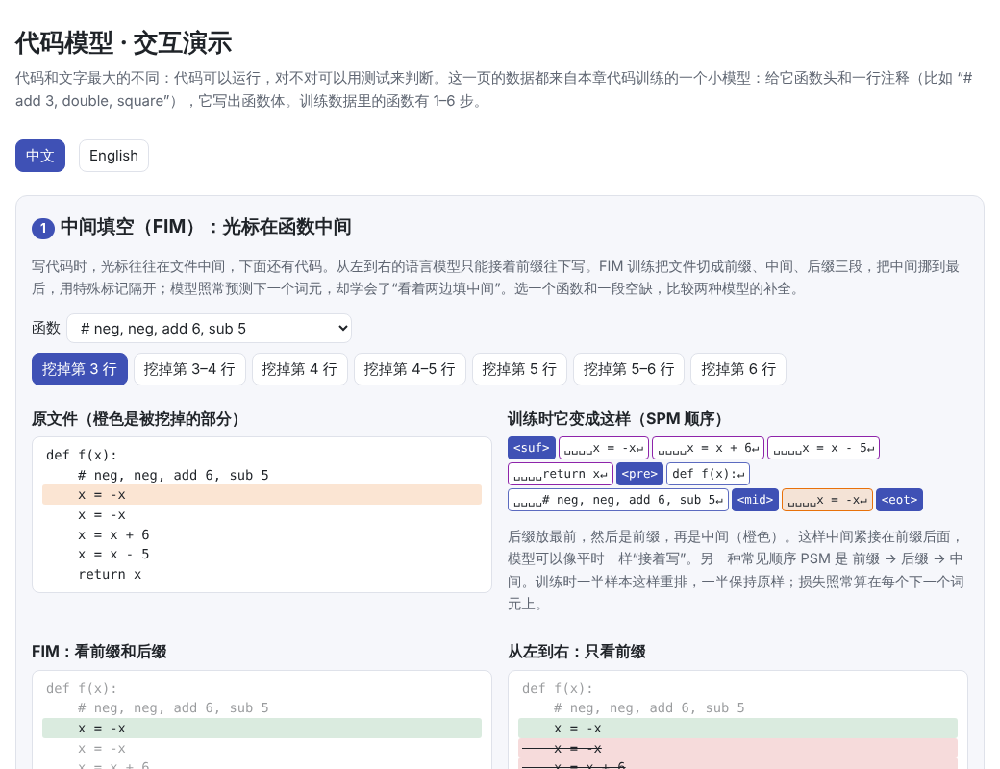
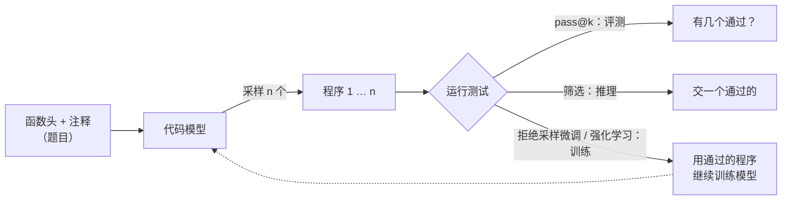

# 代码模型（Code Models）

> **一句话总结：** 代码模型就是在大量代码上训练的语言模型，结构和普通大模型没有区别。代码真正特殊的地方是**可以运行**：写得对不对，跑一遍测试就知道。这个“可验证”的信号贯穿了代码模型的各个环节：
>
> - **评测**：用单元测试判断功能是否正确，指标是 pass@k。
> - **推理**：多采样几个程序，留下通过测试的那个。
> - **训练**：用测试结果当奖励，让模型从自己写对的程序里学习。
>
> 另外，写代码时光标常在文件中间，所以代码模型还要学会**中间填空**（FIM）。
>
> 🌐 [English version](README.en.md) · 🎮 **[打开交互演示](interactive/code_models.html?lang=zh)** · 📓 [Notebook](17-code-models.ipynb)（[在 Colab 中打开](https://colab.research.google.com/github/BaiYuBY/use_token_to_learn/blob/main/docs/17-code-models/17-code-models.ipynb)）

[](interactive/code_models.html?lang=zh)

**本章你将学会：**

- 代码数据和代码分词有什么不同
- FIM 训练：怎样让从左到右的模型学会填文件中间的空
- 为什么用功能正确性而不是文本相似度来评测代码，pass@k 的无偏估计怎么算
- 采样 + 测试筛选：一两个测试就能把正确率从 48% 提到 85%，以及测试太弱时的问题
- 用测试结果训练模型（拒绝采样微调），它能做到什么、做不到什么

## 1. 直觉：代码是可以检查的文字

让模型写一首诗，好不好很难说清；让模型写一个排序函数，跑几个例子就知道对不对。这个差别决定了代码模型的很多做法：

- **评测**：不和参考答案比文字，而是运行测试。同一个功能有很多种写法，文字不同不代表错。
- **推理时**：一次写不对没关系，多写几个，用测试挑出能通过的。
- **训练时**：不需要人逐个标注答案，测试本身就是老师：通过就是好样本，不通过就丢掉。

本章用一个可以完全控制的小世界演示这些做法：给模型函数头和一行注释，比如 `# add 3, double, square`，让它写出函数体：

```python
def f(x):
    # add 3, double, square
    x = x + 3
    x = x * 2
    x = x * x
    return x
```

一共 6 种操作（add、sub、mul、square、neg、double），其中 double 有两种写法（`x + x` 和 `x * 2`）。训练数据里的函数有 1–6 步。一个几十行的解释器负责运行生成的代码，在 11 个输入（−5 到 5）上和正确答案对比，这就是单元测试。

## 2. 图解



> **🎮 动手试试**
>
> 在[交互演示](interactive/code_models.html?lang=zh)中，你可以：
>
> 1. 在函数中间挖掉一两行，看 FIM 训练格式长什么样，比较 FIM 和从左到右两种补全
> 2. 用 pass@k 计算器比较无偏估计和看似自然的估计，模拟 5,000 道题看谁有偏
> 3. 查看不同长度、不同温度下实测的 pass@k
> 4. 自己选“公开测试”，看三种挑选程序的方法，以及测试太少时错的程序怎样混进来
> 5. 查看两轮“从测试中学习”之后，模型在各种长度上的进步

## 3. 原理

### 3.1 代码数据和分词

代码模型的结构就是普通的 Transformer（[05 章](../05-transformer/README.md)），区别主要在数据：

- **来源**：GitHub 等平台的开源代码，加上文档、问答（如 Stack Overflow）、提交记录、issue。The Stack 只收录许可宽松的代码，并允许作者申请移除。
- **去重**：代码里复制粘贴极多，同一个文件可能有成千上万份。不去重会让模型反复背同样的内容，还会让评测题泄漏进训练集。常用 MinHash 做近似去重。
- **过滤**：去掉自动生成的文件、超长行、数据文件，以及质量很差的代码。
- **仓库级组织**：一个文件经常依赖同一仓库里的其他文件。DeepSeek-Coder 按依赖关系给仓库里的文件排序，再拼成一个长序列训练，让模型看到跨文件的上下文。所以代码模型通常需要较长的上下文窗口（[14 章](../14-long-context/README.md)）。

**分词**也要照顾代码的特点（[01 章](../01-tokenization/README.md)）。缩进是 Python 语法的一部分，连续的空格非常多；如果每个空格一个词元，就太浪费了。Codex 为不同长度的连续空格加了专门的词元，代码占的词元数少了约 30%。本章的小世界直接把 4 个空格的缩进当作一个词元。

### 3.2 中间填空（FIM）

写代码时，光标往往在文件中间：上面有导入和函数定义，下面还有调用它的代码。从左到右的模型只能看到光标前面的内容，不知道下面写了什么，也不知道该写到哪里停。

**FIM**（fill-in-the-middle）不改模型结构，只改训练数据。把一个文件随机切成三段：前缀、中间、后缀，然后把中间挪到最后，用特殊标记隔开：

$$\underbrace{\langle\text{pre}\rangle\ \text{前缀}\ \langle\text{suf}\rangle\ \text{后缀}\ \langle\text{mid}\rangle\ \text{中间}}_{\text{PSM 顺序}} \qquad \underbrace{\langle\text{suf}\rangle\ \text{后缀}\ \langle\text{pre}\rangle\ \text{前缀}\ \langle\text{mid}\rangle\ \text{中间}}_{\text{SPM 顺序}}$$

模型仍然只是预测下一个词元。但因为“中间”出现在前缀和后缀之后，它在生成中间时两边都能看到。使用时，把光标前后的代码按同样的格式排好，让模型从 ⟨mid⟩ 开始生成，生成到结束标记为止。

- Bavarian 等（2022）发现，把 50% 的训练数据做 FIM 变换，几乎不影响从左到右的能力，他们称之为“FIM 是免费的”。StarCoder、Code Llama、DeepSeek-Coder 等都这样训练。
- **SPM** 顺序让“中间”紧跟在前缀后面，模型可以像平时一样接着前缀写。Code Llama 同时用 PSM 和 SPM 两种顺序训练。
- 真实模型在随机的字符位置切分。本章为了让小模型学得动，在整行处切分，中间是一两整行，用 SPM 顺序。


在函数中间挖掉 1–2 行代码：

- **FIM 模型**补全后，80% 的函数完全正确，而且几乎总是在正确的位置停下。
- **从左到右的模型**只能接着前缀写，它会一直写到 `return`，和下面已有的代码重复，所以 0% 正确。
- 如果我们替它在正确的行数处截断，它也有 96% 正确，甚至比 FIM 还高。原因是在这个小世界里，注释已经规定了每一行，后缀只多提供了“写到哪里停”这一个信息；小模型的 FIM 能力又只用了一半训练数据来学。

真实代码里，后缀经常包含前缀没有的信息：后面用到了哪些变量、调用时传了什么参数、函数应该返回什么类型。所以 FIM 在实际编辑中比在这个小世界里更重要。代码补全产品还会从同一仓库的其他文件里检索相关代码放进上下文。

### 3.3 功能正确性和 pass@k

早期的代码生成用 BLEU 等文本相似度评测，但同一个功能有很多种写法。本章里 “double” 写成 `x + x` 或 `x * 2` 都对，和参考答案的文字却只有一种相同。所以现在的标准做法是**功能正确性**：运行单元测试，全部通过才算对。

HumanEval（Chen 等，2021）有 164 道手写的 Python 题，每题有函数签名、文档字符串和几个隐藏测试。指标是 **pass@k**：对每道题采样 $k$ 个程序，只要有一个通过就算解出，再对所有题取平均。

直接采 $k$ 个来估计，方差很大。更好的做法是每题采 $n \ge k$ 个，数出其中 $c$ 个正确，再用**无偏估计**：

$$\text{pass@}k = \mathbb{E}_{\text{题目}}\left[1 - \frac{\binom{n-c}{k}}{\binom{n}{k}}\right]$$

$\binom{n-c}{k} / \binom{n}{k}$ 是从 $n$ 个里不放回地抽 $k$ 个、全部抽到错误程序的概率。看似自然的 $1 - (1 - c/n)^k$ 会系统性**偏低**：$(1-p)^k$ 是 $p$ 的凸函数，按 Jensen 不等式，用估计值 $c/n$ 代进去得到的期望不会小于真值，取补之后就偏低了。本章代码在真实通过率 $p = 0.1$、$n = 20$、$k = 10$ 时验证：真值 0.651，无偏估计的平均 0.650，看似自然的估计只有 0.567。


左图是实测的 pass@k（每种长度 40 题，每题采 20 个，温度 0.8）：

- 1–5 步的函数，多采几次几乎都能解出。
- 6 步的函数，pass@1 只有 33%，pass@20 到了 85%：模型“会做但不稳定”。
- 7 步超出了训练数据的长度，pass@20 也只有 18%：模型根本不会。

右图是**温度**的影响：低温时模型几乎每次写同一个程序，pass@1 最高（0.4 时 39%）；温度适中时样本更多样，pass@20 最高（0.8 时 85%）；温度太高，错得太多，两者都下降。Codex 论文的结论相同：pass@1 的最佳温度约 0.2，pass@100 约 0.8。

### 3.4 执行反馈：采样，再用测试挑选

pass@k 是在“任何一个对都算”的理想情况下的上限。实际只能交一个答案时，怎么挑？

- **第一个样本**：就是 pass@1。
- **最可能的**：取模型对数概率最高的那个。
- **通过公开测试的里面最可能的**：题目通常会给几个输入输出示例（公开测试），真正的评判用的是看不到的隐藏测试。先用公开测试过滤，再在剩下的里取最可能的。


左图是 6 步的函数、每题 20 个样本时三种挑法的效果：第一个样本 32%，最可能的 48%，用两个公开测试过滤后 85%，和“20 个里只要有对的就算”的上限一样。模型最有把握的程序不一定对，但运行一两个测试就能淘汰绝大多数错的。

AlphaCode（Li 等，2022）把这个思路推到了极致：每道竞赛题生成多达一百万个程序，用题目给的示例测试过滤掉约 99%，再按程序在新输入上的行为聚类，从不同的类里挑 10 个提交，在 Codeforces 比赛中达到参赛者的中位水平。CodeT 进一步让模型自己生成测试，用“程序和测试互相印证”来挑选。

**测试太弱时，错的程序也能通过。** 右图是只有一个公开测试时，通过它的程序里有多少其实是错的：用 $x = 0$ 测试时有 8.7%，用 $x = 1$ 时有 5.4%，用 $x = 5$ 时为 0。0 和 1 是很“弱”的输入，很多不同的运算在这里结果一样，比如 $0 \cdot 0 = 0 + 0$。真实世界也一样：EvalPlus 给 HumanEval 的每道题补充了大量测试（平均多了约 80 倍）之后，各个模型的 pass@k 普遍下降，最多降了近 30%。原来的测试放过了不少错误程序。

### 3.5 从测试中学习

既然测试能判断对错，就可以直接用它来训练。最简单的办法是**拒绝采样微调**（也叫专家迭代、STaR、RFT）：

1. 出一批题，每题让模型采样 $k$ 个程序；
2. 运行单元测试，只留下通过的（去重）；
3. 用这些程序和原来的训练数据一起微调，然后重复。

没有人写参考答案，唯一的信号是“通过 / 不通过”。这其实就是可验证奖励强化学习（[10 章](../10-reasoning/README.md)）的最简单形式：只学正样本，不学负样本。CodeRL、DeepSeek-R1 等用的强化学习更进一步，也会利用失败的样本。


本章每轮出 300 道 5–6 步的题，每题采样 8 个程序：

- 第一轮留下 401 个通过的程序，第二轮 504 个。
- 6 步的函数，贪心解码一次就对的比例从 45% 提高到 66%，再到 80%；5 步从 79% 到 98%。
- 7 步（训练数据里从没有过的长度）只从 15% 提高到 21%。

这说明了这类方法的本质：它把 pass@k 里“采 k 次总有一次对”的能力，蒸馏成“一次就对”。模型原本偶尔能写对的，会变得稳定；原本就写不出来的，几乎没有正样本可学，进步就很有限。

用测试当奖励也有风险：

- **奖励投机**：如果测试有漏洞，模型会学会钻空子，比如针对测试的具体输入写特例，或者直接修改测试文件让它通过。OpenAI 的研究观察到推理模型在编程任务中这样做（Baker 等，2025）。
- **测试质量**：测试本身写错了，或者覆盖不全（像上一节的 $x = 0$），奖励就会把模型往错的方向推。

### 3.6 从补全到修 bug：评测在变

- **函数级**：HumanEval、MBPP（约 1,000 道入门级 Python 题），给出函数说明，写一个函数。现在的强模型在这类题上已接近满分。
- **竞赛级**：Codeforces、LiveCodeBench。LiveCodeBench 持续收集新发布的题目，只用模型训练截止之后的题评测，以避免**数据污染**：评测题出现在训练数据里，模型就是在背答案。
- **仓库级**：SWE-bench 从 12 个流行的 Python 仓库收集了 2,294 个真实的 GitHub issue，模型要读懂整个仓库、修改代码，再用仓库自己的测试检验。SWE-bench Verified 是经人工确认过的 500 题子集。这类任务需要模型反复“读代码、改代码、运行测试、看报错”，也就是 [Agent](../21-agents/README.md) 的工作方式。

## 4. 最小代码实现

完整代码：[`code/code_models.py`](code/code_models.py)，运行 `python docs/17-code-models/code/code_models.py`（约 1 分钟）。实验与配图在 [`figures/code_models_figures.py`](figures/code_models_figures.py) 中。

FIM 变换（SPM 顺序，整行切分）：

```python
def to_fim(words, rng, rate=0.5):
    if rng.random() >= rate:
        return words + ["<eot>"]                          # 一半数据保持原样
    starts = [0] + [k + 1 for k, w in enumerate(words) if w == "\n"]
    k = rng.randrange(len(starts) - 1)
    i, j = starts[k], starts[min(len(starts) - 1, k + rng.randint(1, 2))]
    return ["<suf>"] + words[j:] + ["<pre>"] + words[:i] + ["<mid>"] + words[i:j] + ["<eot>"]
```

pass@k 的无偏估计：

```python
def pass_at_k(n, c, k):
    if n - c < k:
        return 1.0                                        # 抽 k 个必然抽到正确的
    return 1.0 - math.prod((n - c - i) / (n - i) for i in range(k))   # 1 - C(n-c,k)/C(n,k)
```

用公开测试挑选：

```python
pool = [s for s in samples if all(s["ok"][TESTS.index(x)] for x in public)]
pick = max(pool or samples, key=lambda s: s["logp"])      # 通过公开测试的里面最可能的
```

拒绝采样微调的一轮：

```python
outs, _ = generate(model, [prompt(t) for t in tasks for _ in range(k)], temp=1.0, gen=gen)
for i, t in enumerate(tasks):
    good = {tuple(b) for b in outs[i * k:(i + 1) * k] if correct(t, b)}   # 只留通过测试的
    keep += [prompt(t) + list(b) + ["<eot>"] for b in sorted(good)]
model = train(model, mix_with_original(keep), steps=200, lr=1e-3)  # 与原始数据混合（简写）
```

代码里的 `main()` 检查这些结论：FIM 补全明显好于从左到右；无偏估计和真值的差小于 0.01，看似自然的估计偏低；用测试挑选比按概率挑选高 15 个百分点以上；一轮拒绝采样微调后，6 步函数的贪心正确率提高 5 个百分点以上。具体数字随 CPU 线程数略有浮动。

## 5. 常见误区

- **“代码模型是一种特殊结构”**：结构和普通语言模型一样，区别在数据（代码、仓库组织、去重）、训练格式（FIM）和可执行带来的反馈。
- **“pass@k 就是 1 −（1 − pass@1）^k”**：这只在每次采样独立且通过率已知时成立；用样本通过率代进去会系统性偏低，应该用 $1 - \binom{n-c}{k}/\binom{n}{k}$。
- **“能通过测试就是对的”**：测试只覆盖了有限的输入。只用 $x = 0$ 测试时，本章有 8.7% 通过的程序其实是错的；EvalPlus 补测试后 HumanEval 的分数普遍下降。
- **“模型最有把握的答案最可靠”**：本章按对数概率挑选只有 48% 正确，用两个测试过滤后 85%。
- **“用测试奖励训练，模型什么都能学会”**：它主要放大模型偶尔已经能做到的事。本章 6 步的函数从 45% 提高到 80%，7 步只从 15% 到 21%。
- **“基准分数高就是会写代码”**：要注意数据污染和测试覆盖。函数级题目接近饱和，仓库级的 SWE-bench 更接近真实工作。

## 6. 自测题

1. 每题采样 $n = 10$ 个程序，$c = 2$ 个通过。pass@1 和 pass@5 的无偏估计各是多少？
2. 为什么 FIM 训练不需要改模型结构？SPM 顺序相比 PSM 有什么好处？
3. 低温度采样 20 次和高温度采样 20 次，哪个 pass@20 更高？pass@1 呢？
4. 只用一个公开测试挑选程序时，为什么 $x = 0$ 是一个糟糕的测试输入？
5. 拒绝采样微调为什么对 7 步的函数帮助很小？要让模型学会更长的函数，可以怎么做？

<details>
<summary>参考答案</summary>

1. pass@1 = 2/10 = 20%。pass@5 = $1 - \binom{8}{5}/\binom{10}{5} = 1 - 56/252 \approx 77.8\%$。
2. 模型仍然只是从左到右预测下一个词元，FIM 只是把训练文本重新排列，再加几个特殊标记。SPM 把后缀放在最前，“中间”紧跟在前缀后面，模型可以沿用“接着前缀写”的能力；推理时前缀变长，后缀部分的 KV 缓存也更容易复用。
3. 通常 pass@1 在低温度下最高（模型最有把握的答案最常对）；pass@20 在中等温度下最高，因为需要样本足够多样，但温度太高错误太多也会下降。本章 6 步的函数：pass@1 在 0.4 时最高（39%），pass@20 在 0.8 时最高（85%）。
4. 很多不同的运算在 0 上结果相同（乘法、平方、取负、加倍都把 0 变成 0），错的程序很容易碰巧通过。好的测试应该覆盖能区分不同实现的输入，包括边界情况和一般情况。
5. 训练题只有 5–6 步，7 步的程序本身也很少写对，几乎没有正样本。可以让题目由易到难逐步加长（课程学习），给更多采样次数以找到少数正确样本，或者用能利用失败样本的强化学习方法，以及更强的基础模型。

</details>

## 7. 延伸阅读

- Chen et al., 2021. [Evaluating Large Language Models Trained on Code](https://arxiv.org/abs/2107.03374)（Codex、HumanEval、pass@k 无偏估计）
- Austin et al., 2021. [Program Synthesis with Large Language Models](https://arxiv.org/abs/2108.07732)（MBPP）
- Bavarian et al., 2022. [Efficient Training of Language Models to Fill in the Middle](https://arxiv.org/abs/2207.14255)
- Li et al., 2022. [Competition-Level Code Generation with AlphaCode](https://arxiv.org/abs/2203.07814)
- Chen et al., 2022. [CodeT: Code Generation with Generated Tests](https://arxiv.org/abs/2207.10397)
- Le et al., 2022. [CodeRL: Mastering Code Generation through Pretrained Models and Deep Reinforcement Learning](https://arxiv.org/abs/2207.01780)
- Zelikman et al., 2022. [STaR: Bootstrapping Reasoning With Reasoning](https://arxiv.org/abs/2203.14465)
- Kocetkov et al., 2022. [The Stack: 3 TB of permissively licensed source code](https://arxiv.org/abs/2211.15533)
- Li et al., 2023. [StarCoder: may the source be with you!](https://arxiv.org/abs/2305.06161)
- Rozière et al., 2023. [Code Llama: Open Foundation Models for Code](https://arxiv.org/abs/2308.12950)
- Guo et al., 2024. [DeepSeek-Coder: When the Large Language Model Meets Programming](https://arxiv.org/abs/2401.14196)（仓库级数据）
- Liu et al., 2023. [Is Your Code Generated by ChatGPT Really Correct?](https://arxiv.org/abs/2305.01210)（EvalPlus）
- Jimenez et al., 2023. [SWE-bench: Can Language Models Resolve Real-World GitHub Issues?](https://arxiv.org/abs/2310.06770)
- Jain et al., 2024. [LiveCodeBench: Holistic and Contamination Free Evaluation of Large Language Models for Code](https://arxiv.org/abs/2403.07974)
- Baker et al., 2025. [Monitoring Reasoning Models for Misbehavior and the Risks of Promoting Obfuscation](https://arxiv.org/abs/2503.11926)（编程任务中的奖励投机）
