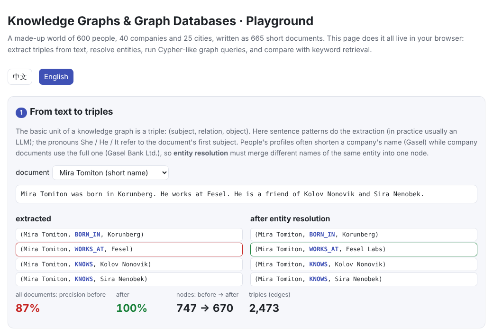
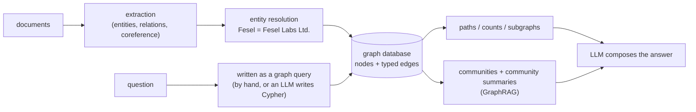

# Knowledge Graphs & Graph Databases

> **In one sentence:** A knowledge graph stores knowledge as a network of entity–relation–entity links, and a graph database lets you query along those relations. It is good at two kinds of question that vector retrieval handles poorly:
>
> - **Multi-hop questions**: “in which country is X's employer headquartered?”
> - **Global questions**: “which company employs the most people?”
>
> The price is that entities and relations must first be **extracted** from text, and different names for the same entity **merged**; the quality of the graph decides everything. GraphRAG combines the two: the graph organizes the corpus, and the retrieved structure goes to the LLM.
>
> 🌐 [中文版](README.md) · 🎮 **[Open the interactive playground](interactive/knowledge_graph.html?lang=en)** · 📓 [Notebook](20-knowledge-graphs.ipynb) ([open in Colab](https://colab.research.google.com/github/BaiYuBY/use_token_to_learn/blob/main/docs/20-knowledge-graphs/20-knowledge-graphs.ipynb))

[](interactive/knowledge_graph.html?lang=en)

**In this chapter you will learn:**

- triples, RDF and property graphs, and how graph databases differ from relational ones
- building a graph from text: entity and relation extraction, coreference resolution, entity resolution
- writing graph queries in Cypher
- why one retrieval round can't answer multi-hop questions, and how hop-by-hop retrieval and graph queries solve them
- global questions and GraphRAG: community detection, community summaries and map-reduce answers

## 1. Intuition: documents tell stories, graphs store relations

[Chapter 19](../19-rag/README.en.md)'s RAG cuts documents into chunks and finds the few most similar to the question. It assumes that **the chunk holding the answer looks like the question**. Two kinds of question break that assumption.

**Multi-hop questions**: “In which city is Mira Tomiton's employer headquartered?” needs two documents:

```text
Mira Tomiton was born in Korunberg. He works at Fesel. He is a friend of ...
Fesel Labs Ltd. is headquartered in Mikelvik. It was founded in 1962 by ...
```

The second never mentions Mira Tomiton and looks nothing like the question, so one retrieval round can hardly find it. On top of that, the profile says “Fesel” while the company document says “Fesel Labs Ltd.”, and you have to know they are the same company.

**Global questions**: “Which company employs the most people?” The answer is spread over hundreds of profiles, and retrieving the top k can count at most k.

A knowledge graph stores things differently: each fact is an edge, such as `(Mira Tomiton)-[:WORKS_AT]->(Fesel Labs)` and `(Fesel Labs)-[:LOCATED_IN]->(Mikelvik)`. A multi-hop question becomes a walk of two steps along edges; a global question becomes counting edges.

This chapter's tiny world has 600 people, 40 companies, 25 cities and 5 countries, written as 665 short documents. In 40% of the profiles the company name is shortened.

## 2. Diagram



> **🎮 Try it yourself**
>
> In the [interactive playground](interactive/knowledge_graph.html?lang=en) you can:
>
> 1. pick any document and see the extracted triples, and which names entity resolution changed
> 2. pick a person and a query template (1–3 hops, number of colleagues, friends' employers, employer's founder), or edit the Cypher yourself and run it, seeing the matched path on the graph
> 3. compare one retrieval round, hop-by-hop retrieval and a graph query on the same multi-hop question
> 4. see the counting comparison for a global question, and the communities found in the graph with their summaries

## 3. How it works

### 3.1 Triples, RDF and property graphs

The basic unit of a knowledge graph is a **triple** (subject, relation, object), such as `(Mira Tomiton, WORKS_AT, Fesel Labs)`. Two data models are common:

- **RDF**: a W3C standard in which nodes and relations are globally unique URIs, queried with SPARQL. Open knowledge bases such as Wikidata and DBpedia use it; it suits linking and reasoning across sources.
- **Property graphs**: nodes and edges can carry labels and properties (e.g. `(:Person {name: "Mira", born: 1992})`), queried with Cypher (Neo4j), Gremlin and others, and since 2024 also the ISO standard GQL. It is the more common choice in application development.

Both graph and relational databases can store this data; the difference is in querying. A relational database joins tables with JOINs, more of them with every hop; a graph database stores adjacency directly and walks edges from a node, so the cost depends only on the edges traversed (“index-free adjacency”).

### 3.2 Building the graph: extraction and entity resolution

Building a graph from text takes several steps:

1. **Entity recognition**: find the people, companies, places and so on.
2. **Relation extraction**: decide how entities are related.
3. **Coreference resolution**: work out who He, She, It or “the company” refers to.
4. **Entity resolution**: merge different names of the same entity into one node, such as Fesel, Fesel Labs and Fesel Labs Ltd.

This used to need purpose-trained models; now an LLM is usually asked to output triples following a given schema (as GraphRAG and LangChain's LLMGraphTransformer do). This chapter uses sentence patterns instead of an LLM for extraction, with pronouns referring to the document's first subject. Entity resolution strips suffixes such as Ltd. and maps a short name to the only full name it begins.

| | Triple precision | Recall | Nodes |
|---|---|---|---|
| Extraction only | 87% | 87% | 747 |
| Extraction + entity resolution | 100% | 100% | 670 |

Only 13% of triples differ, which sounds minor, but they are exactly the edges linking people to companies and companies to cities. The next section shows that when they are wrong, every multi-hop query fails.

Real settings are much harder: LLM extraction misses and invents facts, and spells relation types in many ways (works at / employed by / joined). Real systems therefore define a **schema** up front (which entity and relation types exist), have the model extract only within it, and resolve entities with rules, similarity and human review.

### 3.3 Querying with Cypher

Cypher draws the pattern to find in ASCII: `()` is a node and `-[:REL]->` a directed edge:

```cypher
// 2 hops: in which city is Mira Tomiton's employer headquartered?
MATCH (p:Person {name: "Mira Tomiton"})-[:WORKS_AT]->(co:Company)-[:LOCATED_IN]->(c:City)
RETURN c.name

// How many people work at the same company? Arrows point back from the company to its employees
MATCH (p:Person)-[:WORKS_AT]->(co:Company {name: "Fesel Labs"})
RETURN count(DISTINCT p)
```

This chapter's code includes a mini engine of a few dozen lines. It supports one chain pattern, a name filter and `RETURN x.name` / `count(DISTINCT x)`, which is enough for every question here. The interactive page has the same engine, and you can edit queries there.

**Having an LLM write the query** (Text-to-Cypher) is the usual way to plug a graph into a chat system: given the graph schema (node and relation types), the model translates the question into Cypher, and the result goes back to the model to compose an answer. The difficulties are the same as Text-to-SQL: the schema must be explained clearly, generated queries should be validated first, and read-only access is best.

### 3.4 Multi-hop questions: retrieval vs. the graph


The chapter asks 1-, 2- and 3-hop questions about 200 people and checks whether all the documents needed (or the path in the graph) are found:

| | 1 hop | 2 hops | 3 hops |
|---|---|---|---|
| One BM25 search (top 5) | 98% | 0.5% | 0% |
| Hop-by-hop search (top 5 per hop) | 98% | 90% | 92% |
| Graph query | 100% | 100% | 100% |
| Graph query, no entity resolution | 100% | 0% | 0% |

- **One retrieval round** only finds documents that look like the question. The question contains just the person's name, and the company and city documents don't, so from 2 hops on it nearly always fails.
- **Hop-by-hop search** imitates self-ask and IRCoT: retrieve, read the top document, extract the next entity (the company name), and search again with it. Each step only needs documents related to the current entity, so it keeps up with the chain. But every step can fail (searching with the short name “Fesel” may rank other profiles that mention Fesel first), and errors add up. In real systems this is [agentic retrieval](../21-agents/README.en.md): the model decides what to search for next.
- **A graph query** simply follows edges, provided the graph is right. Without entity resolution, the person links to an isolated “Fesel” node while the company's edges hang off “Fesel Labs Ltd.”, so the path breaks at the first step.

### 3.5 Global questions and GraphRAG


“How many people work at Lirun Bank?” The true answer is 110. A graph `count` returns 110; retrieving the top 10 and counting can reach at most 10 (here 9). Every question of the form “the most, the fewest, how many, what are the main …” is like this: the answer needs the whole corpus, and no retrieval that takes the top k can deliver it.

**GraphRAG** (Microsoft, Edge et al., 2024) works like this:

1. An LLM extracts entities and relations from every document to build a graph.
2. The Leiden algorithm finds **communities** in the graph: groups densely linked inside and sparsely linked to each other, in a hierarchy of large communities containing smaller ones.
3. An LLM writes a **community report** for each: its main entities, how they relate, the key points.
4. A global question is sent to every community report to answer on its own (map), and the partial answers are combined into the final one (reduce).

This chapter uses simpler label propagation instead of Leiden (each node repeatedly adopts the most common label among its neighbours) on the person–company–friend relations, and finds 38 communities. Because friends are mostly colleagues, 96% of people share their community's main employer; the largest community has 107 people, 106 of them at Lirun Bank. Community reports are filled in from the graph (GraphRAG has an LLM write them), and map-reduce over all reports correctly answers “which company employs the most people”.

GraphRAG is not cheap: building the graph and writing the reports means running an LLM over the whole corpus, and again whenever the corpus changes. Many cheaper variants followed: LightRAG simplifies the community reports, and HippoRAG retrieves over the graph with personalized PageRank. The choice depends on your questions. Most are local “look this up” questions, for which vector retrieval is enough; a graph is worth building when questions often need cross-document links, aggregation or a global overview.

## 4. Minimal code

Full code: [`code/knowledge_graph.py`](code/knowledge_graph.py); run `python docs/20-knowledge-graphs/code/knowledge_graph.py` (a few seconds). Experiments and figures are in [`figures/knowledge_graph_figures.py`](figures/knowledge_graph_figures.py).

Extraction (pronouns refer to the document's first subject):

```python
for sent in re.split(r"(?<=\.)\s+(?=[A-Z])", text):
    for pat, rel in PATTERNS:
        m = re.match(pat, sent)
        if m:
            s = subject if m.group("s") in ("She", "He", "It") else m.group("s")
            subject = subject or s
            triples.append((s, rel, m.group("o")))
            break
```

Entity resolution:

```python
strip = lambda n: re.sub(r"\s+(Ltd|Inc|Group)\.?$", "", n)     # Fesel Labs Ltd. -> Fesel Labs
full = {s for s, r, _ in triples if r == "LOCATED_IN"}           # official company names
by_first = defaultdict(set)
for f in full:
    by_first[f.split()[0]].add(f)                                # Fesel -> {Fesel Labs}
canon = lambda n: next(iter(by_first[n])) if n not in full and len(by_first.get(n, ())) == 1 else n
```

The heart of the mini Cypher engine: start from the first node, then extend the matching rows one step along each relation:

```python
rows = [{first_var: n} for n in self.nodes(first_label) if first_name in (None, n)]
for (rel, forward), spec in zip(rels, nodes[1:]):
    rows = [dict(row, **{spec["var"]: n}) for row in rows for n in self.step(row[prev], rel, forward)
            if spec["label"] in (None, self.label.get(n)) and spec["name"] in (None, n)]
```

The code's `main()` checks the conclusions:

- After entity resolution, triple precision and recall both exceed 99%.
- One search is above 90% on 1 hop and below 30% on 3 hops.
- Hop-by-hop search beats one search by more than 40 points on 3 hops, and graph queries reach 100%.
- Without entity resolution, 2-hop graph queries fall at least 20 points.
- The graph count equals the true count, while the top 10 can count at most 10.
- Map-reduce over community reports answers “which company employs the most people” correctly.

## 5. Common misconceptions

- **“A knowledge graph can replace vector retrieval”**: most questions are local, and vector retrieval is simpler, cheaper and more forgiving of wording. Graphs shine on multi-hop relations and aggregation; the two are often used together.
- **“Have an LLM extract triples and the graph is done”**: extraction misses and invents, relation names vary wildly, and one entity has many names. Without a schema and entity resolution the graph shatters into isolated nodes (multi-hop queries score 0% here without resolution).
- **“Graph queries are always right”**: a graph query faithfully returns what is in the graph; errors in the graph come back as they are, and multi-hop queries can compound them.
- **“GraphRAG suits every use case”**: building the graph and the reports is expensive and must be redone when the corpus changes; it is best at global, overview questions.
- **“Multi-hop questions require a graph”**: hop-by-hop retrieval (letting the model search step by step) often works too, above 90% on 2–3 hops here; the price is more retrieval rounds and compounding errors.

## 6. Self-check

1. Write a Cypher query that finds the people who work at the same company as Mira Tomiton and were born in the same city.
2. Why can't one vector search answer “in which country is X's employer headquartered”? Why can hop-by-hop retrieval, and what is its weakness?
3. What goes wrong in a graph when entity resolution is poor? Give an example from this chapter.
4. Why can't retrieving the top k answer “which company employs the most people”? How does GraphRAG answer such questions?
5. Your knowledge base is a few thousand internal technical documents, and users mostly ask “how do I configure this parameter?”. Is a knowledge graph worth building?

<details>
<summary>Answers</summary>

1. This chapter's mini engine supports one chain only; standard Cypher allows two patterns: `MATCH (m:Person {name: "Mira Tomiton"})-[:WORKS_AT]->(co:Company)<-[:WORKS_AT]-(p:Person), (m)-[:BORN_IN]->(c:City)<-[:BORN_IN]-(p) RETURN p.name`.
2. The answer is in the company's and city's documents, which don't contain X's name and don't look like the question, so one search can't find them. Hop-by-hop retrieval searches with the current entity at each step, so it reaches the next document; its weakness is that every step can fail, errors compound, and the extra rounds are slower and costlier.
3. One entity becomes several unconnected nodes and paths break. In this chapter, if the profile's “Fesel” and the company document's “Fesel Labs Ltd.” are not merged, people's WORKS_AT edges point to an isolated “Fesel” node, and every 2- and 3-hop graph query fails.
4. The answer requires counting over the whole corpus, and the top k shows at most k. GraphRAG finds communities in the graph and writes a report for each in advance; a global question is answered by map-reduce over all reports: each answers on its own, then the answers are combined.
5. Probably not. These are local “look this up” questions answered within a single document; vector plus keyword retrieval (with good chunking) is enough. It becomes worth building a graph for that part of the knowledge only if users often ask relational questions such as “which services depend on this component” or “which systems does changing this parameter affect”.

</details>

## 7. Further reading

- Hogan et al., 2021. [Knowledge Graphs](https://arxiv.org/abs/2003.02320) (survey)
- Pan et al., 2023. [Unifying Large Language Models and Knowledge Graphs: A Roadmap](https://arxiv.org/abs/2306.08302)
- Edge et al., 2024. [From Local to Global: A Graph RAG Approach to Query-Focused Summarization](https://arxiv.org/abs/2404.16130) (GraphRAG)
- Traag et al., 2019. [From Louvain to Leiden: guaranteeing well-connected communities](https://arxiv.org/abs/1810.08473)
- Raghavan et al., 2007. [Near linear time algorithm to detect community structures in large-scale networks](https://arxiv.org/abs/0709.2938) (label propagation)
- Yang et al., 2018. [HotpotQA: A Dataset for Diverse, Explainable Multi-hop Question Answering](https://arxiv.org/abs/1809.09600)
- Press et al., 2022. [Measuring and Narrowing the Compositionality Gap in Language Models](https://arxiv.org/abs/2210.03350) (self-ask)
- Trivedi et al., 2022. [Interleaving Retrieval with Chain-of-Thought Reasoning for Knowledge-Intensive Multi-Step Questions](https://arxiv.org/abs/2212.10509) (IRCoT)
- Gutiérrez et al., 2024. [HippoRAG: Neurobiologically Inspired Long-Term Memory for Large Language Models](https://arxiv.org/abs/2405.14831)
- Guo et al., 2024. [LightRAG: Simple and Fast Retrieval-Augmented Generation](https://arxiv.org/abs/2410.05779)
- Vrandečić & Krötzsch, 2014. [Wikidata: a free collaborative knowledgebase](https://doi.org/10.1145/2629489)
- [openCypher](https://opencypher.org/) and [GQL (ISO/IEC 39075:2024)](https://www.iso.org/standard/76120.html)
