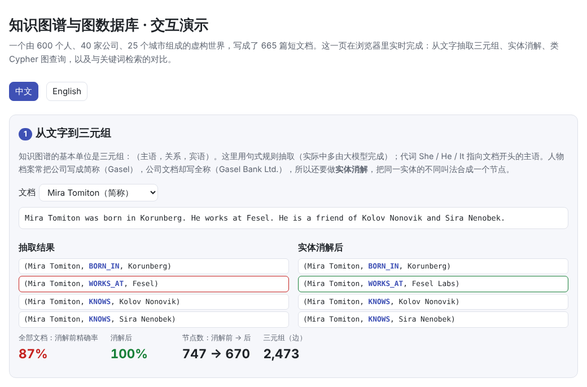
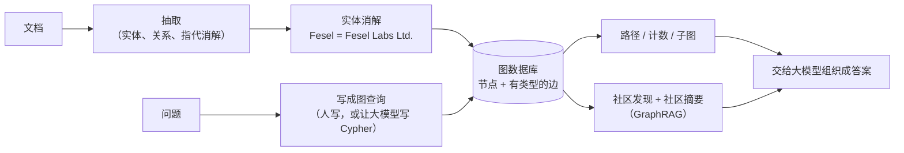
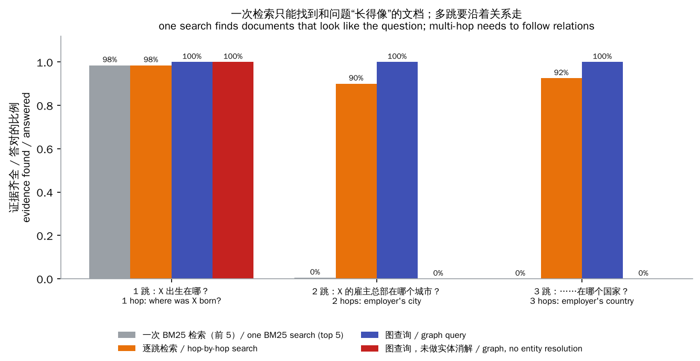
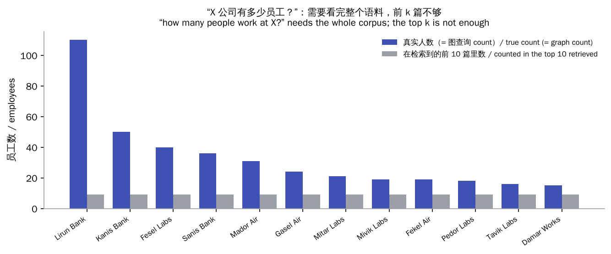

# 知识图谱与图数据库（Knowledge Graphs & Graph Databases）

> **一句话总结：** 知识图谱把知识存成“实体—关系—实体”的网络，图数据库让你沿着关系查询。它擅长向量检索不擅长的两类问题：
>
> - **多跳问题**：“X 的雇主总部在哪个国家？”
> - **全局问题**：“哪家公司员工最多？”
>
> 代价是要先从文字里**抽取**实体和关系，并把同一实体的不同叫法**合并**起来，图的质量决定了一切。GraphRAG 把两者结合：用图组织语料，再把检索到的结构交给大模型。
>
> 🌐 [English version](README.en.md) · 🎮 **[打开交互演示](interactive/knowledge_graph.html?lang=zh)** · 📓 [Notebook](20-knowledge-graphs.ipynb)（[在 Colab 中打开](https://colab.research.google.com/github/BaiYuBY/use_token_to_learn/blob/main/docs/20-knowledge-graphs/20-knowledge-graphs.ipynb)）

[](interactive/knowledge_graph.html?lang=zh)

**本章你将学会：**

- 三元组、RDF 与属性图，以及图数据库和关系数据库的区别
- 从文字建图：实体与关系抽取、指代消解、实体消解
- 用 Cypher 写图查询
- 为什么一次检索答不了多跳问题，逐跳检索和图查询怎样解决
- 全局问题与 GraphRAG：社区发现、社区摘要、map-reduce 回答

## 1. 直觉：文档讲的是事，图存的是关系

[19 章](../19-rag/README.md)的 RAG 把文档切块、找出和问题最像的几块。它的前提是：**答案所在的块和问题长得像**。有两类问题会打破这个前提。

**多跳问题**：“Mira Tomiton 的雇主总部在哪个城市？”要回答它需要两篇文档：

```text
Mira Tomiton was born in Korunberg. He works at Fesel. He is a friend of ...
Fesel Labs Ltd. is headquartered in Mikelvik. It was founded in 1962 by ...
```

第二篇里没有 Mira Tomiton 这个名字，和问题一点也不像，一次检索很难找到它。而且人物档案里写的是简称 “Fesel”，公司文档写的是 “Fesel Labs Ltd.”，还要知道它们是同一家公司。

**全局问题**：“哪家公司员工最多？”答案分散在几百篇人物档案里，检索前 k 篇只能数到 k 个。

知识图谱换一种存法：把每个事实存成一条边，比如 `(Mira Tomiton)-[:WORKS_AT]->(Fesel Labs)`、`(Fesel Labs)-[:LOCATED_IN]->(Mikelvik)`。多跳问题就是沿着边走两步，全局问题就是数边。

本章的小世界有 600 个人、40 家公司、25 个城市、5 个国家，写成 665 篇短文档。人物档案里 40% 的公司名用了简称。

## 2. 图解



> **🎮 动手试试**
>
> 在[交互演示](interactive/knowledge_graph.html?lang=zh)中，你可以：
>
> 1. 任选一篇文档，看抽取出的三元组，以及实体消解改了哪些名字
> 2. 选一个人和查询模板（1–3 跳、同事人数、朋友的雇主、雇主的创始人），或者自己改 Cypher 再运行，在关系图上看到匹配的路径
> 3. 比较同一个多跳问题下，一次检索、逐跳检索和图查询的结果
> 4. 看全局问题的计数对比，以及在图上找出的社区和它们的摘要

## 3. 原理

### 3.1 三元组、RDF 与属性图

知识图谱的基本单位是**三元组**（主语，关系，宾语），比如 `(Mira Tomiton, WORKS_AT, Fesel Labs)`。常见的两种数据模型：

- **RDF**：W3C 标准，节点和关系都用全局唯一的 URI 表示，用 SPARQL 查询。Wikidata、DBpedia 这类开放知识库多用它，适合跨数据源的链接和推理。
- **属性图**：节点和边都可以带标签和属性（如 `(:Person {name: "Mira", born: 1992})`），用 Cypher（Neo4j）、Gremlin 等语言查询，2024 年又有了国际标准 GQL。应用开发中更常见。

图数据库和关系数据库都能存这些数据，区别在查询方式：关系数据库要用 JOIN 把表连起来，跳数越多 JOIN 越多；图数据库直接存邻接关系，从一个节点出发沿着边走，代价只和走过的边数有关（“无索引邻接”）。

### 3.2 建图：抽取与实体消解

从文字建图分几步：

1. **实体识别**：找出文中的人、公司、地点等。
2. **关系抽取**：判断实体之间是什么关系。
3. **指代消解**：He、She、It、“该公司”指的是谁。
4. **实体消解**：把同一实体的不同叫法合并成一个节点，比如 Fesel、Fesel Labs、Fesel Labs Ltd.。

过去这些要用专门训练的模型，现在多半让大模型按给定的模式输出三元组（GraphRAG、LangChain 的 LLMGraphTransformer 等都是这样）。本章用句式规则代替大模型完成抽取，代词指向文档开头的主语；实体消解则是：去掉 Ltd. 这样的后缀，再把简称映射到唯一以它开头的全称。

| | 三元组精确率 | 召回率 | 节点数 |
|---|---|---|---|
| 只抽取 | 87% | 87% | 747 |
| 抽取 + 实体消解 | 100% | 100% | 670 |

只差 13% 的三元组，看起来不多，但这些恰恰是连接人和公司、公司和城市的边。下一节会看到，它们一错，多跳查询就全部失败。

真实场景比这难得多：大模型抽取会漏、会编，也会把关系类型写得五花八门（works at / employed by / 就职于）。所以实际系统通常预先定义好**模式**（有哪些实体类型和关系类型），让模型只在这个范围里抽取，再用规则、相似度和人工审核做实体消解。

### 3.3 用 Cypher 查询

Cypher 用 ASCII 画出要找的模式：`()` 是节点，`-[:关系]->` 是有方向的边：

```cypher
// 2 跳：Mira Tomiton 的雇主总部在哪个城市？
MATCH (p:Person {name: "Mira Tomiton"})-[:WORKS_AT]->(co:Company)-[:LOCATED_IN]->(c:City)
RETURN c.name

// 同一家公司有多少人？箭头反过来写，表示从公司往回找员工
MATCH (p:Person)-[:WORKS_AT]->(co:Company {name: "Fesel Labs"})
RETURN count(DISTINCT p)
```

本章代码里有一个几十行的迷你引擎，只支持一条链式模式、名字过滤和 `RETURN x.name` / `count(DISTINCT x)`，但已经够表达本章的所有问题。交互演示里也有一个同样的引擎，可以自己改查询。

**让大模型写查询**（Text-to-Cypher）是把图接到对话系统里的常见做法：模型根据图的模式（有哪些节点类型、关系类型）把自然语言问题翻译成 Cypher，执行结果再交给模型组织成答案。难点和 Text-to-SQL 一样：模式要讲清楚，生成的查询要先校验，最好只给只读权限。

### 3.4 多跳问题：检索 vs 图



本章对 200 个人各问 1、2、3 跳的问题，看回答需要的所有文档（或图上的路径）能不能找到：

| | 1 跳 | 2 跳 | 3 跳 |
|---|---|---|---|
| 一次 BM25 检索（前 5 篇） | 98% | 0.5% | 0% |
| 逐跳检索（每跳前 5 篇） | 98% | 90% | 92% |
| 图查询 | 100% | 100% | 100% |
| 图查询，未做实体消解 | 100% | 0% | 0% |

- **一次检索**只能找到和问题长得像的文档：问题里只有人名，公司和城市的文档里没有这个人名，所以 2 跳以上几乎全部失败。
- **逐跳检索**模仿 self-ask、IRCoT 的做法：检索、读最靠前的文档、抽出下一个实体（公司名）、再用它去检索。每一步只需要找“和当前实体相关”的文档，所以能跟上链条。但每一步都可能出错（比如用简称 “Fesel” 检索时排在前面的是其他提到 Fesel 的人物档案），错误会累积。在真实系统里，这就是 [Agent 式检索](../21-agents/README.md)：让模型自己决定下一步搜什么。
- **图查询**直接沿着边走，前提是图建得对：不做实体消解，人物连到的是 “Fesel” 这个孤立节点，公司的边挂在 “Fesel Labs Ltd.” 上，路在第一步就断了。

### 3.5 全局问题与 GraphRAG



“Lirun Bank 有多少员工？”真实答案是 110。图查询 `count` 直接数出 110；检索前 10 篇再数，最多只能数到 10（这里是 9）。所有“最多、最少、有多少、主要有哪些”这类问题都是这样：答案需要看完整个语料，任何只取前 k 篇的检索都做不到。

**GraphRAG**（微软，Edge 等，2024）的做法：

1. 用大模型从全部文档中抽取实体和关系，建成图。
2. 用 Leiden 算法在图上找出**社区**：内部连接紧密、彼此连接稀疏的群体，并且是分层的（大社区里套着小社区）。
3. 让大模型为每个社区写一份**社区报告**：有哪些主要实体、它们之间是什么关系、有哪些要点。
4. 全局问题来了，就把问题发给每份社区报告各自作答（map），再把这些部分答案汇总成最终答案（reduce）。

本章用更简单的标签传播代替 Leiden（每个节点反复采用邻居中最常见的标签），在人物—公司—朋友关系上找出 38 个社区。因为朋友大多是同事，96% 的人和自己所在社区的“主要雇主”一致；最大的社区有 107 人，其中 106 人在 Lirun Bank。社区报告直接从图里填写（GraphRAG 里由大模型写），对所有报告做 map-reduce，就能答对“哪家公司员工最多”。

GraphRAG 的代价不低：建图和写社区报告要对全部语料调用大模型，语料更新后还要重建。所以后来有了很多更省的变体：LightRAG 简化了社区报告，HippoRAG 用个性化 PageRank 在图上做检索。实际选择取决于问题类型：大多数问题是局部的“查某件事”，向量检索就够了；常常需要跨文档关联、聚合或者全局概览时，图才值得建。

## 4. 最小代码实现

完整代码：[`code/knowledge_graph.py`](code/knowledge_graph.py)，运行 `python docs/20-knowledge-graphs/code/knowledge_graph.py`（几秒钟）。实验与配图在 [`figures/knowledge_graph_figures.py`](figures/knowledge_graph_figures.py) 中。

抽取（代词指向文档开头的主语）：

```python
for sent in re.split(r"(?<=\.)\s+(?=[A-Z])", text):
    for pat, rel in PATTERNS:
        m = re.match(pat, sent)
        if m:
            s = subject if m.group("s") in ("She", "He", "It") else m.group("s")
            subject = subject or s
            triples.append((s, rel, m.group("o")))
            break
```

实体消解：

```python
strip = lambda n: re.sub(r"\s+(Ltd|Inc|Group)\.?$", "", n)     # Fesel Labs Ltd. -> Fesel Labs
full = {s for s, r, _ in triples if r == "LOCATED_IN"}           # 公司的正式名称
by_first = defaultdict(set)
for f in full:
    by_first[f.split()[0]].add(f)                                # Fesel -> {Fesel Labs}
canon = lambda n: next(iter(by_first[n])) if n not in full and len(by_first.get(n, ())) == 1 else n
```

迷你 Cypher 引擎的核心：从第一个节点出发，沿着每条关系把匹配的行扩展一步：

```python
rows = [{first_var: n} for n in self.nodes(first_label) if first_name in (None, n)]
for (rel, forward), spec in zip(rels, nodes[1:]):
    rows = [dict(row, **{spec["var"]: n}) for row in rows for n in self.step(row[prev], rel, forward)
            if spec["label"] in (None, self.label.get(n)) and spec["name"] in (None, n)]
```

代码里的 `main()` 检查这些结论：实体消解后三元组的精确率和召回率都超过 99%；一次检索在 1 跳上超过 90%，3 跳低于 30%；逐跳检索在 3 跳上比一次检索高 40 个百分点以上，图查询 100%；不做实体消解时 2 跳的图查询至少低 20 个百分点；图计数等于真实人数，而前 10 篇最多数到 10；社区报告的 map-reduce 答对“哪家公司员工最多”。

## 5. 常见误区

- **“知识图谱可以替代向量检索”**：大多数问题是局部的，向量检索更简单、更便宜，对措辞也更宽容。图擅长多跳关系和聚合，两者常常一起用。
- **“让大模型抽取三元组，图就建好了”**：抽取会漏、会编，关系名会五花八门，同一实体会有很多叫法。没有模式约束和实体消解，图会碎成大量孤立节点（本章不消解时多跳查询 0%）。
- **“图查询一定是对的”**：图查询只是把图里有的东西忠实地取出来；图里的错误会被原样返回，甚至被多跳放大。
- **“GraphRAG 适合所有场景”**：它的建图和社区报告成本很高，语料一变就要重建；它擅长的是全局概览类问题。
- **“多跳问题一定要建图”**：逐跳检索（让模型一步步搜）往往也能解决，本章 2–3 跳达到 90% 以上；代价是更多的检索轮次和累积误差。

## 6. 自测题

1. 写一个 Cypher 查询：找出和 Mira Tomiton 在同一家公司工作、并且出生在同一个城市的人。
2. 为什么一次向量检索回答不了“X 的雇主总部在哪个国家”？逐跳检索为什么可以？它的弱点是什么？
3. 实体消解没做好，图会出现什么问题？举一个本章的例子。
4. “哪家公司员工最多”为什么检索前 k 篇做不到？GraphRAG 怎样回答这类问题？
5. 你的知识库是公司内部的几千份技术文档，用户主要问“某个参数怎么配置”这类问题。值得建知识图谱吗？

<details>
<summary>参考答案</summary>

1. 本章的迷你引擎只支持一条链，标准 Cypher 可以写成两个模式：`MATCH (m:Person {name: "Mira Tomiton"})-[:WORKS_AT]->(co:Company)<-[:WORKS_AT]-(p:Person), (m)-[:BORN_IN]->(c:City)<-[:BORN_IN]-(p) RETURN p.name`。
2. 答案在公司和城市的文档里，它们不包含 X 的名字，和问题不像，一次检索找不到。逐跳检索每一步只用当前实体去搜，所以能找到下一篇；弱点是每一步都可能出错，错误会累积，而且需要多轮检索，更慢更贵。
3. 同一实体变成几个互不相连的节点，路径断开。本章人物档案里的 “Fesel” 和公司文档里的 “Fesel Labs Ltd.” 不合并时，人物的 WORKS_AT 边指向孤立的 “Fesel” 节点，2 跳和 3 跳的图查询全部失败。
4. 答案需要统计整个语料，检索前 k 篇最多只能看到 k 个。GraphRAG 预先在图上找出社区、为每个社区写报告；问全局问题时对所有报告做 map-reduce：各自回答，再汇总。
5. 多半不值得。这类问题是局部的“查某件事”，答案在单篇文档里，向量检索 + 关键词检索（加上好的切块）就够了。如果经常要问“哪些服务依赖这个组件”“改这个参数会影响哪些系统”这类关系问题，才值得为这部分关系建图。

</details>

## 7. 延伸阅读

- Hogan et al., 2021. [Knowledge Graphs](https://arxiv.org/abs/2003.02320)（综述）
- Pan et al., 2023. [Unifying Large Language Models and Knowledge Graphs: A Roadmap](https://arxiv.org/abs/2306.08302)
- Edge et al., 2024. [From Local to Global: A Graph RAG Approach to Query-Focused Summarization](https://arxiv.org/abs/2404.16130)（GraphRAG）
- Traag et al., 2019. [From Louvain to Leiden: guaranteeing well-connected communities](https://arxiv.org/abs/1810.08473)
- Raghavan et al., 2007. [Near linear time algorithm to detect community structures in large-scale networks](https://arxiv.org/abs/0709.2938)（标签传播）
- Yang et al., 2018. [HotpotQA: A Dataset for Diverse, Explainable Multi-hop Question Answering](https://arxiv.org/abs/1809.09600)
- Press et al., 2022. [Measuring and Narrowing the Compositionality Gap in Language Models](https://arxiv.org/abs/2210.03350)（self-ask）
- Trivedi et al., 2022. [Interleaving Retrieval with Chain-of-Thought Reasoning for Knowledge-Intensive Multi-Step Questions](https://arxiv.org/abs/2212.10509)（IRCoT）
- Gutiérrez et al., 2024. [HippoRAG: Neurobiologically Inspired Long-Term Memory for Large Language Models](https://arxiv.org/abs/2405.14831)
- Guo et al., 2024. [LightRAG: Simple and Fast Retrieval-Augmented Generation](https://arxiv.org/abs/2410.05779)
- Vrandečić & Krötzsch, 2014. [Wikidata: a free collaborative knowledgebase](https://doi.org/10.1145/2629489)
- [openCypher](https://opencypher.org/) 与 [GQL（ISO/IEC 39075:2024）](https://www.iso.org/standard/76120.html)
