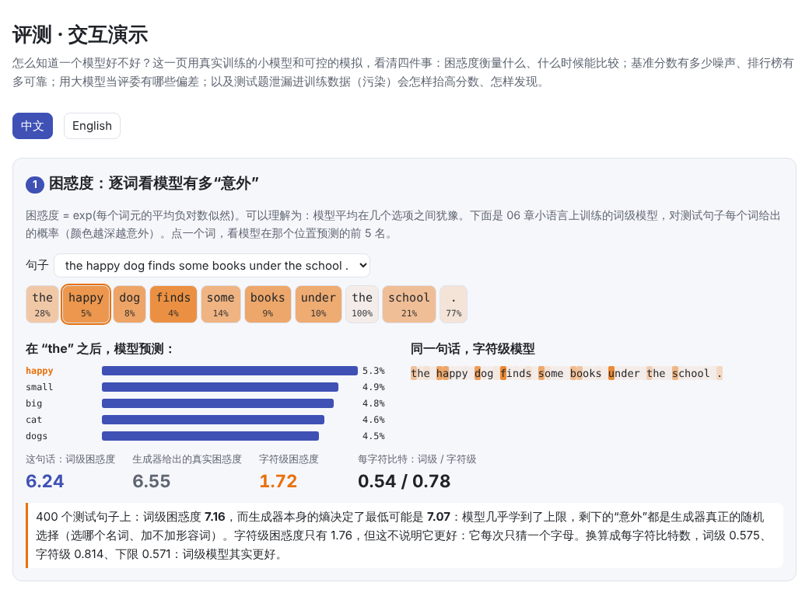
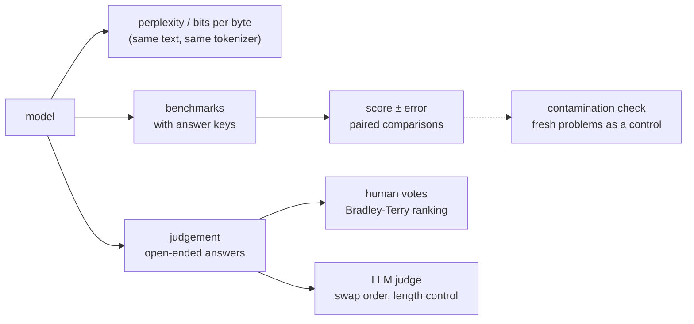
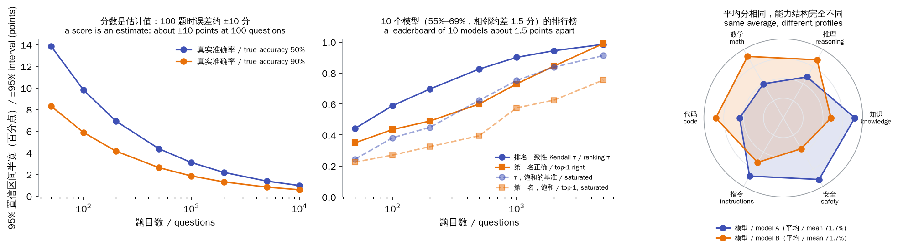
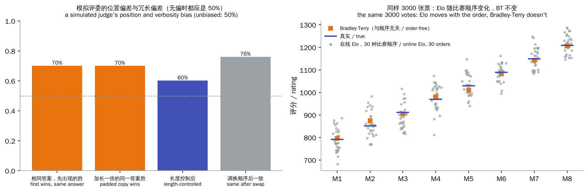
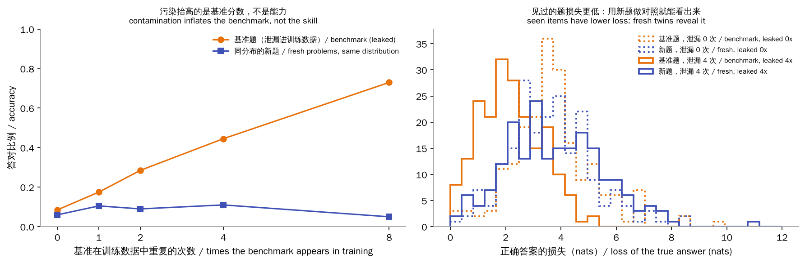

# Evaluation

> **In one sentence:** evaluation answers “is this model good, and how much better is it than that one?”. Every method has pitfalls:
>
> - **Perplexity**: comparable only on the same text with the same tokenizer.
> - **Benchmark scores**: a sample with error bars, and they can be inflated by leaked test questions.
> - **LLM judges**: cheap and handy, but they favour the answer shown first and the longer one.
>
> This chapter measures each pitfall with small models trained for real and with controlled simulations.
>
> 🌐 [中文版](README.md) · 🎮 **[Open the interactive demo](interactive/evaluation.html?lang=en)** · 📓 [Notebook](23-evaluation.ipynb) ([open in Colab](https://colab.research.google.com/github/BaiYuBY/use_token_to_learn/blob/main/docs/23-evaluation/23-evaluation.ipynb))

[](interactive/evaluation.html?lang=en)

**In this chapter you will learn:**

- What perplexity measures and where its floor is; why perplexities under different tokenizers can't be compared, and how to convert them to bits per character (or byte)
- How large a benchmark score's error is, why to compare models question by question (paired), how many questions a leaderboard needs, and what saturation is
- Why to look at per-category scores (a radar chart), not just the average
- The position and verbosity biases of LLM-as-a-judge, and fixes such as swapping the order and length control
- Why arena leaderboards use Bradley-Terry rather than online Elo
- How benchmark contamination inflates scores, why exact matching misses it, and how fresh problems and the model's own loss reveal it

## 1. Intuition: what an exam score tells you

Evaluation is like an exam, and its limits show up from three angles:

- **The paper is a sample**. A student who scores 72 on 100 questions might get 65 or 80 on another paper. Four points between two students may not mean much.
- **Markers have preferences**. Open questions have no answer key, so someone has to mark them, and markers may favour the longer script or the one they read first.
- **Questions can leak**. If you saw the questions beforehand, your score no longer reflects your ability.

The three kinds of LLM evaluation map onto these three problems:

1. **Automatic metrics** such as perplexity: no labels needed, but they measure only next-word prediction.
2. **Benchmarks**: question sets with answer keys, such as MMLU, GSM8K, HumanEval, SWE-bench.
3. **Judgement by people or models**: open-ended answers are voted on by people (Chatbot Arena) or graded by a strong model (LLM-as-a-judge).

The experiments in this chapter:

- Train word-level and character-level models on [chapter 6](../06-pretraining/README.en.md)'s toy language and compare their perplexities.
- Simulate benchmarks and leaderboards with item response theory.
- Measure biases and fixes with a simulated judge whose biases are known.
- Train a small GPT on two-digit multiplication, mix the test questions into its training data, and see how contamination inflates the score and how it can be caught.

## 2. Diagrams



> **🎮 Try it yourself**
>
> In the [interactive demo](interactive/evaluation.html?lang=en) you can:
>
> 1. See the model's probability and surprisal word by word, and compare the word-level and character-level models
> 2. Change the number and difficulty of questions, redraw the benchmark, and watch the leaderboard and its error bars change; compare two models with the same average on a radar chart
> 3. Tune a simulated judge's position bias, verbosity bias and noise; shuffle the same votes and compare Elo with Bradley-Terry
> 4. Explore the contamination experiment: the clean and contaminated models' answers to each problem, and the loss distributions

## 3. How it works

### 3.1 Perplexity

A language model gives every token in a text a probability. **Perplexity** is the exponential of the average negative log-likelihood:

$$
\text{PPL} = \exp\Big(-\frac{1}{N}\sum_{i=1}^{N} \log p(x_i \mid x_{<i})\Big)
$$

Intuitively, it is how many options the model is torn between on average: guessing uniformly among 80 words gives a perplexity of 80.

**The floor**: text is itself random. Chapter 6's toy language comes from a known generator, so every sentence's probability can be computed exactly, and the text's entropy (the lowest possible perplexity) is known:

| | perplexity per word |
|---|---|
| uniform guess (80 words) | 80 |
| word-level small GPT (700 steps) | 7.16 |
| the generator itself (floor) | 7.07 |

The model has nearly reached the limit. The remaining surprise is the generator's genuinely random choices:

- Which adjective or adverb: about 3 nats each.
- “an”: about 4.4 nats, because it gives away that the next word starts with a vowel.
- “the”, “that” and the full stop are hardly surprising at all.

Real language has no known floor, but the idea is the same: once perplexity is low enough, what remains is mostly the text's own uncertainty.

**Different tokenizers can't be compared**. On the same test text:

| | perplexity | bits per character |
|---|---|---|
| word-level model | 7.16 (per word) | 0.575 |
| character-level model | 1.76 (per character) | 0.814 |
| floor | | 0.571 |

By perplexity the character model looks 4× better; but it only guesses one letter at a time, which is of course easier. Converted to **bits per character** (total bits ÷ characters), both measure the information needed for the same text, and the word-level model is actually the better one. Large models with different tokenizers are usually compared in **bits per byte**, as in The Pile's evaluations.

**And you can cheat**: merge 21 object and place words into one `<unk>` and perplexity drops from 7.16 to 5.09, while the model no longer says which word it is. So compare perplexities only on **the same text with the same tokenizer and vocabulary**.

Perplexity is good for monitoring pre-training and comparing models of one family. But it doesn't always track downstream ability (solving problems, following instructions), so benchmarks are still needed.

### 3.2 A benchmark score is a sample

A benchmark is a sample from “all possible questions”. With accuracy $p$ and $n$ questions, the standard error is $\sqrt{p(1-p)/n}$:

| questions | 95% interval at 70% accuracy |
|---|---|
| 100 | ±9.0 points |
| 1,000 | ±2.8 points |
| 10,000 | ±0.9 points |

Many benchmarks have only a few hundred questions, so models one or two points apart on a leaderboard are often within the error. Scores should be reported with confidence intervals.

**Item response theory** (IRT) makes this precise: each model has an ability $\theta$, each question a difficulty $b$, and the chance of a right answer is $\sigma(\theta - b)$.

This leads to an important conclusion: compare two models question by question on **the same questions** (a paired comparison), rather than treating two scores as independent. Question difficulty is the same for both models, so pairing removes that noise.

Simulating two models about 4 points apart (67.0% vs 62.9%), here is how often the difference is detected:

| shared questions | unpaired test | paired bootstrap |
|---|---|---|
| 200 | 6% | 15% |
| 500 | 30% | 39% |
| 1,000 | 47% | 59% |
| 2,000 | 87% | 95% |

**Leaderboards**: 10 models with true accuracy from 55% to 69%, neighbours about 1.5 points apart:

| questions | agreement with the true ranking (Kendall τ) | true best ranked first |
|---|---|---|
| 100 | 0.58 | 43% |
| 500 | 0.83 | 65% |
| 2,000 | 0.95 | 88% |



**Saturation**: if the questions are too easy, all models score 92%–96%, and with the same 500 questions τ is only 0.64 and the best model comes first only 43% of the time. Most questions are easy for everyone, and the remaining differences are mostly noise, plus label errors: many older benchmarks turn out to have a share of questions with wrong answer keys. That is why harder benchmarks such as MMLU-Pro and GPQA followed MMLU. Good questions have difficulty close to the abilities being compared. IRT can also pick the most informative few questions out of a large benchmark (as tinyBenchmarks does).

**Averages hide profiles**. Two models both average 71.7%:

- Model A is strong at knowledge, instruction following and safety.
- Model B is strong at reasoning, math and code.

Weighted for a coding assistant, B scores 86.5% and A 55.0%; weighted for a customer-service bot, it is the other way round. So look at per-category scores (a radar chart) and weight them for your own use. Frameworks such as HELM report many dimensions at once (accuracy, calibration, robustness, fairness, efficiency…) for the same reason.

Real evaluations have many details that change the score:

- The prompt format and the choice of few-shot examples.
- Whether multiple-choice answers are scored by option log-probabilities or by letting the model generate a letter.
- How the answer is parsed from the output.
- The sampling temperature.

The same model can score several points differently in different evaluation harnesses. When comparing, make sure the setup is the same.

### 3.3 LLMs as judges

Open-ended answers (writing, conversation, explanations) have no answer key. Human judgement is the most reliable but slow and expensive, so a strong model often acts as the judge (LLM-as-a-judge). It takes two common forms:

- **Single grading**: a 1–10 score against a rubric.
- **Pairwise comparison**: which of A and B is better.

The MT-Bench paper found that GPT-4 as a judge agrees with humans over 80% of the time, about as often as humans agree with each other. But judges have systematic biases. Here they are measured with a simulated judge whose biases are known (perceived score = true quality + verbosity × log length + noise, with a bonus for the first slot):

| Measurement | Result | Unbiased judge |
|---|---|---|
| **the same** answer in both slots: the first wins | 70% | 50% |
| **the same** answer padded to twice the length (nothing new) beats the original | 70% | 50% |
| verdict unchanged after swapping the two answers | 76% | |
| agreement with the expert when judged once | 82% | |

Real LLM judges have been measured to show the same biases:

- **Position bias**: favouring the first (or second) answer.
- **Verbosity bias**: favouring the longer answer.
- **Self-preference**: favouring answers in their own style, even their own outputs.

Fixes:

- **Swap the order**: judge both orders and call it a tie when the verdicts disagree. Here the consistent verdicts agree with the expert 92% of the time (covering 76% of comparisons).
- **Length control**: estimate the effect of length by regression and remove it (length-controlled AlpacaEval). Here the padded copy's win rate drops from 70% to 60%: less, but not gone, since a simple statistical model only approximates the judge.
- **Rubrics and reference answers**: leave the judge less room to improvise.
- **Check against human labels regularly**: the judge needs evaluating too.



### 3.4 Arena leaderboards: Elo vs Bradley-Terry

Chatbot Arena (LMArena) has users vote between two anonymous models' answers and ranks models from many pairwise votes. It first used chess's **online Elo**: after each game, both ratings move according to the result. But Elo was designed for players who improve, so recent games count more; a model's ability is fixed, and the same votes in another order give different Elo ratings.

In this chapter's simulation, 8 models and 3,000 votes in 20 different orders move the Elo ratings by ±47 points on average.

The **Bradley-Terry** model assumes $P(i \text{ beats } j) = \sigma(s_i - s_j)$ and fits all votes at once by maximum likelihood, independent of the order, with bootstrap confidence intervals. The Arena later switched to this method.

When two models' intervals overlap, the difference in their ranks means nothing.

### 3.5 Contamination: test questions in the training data

LLM pre-training data comes from the whole web, and benchmark questions and answers may well be in it. The model may have memorized the answers, and the score no longer reflects ability.

This chapter's experiment:

- **The benchmark**: 200 two-digit multiplications.
- **The control**: another 200 “fresh” problems from the same distribution that no model ever sees.
- **Training**: the same small GPT trains on 3,000 other problems, with the benchmark mixed into its data 0–8 times.

| benchmark copies in training | benchmark | fresh | loss separates the two (AUC) |
|---|---|---|---|
| 0 | 8.5% | 6.0% | 0.48 |
| 1 | 17.5% | 10.5% | 0.57 |
| 4 | 44.5% | 11.0% | 0.78 |
| 8 (figure run) | 73.0% | 5.0% | |



The benchmark score climbs with every copy; the fresh problems don't move: the model memorized answers instead of learning multiplication.

How to catch it?

- **Search the training data**: GPT-3 and others “decontaminate” with 13-word n-gram overlaps. Here a 9-character overlap finds 0% in the clean data and 100% for a verbatim leak. But write the problem the other way round (58\*37 for 37\*58) and it finds only 5%, while the model still benefits (19.0% on the benchmark vs 6.0% fresh). In the real world questions are paraphrased, translated and buried in forum threads, so exact matching misses a lot; and most models' training data isn't public, so it can't be searched at all.
- **Compare with fresh problems from the same distribution**: a clean model does the same on both, a contaminated one shows a gap. GSM1k did exactly this: it wrote 1,000 new problems in GSM8K's style, and some models' accuracy dropped by up to about 13 points on them.
- **Look at the model's own loss** (membership inference): seen items have lower loss. Compare the loss distributions on test and fresh items; methods such as Min-K% Prob don't even need fresh items. With 4 copies the loss separates the two sets with AUC 0.78; with 1 copy only 0.57, so light contamination is hard to detect.
- **Prevent leaks**: put a unique **canary string** in benchmark files (as BIG-bench does) so data collectors can filter them; don't publish test answers; use continuously refreshed “live” benchmarks (such as LiveBench and LiveCodeBench, built from questions newer than the models' training cut-off).

### 3.6 Practical advice

- **Decide what you care about first**: a general leaderboard isn't your task. The most valuable evaluation set is often a few hundred examples collected and labelled from your own real use.
- **Report uncertainty**: give confidence intervals, pair comparisons on the same questions, and don't conclude anything from a gap smaller than the error.
- **Fix the evaluation setup**: write down the prompt, decoding parameters and answer parsing, and compare within one harness (such as lm-evaluation-harness).
- **Watch for contamination**: keep some questions that were never published, and use fresh problems as a control.
- **Open-ended tasks**: combine human evaluation with an LLM judge; have the judge swap orders and control for length, and check it against human results regularly.
- **Evaluating agents** ([chapter 21](../21-agents/README.en.md)): beyond the final result, look at steps, cost and failure modes; run each task several times and look at the distribution of success.

## 4. Minimal code

Full code:

- [`code/perplexity.py`](code/perplexity.py): perplexity and its floor, bits per character, the `<unk>` cheat, about a minute.
- [`code/benchmarks.py`](code/benchmarks.py): error bars, paired comparisons, leaderboards, saturation, profiles, a few seconds.
- [`code/llm_judge.py`](code/llm_judge.py): judge biases and fixes, Elo vs Bradley-Terry, a few seconds.
- [`code/contamination.py`](code/contamination.py): the contamination experiment and detection, about a minute.

The experiments and figures are in [`figures/evaluation_figures.py`](figures/evaluation_figures.py).

Perplexity and bits per character:

```python
nll = token_nll(model, ids, ctx)                 # negative log-likelihood of each token (nats)
ppl = math.exp(nll.mean())
bits_per_char = nll.sum().item() / math.log(2) / n_chars
```

Item response theory and the paired bootstrap:

```python
p = sigmoid(abilities[:, None] - difficulties[None, :])   # models × questions
correct = rng.random(p.shape) < p

idx = rng.integers(0, len(x), (n_boot, len(x)))           # both models resampled on the same questions
diffs = x[idx].mean(1) - y[idx].mean(1)
```

A biased judge, and swapping the order:

```python
ab = judge.first_wins(qa, la, qb, lb)          # A shown first
ba = ~judge.first_wins(qb, lb, qa, la)         # B shown first (True means A wins)
consistent = ab == ba                          # keep only verdicts that agree in both orders
```

The MM algorithm for Bradley-Terry:

```python
for _ in range(iters):
    p = wins / (games / (p[:, None] + p[None, :])).sum(1)
    p /= np.exp(np.log(p).mean())
```

Contamination detection: compare the loss on benchmark and fresh items:

```python
(cb, lb), (cf, lf) = score(model, bench), score(model, fresh)
print(cb.mean(), cf.mean(), auc(lb, lf))       # the accuracy gap, and how well loss separates the two sets
```

The `main()` functions check these findings:

- The word-level model's perplexity is above, and close to, the generator's floor.
- Word- and character-level perplexities differ by more than 3×, while bits per character are on the same scale.
- Merging words lowers perplexity.
- Simulated score errors match the formula, and paired comparisons are more sensitive.
- More questions make the leaderboard more accurate, and a saturated benchmark separates models worse.
- The judge's position and verbosity biases are clear; consistent verdicts after swapping are more accurate; length control reduces the verbosity bias.
- Bradley-Terry recovers the true ranking while Elo moves with the order of games.
- Contamination inflates the benchmark but not fresh problems; exact matching misses a rewritten leak that still helps the model.

## 5. Common misconceptions

- **“Lower perplexity means a better model”**: only on the same text with the same tokenizer. And perplexity doesn't always track downstream performance.
- **“One point higher on the leaderboard means better”**: on a benchmark of a few hundred questions the error is several points. Look at the intervals and pair the comparison.
- **“The model with the higher average suits me better”**: averages hide profiles. Weight the categories for your use, and ideally evaluate on your own data.
- **“An LLM judge is as objective as a person”**: it favours the first, the longer and the more familiar-sounding answer. Swap the order, control for length, and check it against human results.
- **“We checked n-gram overlap, so there's no contamination”**: paraphrased and translated leaks slip through. Fresh problems from the same distribution are a more reliable check.
- **“A high benchmark score means the model can do the task”**: it may have memorized the questions or learned the benchmark's format. Test again on new questions, asked differently.

## 6. Self-check questions

1. Your model scores 81% on a 400-question benchmark and a rival scores 78%. On those questions, yours is right and the rival wrong on 30, and the reverse on 18. How do you judge whether the gap is real?
2. Why can't you directly compare the perplexities of the same model trained with a 32k-vocabulary tokenizer and with a 128k one? What should you use instead?
3. Design an experiment to test whether your LLM judge has a verbosity bias.
4. A new model beats its predecessor by 10 points on GSM8K, but by only 2 points on 200 new problems you wrote in the same style. What might explain it, and what else should you do?
5. On Chatbot Arena two models are rated 1250 ± 8 and 1243 ± 9 (95% intervals). Is the first one better?

<details>
<summary>Answers</summary>

1. Use a paired test: only the 48 questions where they differ carry information. If the models were equally good, those 48 would split about evenly (24/24). 30 vs 18 is about 1.7 standard deviations (McNemar: $(30-18)^2/48 = 3.0$, p ≈ 0.08), not yet significant; you need more questions, or a look at what the differing questions have in common.
2. Perplexity is an average per token, and different vocabularies give tokens of different lengths and counts. Convert to bits per byte (or character) of the same text: total negative log-likelihood ÷ ln 2 ÷ bytes.
3. Take a set of answers and make a version of each that is only longer, with no new information (repeat points, add filler). Have the judge compare original and padded versions, judging both orders. An unbiased judge wins about 50% for each; clearly above 50% for the padded versions is verbosity bias. You can also regress the verdicts of many real comparisons on the length difference.
4. GSM8K is probably contaminated (original or paraphrased problems in the training data), or the model overfits the benchmark's format. Check the training data for overlap with GSM8K, compare the model's loss on GSM8K problems and on new ones, and trust the new problems from now on.
5. Not for certain. The intervals (1242–1258 and 1234–1252) overlap, so the gap is within statistical error; treat them as roughly tied.

</details>

## 7. Further reading

- Jelinek et al., 1977. Perplexity — a measure of the difficulty of speech recognition tasks (where perplexity comes from)
- Gao et al., 2020. [The Pile: An 800GB Dataset of Diverse Text for Language Modeling](https://arxiv.org/abs/2101.00027) (bits per byte)
- Hendrycks et al., 2020. [Measuring Massive Multitask Language Understanding](https://arxiv.org/abs/2009.03300) (MMLU)
- Liang et al., 2022. [Holistic Evaluation of Language Models](https://arxiv.org/abs/2211.09110) (HELM)
- Srivastava et al., 2022. [Beyond the Imitation Game](https://arxiv.org/abs/2206.04615) (BIG-bench, canary strings)
- Miller, 2024. [Adding Error Bars to Evals](https://arxiv.org/abs/2411.00640)
- Polo et al., 2024. [tinyBenchmarks: evaluating LLMs with fewer examples](https://arxiv.org/abs/2402.14992) (IRT)
- Zheng et al., 2023. [Judging LLM-as-a-Judge with MT-Bench and Chatbot Arena](https://arxiv.org/abs/2306.05685)
- Chiang et al., 2024. [Chatbot Arena: An Open Platform for Evaluating LLMs by Human Preference](https://arxiv.org/abs/2403.04132)
- Dubois et al., 2024. [Length-Controlled AlpacaEval](https://arxiv.org/abs/2404.04475)
- Panickssery et al., 2024. [LLM Evaluators Recognize and Favor Their Own Generations](https://arxiv.org/abs/2404.13076)
- Brown et al., 2020. [Language Models are Few-Shot Learners](https://arxiv.org/abs/2005.14165) (13-gram decontamination in the appendix)
- Zhang et al., 2024. [A Careful Examination of Large Language Model Performance on Grade School Arithmetic](https://arxiv.org/abs/2405.00332) (GSM1k)
- Shi et al., 2023. [Detecting Pretraining Data from Large Language Models](https://arxiv.org/abs/2310.16789) (Min-K% Prob)
- White et al., 2024. [LiveBench: A Challenging, Contamination-Free LLM Benchmark](https://arxiv.org/abs/2406.19314)
- [lm-evaluation-harness](https://github.com/EleutherAI/lm-evaluation-harness)
