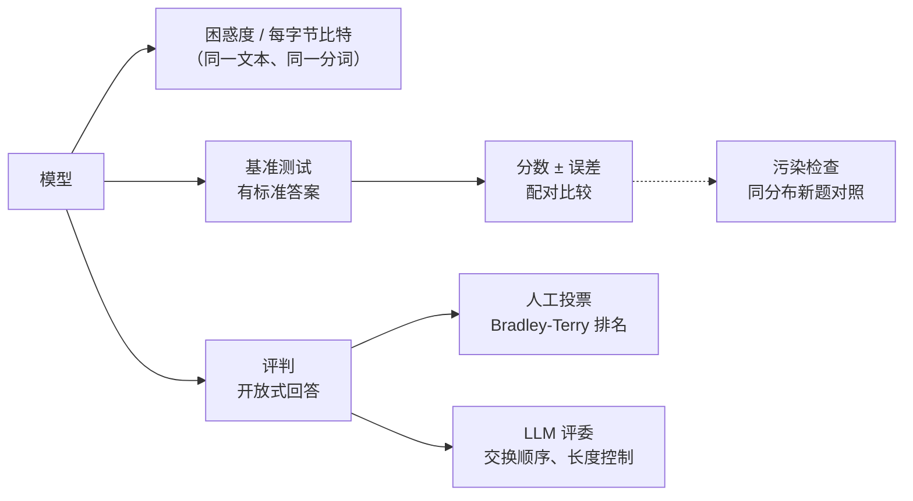

# 评测（Evaluation）

> **一句话总结：** 评测回答的是“这个模型到底好不好、比另一个好多少”。每种方法都有陷阱：
>
> - **困惑度**：只能在同一份文本、同一种分词下比较。
> - **基准分数**：本身是一次抽样，有误差，还可能被泄漏的测试题抬高。
> - **用大模型当评委**：便宜好用，但偏爱先出现的答案和更长的答案。
>
> 本章用真实训练的小模型和可控的模拟，把这些陷阱一个个量出来。
>
> 🌐 [English version](README.en.md) · 🎮 **[打开交互演示](interactive/evaluation.html?lang=zh)** · 📓 [Notebook](23-evaluation.ipynb)（[在 Colab 中打开](https://colab.research.google.com/github/BaiYuBY/use_token_to_learn/blob/main/docs/23-evaluation/23-evaluation.ipynb)）

[](interactive/evaluation.html?lang=zh)

**本章你将学会：**

- 困惑度衡量什么、它的下限在哪里，为什么不同分词的困惑度不能比、怎样换算成每字符（每字节）比特数
- 基准分数的误差有多大，为什么要在同一批题上配对比较，排行榜在多少道题时才可靠，什么是基准饱和
- 为什么要看分类别的分数（雷达图），而不只看平均分
- LLM-as-a-judge 的位置偏差和冗长偏差，以及交换顺序、长度控制等修正方法
- 竞技场排行榜为什么用 Bradley-Terry 而不是在线 Elo
- 基准污染怎样抬高分数，为什么精确匹配查不出来，怎样用同分布的新题和模型的损失发现它

## 1. 直觉：考试成绩能说明什么

评测像考试，可以从三个角度理解它的局限：

- **考卷只是抽样**。100 道题考 72 分的学生，换一套卷子可能考 65 分，也可能考 80 分。两个学生差 4 分，未必说明谁更好。
- **阅卷人有偏好**。开放式问题没有标准答案，要有人打分。阅卷人可能偏爱字写得多的、偏爱先看到的那份。
- **考题可能泄露**。考前见过原题，分数就不再反映能力。

大模型评测的三类方法正好对应这三个问题：

1. **自动指标**，如困惑度：不需要标注，但只衡量“预测下一个词”的能力。
2. **基准测试**：有标准答案的题库，如 MMLU、GSM8K、HumanEval、SWE-bench。
3. **人或模型的评判**：开放式回答由人投票（Chatbot Arena）或由强模型打分（LLM-as-a-judge）。

本章的实验：

- 在 [06 章](../06-pretraining/README.md)的小语言上训练词级和字符级模型，比较它们的困惑度。
- 用项目反应理论模拟基准和排行榜。
- 用带已知偏差的模拟评委测量各种偏差和修正。
- 用两位数乘法训练小 GPT，把测试题混进训练数据，看污染怎样抬高分数、怎样被发现。

## 2. 图解



> **🎮 动手试试**
>
> 在[交互演示](interactive/evaluation.html?lang=zh)中，你可以：
>
> 1. 逐词查看模型的预测概率和惊讶度，对比词级与字符级模型
> 2. 改变题目数量和难度，反复抽题，看排行榜和置信区间怎样变；用雷达图比较两个平均分相同的模型
> 3. 调节模拟评委的位置偏差、冗长偏差和噪声；把同样的投票打乱顺序，比较 Elo 和 Bradley-Terry
> 4. 查看污染实验：每道题干净模型和被污染模型的答案，以及损失的分布

## 3. 原理

### 3.1 困惑度

语言模型给一段文本中每个词元一个概率。**困惑度**是平均负对数似然的指数：

$$
\text{PPL} = \exp\Big(-\frac{1}{N}\sum_{i=1}^{N} \log p(x_i \mid x_{<i})\Big)
$$

直观地说，模型平均在几个选项之间犹豫：均匀地猜 80 个词，困惑度就是 80。

**下限**：文本本身有随机性。06 章的小语言来自一个已知的生成器，可以精确算出每个句子的概率，所以这段文本的熵（也就是困惑度的下限）是已知的：

| | 每词困惑度 |
|---|---|
| 均匀猜测（80 个词） | 80 |
| 词级小 GPT（训练 700 步） | 7.16 |
| 生成器本身（下限） | 7.07 |

模型已经几乎学到了上限。剩下的“意外”是生成器真正的随机选择：

- 用哪个形容词、哪个副词，每个约 3 nats。
- “an”约 4.4 nats：它泄露了下一个词以元音开头。
- 而“the”“that”和句号几乎没有意外。

真实的语言没有已知的下限，但道理一样：困惑度降到一定程度后，剩下的主要是文本本身的不确定性。

**不同分词不能比**。同一段测试文本：

| | 困惑度 | 每字符比特数 |
|---|---|---|
| 词级模型 | 7.16（每词） | 0.575 |
| 字符级模型 | 1.76（每字符） | 0.814 |
| 下限 | | 0.571 |

只看困惑度，字符级“好” 4 倍；可它每次只猜一个字母，当然容易。换算成**每字符比特数**（总比特数 ÷ 字符数）后，比的是同一段文本需要多少信息，词级模型其实更好。不同分词器的大模型之间比较时，通常用**每字节比特数**（bits per byte），如 The Pile 的评测。

**还能“作弊”**：把 21 个宾语和地点词合并成一个 `<unk>`，困惑度就从 7.16 降到 5.09，模型却不再告诉你是哪个词。所以困惑度只能在**同一份文本、同一种分词和词表**下比较。

困惑度适合监控预训练、比较同一系列的模型。但它和下游能力（会不会做题、听不听指令）并不总是一致，所以还需要基准测试。

### 3.2 基准分数是一次抽样

基准是从“所有可能的题”中抽出的一个样本。准确率 $p$、题目数 $n$ 时，标准误差是 $\sqrt{p(1-p)/n}$：

| 题目数 | 准确率 70% 时的 95% 区间 |
|---|---|
| 100 | ±9.0 分 |
| 1,000 | ±2.8 分 |
| 10,000 | ±0.9 分 |

很多基准只有几百道题，排行榜上相差一两分的模型，往往在误差之内。报告分数时应该附上置信区间。

**项目反应理论**（IRT）把这件事说得更清楚：每个模型有一个能力值 $\theta$，每道题有一个难度 $b$，答对的概率是 $\sigma(\theta - b)$。

这带来一个重要结论：比较两个模型时，应该在**同一批题**上逐题比较（配对比较），而不是把两个分数当作独立的。题目难度对两个模型是一样的，配对就把这部分噪声去掉了。

模拟两个真实准确率差约 4 分（67.0% 对 62.9%）的模型，看差异被检测到的比例：

| 共同的题目数 | 不配对检验 | 配对自助法 |
|---|---|---|
| 200 | 6% | 15% |
| 500 | 30% | 39% |
| 1,000 | 47% | 59% |
| 2,000 | 87% | 95% |

**排行榜**：10 个模型真实准确率从 55% 到 69%，相邻约差 1.5 分：

| 题目数 | 与真实排名的一致性（Kendall τ） | 真正最好的排第一 |
|---|---|---|
| 100 | 0.58 | 43% |
| 500 | 0.83 | 65% |
| 2,000 | 0.95 | 88% |


**饱和**：如果题目太容易，所有模型都在 92%–96%，同样 500 道题，τ 只有 0.64，第一名正确只有 43%。大部分题谁都会，剩下的差异主要是噪声，以及标注错误：很多老基准都发现有一定比例的题本身答案就错了。这就是为什么 MMLU 之后出现了 MMLU-Pro、GPQA 等更难的基准。好的题目，难度应该接近被比较的模型的能力。IRT 也能用来从大基准中挑出最有区分度的少量题目（如 tinyBenchmarks）。

**平均分掩盖能力结构**。两个模型平均分都是 71.7%：

- 模型 A 擅长知识、指令遵循和安全。
- 模型 B 擅长推理、数学和代码。

按“编程助手”的需求加权，B 得 86.5%、A 得 55.0%；按“客服机器人”加权则反过来。所以要看分类别的分数（雷达图），并按自己的用途加权。HELM 等评测框架同时报告多个维度（准确率、校准、鲁棒性、公平性、效率……），也是这个原因。

实际评测中还有很多会改变分数的细节：

- 提示格式、少样本示例的选择。
- 选择题是比较选项的对数概率，还是让模型生成字母。
- 答案怎样从输出中解析出来。
- 采样温度。

同一个模型在不同评测框架里的分数可以差好几分。比较时要确认用的是同一套设置。

### 3.3 用大模型当评委

开放式回答（写作、对话、解释）没有标准答案。人工评判最可靠，但贵而慢，于是常用一个强模型当评委（LLM-as-a-judge）。常见的形式有两种：

- **单独打分**：按细则打 1–10 分。
- **两两比较**：A 和 B 哪个更好。

MT-Bench 的论文发现，GPT-4 当评委与人类的一致率超过 80%，与人类之间的一致率相当。但评委有系统性偏差，这里用一个带已知偏差的模拟评委测量（它的感知分 = 真实质量 + 冗长系数 × log 长度 + 噪声，第一个位置额外加分）：

| 测量 | 结果 | 无偏的评委 |
|---|---|---|
| 两个位置放**同一个**答案，先出现的胜 | 70% | 50% |
| **同一个**答案加长一倍（没有新内容）后，胜过原版 | 70% | 50% |
| 交换两个答案的顺序后结论不变 | 76% | |
| 只判一次时与专家一致 | 82% | |

真实的大模型评委被测出同样的偏差：

- **位置偏差**：偏爱第一个（或第二个）答案。
- **冗长偏差**：偏爱更长的答案。
- **自我偏好**：偏爱和自己风格相似、甚至是自己生成的答案。

修正方法：

- **交换顺序**：两种顺序各判一次，结论不一致就算平局。这里一致的结论与专家吻合 92%（覆盖 76% 的比较）。
- **长度控制**：用回归估计长度的影响，然后去掉它（长度控制的 AlpacaEval）。这里加长版的胜率从 70% 降到 60%：减轻，但没有消除，因为简单的统计模型只是近似了评委的行为。
- **评分细则和参考答案**：减少评委自由发挥的空间。
- **定期和人工标注对照**：评委本身也需要被评测。


### 3.4 竞技场排行榜：Elo 与 Bradley-Terry

Chatbot Arena（LMArena）让用户对两个匿名模型的回答投票，再从大量两两投票中算出排名。最初用国际象棋的**在线 Elo**：每场比赛后按结果调整双方评分。但 Elo 是为会进步的棋手设计的，最近的比赛影响更大；模型的能力是固定的，同样的投票换个顺序，Elo 就给出不同的结果。

本章模拟中，8 个模型、3000 张票，换 20 种顺序，Elo 平均波动 ±47 分。

**Bradley-Terry** 模型假设 $P(i \text{ 胜 } j) = \sigma(s_i - s_j)$，用全部投票一次性求极大似然，与顺序无关，还能用自助法给出置信区间。Arena 后来改用了这种方法。

两个模型的置信区间重叠时，它们的名次差异没有意义。

### 3.5 污染：测试题泄漏进训练数据

大模型的预训练数据来自整个互联网，基准的题目和答案很可能就在里面。模型可能“背”过答案，分数就不再反映能力。

本章的实验：

- **基准**：200 道两位数乘法。
- **对照**：另取 200 道同分布的“新题”，任何模型都没见过。
- **训练**：同一个小 GPT 用 3000 道其他题训练，再把基准题混进训练数据 0–8 次。

| 基准在训练数据中出现 | 基准 | 新题 | 用损失区分两组（AUC） |
|---|---|---|---|
| 0 次 | 8.5% | 6.0% | 0.48 |
| 1 次 | 17.5% | 10.5% | 0.57 |
| 4 次 | 44.5% | 11.0% | 0.78 |
| 8 次（配图实验） | 73.0% | 5.0% | |


基准分数随泄漏次数一路上涨，新题却纹丝不动：模型背了答案，没有学会乘法。

怎样发现？

- **在训练数据里搜索**：GPT-3 等用 13 个词的 n-gram 重叠来“去污染”。这里用 9 个字符的重叠：干净数据 0%，原样泄漏 100%。但把题目换个写法（58\*37 代替 37\*58）就只能查到 5%，而模型照样受益（基准 19.0%、新题 6.0%）。真实世界里，题目被改写、翻译、混在讨论帖里，精确匹配很难查全。而且多数模型的训练数据不公开，根本没法搜。
- **用同分布的新题对照**：干净的模型在两组题上表现一样，污染的模型有明显差距。GSM1k 就是这样做的：按 GSM8K 的风格重新出了 1000 道题，一些模型在新题上的准确率最多下降了约 13 个百分点。
- **看模型自己的损失**（成员推断）：见过的题损失更低。比较测试题和新题的损失分布即可，Min-K% Prob 等方法甚至不需要新题。泄漏 4 次时，用损失区分两组的 AUC 是 0.78；只泄漏 1 次时只有 0.57，轻微的污染很难发现。
- **防止泄漏**：在基准文件里放一个独特的**金丝雀字符串**（BIG-bench 的做法），请数据收集者过滤；不公开测试集答案；用持续更新的“动态”基准（如 LiveBench、LiveCodeBench，只用模型训练截止之后的新题）。

### 3.6 实践建议

- **先定义你关心什么**：通用排行榜不等于你的任务。最有价值的评测集，往往是从自己的真实使用场景里收集、标注的几百个例子。
- **报告不确定性**：给出置信区间；比较两个模型时在同一批题上配对；差距小于误差就不要下结论。
- **固定评测设置**：提示、解码参数、答案解析都写清楚，用同一个框架（如 lm-evaluation-harness）比较。
- **警惕污染**：留一些从未公开过的题；用新题对照。
- **开放式任务**：人工评测 + LLM 评委结合；评委要交换顺序、控制长度，并定期与人工结果对照。
- **agent 的评测**（[21 章](../21-agents/README.md)）：除了最终结果，还要看步数、成本、失败方式；同一任务多跑几次，看成功率的分布。

## 4. 最小代码实现

完整代码：

- [`code/perplexity.py`](code/perplexity.py)：困惑度与它的下限、每字符比特数、`<unk>` 作弊，约 1 分钟。
- [`code/benchmarks.py`](code/benchmarks.py)：误差、配对比较、排行榜、饱和、能力结构，几秒钟。
- [`code/llm_judge.py`](code/llm_judge.py)：评委偏差与修正、Elo 与 Bradley-Terry，几秒钟。
- [`code/contamination.py`](code/contamination.py)：污染实验与检测，约 1 分钟。

实验与配图在 [`figures/evaluation_figures.py`](figures/evaluation_figures.py) 中。

困惑度与每字符比特数：

```python
nll = token_nll(model, ids, ctx)                 # 每个词元的负对数似然（nats）
ppl = math.exp(nll.mean())
bits_per_char = nll.sum().item() / math.log(2) / n_chars
```

项目反应理论与配对自助法：

```python
p = sigmoid(abilities[:, None] - difficulties[None, :])   # 模型 × 题目
correct = rng.random(p.shape) < p

idx = rng.integers(0, len(x), (n_boot, len(x)))           # 两个模型用同一批重抽样的题
diffs = x[idx].mean(1) - y[idx].mean(1)
```

带偏差的评委与交换顺序：

```python
ab = judge.first_wins(qa, la, qb, lb)          # A 在前
ba = ~judge.first_wins(qb, lb, qa, la)         # B 在前（True 表示 A 胜）
consistent = ab == ba                          # 只保留两种顺序结论一致的
```

Bradley-Terry 的 MM 算法：

```python
for _ in range(iters):
    p = wins / (games / (p[:, None] + p[None, :])).sum(1)
    p /= np.exp(np.log(p).mean())
```

污染检测：比较基准题和新题的损失：

```python
(cb, lb), (cf, lf) = score(model, bench), score(model, fresh)
print(cb.mean(), cf.mean(), auc(lb, lf))       # 准确率差距，以及用损失区分两组的 AUC
```

代码里的 `main()` 检查这些结论：

- 词级模型的困惑度高于、且接近生成器的下限。
- 词级与字符级的困惑度相差 3 倍以上，每字符比特数却在同一量级。
- 合并词语会降低困惑度。
- 模拟的分数误差与公式一致，配对比较更灵敏。
- 题目越多排行榜越准，饱和的基准区分度更差。
- 评委的位置偏差和冗长偏差都显著，交换顺序后的一致结论更准，长度控制减轻冗长偏差。
- Bradley-Terry 的排名与真实一致，而 Elo 随比赛顺序变化。
- 污染抬高基准分数而不影响新题；精确匹配查不出换写法的泄漏，而模型照样受益。

## 5. 常见误区

- **“困惑度越低，模型越好”**：只有同一文本、同一分词下才能比。而且困惑度和下游任务表现不总是一致。
- **“排行榜上高 1 分就是更好”**：几百道题的基准，误差就有好几分。看置信区间，做配对比较。
- **“平均分高的模型更适合我”**：平均分会掩盖能力结构。按自己用途的类别加权，最好用自己的数据评测。
- **“LLM 评委和人一样客观”**：它偏爱先出现的、更长的、和自己风格相似的答案。要交换顺序、控制长度，并与人工结果对照。
- **“查过 n-gram 重叠，就没有污染”**：改写、翻译过的泄漏查不出来。用同分布的新题对照更可靠。
- **“基准分数高说明模型会这件事”**：可能是背过题，也可能是学会了基准的格式套路。换一批新题、换一种问法再测。

## 6. 自测题

1. 你的模型在一个 400 题的基准上得 81%，对手得 78%。在同一批题上，你的模型对、对手错的有 30 题，反过来的有 18 题。怎样判断差距是否可靠？
2. 为什么同一个模型，用 32k 词表的分词器和用 128k 词表的分词器训练，困惑度不能直接比较？应该用什么？
3. 设计一个实验，检验你的 LLM 评委有没有冗长偏差。
4. 一个新模型在 GSM8K 上比上一代高 10 分，但在你自己新出的 200 道同风格题上只高 2 分。可能是什么原因？还应该做什么？
5. Chatbot Arena 上两个模型的评分是 1250 ± 8 和 1243 ± 9（95% 区间），能说第一个更好吗？

<details>
<summary>参考答案</summary>

1. 用配对检验：只有两者结论不同的 48 题有信息量。若两者其实一样好，这 48 题应各占一半（24/24）。30 对 18 的差距约为 1.7 个标准差（McNemar 检验：$(30-18)^2/48 = 3.0$，p ≈ 0.08），还不够显著；需要更多题，或者在差异题上看具体原因。
2. 困惑度是“每个词元”的平均，词表不同，词元的长度和数量都不同。应该换算成同一段文本的每字节（或每字符）比特数：总负对数似然 ÷ ln 2 ÷ 字节数。
3. 取一批答案，为每个答案做一个只加长、不增加信息的版本（如重复要点、加套话），让评委比较原版和加长版，两种顺序各判一次。无偏的评委胜率应接近 50%；明显高于 50% 就是冗长偏差。也可以在大量真实比较上做回归，看长度差对胜负的影响。
4. 很可能是 GSM8K 被污染了（训练数据里有原题或改写），或者模型针对这个基准的格式做了过拟合。应该检查训练数据与 GSM8K 的重叠、比较模型在 GSM8K 题和新题上的损失，以后以新题上的成绩为准。
5. 不能确定。两个区间（1242–1258 与 1234–1252）有重叠，差距在统计误差之内，应视为大致相当。

</details>

## 7. 延伸阅读

- Jelinek et al., 1977. Perplexity — a measure of the difficulty of speech recognition tasks（困惑度的提出）
- Gao et al., 2020. [The Pile: An 800GB Dataset of Diverse Text for Language Modeling](https://arxiv.org/abs/2101.00027)（每字节比特数）
- Hendrycks et al., 2020. [Measuring Massive Multitask Language Understanding](https://arxiv.org/abs/2009.03300)（MMLU）
- Liang et al., 2022. [Holistic Evaluation of Language Models](https://arxiv.org/abs/2211.09110)（HELM）
- Srivastava et al., 2022. [Beyond the Imitation Game](https://arxiv.org/abs/2206.04615)（BIG-bench，金丝雀字符串）
- Miller, 2024. [Adding Error Bars to Evals](https://arxiv.org/abs/2411.00640)
- Polo et al., 2024. [tinyBenchmarks: evaluating LLMs with fewer examples](https://arxiv.org/abs/2402.14992)（IRT）
- Zheng et al., 2023. [Judging LLM-as-a-Judge with MT-Bench and Chatbot Arena](https://arxiv.org/abs/2306.05685)
- Chiang et al., 2024. [Chatbot Arena: An Open Platform for Evaluating LLMs by Human Preference](https://arxiv.org/abs/2403.04132)
- Dubois et al., 2024. [Length-Controlled AlpacaEval](https://arxiv.org/abs/2404.04475)
- Panickssery et al., 2024. [LLM Evaluators Recognize and Favor Their Own Generations](https://arxiv.org/abs/2404.13076)
- Brown et al., 2020. [Language Models are Few-Shot Learners](https://arxiv.org/abs/2005.14165)（附录中的 13-gram 去污染）
- Zhang et al., 2024. [A Careful Examination of Large Language Model Performance on Grade School Arithmetic](https://arxiv.org/abs/2405.00332)（GSM1k）
- Shi et al., 2023. [Detecting Pretraining Data from Large Language Models](https://arxiv.org/abs/2310.16789)（Min-K% Prob）
- White et al., 2024. [LiveBench: A Challenging, Contamination-Free LLM Benchmark](https://arxiv.org/abs/2406.19314)
- [lm-evaluation-harness](https://github.com/EleutherAI/lm-evaluation-harness)
