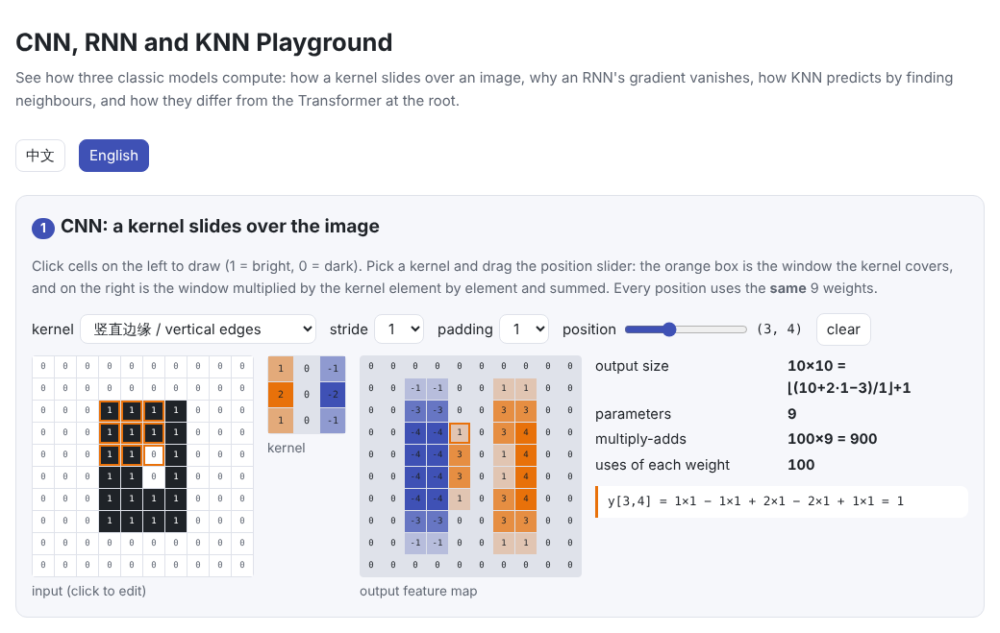
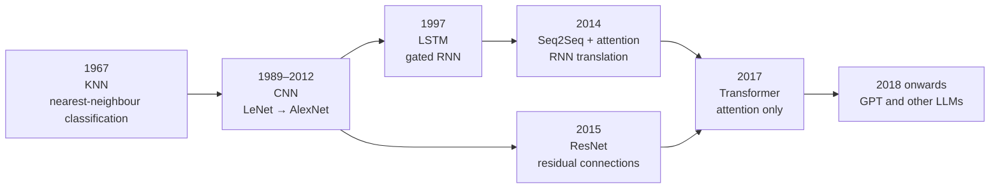
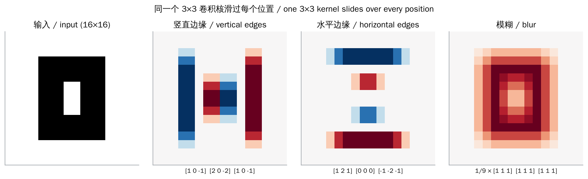
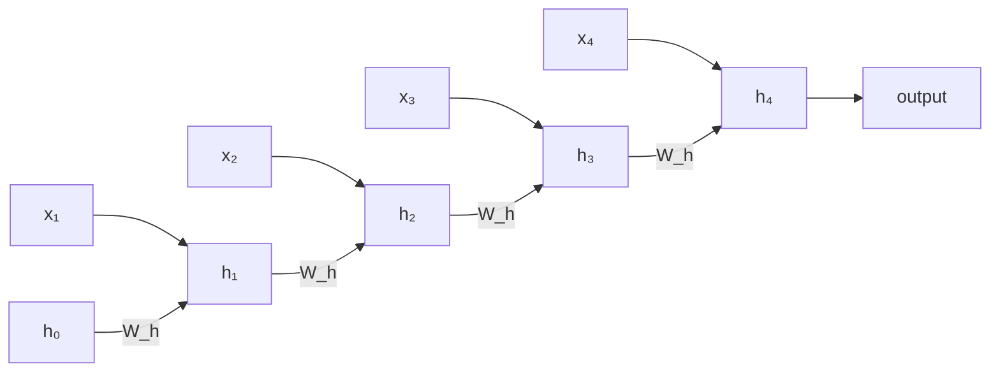
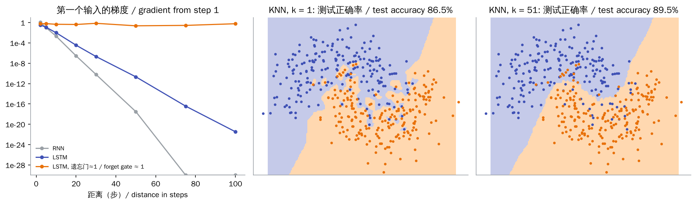
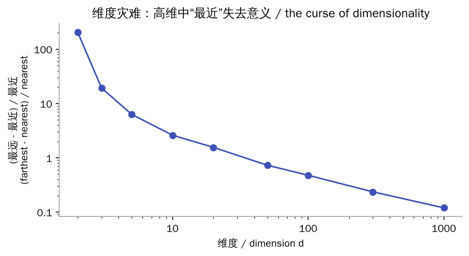

# How do CNNs, RNNs and KNN work, and how are they different from LLMs?

> 🌐 [中文](classic-models.md) · 📅 Checked: 2026-10-30 · 🏷️ CNN, RNN, LSTM, KNN, model comparison · 🎮 **[Open the playground](interactive/classic-models.html?lang=en)**

[](interactive/classic-models.html?lang=en)

## Short answer

- **CNN (convolutional neural network)**: a small kernel **slides** over the image and takes a dot product at every position. The same weights are **shared** across all positions, which makes CNNs good at local patterns (edges, textures); deeper layers see larger regions.
- **RNN (recurrent neural network)**: reads a sequence **one step at a time**, keeping a hidden state $h_t$ that remembers what came before. In a plain RNN the gradient shrinks exponentially with distance (**vanishing gradients**); the LSTM eases this with gates and a memory cell updated by addition.
- **KNN (k-nearest neighbours)**: **no training** at all. It stores every example as is, and predicts by letting the $k$ closest examples vote. Cost grows with the dataset, and in high dimensions “nearest” loses its meaning.

LLMs (Transformers) replace the CNN's local window and the RNN's step-by-step relay with attention: every token can look directly at every earlier token, and a whole sequence is processed in parallel during training. The price is compute that grows with the square of the length, plus a KV cache during generation.

None of these models has disappeared. Residual connections come from CNNs (ResNet); attention was invented for RNN translation models; RNN-like Mamba and RWKV are returning for long contexts; and KNN lives on as vector search in RAG.



## Explanation

### 1. CNNs: sliding dot products

**How it computes**: a kernel is a small weight matrix (say $3 \times 3$). Place it on the top-left of the image, multiply it element by element with the pixels it covers and add up: that is one output value. Slide one step right (or down) and repeat. Sliding over the whole image gives a **feature map**. With $C_{\text{in}}$ input channels the kernel has $C_{\text{in}}$ layers; with $C_{\text{out}}$ kernels you get $C_{\text{out}}$ feature maps.

$$
y_{c,i,j} = \sum_{c'=1}^{C_{\text{in}}} \sum_{u=1}^{K} \sum_{v=1}^{K} W_{c,c',u,v} \cdot x_{c',\, i \cdot s + u,\, j \cdot s + v} + b_c
$$



Key ideas:

| Idea | Meaning |
| --- | --- |
| **Weight sharing** | One kernel is used at every position. A 3×3, 64→64-channel layer has only about 37K parameters, whatever the image size |
| **Local receptive field** | Each output sees a small window; deeper layers see more (about $L(K-1)+1$ pixels wide after $L$ layers) |
| **Stride / padding** | Stride $s$ sets the step; padding sets how edges are handled. Output size is $\lfloor (H + 2P - K)/s \rfloor + 1$ |
| **Pooling** | Take the max or mean over a small window to shrink the map and tolerate small shifts |
| **Translation equivariance** | Wherever a pattern moves, its feature moves with it, which is why CNNs suit images |

**Compute**: each output value takes $C_{\text{in}} K^2$ multiply-adds, so a layer costs $2 \cdot H_{\text{out}} W_{\text{out}} \cdot C_{\text{out}} C_{\text{in}} K^2$ FLOPs. Few parameters, lots of compute: on a $56 \times 56$ feature map each weight is used 3,136 times.

**On a GPU**: libraries usually unfold every window into a column (**im2col**), turning the convolution into **one big matrix multiply**. This page's code checks that the sliding loops, im2col + matmul, and `F.conv2d` all agree. On hardware, CNNs and Transformers are both mostly doing matrix multiplies.

### 2. RNNs: memory passed along step by step

**How it computes**: an RNN reads $x_1, x_2, \dots$ in order. At each step it combines the current input with the previous hidden state to get a new hidden state:

$$
h_t = \tanh(W_{x} x_t + W_{h} h_{t-1} + b)
$$

The same weights $W_x, W_h$ are reused at every step (weight sharing over time). Unrolled, it looks like a very deep network with one layer per time step:



**Vanishing gradients**: training backpropagates along this chain (BPTT). The effect of input 1 on step $T$ is multiplied by $T-1$ Jacobians $\partial h_t / \partial h_{t-1}$. When their size is below 1 the product shrinks exponentially (vanishing); above 1 it explodes. Measured by this page's code:

| Distance | Plain RNN | LSTM (default init) | LSTM (forget gate ≈ 1) |
| --- | --- | --- | --- |
| 5 steps | 9.5e-02 | 1.1e-01 | 5.9e-01 |
| 20 steps | 2.9e-07 | 3.5e-05 | 4.1e-01 |
| 50 steps | 3.1e-18 | 2.1e-11 | 2.3e-01 |
| 100 steps | 0 | 3.4e-22 | 5.8e-01 |

The **LSTM** adds a memory “conveyor belt” $c_t$ controlled by three gates: the forget gate $f$ decides how much old memory to keep, the input gate $i$ how much new content to write, and the output gate $o$ how much to show.

$$
c_t = f_t \odot c_{t-1} + i_t \odot \tilde{c}_t, \qquad h_t = o_t \odot \tanh(c_t)
$$

The key is that $c_t$ is updated by **addition**: with the forget gate near 1, gradients travel far along $c$ almost undamaged. This is the same idea as the Transformer's **residual connection** (see [05 Transformer block](../05-transformer/README.en.md)). The table also shows that the LSTM only eases the problem: if the forget gate is not close to 1, gradients still vanish. In practice the forget-gate bias is often initialized to 1 or more.

**Compute and bottleneck**: each step costs about $2N$ FLOPs ($N$ parameters), the same per token as a Transformer. The real bottleneck is that it **must run sequentially**: step $t$ waits for step $t-1$, so training cannot be parallelized over time and the GPU sits mostly idle. It has an upside too: the state has a fixed size, with no growing KV cache during generation.

### 3. KNN: no training, only comparing

**How it computes**:

1. **“Training”**: store every example $(x_i, y_i)$ as is; nothing is learned.
2. **Prediction**: for a new point $q$, compute its distance to every stored example (e.g. Euclidean $\lVert q - x_i \rVert$ or cosine similarity), take the $k$ closest, and let them vote (classification) or average (regression).

**What $k$ does**: with $k = 1$ the decision boundary is very jagged and memorizes noisy points (overfitting); with a very large $k$ it becomes too smooth (underfitting). On this page's noisy “two moons” data: $k = 1$ gets 86.5%, $k = 15$ gets 89.5%, $k = 151$ gets 87.3%.

**Compute**: every query is compared with all $n$ examples, about $3nd$ FLOPs ($d$ is the dimension), and the whole dataset must stay in memory. More data means slower queries. Real systems speed this up with **approximate nearest-neighbour (ANN)** indexes such as HNSW (layered graphs), IVF (coarse buckets, then a fine search) and PQ (compressed vectors), trading a little accuracy for orders of magnitude in speed.

**The curse of dimensionality**: in high dimensions, distances between random points become nearly equal, so “nearest” and “farthest” barely differ. That is why KNN works poorly on raw high-dimensional data such as pixels. Usually a neural network first maps the data to meaningful **embeddings** (see [02 Embedding](../02-embedding/README.en.md)), and neighbours are searched in that space.





### 4. Compared with LLMs (Transformers)

| | CNN | RNN / LSTM | KNN | Transformer LLM |
| --- | --- | --- | --- | --- |
| Core operation | Convolution (dot products) in a local window | Step-by-step hidden-state update | Distances and a vote | Attention + feed-forward network |
| What is learned | Kernels (local patterns) | The state-update rule | Nothing; it stores data | Attention projections and FFN weights |
| Built-in assumptions (inductive bias) | Locality, translation equivariance | Order, recent matters more | Nearby points share labels | Few; mostly learned from data |
| How far it sees | A local window that grows with depth | Unbounded in theory, limited by vanishing gradients in practice | The whole dataset | The whole context window; any two positions are one step apart |
| Parallel training? | ✅ | ❌ step by step | No training | ✅ the whole sequence at once |
| Memory at inference | Fixed | A fixed-size state | The whole dataset | A KV cache that grows with the context |
| Compute grows with | Image resolution | Sequence length (linearly) | Data size × dimension | Parameters × tokens; attention grows with length squared |
| Typical uses | Images, speech, early text classification | Speech, translation (before 2017) | Small-data classification, recommendation, vector search | Language, code, multimodal |

Why did Transformers replace RNNs? Two main reasons:

1. **Parallelism**: an RNN must go step by step, while a Transformer processes a whole sequence at once during training and can keep thousands of GPUs busy.
2. **Long-range dependencies**: in an RNN, two words $n$ steps apart are connected through $n$ hand-offs, so information and gradients fade; attention connects any two positions directly.

The price is compute that grows with the square of the length, and the KV cache at inference (see [How LLM compute is counted](compute.en.md)). Transformers also build in fewer assumptions, so they need more data to learn well; with enough data, that turns into an advantage.

### 5. Where they stand in the LLM era

- **CNNs**: Vision Transformers (ViT) can beat CNNs given enough data, but CNNs remain common on devices and with small datasets. Residual connections and normalization layers also carried over from the CNN era.
- **RNNs**: Mamba (a state-space model) and RWKV combine the RNN's fixed-size state with parallel training. Linear attention can also be written as an RNN. They attract interest for long contexts and low-memory inference.
- **KNN**: vector search in RAG is KNN in embedding space (see 19 RAG and vector databases, planned). kNN-LM (Khandelwal et al., 2020) combined a language model's predictions with nearest-neighbour retrieval over its training data and lowered perplexity.

## Why it matters

- **Understanding where LLM designs come from**: attention, residual connections and gating all come from these earlier models.
- **Picking the right tool**: with little data, little compute or a simple task, a CNN, a small RNN or even KNN is often better and cheaper.
- **Reading new architectures**: many “new” architectures recombine old ideas; Mamba revives the RNN, and RAG pairs KNN with an LLM.

## Code

[`code/classic_models.py`](code/classic_models.py) implements convolution (sliding loops and im2col), an RNN, an LSTM and KNN from scratch, checks them against `F.conv2d`, `nn.RNN`, `nn.LSTM` and brute-force search, and measures vanishing gradients and the curse of dimensionality. Run `python docs/qa/code/classic_models.py`; it takes a few seconds.

```python
def conv2d_im2col(x, w, stride=1, padding=0):
    c_out, c_in, k, _ = w.shape
    cols = F.unfold(x[None], k, padding=padding, stride=stride)[0]   # every window becomes a column
    h_out = (x.shape[1] + 2 * padding - k) // stride + 1
    return (w.reshape(c_out, -1) @ cols).reshape(c_out, h_out, -1)   # one matrix multiply

def lstm_forward(x, w_ih, w_hh, b_ih, b_hh):
    ...
    for x_t in x:                                   # strictly one step at a time
        i, f, g, o = (w_ih @ x_t + b_ih + w_hh @ h + b_hh).split(d)
        c = f.sigmoid() * c + i.sigmoid() * g.tanh()     # memory updated by addition
        h = o.sigmoid() * c.tanh()
```

## Related chapters

- [02 Embedding](../02-embedding/README.en.md): KNN works well in embedding space
- [04 Attention](../04-attention/README.en.md): how attention replaced the RNN's step-by-step relay
- [05 Transformer block](../05-transformer/README.en.md): residual connections and the LSTM's additive memory
- [How LLM compute is counted](compute.en.md): compute and bottlenecks compared across models
- **[14 Long context](../14-long-context/README.en.md)**, **16 Multimodal**, **19 RAG and vector databases** (planned): linear attention and state-space models, ViT, vector search

## Sources

- Cover & Hart, 1967. [Nearest Neighbor Pattern Classification](https://doi.org/10.1109/TIT.1967.1053964)
- LeCun et al., 1989. [Backpropagation Applied to Handwritten Zip Code Recognition](https://doi.org/10.1162/neco.1989.1.4.541) (an early CNN)
- Krizhevsky et al., 2012. [ImageNet Classification with Deep Convolutional Neural Networks](https://papers.nips.cc/paper/4824-imagenet-classification-with-deep-convolutional-neural-networks) (AlexNet)
- He et al., 2015. [Deep Residual Learning for Image Recognition](https://arxiv.org/abs/1512.03385) (ResNet)
- Hochreiter & Schmidhuber, 1997. [Long Short-Term Memory](https://doi.org/10.1162/neco.1997.9.8.1735)
- Bengio et al., 1994. [Learning Long-Term Dependencies with Gradient Descent is Difficult](https://doi.org/10.1109/72.279181) (vanishing gradients)
- Jozefowicz et al., 2015. [An Empirical Exploration of Recurrent Network Architectures](https://proceedings.mlr.press/v37/jozefowicz15.html) (forget-gate bias of 1)
- Bahdanau et al., 2014. [Neural Machine Translation by Jointly Learning to Align and Translate](https://arxiv.org/abs/1409.0473) (attention)
- Vaswani et al., 2017. [Attention Is All You Need](https://arxiv.org/abs/1706.03762)
- Dosovitskiy et al., 2020. [An Image is Worth 16x16 Words](https://arxiv.org/abs/2010.11929) (ViT)
- Gu & Dao, 2023. [Mamba: Linear-Time Sequence Modeling with Selective State Spaces](https://arxiv.org/abs/2312.00752)
- Peng et al., 2023. [RWKV: Reinventing RNNs for the Transformer Era](https://arxiv.org/abs/2305.13048)
- Khandelwal et al., 2020. [Generalization through Memorization: Nearest Neighbor Language Models](https://arxiv.org/abs/1911.00172)
- Malkov & Yashunin, 2016. [Efficient and robust approximate nearest neighbor search using HNSW graphs](https://arxiv.org/abs/1603.09320)
- Beyer et al., 1999. [When Is “Nearest Neighbor” Meaningful?](https://doi.org/10.1007/3-540-49257-7_15) (the curse of dimensionality)
