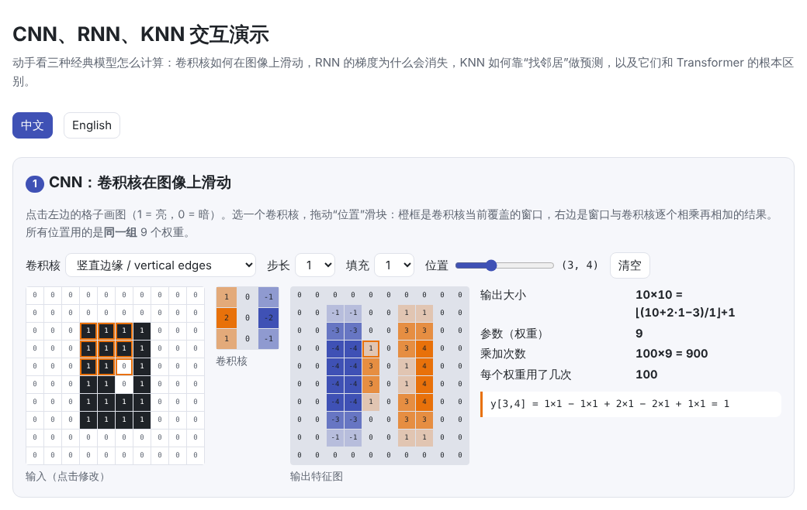
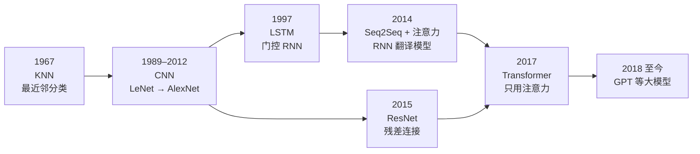
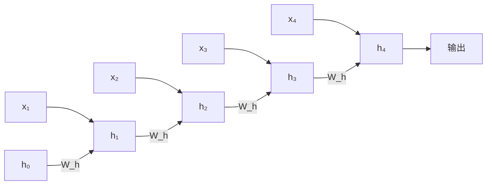

# CNN、RNN、KNN 是怎么工作的？和大模型有什么不同？

> 🌐 [English](classic-models.en.md) · 📅 核实日期：2026-10-30 · 🏷️ CNN、RNN、LSTM、KNN、模型对比 · 🎮 **[打开交互演示](interactive/classic-models.html?lang=zh)**

[](interactive/classic-models.html?lang=zh)

## 一句话回答

- **CNN（卷积神经网络）**：用一个小的卷积核在图像上**滑动**，每个位置做一次点积。同一组权重在所有位置**共享**，擅长发现局部图案（边缘、纹理），层数越深，看到的范围越大。
- **RNN（循环神经网络）**：**一步一步**读序列，用一个隐藏状态 $h_t$ 记住前面的内容。普通 RNN 的梯度会随距离指数衰减（**梯度消失**），LSTM 用门控和“加法”更新的记忆单元缓解了这个问题。
- **KNN（k 近邻）**：**不训练**，把所有样本原样存下来；预测时找最近的 $k$ 个样本投票。成本随数据量增长，维度很高时“最近”会失去意义。

大模型（Transformer）用注意力代替了卷积的“局部窗口”和 RNN 的“逐步传递”：每个词元可以直接看到前面所有词元，训练时整段序列并行计算。代价是计算量随长度平方增长，生成时要保存 KV 缓存。

这几种模型并没有消失：残差连接来自 CNN（ResNet），注意力最早是为 RNN 翻译模型发明的，类 RNN 的 Mamba、RWKV 正在长上下文场景中复兴，KNN 则以向量检索的形式出现在 RAG 中。



## 详细解释

### 1. CNN：滑动的点积

**计算机制**：卷积核是一个小的权重矩阵（例如 $3 \times 3$）。把它放在图像左上角，与覆盖的像素逐个相乘再相加，得到一个输出值；向右（或向下）滑动一格，再算一次……滑遍全图，就得到一张**特征图**。有 $C_{\text{in}}$ 个输入通道时，卷积核也有 $C_{\text{in}}$ 层；有 $C_{\text{out}}$ 个卷积核，就输出 $C_{\text{out}}$ 张特征图。

$$
y_{c,i,j} = \sum_{c'=1}^{C_{\text{in}}} \sum_{u=1}^{K} \sum_{v=1}^{K} W_{c,c',u,v} \cdot x_{c',\, i \cdot s + u,\, j \cdot s + v} + b_c
$$


几个关键概念：

| 概念 | 含义 |
| --- | --- |
| **权重共享** | 同一个卷积核用于所有位置。$3 \times 3$、64→64 通道的卷积层只有约 3.7 万个参数，与图像大小无关 |
| **局部感受野** | 每个输出只看一个小窗口；层数越多，能看到的范围越大（第 $L$ 层约为 $L(K-1)+1$ 个像素宽） |
| **步长 / 填充** | 步长 $s$ 决定滑动间隔，填充决定边缘怎么处理。输出边长为 $\lfloor (H + 2P - K)/s \rfloor + 1$ |
| **池化** | 在小窗口内取最大值或平均值，缩小特征图，让模型对小的平移不敏感 |
| **平移等变** | 图案移动到哪里，特征就出现在哪里，这是 CNN 适合图像的原因 |

**计算量**：每个输出值需要 $C_{\text{in}} K^2$ 次乘加，所以一层的计算量是 $2 \cdot H_{\text{out}} W_{\text{out}} \cdot C_{\text{out}} C_{\text{in}} K^2$ 次运算。参数少、计算量大：$56 \times 56$ 的特征图上，每个权重要被用 3136 次。

**GPU 上怎么算**：深度学习库通常把每个窗口展开成一列（**im2col**），把卷积变成**一次大的矩阵乘法**。本页的代码验证了“滑动循环”“im2col + 矩阵乘法”和 `F.conv2d` 三者结果一致。所以 CNN 和 Transformer 在硬件上本质上都在做矩阵乘法。

### 2. RNN：一步一步传递的记忆

**计算机制**：RNN 按顺序读入 $x_1, x_2, \dots$，每一步把当前输入和上一步的隐藏状态合起来，得到新的隐藏状态：

$$
h_t = \tanh(W_{x} x_t + W_{h} h_{t-1} + b)
$$

同一组权重 $W_x, W_h$ 在每个时间步重复使用（时间上的权重共享）。把循环“展开”后，它就像一个很深的网络，每一层对应一个时间步：



**梯度消失**：训练时要沿着这条链反向传播（BPTT）。第 1 步的输入对第 $T$ 步的影响，要乘上 $T-1$ 个雅可比矩阵 $\partial h_t / \partial h_{t-1}$。它们的“大小”小于 1 时，乘积按指数缩小（梯度消失）；大于 1 时则爆炸。本页代码的测量结果：

| 距离 | 普通 RNN | LSTM（默认初始化） | LSTM（遗忘门 ≈ 1） |
| --- | --- | --- | --- |
| 5 步 | 9.5e-02 | 1.1e-01 | 5.9e-01 |
| 20 步 | 2.9e-07 | 3.5e-05 | 4.1e-01 |
| 50 步 | 3.1e-18 | 2.1e-11 | 2.3e-01 |
| 100 步 | 0 | 3.4e-22 | 5.8e-01 |

**LSTM** 的办法是增加一条记忆“传送带” $c_t$，用三个门控制：遗忘门 $f$ 决定保留多少旧记忆，输入门 $i$ 决定写入多少新内容，输出门 $o$ 决定输出多少。

$$
c_t = f_t \odot c_{t-1} + i_t \odot \tilde{c}_t, \qquad h_t = o_t \odot \tanh(c_t)
$$

关键是 $c_t$ 用**加法**更新：遗忘门接近 1 时，梯度可以沿着 $c$ 几乎无损地传很远。这和 Transformer 的**残差连接**（见 [05 Transformer 结构](../05-transformer/README.md)）是同一个思路。不过上表也说明，LSTM 只是缓解了问题：遗忘门不接近 1 时，梯度仍会消失。实践中常把遗忘门的偏置初始化为 1 或更大。

**计算量与瓶颈**：每个时间步约 $2N$ 次运算（$N$ 是参数量），这一点与 Transformer 每个词元的计算量相同。真正的瓶颈是**必须串行**：第 $t$ 步要等第 $t-1$ 步算完，训练时无法沿时间并行，GPU 大部分时间吃不饱。但它也有优点：状态大小固定，生成时不需要不断增长的 KV 缓存。

### 3. KNN：不训练，只比较

**计算机制**：

1. **“训练”**：把所有样本 $(x_i, y_i)$ 原样存下来，什么也不学。
2. **预测**：对新样本 $q$，计算它到每个已存样本的距离（如欧氏距离 $\lVert q - x_i \rVert$ 或余弦相似度），取最近的 $k$ 个，按多数投票（分类）或取平均（回归）。

**$k$ 的作用**：$k = 1$ 时决策边界非常曲折，会把噪声点也记住（过拟合）；$k$ 太大时边界过于平滑（欠拟合）。本页代码在带噪声的“双月”数据上测得：$k = 1$ 为 86.5%，$k = 15$ 为 89.5%，$k = 151$ 为 87.3%。

**计算量**：每次查询都要与全部 $n$ 个样本比较，约 $3nd$ 次运算（$d$ 是维度），还要把整个数据集放在内存里。数据越多，查询越慢。实际系统用 **近似最近邻（ANN）** 索引来加速，如 HNSW（分层图）、IVF（先粗分再细找）、PQ（向量压缩），以少量精度换取几个数量级的速度。

**维度灾难**：维度很高时，随机点之间的距离会变得差不多，“最近”和“最远”区别很小。所以 KNN 在原始像素这类高维数据上效果不好，通常要先用神经网络把数据映射成有意义的**嵌入向量**（见 [02 词嵌入](../02-embedding/README.md)），再在嵌入空间里找近邻。


### 4. 和大模型（Transformer）对比

| | CNN | RNN / LSTM | KNN | Transformer 大模型 |
| --- | --- | --- | --- | --- |
| 核心操作 | 局部窗口内的卷积（点积） | 隐藏状态逐步更新 | 计算距离、投票 | 注意力 + 前馈网络 |
| 学到了什么 | 卷积核（局部图案） | 状态更新规则 | 不学习，存数据 | 注意力投影与前馈网络的权重 |
| 内置假设（归纳偏置） | 局部性、平移等变 | 顺序性、近期更重要 | 相近的样本标签相同 | 很少，主要靠数据学 |
| 看多远 | 随层数增长的局部窗口 | 理论上无限，实际受梯度消失限制 | 整个数据集 | 整个上下文窗口，任意两个位置一步可达 |
| 训练能否并行 | ✅ | ❌ 必须逐步 | 无需训练 | ✅ 整段序列一起算 |
| 推理时的内存 | 固定 | 固定大小的状态 | 整个数据集 | KV 缓存随上下文增长 |
| 计算量随什么增长 | 图像分辨率 | 序列长度（线性） | 数据量 × 维度 | 参数量 × 词元数，注意力随长度平方 |
| 典型用途 | 图像、语音、早期文本分类 | 语音、翻译（2017 年前） | 小数据分类、推荐、向量检索 | 语言、代码、多模态 |

为什么 Transformer 取代了 RNN？主要有两点：

1. **并行**：RNN 必须逐步计算，Transformer 训练时整段序列一次算完，能用满成千上万张 GPU。
2. **长距离依赖**：RNN 中相距 $n$ 步的两个词要经过 $n$ 次传递，信息和梯度都会衰减；注意力让任意两个位置直接相连。

它付出的代价是计算量随长度平方增长，以及推理时的 KV 缓存（见[大模型的算力怎么算](compute.md)）。Transformer 的内置假设也更少，所以需要更多数据才能学好；数据足够多时，这反而成了优势。

### 5. 它们在大模型时代的位置

- **CNN**：视觉 Transformer（ViT）在大数据上已能超过 CNN，但 CNN 在端侧和小数据场景仍很常用。残差连接、归一化等技术也是从 CNN 时代沿用下来的。
- **RNN**：Mamba（状态空间模型）、RWKV 等架构把 RNN“固定大小状态”的优点与可并行训练结合起来。线性注意力在数学上也可以写成 RNN 的形式。它们在长上下文、低显存推理场景很受关注。
- **KNN**：RAG 中的向量检索本质上就是在嵌入空间里做 KNN（见 17 提示工程与 RAG，计划中）。kNN-LM（Khandelwal 等，2020）把语言模型的预测与“在训练数据中检索最近邻”结合，降低了困惑度。

## 为什么重要

- **理解大模型的设计来源**：注意力、残差连接、门控等思想都来自这些更早的模型。
- **选对工具**：数据少、资源少、任务简单时，CNN、小 RNN 甚至 KNN 往往更合适、更便宜。
- **看懂新架构**：很多“新”架构是在重新组合这些老思想，例如 Mamba 是 RNN 的复兴，RAG 是 KNN 与大模型的结合。

## 代码

[`code/classic_models.py`](code/classic_models.py)：从零实现卷积（滑动循环与 im2col）、RNN、LSTM 和 KNN，并分别与 `F.conv2d`、`nn.RNN`、`nn.LSTM` 和暴力搜索对比，还测量了梯度消失和维度灾难。运行 `python docs/qa/code/classic_models.py`，只需几秒。

```python
def conv2d_im2col(x, w, stride=1, padding=0):
    c_out, c_in, k, _ = w.shape
    cols = F.unfold(x[None], k, padding=padding, stride=stride)[0]   # 每个窗口展开成一列
    h_out = (x.shape[1] + 2 * padding - k) // stride + 1
    return (w.reshape(c_out, -1) @ cols).reshape(c_out, h_out, -1)   # 一次矩阵乘法

def lstm_forward(x, w_ih, w_hh, b_ih, b_hh):
    ...
    for x_t in x:                                   # 只能逐步计算
        i, f, g, o = (w_ih @ x_t + b_ih + w_hh @ h + b_hh).split(d)
        c = f.sigmoid() * c + i.sigmoid() * g.tanh()     # 加法更新的记忆
        h = o.sigmoid() * c.tanh()
```

## 与知识库的关系

- [02 词嵌入](../02-embedding/README.md)：KNN 在嵌入空间里才好用
- [04 注意力机制](../04-attention/README.md)：注意力如何取代 RNN 的逐步传递
- [05 Transformer 结构](../05-transformer/README.md)：残差连接与 LSTM 的“加法记忆”
- [大模型的算力怎么算](compute.md)：各种模型的计算量与瓶颈对比
- **14 长上下文**、**16 多模态**、**17 提示工程与 RAG**（计划中）：线性注意力与状态空间模型、ViT、向量检索

## 来源

- Cover & Hart, 1967. [Nearest Neighbor Pattern Classification](https://doi.org/10.1109/TIT.1967.1053964)
- LeCun et al., 1989. [Backpropagation Applied to Handwritten Zip Code Recognition](https://doi.org/10.1162/neco.1989.1.4.541)（早期 CNN）
- Krizhevsky et al., 2012. [ImageNet Classification with Deep Convolutional Neural Networks](https://papers.nips.cc/paper/4824-imagenet-classification-with-deep-convolutional-neural-networks)（AlexNet）
- He et al., 2015. [Deep Residual Learning for Image Recognition](https://arxiv.org/abs/1512.03385)（ResNet）
- Hochreiter & Schmidhuber, 1997. [Long Short-Term Memory](https://doi.org/10.1162/neco.1997.9.8.1735)
- Bengio et al., 1994. [Learning Long-Term Dependencies with Gradient Descent is Difficult](https://doi.org/10.1109/72.279181)（梯度消失）
- Jozefowicz et al., 2015. [An Empirical Exploration of Recurrent Network Architectures](https://proceedings.mlr.press/v37/jozefowicz15.html)（遗忘门偏置初始化为 1）
- Bahdanau et al., 2014. [Neural Machine Translation by Jointly Learning to Align and Translate](https://arxiv.org/abs/1409.0473)（注意力）
- Vaswani et al., 2017. [Attention Is All You Need](https://arxiv.org/abs/1706.03762)
- Dosovitskiy et al., 2020. [An Image is Worth 16x16 Words](https://arxiv.org/abs/2010.11929)（ViT）
- Gu & Dao, 2023. [Mamba: Linear-Time Sequence Modeling with Selective State Spaces](https://arxiv.org/abs/2312.00752)
- Peng et al., 2023. [RWKV: Reinventing RNNs for the Transformer Era](https://arxiv.org/abs/2305.13048)
- Khandelwal et al., 2020. [Generalization through Memorization: Nearest Neighbor Language Models](https://arxiv.org/abs/1911.00172)
- Malkov & Yashunin, 2016. [Efficient and robust approximate nearest neighbor search using HNSW graphs](https://arxiv.org/abs/1603.09320)
- Beyer et al., 1999. [When Is “Nearest Neighbor” Meaningful?](https://doi.org/10.1007/3-540-49257-7_15)（维度灾难）
