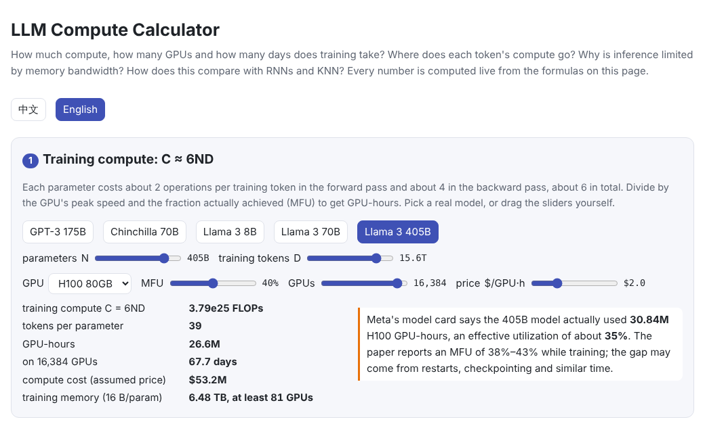
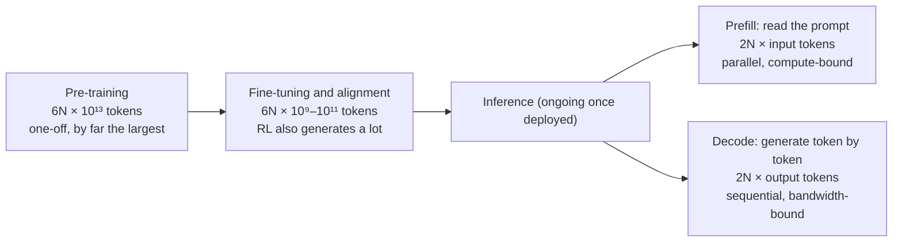

# How is LLM compute measured, where does it go, and why is it so much more than RNNs, CNNs or KNN?

> 🌐 [中文](compute.md) · 📅 Checked: 2026-10-30 · 🏷️ compute, FLOPs, training cost, inference cost · 🎮 **[Open the compute calculator](interactive/compute.html?lang=en)**

[](interactive/compute.html?lang=en)

## Short answer

Compute is measured in **floating-point operations (FLOPs)**: multiplying an $(m \times k)$ matrix by a $(k \times n)$ matrix takes $2mkn$ of them. For Transformers there is a very handy estimate: a model with $N$ parameters needs **about $2N$ FLOPs per token for a forward pass and about $6N$ per token for training**, so training costs about $6ND$ in total ($D$ is the number of training tokens). Almost all of it is matrix multiplication, mostly in the feed-forward networks and the attention projections. With long contexts, attention scores become a large share too.

At inference time the bottleneck is often not compute but **memory bandwidth and memory capacity**: when generating token by token, every step must read all the weights from GPU memory.

Compared with RNNs, CNNs and KNN, an LLM **does not spend more compute per parameter**. It is expensive in four other ways: parameters and data are orders of magnitude larger; attention cost grows with the square of the sequence length; generation keeps a growing KV cache; and decoding has to produce one token after another.

## Explanation

### 1. Units for measuring compute

| Unit | Meaning | Example |
| --- | --- | --- |
| **FLOP / FLOPs** | One / several floating-point operations (one multiply or one add): an **amount** of work | Pre-training Llama 3 405B took about $3.8 \times 10^{25}$ FLOPs |
| **FLOP/s** | Floating-point operations per second: hardware **speed** | H100 SXM peaks at about 989 TFLOP/s dense BF16 ($9.89 \times 10^{14}$) |
| **MAC** | One multiply-accumulate = 2 FLOPs | CNN papers often call MACs “FLOPs”; watch for the factor of 2 |
| **Memory bandwidth** | Bytes per second that can be moved to and from GPU memory | H100 SXM: about 3.35 TB/s |
| **MFU** | Achieved compute ÷ hardware peak (model FLOPs utilization) | Large training runs usually reach 30%–50% |
| **GPU-hours** | How many GPUs for how many hours | What finally turns into money and electricity |

> **Note**: “FLOPs” sometimes means a count and sometimes (as FLOPS) a rate per second. Check which one a number means.

### 2. Where $2N$ and $6N$ come from

Every weight in the model takes part in **one multiply and one add** for each token (each $W_{ij}$ in $y = Wx$ is used exactly once), so a forward pass costs about $2N$ FLOPs.

Training also needs backpropagation, which computes two kinds of gradient: with respect to the activations (passed back to the previous layer) and with respect to the weights (used for the update). Each costs about as much as the forward pass, so

$$
\text{training per token} \approx \underbrace{2N}_{\text{forward}} + \underbrace{4N}_{\text{backward}} = 6N, \qquad C_{\text{train}} \approx 6ND
$$

Part of attention's work **involves no parameters at all**: scoring every earlier token's $k$ with $q$, then taking a weighted sum of the $v$ vectors. With context length $n_{\text{ctx}}$, a causal token looks at $n_{\text{ctx}}/2$ tokens on average, which costs about $2 \cdot n_{\text{layer}} \cdot n_{\text{ctx}} \cdot d$ forward FLOPs (Kaplan et al., 2020). It is negligible for short contexts and grows as the context gets longer:


This page's code checks these formulas against PyTorch's own counter, `torch.utils.flop_counter`, and they agree:

```text
GPT: 914,432 matmul weights, 64 tokens
  forward  1,959,936 FLOPs/token = 2N + attention  ✓ matches PyTorch  (2N = 1,828,864)
  training 5,945,344 FLOPs/token, 3.03x the forward pass (≈ 6N)
  7B model, context   1024: attention is  2.0% of forward FLOPs per token
  7B model, context   8192: attention is 14.2% of forward FLOPs per token
  7B model, context 131072: attention is 72.6% of forward FLOPs per token
```

### 3. A check with real numbers

Llama 3 405B was pre-trained on 15.6 trillion ($15.6 \times 10^{12}$) tokens:

$$
6ND = 6 \times 405 \times 10^9 \times 15.6 \times 10^{12} \approx 3.79 \times 10^{25}\ \text{FLOPs}
$$

This matches the $3.8 \times 10^{25}$ FLOPs reported in the Llama 3 paper.

Now convert that to time. Meta's model card says training the 405B model took **30.84 million H100 GPU-hours**. Had every GPU run at its 989 TFLOP/s peak, those GPU-hours would have done

$$
30.84 \times 10^6 \times 3600 \times 989 \times 10^{12} \approx 1.10 \times 10^{26}\ \text{FLOPs}
$$

Only about 35% of that was useful work. The paper reports an MFU of 38%–43% while training, and the rest of the gap may come from restarts after failures, checkpointing and other time not spent training. At an assumed $2 per GPU-hour, the compute alone comes to about $60 million. That price is an assumption, not an official figure.

> **🎮 Try it**: in the [compute calculator](interactive/compute.html?lang=en), pick a model, a GPU and an MFU and see how many days and GPUs training takes.

### 4. Which stages use the most compute



| Stage | Compute | Main bottleneck | Notes |
| --- | --- | --- | --- |
| Pre-training | $6ND$, around $10^{25}$ for frontier models | Compute, communication between GPUs | One-off, but the largest |
| Memory during training | About 16 bytes per parameter with mixed-precision AdamW | Memory capacity | A 7B model needs about 110 GB before activations, more than one 80 GB GPU (see [08 Fine-tuning](../08-finetuning/README.en.md)) |
| Fine-tuning, alignment | $6N \times$ far fewer tokens | Compute | Reinforcement learning makes the model generate many answers, and generating is inference |
| Inference: prefill | $2N$ per input token | Compute | The whole prompt is processed in parallel |
| Inference: decode | $2N$ per output token | **Memory bandwidth** | Every step reads all the weights; see the figure below |
| Inference: KV cache | $2 \times n_{\text{layer}} \times n_{\text{kv}} \times d_{\text{head}} \times$ bytes per token | Memory capacity | Llama 2 7B (BF16): about 0.5 MB per token, about 2 GB per request at 4K context |
| “Thinking” in reasoning models | Longer thinking means more decoding | Bandwidth, latency | See [reasoning effort](reasoning-effort.en.md) |

Why is decoding bandwidth-bound? Take a 7B model with a batch of 1. Generating one token takes about $1.3 \times 10^{10}$ FLOPs, which an H100 does in about 13 microseconds. But it must also read about 13 GB of weights from memory, which takes about 4 milliseconds, so the compute units spend most of their time waiting for data. The fix is **batching**: one read of the weights serves a whole batch of requests, each getting one new token.


Over a model's lifetime, inference can add up to more than training: if a model generates trillions of tokens for its users, $2N \times$ inference tokens soon catches up with $6ND$ (see section 3.5 of [07 Scaling laws](../07-scaling-laws/README.en.md)).

### 5. Compared with RNNs, CNNs and KNN

| | Transformer LLM | RNN / LSTM | CNN | KNN |
| --- | --- | --- | --- | --- |
| Compute per example | $2N$ per token + attention (grows with context) | About $2N$ per token | About $2 \times$ MACs per image, proportional to resolution | Each query is compared with all $n$ stored examples: about $3nd$ |
| Uses of each weight | Once per token | Once per time step | Reused at every pixel, hundreds to thousands of times | No weights; it stores the data itself |
| Parallel training? | ✅ The whole sequence at once | ❌ Step $t$ waits for step $t-1$ | ✅ | No training needed |
| Memory while generating or querying | KV cache grows with the context | A fixed-size hidden state | Fixed | The whole dataset |
| Typical scale | $10^9$–$10^{12}$ parameters, $10^{12}$–$10^{13}$ training tokens | Historically $10^7$–$10^8$ parameters | ResNet-50: 25.6M parameters, about 3.8 billion multiply-adds per image | Depends on the dataset |
| What is expensive | Scale, long contexts, KV cache, sequential decoding | Training is hard to parallelize, GPUs sit idle | Large at high resolution | More data means slower queries and more memory |

What to take from this:

- **Compute per parameter is not higher.** This page's code confirms that an LSTM also costs $2N$ per token. CNNs actually do more work per parameter: one $3 \times 3$ kernel is reused 3,136 times on a $56 \times 56$ feature map.
- **Transformers are expensive because they scale.** An RNN must go step by step and struggles to keep a GPU busy. A Transformer processes a whole sequence in parallel during training, so it can make good use of tens of thousands of GPUs. Scaling laws then show that more compute gives better results (see [07 Scaling laws](../07-scaling-laws/README.en.md)), so people make both models and datasets bigger.
- **RNNs have an advantage at inference**: their state has a fixed size, with no growing KV cache. This is one reason RNN-like architectures such as Mamba and RWKV are getting attention again for long contexts.
- **KNN is a different idea.** It does not train or compress anything; it keeps the data as is and compares every query with all of it, so cost grows with the dataset, and in practice approximate nearest-neighbour indexes such as HNSW or IVF are used. An LLM in effect compresses its data into parameters, so a query costs the same whatever the training set size. Vector search in RAG is a direct use of KNN (see 17 Prompting and RAG, planned).

### 6. Common misconceptions

- **“Fewer FLOPs means faster”**: not necessarily. Decoding is mostly limited by bandwidth, and FlashAttention speeds attention up by reducing memory traffic, not the amount of arithmetic.
- **“An MoE model's compute follows its total parameters”**: each token only activates some experts, so compute follows the **active parameters**. DeepSeek-V3, for example, has 671B parameters in total but activates 37B per token.
- **“6ND is exact”**: it ignores attention scores, normalization, activation functions and so on. The error is noticeable for very long contexts or very small models.
- **“FLOPs in CNN papers mean the same thing”**: many CNN papers report multiply-adds as “FLOPs”, a factor of 2 lower than the convention here.

## Why it matters

- **Planning a budget**: before training, you can estimate how many GPUs, days and dollars it will take. [Scaling laws](../07-scaling-laws/README.en.md) are framed in terms of a fixed compute budget.
- **Understanding inference optimization**: KV caching, quantization, batching, speculative decoding and MoE all trade between three resources: compute, bandwidth and memory.
- **Judging architectures**: what training, inference and long-context processing each cost for the same quality decides whether an architecture is practical.

## Code

[`code/flops.py`](code/flops.py) uses `torch.utils.flop_counter.FlopCounterMode` to check the FLOP formulas for a matrix multiply, a GPT (forward $2N$, training about $6N$), an LSTM and a CNN, and times a brute-force KNN search. Run `python docs/qa/code/flops.py`; it takes a few seconds.

```python
def gpt_forward_flops(n_matmul, n_layers, d, t):
    return 2 * n_matmul * t + 4 * n_layers * t * t * d   # 2N per token + attention

with FlopCounterMode(display=False) as counter:
    model(ids)
assert counter.get_total_flops() == gpt_forward_flops(n, n_layers, d, t)
```

## Related chapters

- [04 Attention](../04-attention/README.en.md): attention cost grows with the square of the sequence length
- [05 Transformer block](../05-transformer/README.en.md): the feed-forward network holds most of the parameters and compute
- [06 Pre-training](../06-pretraining/README.en.md): the training loop and MFU
- [07 Scaling laws](../07-scaling-laws/README.en.md): $C \approx 6ND$ and compute-optimal allocation
- [08 Fine-tuning](../08-finetuning/README.en.md): the memory bill of training, and how LoRA and QLoRA cut it
- **12 Inference optimization** and **13 Serving systems** (planned): KV cache, quantization, batching

## Sources

- Kaplan et al., 2020. [Scaling Laws for Neural Language Models](https://arxiv.org/abs/2001.08361) (Table 1: forward FLOPs per token $2N + 2 n_{\text{layer}} n_{\text{ctx}} d$)
- Llama Team, Meta, 2024. [The Llama 3 Herd of Models](https://arxiv.org/abs/2407.21783) (405B: 15.6T tokens, $3.8 \times 10^{25}$ FLOPs, MFU 38%–43%)
- Meta. [Llama 3.1 Model Card](https://github.com/meta-llama/llama-models/blob/main/models/llama3_1/MODEL_CARD.md) (405B: 30.84M H100-80GB GPU-hours)
- NVIDIA. [H100 Tensor Core GPU](https://www.nvidia.com/en-us/data-center/h100/) (about 989 TFLOP/s dense BF16, half the quoted sparse figure of 1,979; HBM3 3.35 TB/s)
- Chowdhery et al., 2022. [PaLM: Scaling Language Modeling with Pathways](https://arxiv.org/abs/2204.02311) (introduces MFU)
- Pope et al., 2022. [Efficiently Scaling Transformer Inference](https://arxiv.org/abs/2211.05102) (compute vs bandwidth limits in inference)
- Dao et al., 2022. [FlashAttention](https://arxiv.org/abs/2205.14135) (faster attention through less memory traffic)
- He et al., 2015. [Deep Residual Learning for Image Recognition](https://arxiv.org/abs/1512.03385) (ResNet-50: about 3.8 billion multiply-adds)
- DeepSeek-AI, 2024. [DeepSeek-V3 Technical Report](https://arxiv.org/abs/2412.19437) (671B total, 37B active parameters)
- PyTorch. [torch.utils.flop_counter](https://github.com/pytorch/pytorch/blob/main/torch/utils/flop_counter.py)

> Hardware specs and prices change quickly; check the vendor's latest figures before relying on them. The cost figure on this page is a rough estimate based on an assumed price.
