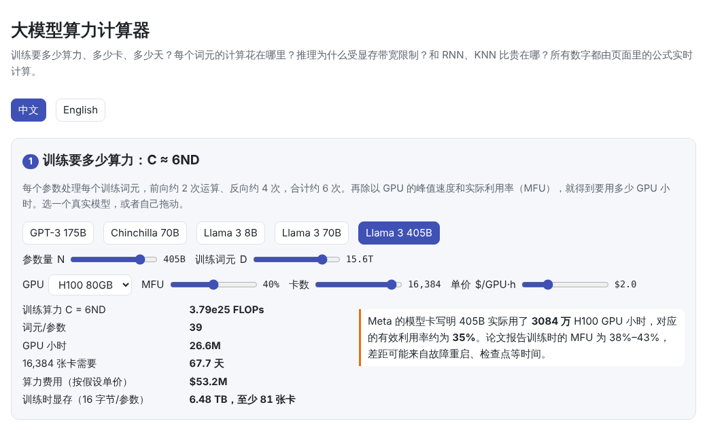
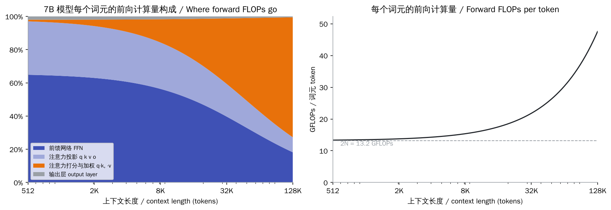
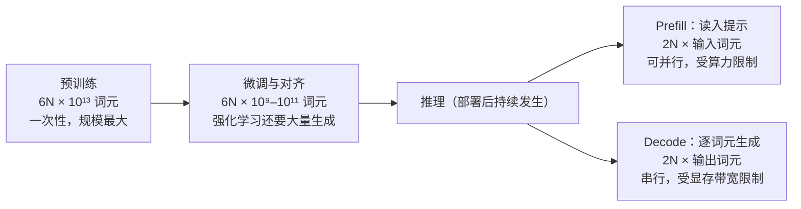
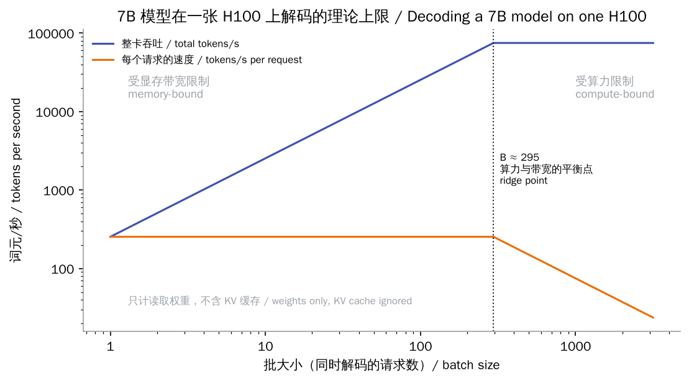

# 大模型的算力怎么量化？哪些环节最耗算力？和 RNN、CNN、KNN 比贵在哪？

> 🌐 [English](compute.en.md) · 📅 核实日期：2026-10-30 · 🏷️ 算力、FLOPs、训练成本、推理成本 · 🎮 **[打开算力计算器](interactive/compute.html?lang=zh)**

[](interactive/compute.html?lang=zh)

## 一句话回答

算力用**浮点运算次数（FLOPs）**来量化：两个矩阵 $(m \times k)$ 与 $(k \times n)$ 相乘需要 $2mkn$ 次运算。对 Transformer 有一个很好用的估算：参数量为 $N$ 的模型，**处理一个词元的前向计算约需 $2N$ 次运算，训练约需 $6N$ 次**，所以训练总算力约为 $6ND$（$D$ 为训练词元数）。绝大部分算力花在矩阵乘法上，主要是前馈网络和注意力中的投影；上下文很长时，注意力打分的计算量也会变得很大。

推理时的瓶颈往往不是算力，而是**显存带宽和显存容量**：逐词元生成时，每一步都要把全部权重从显存读一遍。

和 RNN、CNN、KNN 相比，大模型**平均到每个参数上的计算并不更贵**。它贵在四个方面：参数和数据的规模大了几个数量级；注意力的计算量随序列长度平方增长；生成时要保存不断增长的 KV 缓存；解码只能一个词元接一个词元地进行。

## 详细解释

### 1. 量化算力的几个单位

| 单位 | 含义 | 例子 |
| --- | --- | --- |
| **FLOP / FLOPs** | 一次 / 若干次浮点运算（一次乘法或一次加法），衡量**计算量** | Llama 3 405B 的预训练约 $3.8 \times 10^{25}$ FLOPs |
| **FLOP/s** | 每秒浮点运算次数，衡量硬件**速度** | H100 SXM 的 BF16 稠密峰值约 989 TFLOP/s（$9.89 \times 10^{14}$） |
| **MAC** | 一次乘加（multiply-accumulate）= 2 FLOPs | CNN 论文常把 MACs 直接叫作 FLOPs，比较时要注意相差 2 倍 |
| **显存带宽** | 每秒能从显存读写多少字节 | H100 SXM 约 3.35 TB/s |
| **MFU** | 实际达到的算力 ÷ 硬件峰值（model FLOPs utilization） | 大规模训练通常在 30%–50% |
| **GPU 小时** | 用了多少张卡、多少小时 | 最终换算成钱和电 |

> **注意**：英文中 “FLOPs” 有时指次数，有时（写作 FLOPS）指每秒次数。看到数字时先确认是哪一个。

### 2. 为什么是 $2N$ 和 $6N$

模型里的每个权重，在处理一个词元时都要参与**一次乘法和一次加法**（矩阵乘法 $y = Wx$ 中的每个 $W_{ij}$ 都恰好用一次），所以前向计算约为 $2N$ 次运算。

训练时还要反向传播。反向传播要算两种梯度：对激活值的梯度（传给前一层），和对权重的梯度（用来更新参数），每种的计算量都和前向差不多。所以

$$
\text{训练每个词元} \approx \underbrace{2N}_{\text{前向}} + \underbrace{4N}_{\text{反向}} = 6N, \qquad C_{\text{训练}} \approx 6ND
$$

注意力还有一部分计算**不对应任何参数**：用 $q$ 给前面所有词元的 $k$ 打分，再对 $v$ 加权求和。上下文长度为 $n_{\text{ctx}}$ 时，因果注意力中每个词元平均要看 $n_{\text{ctx}}/2$ 个词元，前向约需 $2 \cdot n_{\text{layer}} \cdot n_{\text{ctx}} \cdot d$ 次运算（Kaplan 等，2020）。上下文较短时，这部分可以忽略；上下文变长后，它会越来越大：



本页的代码用 PyTorch 自带的计数器 `torch.utils.flop_counter` 验证了这些公式，结果一致：

```text
GPT: 914,432 matmul weights, 64 tokens
  forward  1,959,936 FLOPs/token = 2N + attention  ✓ matches PyTorch  (2N = 1,828,864)
  training 5,945,344 FLOPs/token, 3.03x the forward pass (≈ 6N)
  7B model, context   1024: attention is  2.0% of forward FLOPs per token
  7B model, context   8192: attention is 14.2% of forward FLOPs per token
  7B model, context 131072: attention is 72.6% of forward FLOPs per token
```

### 3. 用真实数字验算一次

Llama 3 405B 用 15.6 万亿（$15.6 \times 10^{12}$）个词元预训练：

$$
6ND = 6 \times 405 \times 10^9 \times 15.6 \times 10^{12} \approx 3.79 \times 10^{25}\ \text{FLOPs}
$$

这与 Llama 3 论文给出的 $3.8 \times 10^{25}$ FLOPs 一致。

再换算成时间。Meta 的模型卡写明，405B 的训练用了 **3084 万 H100 GPU 小时**。如果每张卡都以 989 TFLOP/s 的峰值运行，这些卡时总共能完成

$$
30.84 \times 10^6 \times 3600 \times 989 \times 10^{12} \approx 1.10 \times 10^{26}\ \text{FLOPs}
$$

实际有效算力只占约 35%。论文报告训练期间的 MFU 为 38%–43%，剩下的差距可能来自故障重启、检查点保存等不计入训练的时间。按每 GPU 小时 2 美元粗算，仅算力就约 6000 万美元。这个价格是假设值，不是官方数字。

> **🎮 动手试试**：在[算力计算器](interactive/compute.html?lang=zh)中选择不同的模型、GPU 和 MFU，看看训练要多少天、多少卡。

### 4. 哪些环节最耗算力



| 环节 | 计算量 | 主要瓶颈 | 说明 |
| --- | --- | --- | --- |
| 预训练 | $6ND$，前沿模型达 $10^{25}$ 量级 | 算力、卡间通信 | 一次性投入，但最大 |
| 训练时的显存 | 混合精度 AdamW 每个参数约 16 字节 | 显存容量 | 7B 模型不算激活值就要约 110 GB，一张 80 GB 的卡放不下（见 [08 微调](../08-finetuning/README.md)） |
| 微调、对齐 | $6N \times$ 较少的词元 | 算力 | 强化学习需要模型自己生成大量回答，生成部分就是推理 |
| 推理：prefill | 每个输入词元 $2N$ | 算力 | 整段提示可以并行处理 |
| 推理：decode | 每个输出词元 $2N$ | **显存带宽** | 每一步都要读一遍全部权重，见下图 |
| 推理：KV 缓存 | 每个词元 $2 \times n_{\text{layer}} \times n_{\text{kv}} \times d_{\text{head}} \times$ 字节数 | 显存容量 | Llama 2 7B（BF16）每个词元约 0.5 MB，4K 上下文约 2 GB/请求 |
| 推理模型的“思考” | 思考越长，decode 越多 | 带宽、延迟 | 见[推理强度](reasoning-effort.md) |

为什么 decode 受带宽限制？以 7B 模型、batch 为 1 为例：生成一个词元要做约 $1.3 \times 10^{10}$ 次运算，H100 只需约 13 微秒；但还要把约 13 GB 的权重从显存读一遍，需要约 4 毫秒。计算单元大部分时间在等数据。解决办法是**批处理**：同一份权重被一批请求共用，读一次权重就能为很多请求各生成一个词元。



从模型的整个生命周期看，推理的总量可能超过训练：一个模型如果要为大量用户生成万亿级的词元，$2N \times$ 推理词元数很快就能追上 $6ND$（见 [07 规模定律](../07-scaling-laws/README.md) 第 3.5 节）。

### 5. 和 RNN、CNN、KNN 比较

| | Transformer 大模型 | RNN / LSTM | CNN | KNN |
| --- | --- | --- | --- | --- |
| 每个样本的计算量 | 每个词元 $2N$ + 注意力（随上下文增长） | 每个词元约 $2N$ | 每张图约 $2 \times$ MACs，与分辨率成正比 | 每次查询要和全部 $n$ 个样本比较：约 $3nd$ |
| 每个权重用几次 | 每个词元 1 次 | 每个时间步 1 次 | 在每个像素位置都重复使用，几百到几千次 | 没有权重，存的是数据本身 |
| 训练时能否并行 | ✅ 整个序列一次算完 | ❌ 第 $t$ 步要等第 $t-1$ 步 | ✅ | 无需训练 |
| 生成或推理时的内存 | KV 缓存随上下文线性增长 | 固定大小的隐藏状态 | 固定 | 要存下整个数据集 |
| 典型规模 | $10^9$–$10^{12}$ 参数，$10^{12}$–$10^{13}$ 训练词元 | 过去多为 $10^7$–$10^8$ 参数 | ResNet-50：2560 万参数，每张图约 38 亿次乘加 | 取决于数据集大小 |
| 主要的“贵” | 规模、长上下文、KV 缓存、串行解码 | 训练难以并行，GPU 利用率低 | 高分辨率时计算量大 | 数据越多，查询越慢、越占内存 |

这几种模型各自的原理和计算机制，见 [CNN、RNN、KNN 是怎么工作的？](classic-models.md)。几点理解：

- **每个参数的计算并不更贵**。本页代码验证了 LSTM 每个词元也是 $2N$。CNN 平均到每个参数上反而更“费”：一个 $3 \times 3$ 卷积核在 $56 \times 56$ 的特征图上要重复使用 3136 次。
- **Transformer 贵在“能扩大”**。RNN 必须一步一步算，很难用满 GPU；Transformer 训练时能把整个序列并行算完，于是可以有效地用上万张 GPU。规模定律又表明投入越多效果越好（见 [07 规模定律](../07-scaling-laws/README.md)），人们就愿意把模型和数据都做大。
- **RNN 在推理时反而有优势**：状态大小固定，没有不断增长的 KV 缓存。这也是 Mamba、RWKV 等“类 RNN”架构在长上下文场景重新受关注的原因。
- **KNN 是另一种思路**：它不训练、不压缩，把数据原样存下来，每次查询都要与全部数据比较，成本随数据量增长，所以实际中会用 HNSW、IVF 等近似最近邻索引。大模型则相当于把数据“压缩”进参数，查询成本只取决于模型大小。RAG 中的向量检索就是 KNN 的直接应用（见 17 提示工程与 RAG，计划中）。

### 6. 常见误区

- **“FLOPs 越少就越快”**：不一定。decode 主要受带宽限制，FlashAttention 也是通过减少显存读写来提速，计算量本身并没有减少。
- **“MoE 模型的计算量按总参数算”**：MoE 每个词元只激活一部分专家，计算量按**激活参数**算。例如 DeepSeek-V3 总参数 671B，每个词元只激活 37B。
- **“6ND 是精确值”**：它忽略了注意力打分、归一化、激活函数等。上下文很长或模型很小时，偏差会比较明显。
- **“CNN 论文里的 FLOPs 和这里的一样”**：很多 CNN 论文的 “FLOPs” 实际是乘加次数，和这里相差 2 倍。

## 为什么重要

- **预算规划**：训练前就能估出要多少卡、多少天、多少钱，[规模定律](../07-scaling-laws/README.md)也是在“给定算力”的前提下讨论的。
- **理解推理优化**：KV 缓存、量化、批处理、投机解码、MoE 等技术，都是围绕“算力”“带宽”“显存”这三种资源做取舍。
- **判断架构选择**：同样的效果，训练成本、推理成本、长上下文成本分别是多少，决定了一个架构能不能用起来。

## 代码

[`code/flops.py`](code/flops.py)：用 `torch.utils.flop_counter.FlopCounterMode` 验证矩阵乘法、GPT（前向 $2N$、训练约 $6N$）、LSTM、CNN 的计算量公式，并测量 KNN 的暴力搜索。运行 `python docs/qa/code/flops.py`，只需几秒。

```python
def gpt_forward_flops(n_matmul, n_layers, d, t):
    return 2 * n_matmul * t + 4 * n_layers * t * t * d   # 2N per token + attention

with FlopCounterMode(display=False) as counter:
    model(ids)
assert counter.get_total_flops() == gpt_forward_flops(n, n_layers, d, t)
```

## 与知识库的关系

- [04 注意力机制](../04-attention/README.md)：注意力的计算量随序列长度平方增长
- [05 Transformer 结构](../05-transformer/README.md)：前馈网络占了大部分参数和计算
- [06 预训练](../06-pretraining/README.md)：训练循环、MFU
- [07 规模定律](../07-scaling-laws/README.md)：$C \approx 6ND$ 与算力最优分配
- [08 微调](../08-finetuning/README.md)：训练时的显存账，以及 LoRA、QLoRA 如何省显存
- **12 推理优化**、**13 推理服务系统**（计划中）：KV 缓存、量化、批处理

## 来源

- Kaplan et al., 2020. [Scaling Laws for Neural Language Models](https://arxiv.org/abs/2001.08361)（表 1：每个词元的前向计算量 $2N + 2 n_{\text{layer}} n_{\text{ctx}} d$）
- Llama Team, Meta, 2024. [The Llama 3 Herd of Models](https://arxiv.org/abs/2407.21783)（405B：15.6T 词元、$3.8 \times 10^{25}$ FLOPs、MFU 38%–43%）
- Meta. [Llama 3.1 Model Card](https://github.com/meta-llama/llama-models/blob/main/models/llama3_1/MODEL_CARD.md)（405B：3084 万 H100-80GB GPU 小时）
- NVIDIA. [H100 Tensor Core GPU](https://www.nvidia.com/en-us/data-center/h100/)（BF16 稠密约 989 TFLOP/s，即标称稀疏值 1979 的一半；HBM3 3.35 TB/s）
- Chowdhery et al., 2022. [PaLM: Scaling Language Modeling with Pathways](https://arxiv.org/abs/2204.02311)（提出 MFU）
- Pope et al., 2022. [Efficiently Scaling Transformer Inference](https://arxiv.org/abs/2211.05102)（推理中的算力与带宽瓶颈）
- Dao et al., 2022. [FlashAttention](https://arxiv.org/abs/2205.14135)（通过减少显存读写来加速注意力）
- He et al., 2015. [Deep Residual Learning for Image Recognition](https://arxiv.org/abs/1512.03385)（ResNet-50：约 38 亿次乘加）
- DeepSeek-AI, 2024. [DeepSeek-V3 Technical Report](https://arxiv.org/abs/2412.19437)（671B 总参数，37B 激活参数）
- PyTorch. [torch.utils.flop_counter](https://github.com/pytorch/pytorch/blob/main/torch/utils/flop_counter.py)

> 硬件参数与价格变化很快，计算时请以厂商最新资料为准。本页的成本数字是按假设单价做的粗略估算。
