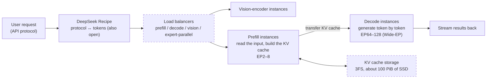

# What is DeepSeek's open-source DeepInfer, and why does it matter?

> 🌐 [中文](deepinfer.md) · 📅 Checked: 2026-10-29 · 🏷️ inference engines, serving, MoE, DeepSeek

## Short answer

DeepInfer is the open-source release of the **inference framework** behind DeepSeek's production services, published on 20 October 2026 under the Apache 2.0 licence (repository `deepseek-ai/DeepInfer`). It currently supports only DeepSeek-V4.1-Flash and runs on NVIDIA SM100 (Blackwell) GPUs and Huawei Ascend 950 NPUs. It open-sources the engine itself, but not the KV cache system, prefill/decode disaggregation or load balancing that a complete service also needs.

> **Two different words in Chinese**: in Chinese, “推理” covers both **inference** (running a model, this page) and **reasoning** (thinking things through). See the [glossary](../glossary.en.md).

## Explanation

### 1. What an inference framework does

A trained model is just a pile of weights. Serving it to many users at once takes software that turns requests into tokens, packs many requests into batches, schedules the computation across hundreds or thousands of accelerators, manages the KV cache, and streams generated tokens back. That software is an inference framework; well-known open-source ones are vLLM, SGLang and TensorRT-LLM. DeepInfer's README says it was originally built primarily on vLLM, with inspiration from SGLang and TensorRT-LLM.

### 2. What DeepSeek's full serving system looks like

According to the deployment Q&A published with the repository, the production system for V4.1-Flash looks roughly like this; solid boxes are open-sourced in this release, dashed boxes are not:

Key design points (figures from DeepSeek's deployment Q&A):

- **E/P/D disaggregation**: the vision encoder (E), prefill (P, reading the input) and decode (D, generating token by token) run on separate machines. P determines time to first token (TTFT) and D the time between tokens (TBT), so separating them lets each be optimised on its own.
- **Very wide expert parallelism for decode (Wide-EP)**: the MoE experts are spread over 64–128 accelerators with only a few experts each, allowing very large batches and much higher throughput. The cost is that the smallest efficient deployment unit is about 64 accelerators for prefill plus 64 for decode.
- **Long-lived KV cache**: KV caches for previously computed prefixes (long chat histories, files an agent reads repeatedly) are stored in a dedicated 3FS distributed storage cluster, designed to retain them for more than 72 hours, so a hit avoids redoing the prefill.
- **Scale**: the document states that a single cluster processes about 155 trillion tokens per day.

### 3. What this release includes

| Feature | What it does | Chapter |
| --- | --- | --- |
| Optimised kernels: FlashMLA, DeepGEMM, DeepEP, TileKernels and more | Fast attention, matrix multiplication and expert-parallel communication | [12 Inference optimization](../12-inference-optimization/README.en.md), [15 MoE](../15-moe/README.en.md) |
| Parallelism: attention data parallelism / balanced context parallelism, MoE expert parallelism + EPLB | Spread the model and requests over many accelerators and keep their load balanced | [13 Serving systems](../13-serving/README.en.md) |
| DSpark speculative decoding with confidence-scheduled verification | Guess a few draft tokens and verify them together, choosing how many to verify by confidence; the document reports about 30% fewer draft tokens verified per step with essentially the same accepted length | [12 Inference optimization](../12-inference-optimization/README.en.md) |
| Asynchronous scheduling | The CPU schedules the next step while the GPU computes this one, removing idle time | [13 Serving systems](../13-serving/README.en.md) |
| SWA bounded replay | On a cache hit, recompute only a short tail, working with sliding-window attention to cut prefill work | [14 Long context](../14-long-context/README.en.md) |
| Batch-invariant inference, deterministic sampling | The same request gives exactly the same result whatever it is batched with and however often it runs | [13 Serving systems](../13-serving/README.en.md) |
| Structured outputs | Force output to match a JSON schema, regex or grammar | [11 Decoding and sampling](../11-decoding/README.en.md) |

### 4. What it leaves out

The README lists three things a complete service needs that are not included:

1. A KV cache system
2. Vision-encoder / prefill / decode disaggregation (most of the engine-side functionality is already implemented)
3. Load balancing across data-parallel replicas

The deployment document explains that these components are tightly coupled to DeepSeek's internal infrastructure and so are not yet fully open-sourced, though an accompanying Zhihu article describes their design. In other words, what you get is a high-performance engine for **offline inference**, not a ready-to-run online service.

## Why it matters

1. **A look at the inference engineering a frontier lab actually runs**: once a model is deployed, most of its compute goes to inference. KV caching, speculative decoding and expert parallelism, usually scattered across papers, appear here together as production code with real deployment parameters.
2. **Multi-vendor hardware**: support for both NVIDIA and Huawei Ascend matters for compute diversity and for the domestic chip ecosystem in China.
3. **Determinism matters more and more**: batch-invariant inference makes the same input always give the same output, which is key for stable reinforcement-learning training and reproducible evaluation.
4. **What was not released shows where the difficulty lies**: at scale, the hard part is not only fast computation on one accelerator but also storing and reusing KV caches, scheduling prefill and decode, and balancing load across hundreds or thousands of accelerators.

## Quick glossary

| Term | Meaning |
| --- | --- |
| Prefill | Process the whole input at once and compute the KV cache for every input token |
| Decode | Afterwards, generate one (or a few) new tokens per step, repeatedly reading the KV cache |
| TTFT / TBT | Time to first token / time between consecutive tokens |
| KV cache | Keys and Values already computed by attention, kept to avoid recomputing them (see [04 Attention](../04-attention/README.en.md)) |
| EP (expert parallelism) | Put different MoE experts on different accelerators |
| DP (data parallelism) | Several replicas each handle different requests |
| Speculative decoding | Guess a few tokens cheaply, then have the large model verify them in one go |

## How it fits the knowledge base

- **[13 Serving systems](../13-serving/README.en.md)** (this question is why the chapter was added): batching, P/D disaggregation, parallelism and load balancing, with vLLM, SGLang and DeepInfer as case studies
- **[12 Inference optimization](../12-inference-optimization/README.en.md)**: KV cache, quantisation, speculative decoding, FlashAttention / MLA
- **[15 Mixture of experts](../15-moe/README.en.md)**: expert parallelism and load balancing
- [04 Attention](../04-attention/README.en.md), [05 Transformer block](../05-transformer/README.en.md): where the KV cache and GQA come from

## Sources

- DeepSeek-AI. [deepseek-ai/DeepInfer (README and doc/inference_deployment_qa.md)](https://github.com/deepseek-ai/DeepInfer), primary source
- SiliconANGLE, 2026-10-20. [DeepSeek open-sources DeepInfer, the inference framework behind its production services](https://siliconangle.com/2026/10/20/deepseek-open-sources-deepinfer-the-inference-framework-behind-its-production-services/)
- The New Stack. [DeepSeek open-sources the inference engine behind its API](https://thenewstack.io/deepseek-deepinfer-huawei-nvidia/)

> The feature list and deployment figures on this page follow the README and deployment Q&A in the DeepInfer repository (checked 2026-10-29). That document is updated over time, so details may change.
