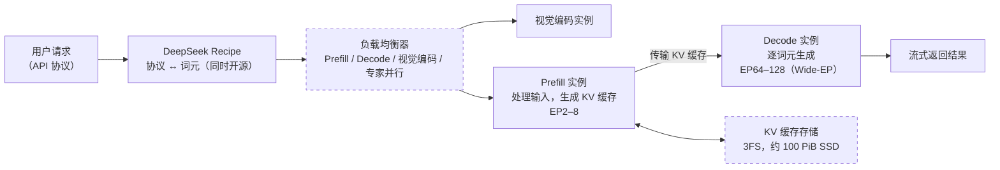

# DeepSeek 开源的 DeepInfer 是什么？为什么重要？

> 🌐 [English](deepinfer.en.md) · 📅 核实日期：2026-10-29 · 🏷️ 推理引擎、推理服务、MoE、DeepSeek

## 一句话回答

DeepInfer 是 DeepSeek 线上生产服务所用的**推理框架**（inference framework）的开源版本，于 2026 年 10 月 20 日以 Apache 2.0 许可发布（仓库 `deepseek-ai/DeepInfer`）。它目前只支持 DeepSeek-V4.1-Flash，可以在英伟达 SM100（Blackwell）GPU 和华为昇腾 950 NPU 上运行。它开源了“引擎”本身，但没有开源 KV 缓存系统、Prefill/Decode 分离部署和负载均衡这几块组成完整服务所需的部件。

> **注意区分两个“推理”**：推理框架/推理引擎里的推理是 **inference**（运行模型），不是 **reasoning**（思考）。见[术语表](../glossary.md)。

## 详细解释

### 1. 推理框架是做什么的

模型训练好之后，只是一堆权重。要让成千上万的用户同时用上它，还需要一套软件负责：把请求转成词元、把很多请求拼成批次、调度到成百上千张卡上计算、管理 KV 缓存、把生成的词元流式返回。这套软件就是推理框架，常见的开源框架有 vLLM、SGLang、TensorRT-LLM。DeepInfer 的 README 写明，它最初主要基于 vLLM 开发，也借鉴了 SGLang 和 TensorRT-LLM。

### 2. DeepSeek 的完整推理系统长什么样

根据 DeepSeek 随仓库发布的部署问答文档，V4.1-Flash 的线上系统大致如下，其中实线框是这次开源的部分，虚线框是没有开源的部分：

几个关键设计（数据来自 DeepSeek 的部署问答文档）：

- **E/P/D 分离部署**：视觉编码（E）、读输入的 Prefill（P）、逐词元生成的 Decode（D）分开部署在不同机器上。P 决定“首个词元要等多久”（TTFT），D 决定“后续每个词元多快”（TBT），分开后可以各自优化。
- **Decode 用超大规模专家并行（Wide-EP）**：MoE 模型的专家分散到 64–128 张卡上，每张卡只放少数专家，能把批次做得很大、显著提高吞吐。代价是最小的高效部署单元约为 64 张卡做 Prefill、64 张卡做 Decode。
- **KV 缓存长期保存**：之前算过的前缀（比如长对话的历史、Agent 反复读取的文件）会把 KV 缓存存到专用的 3FS 分布式存储里，设计目标是保留 72 小时以上，命中时就不必重新 Prefill。
- **规模**：文档称单个集群每天处理约 155 万亿个词元。

### 3. 这次开源了什么

| 功能 | 作用 | 对应章节 |
| --- | --- | --- |
| 优化算子：FlashMLA、DeepGEMM、DeepEP、TileKernels 等 | 注意力、矩阵乘、专家并行通信的高性能实现 | [12 推理优化](../12-inference-optimization/README.md)、[15 MoE](../15-moe/README.md) |
| 并行：注意力数据并行 / 均衡的上下文并行，MoE 专家并行 + EPLB | 把模型和请求分布到多张卡上，并让每张卡负载均衡 | [13 推理服务系统](../13-serving/README.md) |
| DSpark 投机解码 + 按置信度安排验证 | 先猜几个草稿词元再一起验证；按置信度决定验证几个，文档称每步验证的草稿数减少约 30%，接受长度基本不变 | [12 推理优化](../12-inference-optimization/README.md) |
| 异步调度 | CPU 安排下一步时，GPU 同时在算这一步，消除空等 | [13 推理服务系统](../13-serving/README.md) |
| SWA 有界重放 | 缓存命中时，只重算最后一小段，配合滑动窗口注意力减少 Prefill 计算 | [14 长上下文](../14-long-context/README.md) |
| batch 不变推理、确定性采样 | 同一个请求无论和谁一起批处理、跑几次，结果都完全一样 | [13 推理服务系统](../13-serving/README.md) |
| 结构化输出 | 强制输出符合 JSON schema、正则表达式或语法 | 11 解码与采样（计划中） |

### 4. 没有开源什么

README 明确列出，组成完整的推理服务还需要三样，这次没有包含：

1. KV 缓存系统
2. 视觉编码 / Prefill / Decode 分离部署（引擎侧大部分功能已经实现）
3. 多个数据并行副本之间的负载均衡

部署文档的解释是：这些组件和 DeepSeek 内部基础设施耦合很深，所以暂时没有完全开源，但在配套的知乎文章中介绍了设计思路。也就是说，现在拿到的是一个可以**离线推理**的高性能引擎，而不是开箱即用的完整线上服务。

## 为什么重要

1. **看到一线实验室真正在用的推理工程**：模型上线后，大部分算力花在推理上。KV 缓存、投机解码、专家并行这些在论文里零散出现的技术，在这里以生产级代码的形式集中呈现，还附带了真实的部署参数。
2. **多硬件支持**：同时支持英伟达和华为昇腾，对算力多元化和国产芯片生态有实际意义。
3. **确定性越来越重要**：batch 不变推理让同一个输入总能得到同样的输出。这对强化学习训练的稳定性、评测的可复现性都很关键。
4. **没开源的部分恰好说明了难点在哪**：大规模服务最难的不只是单卡算得快，还有 KV 缓存的存储与复用、Prefill/Decode 的调度和成百上千张卡之间的负载均衡。

## 名词速查

| 名词 | 含义 |
| --- | --- |
| Prefill（预填充） | 一次性处理整段输入，计算出所有输入词元的 KV 缓存 |
| Decode（解码） | 之后每一步只生成一个（或几个）新词元，反复读取 KV 缓存 |
| TTFT / TBT | 首个词元的等待时间 / 相邻两个词元之间的间隔 |
| KV 缓存 | 注意力中已经算过的 Key 和 Value，保存下来避免重复计算（见 [04 注意力机制](../04-attention/README.md)） |
| EP（专家并行） | 把 MoE 的不同专家放在不同的卡上 |
| DP（数据并行） | 多份副本分别处理不同的请求 |
| 投机解码 | 先用便宜的方法猜几个词元，再让大模型一次性验证 |

## 与知识库的关系

- **[13 推理服务系统](../13-serving/README.md)**（正是因为这个问题而新增的章节）：批处理、P/D 分离、并行策略、负载均衡，以 vLLM、SGLang、DeepInfer 为案例
- **[12 推理优化](../12-inference-optimization/README.md)**：KV 缓存、量化、投机解码、FlashAttention / MLA
- **[15 混合专家 MoE](../15-moe/README.md)**：专家并行与负载均衡
- [04 注意力机制](../04-attention/README.md)、[05 Transformer 结构](../05-transformer/README.md)：KV 缓存和 GQA 的来源

## 来源

- DeepSeek-AI. [deepseek-ai/DeepInfer（README 与 doc/inference_deployment_qa.md）](https://github.com/deepseek-ai/DeepInfer)，一手资料
- SiliconANGLE, 2026-10-20. [DeepSeek open-sources DeepInfer, the inference framework behind its production services](https://siliconangle.com/2026/10/20/deepseek-open-sources-deepinfer-the-inference-framework-behind-its-production-services/)
- The New Stack. [DeepSeek open-sources the inference engine behind its API](https://thenewstack.io/deepseek-deepinfer-huawei-nvidia/)

> 本页的功能列表与部署数据以 DeepInfer 仓库中的 README 和部署问答文档为准（核实于 2026-10-29）。该文档会持续更新，细节可能变化。
