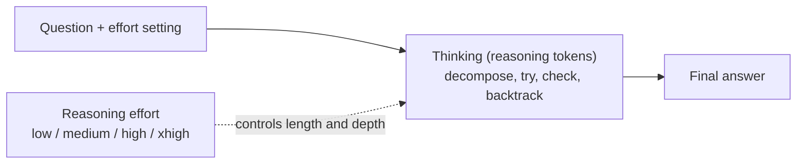

# How are reasoning effort levels (low / medium / high / xhigh) set?

> 🌐 [中文](reasoning-effort.md) · 📅 Checked: 2026-10-29 · 🏷️ reasoning models, test-time compute, APIs

## Short answer

“Reasoning effort” controls **how long a reasoning model thinks before it answers**: the higher the effort, the more “thinking” tokens the model generates, the better it does on hard problems, and the slower and more expensive it gets. Providers expose levels such as low, medium, high and xhigh in their APIs; the available levels and the default depend on the model. How a level maps to an actual amount of thinking is each provider's internal implementation and is not fully public.

> **Two different words in Chinese**: in Chinese, “推理” covers both **reasoning** (thinking things through, this page) and **inference** (running a model). See the [glossary](../glossary.en.md).

## Explanation

### 1. Reasoning models add a “thinking” phase

A plain chat model reads the question and writes the answer directly. A reasoning model (OpenAI's o-series and GPT-5 series, DeepSeek-R1, Claude with extended thinking, …) first writes a **thinking process** and then the final answer:

This ability comes mainly from reinforcement learning. The DeepSeek-R1 paper showed that with RL on problems whose answers can be checked automatically (maths, code), the model learns by itself to write longer thinking and to check and correct its own mistakes along the way.

### 2. How the APIs expose it

| Provider | Parameter | Levels (model-dependent) | Notes |
| --- | --- | --- | --- |
| OpenAI | `reasoning.effort` (Responses API) | none, minimal, low, medium, high, xhigh, … | Supported levels and defaults differ per model |
| Anthropic | `output_config.effort` | low, medium, high, xhigh, max on the newest models | Older models set a thinking-token budget directly with `budget_tokens` |
| gpt-oss (open weights) | `Reasoning: low / medium / high` in the system prompt | low, medium, high | Switched by prompt, so you can watch the effect |
| Qwen3 (open weights) | `enable_thinking`, or `/think` and `/no_think` in a message | thinking / non-thinking | One model supports both modes |

Levels are not portable: the same name can mean different amounts of thinking on different models. For cross-model use, low / medium / high is the safest set; check the official docs for specifics.

### 3. Roughly how it works underneath

Providers have not published their exact methods, but public research and open models show a few common approaches:

1. **Learn during training to adapt to the level**: during RL, different levels get different length budgets or length penalties, and the level is part of the input (for example in the system prompt). The model learns to be brief at low effort and thorough at high effort. gpt-oss's `Reasoning: low/medium/high` is an example.
2. **Cap the budget at inference time**: set a maximum number of thinking tokens and force the model to stop thinking and answer once it is reached. The s1 paper's *budget forcing* goes further: to make the model think more, append “Wait” when it is about to stop; to make it think less, insert the end-of-thinking marker.
3. **Let the model decide**: think longer on hard questions and briefly on easy ones. The level then acts as a ceiling or a tendency rather than a fixed length.

### 4. Choosing a level (rules of thumb)

| Task | Suggestion | Why |
| --- | --- | --- |
| Chit-chat, rewriting, simple lookups | none / minimal / low | Extra thinking adds latency and cost with almost no benefit |
| Everyday coding changes, writing, analysis | medium | The default on most models; balances quality and speed |
| Competition maths, hard debugging, long-horizon planning | high / xhigh | More thinking makes it likelier to find and fix mistakes |
| Latency-sensitive production services | Start low and raise it for the cases that fail | Decide from evaluation data, not intuition |

Higher is not always better: on easy questions, overly long thinking can introduce errors, often called *overthinking*.

## Why it matters

- **A new scaling axis**: gains used to come mainly from bigger models and more training data. Reasoning models show that **spending more compute at use time** (test-time compute) also keeps improving results, with diminishing returns that often look roughly logarithmic in compute.
- **Direct cost and latency impact**: thinking tokens are usually billed as output tokens even when users do not see the full thinking. The same question can take several to dozens of times more tokens at a high level than at a low one.
- **A core product knob**: one model can serve both “quick answer” and “deep thinking” scenarios, and agents and coding assistants often adjust the level by task difficulty.

## How it fits the knowledge base

- [10 Reasoning models and test-time compute](../10-reasoning/README.en.md): why chain of thought works, RL with verifiable rewards (GRPO), thinking budgets, with CPU experiments and a playground
- [04 Attention](../04-attention/README.en.md): longer thinking means longer context, so attention compute and the KV cache grow too
- [09 Alignment](../09-alignment/README.en.md): the basics of reinforcement learning (PPO, the KL penalty)
- **[11 Decoding and sampling](../11-decoding/README.en.md)**: the thinking itself is generated token by token

## Sources

- OpenAI. [Reasoning models (API docs)](https://developers.openai.com/api/docs/guides/reasoning)
- OpenAI, 2024. [Learning to reason with LLMs](https://openai.com/index/learning-to-reason-with-llms/) (o1; train-time and test-time compute scaling)
- DeepSeek-AI, 2025. [DeepSeek-R1: Incentivizing Reasoning Capability in LLMs via Reinforcement Learning](https://arxiv.org/abs/2501.12948)
- Muennighoff et al., 2025. [s1: Simple test-time scaling](https://arxiv.org/abs/2501.19393) (budget forcing)
- OpenAI, 2025. [gpt-oss](https://github.com/openai/gpt-oss) (`Reasoning: low/medium/high`)
- Qwen Team, 2025. [Qwen3](https://github.com/QwenLM/Qwen3) (thinking / non-thinking modes)
- DataNorth. [AI effort levels explained](https://datanorth.ai/blog/ai-effort-levels-explained) (a summary of providers' levels)

> Provider parameters and levels change quickly; check the official docs before relying on them.
