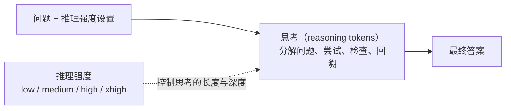

# 推理强度（low / medium / high / xhigh）是怎么设置的？

> 🌐 [English](reasoning-effort.en.md) · 📅 核实日期：2026-10-29 · 🏷️ 推理模型、测试时计算、API

## 一句话回答

“推理强度”控制**推理模型在给出答案之前想多久**：强度越高，模型生成的“思考”词元越多，难题上越准，但也越慢、越贵。各家在 API 中提供 low、medium、high、xhigh 等档位，具体档位和默认值因模型而异；档位如何映射到具体的思考长度属于各家的内部实现，没有完全公开。

> **注意区分两个“推理”**：这里的推理是 **reasoning**（思考、推导），不是 **inference**（运行模型）。见[术语表](../glossary.md)。

## 详细解释

### 1. 推理模型多了一段“思考”

普通的对话模型读完问题就直接输出答案。推理模型（如 OpenAI 的 o 系列与 GPT-5 系列、DeepSeek-R1、开启扩展思考的 Claude）会先生成一段**思考过程**，再给出最终答案：

这种能力主要是用强化学习训练出来的：DeepSeek-R1 的论文显示，用可以自动判对错的题目（数学、代码）做强化学习，模型会自己学会写更长的思考过程，并在其中检查和纠正错误。

### 2. 各家 API 怎么设置

| 提供方 | 参数 | 档位（依模型而定） | 备注 |
| --- | --- | --- | --- |
| OpenAI | `reasoning.effort`（Responses API） | none、minimal、low、medium、high、xhigh 等 | 不同模型支持的档位和默认值不同 |
| Anthropic | `output_config.effort` | 最新模型为 low、medium、high、xhigh、max | 更早的模型用 `budget_tokens` 直接指定思考词元预算 |
| gpt-oss（开源权重） | 系统提示中写 `Reasoning: low / medium / high` | low、medium、high | 用提示词切换，可以直接看到效果 |
| Qwen3（开源权重） | `enable_thinking`，或在消息中写 `/think`、`/no_think` | 思考 / 不思考 | 一个模型同时支持两种模式 |

各家的档位并不通用，同一个名字在不同模型上对应的思考长度也不同。需要跨模型使用时，low / medium / high 是最稳妥的选择，具体以官方文档为准。

### 3. 背后大致是怎么实现的

各家没有公开具体做法，但公开的研究和开源模型展示了几种常见思路：

1. **训练时学会“看档位调长度”**：在强化学习中，给不同档位设置不同的长度预算或长度惩罚，并把档位作为输入（例如写在系统提示里）。模型由此学会：低档时简短作答，高档时充分展开。gpt-oss 的 `Reasoning: low/medium/high` 就属于这一类。
2. **推理时限制预算**：给思考设置词元上限，到上限就强制结束思考、开始作答。s1 论文的 *budget forcing* 更进一步：想让模型多想，就在它准备结束时追加 “Wait”；想让它少想，就直接插入“思考结束”的标记。
3. **模型自己决定想多久**：难题多想、简单题少想。档位此时更像一个“上限”或“倾向”，而不是固定长度。

### 4. 怎么选档位（经验建议）

| 任务 | 建议 | 原因 |
| --- | --- | --- |
| 闲聊、改写、简单查询 | none / minimal / low | 多想几乎没有收益，只增加延迟和成本 |
| 一般的代码修改、写作、分析 | medium | 大多数模型的默认档位，兼顾质量与速度 |
| 竞赛数学、复杂调试、长链条规划 | high / xhigh | 思考越充分，越可能找到并纠正错误 |
| 对延迟敏感的线上服务 | 先用低档，再按失败案例逐步调高 | 用评测数据决定，而不是凭感觉 |

档位越高并不总是越好：简单问题上，过长的思考可能“想多了”，反而引入错误，这种现象常被称为 *overthinking*。

## 为什么重要

- **一条新的扩展路径**：过去提升效果主要靠更大的模型和更多的训练数据；推理模型表明，**在使用时多花算力**（测试时计算，test-time compute）也能持续提升效果，只是收益递减，常近似随算力的对数增长。
- **直接影响成本和延迟**：思考词元通常按输出词元计费，即使用户看不到完整的思考内容。同一个问题，高档可能比低档多花几倍到几十倍的词元。
- **产品设计的核心旋钮**：同一个模型可以服务“快速回答”和“深度思考”两类场景，Agent 和编程助手经常按任务难度动态调整。

## 与知识库的关系

- [10 推理模型与测试时计算](../10-reasoning/README.md)：思维链为什么有效、可验证奖励的强化学习（GRPO）、思考预算，以及在 CPU 上的实验与交互演示
- [04 注意力机制](../04-attention/README.md)：思考越长，上下文越长，注意力的计算量和 KV 缓存也随之增长
- [09 对齐](../09-alignment/README.md)：强化学习（PPO、KL 惩罚）的基础
- **11 解码与采样**（计划中）：思考过程本身也是逐词元生成的

## 来源

- OpenAI. [Reasoning models（API 文档）](https://developers.openai.com/api/docs/guides/reasoning)
- OpenAI, 2024. [Learning to reason with LLMs](https://openai.com/index/learning-to-reason-with-llms/)（o1，训练与测试时计算的扩展曲线）
- DeepSeek-AI, 2025. [DeepSeek-R1: Incentivizing Reasoning Capability in LLMs via Reinforcement Learning](https://arxiv.org/abs/2501.12948)
- Muennighoff et al., 2025. [s1: Simple test-time scaling](https://arxiv.org/abs/2501.19393)（budget forcing）
- OpenAI, 2025. [gpt-oss](https://github.com/openai/gpt-oss)（`Reasoning: low/medium/high`）
- Qwen Team, 2025. [Qwen3](https://github.com/QwenLM/Qwen3)（思考 / 非思考模式）
- DataNorth. [AI effort levels explained](https://datanorth.ai/blog/ai-effort-levels-explained)（各家档位的整理）

> 各家 API 的参数与档位变化很快，使用前请以官方文档为准。
