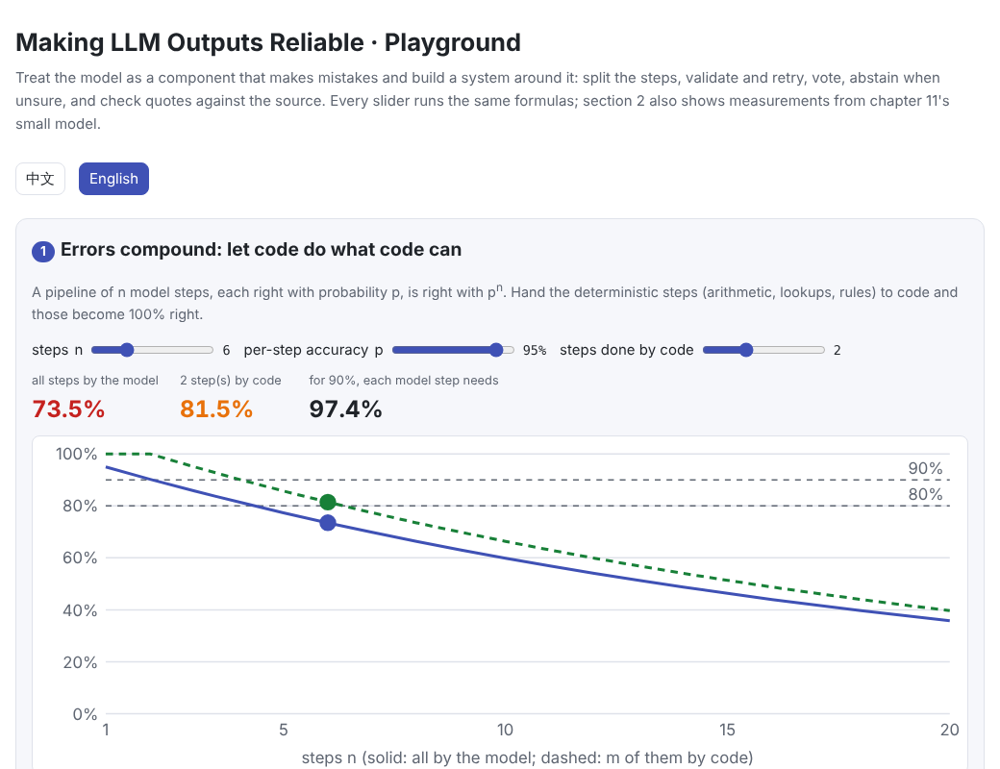
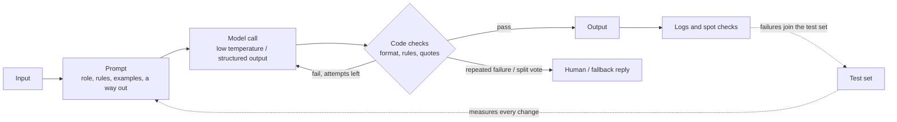
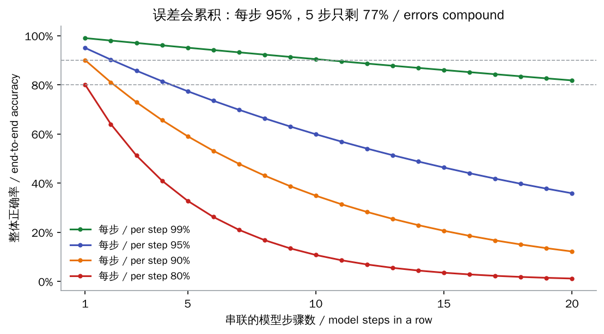
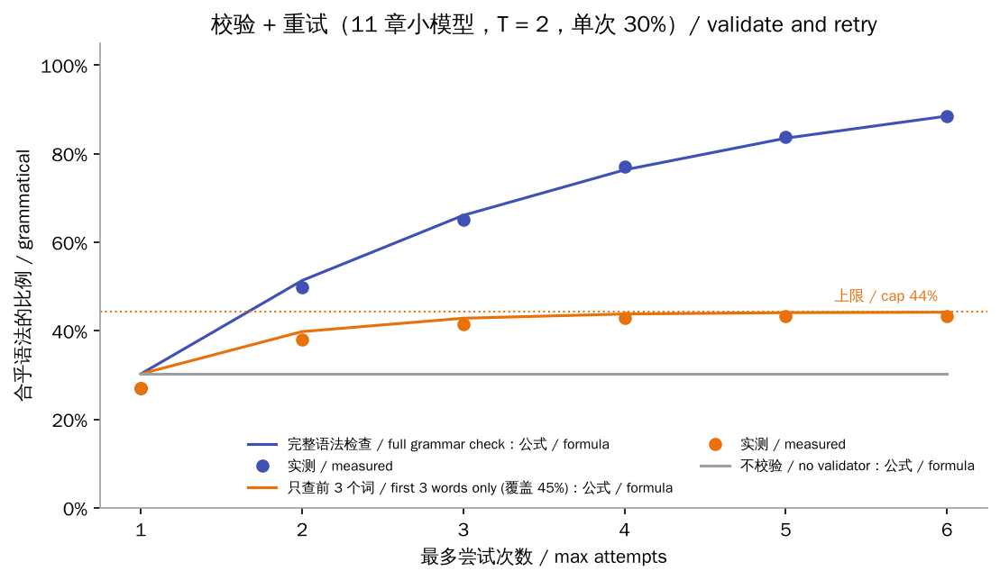
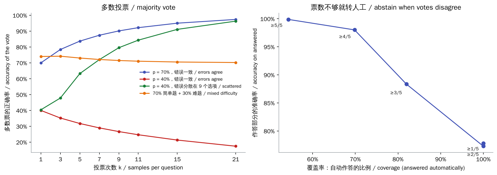

# How do I make LLM outputs reliable, and stop the model making things up?

> 🌐 [中文](reliability.md) · 📅 Checked: 2026-10-30 · 🏷️ reliability, prompt engineering, role-play, validation and retries, hallucination, knowledge conflicts · 🎮 **[Open the interactive playground](interactive/reliability.html?lang=en)**

[](interactive/reliability.html?lang=en)

## Short answer

**Don't expect a prompt alone to make a model as dependable as a program. Treat the model as a component that makes mistakes, and build a system around it that measures, validates, retries and declines to answer when unsure.**

The prompt sets the accuracy $p$ of a single call; the system sets the final accuracy. The key facts:

- **Errors compound.** $n$ steps that are each right with probability $p$ are all right with $p^n$. At 95% per step, 5 steps leave 77%. Hand the deterministic parts (arithmetic, lookups, rules) to code.
- **Validate and retry is the strongest tool.** When a programmatic validator rejects an answer, try again. With 70% per attempt, every error caught and up to 3 attempts, you reach 97%. But **errors the validator cannot see survive any number of retries**.
- **Voting only helps when errors scatter.** If the model makes the same mistake every time on some kind of question, voting just confirms the mistake.
- **Abstain when unsure.** Handle only the cases you are confident about automatically and send the rest to a person. This trades coverage for accuracy, and is often the most realistic way to get program-like reliability.
- **Fabrication (hallucination) is fought with documents, quotes and code that checks the quotes**, not by writing “do not make things up”.
- **When the model contradicts facts you gave it**, it is usually a context–memory conflict or the fact never reached it: log the full prompt first, then declare the facts authoritative; values that must never be wrong go in as placeholders filled by code.



## Detailed explanation

### 1. Build a test set first, or you can't tell 60% from 90%

“80–90% accuracy” has to be measurable before it can be improved. Collect 50–200 real inputs with expected outputs or grading rules, and run all of them after every prompt change:

- **Grade with code wherever possible**: is the JSON valid, are the fields present, are the numbers in range, are the required keywords there?
- **For open-ended answers**, another model can grade against a rubric (LLM-as-judge), but first check that its grades agree with human ones.
- **Include traps on purpose**: questions the documents cannot answer, questions with false premises, messages that try to push a persona out of character. Measure both the fabrication rate and the correct-refusal rate.

Without measurement, each change is judged on a handful of examples, and it is easy to fix one case while quietly breaking another.

### 2. Split the task: errors compound



When a workflow chains several model steps, the end-to-end accuracy is the product of the step accuracies. So:

- **Give deterministic work to code**: arithmetic, dates, database queries and rule checks can be 100% right.
- **Let the model do what it is good at**: understanding intent, classifying, extracting, rewriting, writing natural language.
- **Define each step's inputs and outputs**, so every step can be validated and evaluated on its own.

### 3. Writing the prompt

The prompt sets the single-call accuracy $p$. Practices that work reliably:

| Practice | Why it works |
| --- | --- |
| **State the role, task, context, constraints and output format** | The model cannot see the context in your head; explaining *why* helps it generalise to cases you did not list |
| **Give 3–5 varied examples**, including edge cases and a refusal | Examples pin down format and tone better than descriptions; their order and label balance also sway the output (Zhao et al., 2021), so vary them |
| **Provide a way out**: a fixed fallback reply or `needs_human: true` when unsure | Without one, the model tends to answer anyway |
| **Separate instructions, documents and examples with XML tags**; put long documents first and the question last | Documents are less likely to be read as instructions; key facts buried mid-context are easily missed (Liu et al., 2023) |
| **State rules positively**: “when X, do this”, not only “don't do X” | An alternative behaviour is easier to follow |
| **Think before answering** on tasks that need reasoning, or use a reasoning model | See [10 Reasoning models and test-time compute](../10-reasoning/README.md) |

### 4. Role-play: keeping a persona consistent

The hard part of role-play is **consistency**. Tone, knowledge limits and backstory must not contradict themselves, and the character must not drift out of role after many turns.

- **Write a persona card**: identity, personality, speaking style, reply length, what the character knows and what it does not. For history not on the card, tell the model to stay vague rather than invent specifics.
- **Show sample exchanges**: at least one normal exchange, one refusal when the documents have no answer, and one reply to a user trying to break character.
- **Prevent persona drift.** Adherence to the system prompt weakens over a conversation and drifts noticeably within a few turns (Li et al., 2024). Have your code prepend a one-line persona reminder to each user message, or periodically summarise the conversation and start afresh.
- **Lower the temperature** to reduce randomness.
- **Separate two kinds of content**: what may be improvised (small talk, interjections) and what must be exact (prices, rules, canonical facts). Validate the second kind in code.

Section 6 of the playground assembles a role-play system-prompt template from the parts you tick.

### 5. Decoding: temperature and structured output

- **Use a low temperature (0–0.3) for tasks that need stability.** On the small model in [11 Decoding and sampling](../11-decoding/README.md), 100% of sentences are grammatical at temperature 0.2 and only 3% at temperature 3.
- **Use structured output (JSON Schema, constrained decoding) when the format is fixed.** Illegal tokens are masked during sampling, so the format is always valid: in chapter 11, temperature 3 with the grammar constraint gave 100% grammatical sentences. It guarantees the **format**, not that the **content** is right.
- **Temperature 0 is not fully deterministic.** Server-side batching causes tiny numerical differences, so the same input occasionally gives a different output (Thinking Machines, 2025). If you need reproducibility, cache results in your system.

### 6. Validate and retry: only errors the validator sees go away



Let one attempt be right with probability $p$, let the validator reject a fraction $c$ of the wrong answers (and never a right one), and allow up to $r$ attempts. An attempt is rejected with probability $q = (1-p)c$, so:

$$
\text{accuracy} = p\,(1 + q + q^2 + \dots + q^{r-1}), \qquad \text{to a human} = q^r, \qquad \text{cap}\ (r\to\infty) = \frac{p}{p + (1-p)(1-c)}
$$

- With $c = 1$ (every error caught), $p = 0.7$ and $r = 3$ give 97.3% accuracy at only 1.39 calls on average.
- With $c = 0.5$, no number of retries lifts $p = 0.5$ above 67%.

The figure above is a real experiment: [chapter 11](../11-decoding/README.md)'s small GPT “writes a grammatical sentence” at temperature T = 2, succeeding only 30% of the time per attempt.

- **The full grammar checker** reaches 77% after 4 attempts (88% after 6).
- **A validator that checks only the first 3 words** catches 45% of the errors and reaches only 43% after 4 attempts. More attempts leave it near the formula's cap of 44%.

The measurements follow the formula closely.

So invest in **validator coverage**: JSON Schema, ranges, enums, business rules, quote checks, unit tests (for code).

**Asking the model to “check its own answer” is usually not enough.** Self-correction without an outside signal often fails and can turn right answers wrong (Huang et al., 2023). Useful feedback comes from a validator's error message, a tool's result or a comparison with the source. Putting the specific error into the retry prompt works better than a bare “try again”.

### 7. Voting, and abstaining when unsure



For tasks with a single right answer (classification, extraction, numbers), you can sample $k$ times and take the majority (self-consistency, Wang et al., 2022). How well it works depends on what the errors look like:

- **When one sample is right more than 50% of the time and the errors scatter**, voting helps: at $p = 0.7$, 15 votes reach 95%.
- **When the model consistently makes the same mistake**, voting hurts: at $p = 0.4$ with consistent errors, 15 votes give only 21%.
- **Real questions mix easy and hard.** With 70% easy questions (95% per sample) and 30% hard ones (25% per sample, consistent errors), one sample scores 74% and 15 votes score 71%. Voting cannot rescue questions the model consistently gets wrong.

Voting is more valuable as **a confidence signal**: if the top answer gets only 2–3 of 5 votes, the model is unsure, so hand the question to a person or use a fallback reply. In the right-hand plot, requiring at least 4 of 5 votes to agree answers 70% of questions at 98% accuracy. This is trading coverage for accuracy (selective prediction, Geifman & El-Yaniv, 2017).

### 8. Fabrication (hallucination): why it happens and how to reduce it

**Why models make things up.** A model learns to produce a plausible next token and has no default “I don't know”. Training and benchmarks usually score abstaining the same as a wrong answer, so models learn to guess (Kalai et al., 2025). Fabrication is most likely in these cases:

- obscure facts
- questions with false premises
- questions the documents cannot answer, when the model is pushed to answer anyway
- requests for specific names, numbers, links or citations

**What reduces it**, roughly in order of effect:

1. **Give it the facts instead of asking it to remember**: use RAG or paste the documents into the prompt, and say “answer only from the documents”.
2. **Quote first, then answer, and check the quotes in code.** Require a verbatim quote for every claim, check in code that each quote really appears in the documents, and reject and retry if one does not. This is section 6's validate-and-retry with high coverage; section 5 of the playground has a dozen-line checker.
3. **Allow and demonstrate refusal**: give a fixed fallback reply and show it once in the examples.
4. **Restrict the output to a known set.** Constrain product names, IDs and field values with an enum or constrained decoding, then confirm in the database that they exist.
5. **Use tools instead of memory**: arithmetic in code, lookups in a database or search.
6. **Compare several samples.** Real facts tend to agree across samples; invented details change each time (SelfCheckGPT, Manakul et al., 2023). Abstain when they disagree.
7. **Verify claim by claim.** Split the answer into individual claims and, in a separate call, check whether the documents support each one; drop those that are unsupported (Chain-of-Verification, Dhuliawala et al., 2023).
8. **Check the premise.** Ask the model to first decide whether the question's premise holds.
9. **Be careful with fine-tuning.** Teaching new facts by fine-tuning can increase fabrication (Gekhman et al., 2024). Leave facts to retrieval, and use fine-tuning for format, tone and behaviours such as refusing when unsure.

### 9. The model contradicts the facts you gave it

This is a **context–memory conflict** (knowledge conflict): either the facts in the prompt disagree with what the model “remembers” from training, or the model never effectively read them. Common causes:

| Cause | What it looks like |
| --- | --- |
| **The model trusts its memory** | A price, role or rule changed and the model still gives the old one; the better known the old version, the harder it is to override (Longpre et al., 2021) |
| **News after the training cutoff** | “As far as I know, that has not happened”; some models are trained not to take users' claims at face value and treat new facts as misinformation |
| **The fact was never really read** | History was truncated, retrieval missed it, it sat in the middle of a long context, or a table or PDF was mangled in parsing |
| **The context contradicts itself** | Old and new versions of a document are both present; a few-shot example contains a different number and the model copies it |
| **A reasoning step went wrong** | The fact was used, but a conversion, comparison or multi-step inference was wrong, so it looks as if the fact was ignored |
| **Persona drift after many turns** | Dozens of turns in, the persona card's facts carry less weight and the model falls back on common knowledge |

Research finds that models accept coherent, convincing external evidence, yet show confirmation bias when that evidence conflicts with their memory (Xie et al., 2023). What to do, in order:

1. **Debug first: log the complete prompt the model actually received.** Check that the fact is there, appears once, and has no conflicting version. Much “disobedience” is code that never delivered the fact.
2. **Declare the facts authoritative and say why they may differ from what the model knows.** Put them in a `<facts>` block in the system prompt: “valid as of 2026-10; may postdate your training or belong to this scenario; when they conflict with your memory, they win; do not question or correct them.” Once the model knows why, it is less inclined to “correct” you.
3. **Ask “according to the documents”**: “According to &lt;facts&gt;, what is X?” rather than “What is X?”. Framing the question as “what does this source say” clearly improves faithfulness to the context (Zhou et al., 2023).
4. **Keep key facts near the question, and re-attach them every turn.** Don't count on the model remembering something said 20 turns ago.
5. **Quote first, then check the key facts in code.** Extract numbers, names and dates from the answer and compare them with your fact table; on a mismatch, retry with the specific error: “you said the price is 299, but &lt;facts&gt; says 199”. This is section 6's validate-and-retry.
6. **Most reliable: don't let the model generate critical facts at all.** Have it write sentences with placeholders, such as “this one is now only {price} yuan”, and fill in the real values in code. For prices, stock, order numbers and dates this makes them 100% right.
7. **Clean the context**: replace concrete values in examples with obvious placeholders, and remove outdated documents.
8. **Compute in code what code can compute**: do conversions and comparisons before the model words the answer; for multi-step reasoning, have it reason first or use a reasoning model.
9. **Measure it separately**: put “facts that contradict common knowledge” in the test set (changed prices, fictional settings, post-cutoff news) and track how often the model stays faithful to the context.

### 10. When the prompt has hit its ceiling

- **Factual errors**: add RAG and tools (19 RAG and vector databases, 21 Agents, planned).
- **Format, style and persona consistency**: fine-tune with a few hundred to a few thousand good examples using SFT or LoRA; see [08 Fine-tuning](../08-finetuning/README.md).
- **After launch**: log outputs, spot-check samples, classify the errors and add the failures to the test set, closing the loop.

## Why it matters

The model is probabilistic, so a single call can never be 100% right, but the system around it can be very dependable. Three things are yours to design:

- who does each step
- how it is checked
- what happens when the model is unsure

Time spent on these three and on the test set usually pays off more than polishing the prompt's wording.

## Code

[`code/reliability.py`](code/reliability.py) derives and checks the formulas above, and measures validate-and-retry on chapter 11's small GPT (about 20 seconds):

```bash
python docs/qa/code/reliability.py
```

```text
== 3. a real model: write a grammatical sentence / 真实模型：写一个合乎语法的句子 ==
  one attempt at T = 1.5: 56% grammatical; the 3-word validator catches 38% of the errors
  full grammar check  : 1 tries 59% (formula 56%), 2 tries 82% (formula 81%), 4 tries 95% (formula 96%)
  first 3 words only  : 1 tries 59% (formula 56%), 2 tries 68% (formula 66%), 4 tries 69% (formula 68%)
  retries only remove the errors the validator can see  ✓
```

The figures and the playground's data come from [`figures/reliability_figures.py`](figures/reliability_figures.py).

## How it connects

- [08 Fine-tuning](../08-finetuning/README.md): when prompting has hit its ceiling, fix format and persona with SFT / LoRA
- [10 Reasoning models and test-time compute](../10-reasoning/README.md): thinking first, self-consistency voting, verifiers
- [11 Decoding and sampling](../11-decoding/README.md): temperature, constrained decoding and structured output
- [How reasoning effort is set](reasoning-effort.en.md): the cost of letting the model think longer
- **[18 Prompt engineering](../18-prompt-engineering/README.en.md)**, **19 RAG and vector databases**, **21 Agents and the agent loop**, **23 Evaluation** (planned)

## Sources

- Anthropic. [Prompt engineering overview](https://platform.claude.com/docs/en/build-with-claude/prompt-engineering/overview), [Reduce hallucinations](https://platform.claude.com/docs/en/test-and-evaluate/strengthen-guardrails/reduce-hallucinations), [Keep Claude in character](https://platform.claude.com/docs/en/test-and-evaluate/strengthen-guardrails/keep-claude-in-character) (official docs)
- OpenAI, 2024. [Introducing Structured Outputs in the API](https://openai.com/index/introducing-structured-outputs-in-the-api/) (JSON Schema-constrained output)
- Kalai et al., 2025. [Why Language Models Hallucinate](https://arxiv.org/abs/2509.04664)
- Wang et al., 2022. [Self-Consistency Improves Chain of Thought Reasoning in Language Models](https://arxiv.org/abs/2203.11171)
- Huang et al., 2023. [Large Language Models Cannot Self-Correct Reasoning Yet](https://arxiv.org/abs/2310.01798)
- Manakul et al., 2023. [SelfCheckGPT: Zero-Resource Black-Box Hallucination Detection](https://arxiv.org/abs/2303.08896)
- Dhuliawala et al., 2023. [Chain-of-Verification Reduces Hallucination in Large Language Models](https://arxiv.org/abs/2309.11495)
- Longpre et al., 2021. [Entity-Based Knowledge Conflicts in Question Answering](https://arxiv.org/abs/2109.05052)
- Xie et al., 2023. [Adaptive Chameleon or Stubborn Sloth: Revealing the Behavior of Large Language Models in Knowledge Conflicts](https://arxiv.org/abs/2305.13300)
- Zhou et al., 2023. [Context-faithful Prompting for Large Language Models](https://arxiv.org/abs/2303.11315)
- Gekhman et al., 2024. [Does Fine-Tuning LLMs on New Knowledge Encourage Hallucinations?](https://arxiv.org/abs/2405.05904)
- Li et al., 2024. [Measuring and Controlling Instruction (In)Stability in Language Model Dialogs](https://arxiv.org/abs/2402.10962) (persona drift)
- Liu et al., 2023. [Lost in the Middle: How Language Models Use Long Contexts](https://arxiv.org/abs/2307.03172)
- Zhao et al., 2021. [Calibrate Before Use: Improving Few-Shot Performance of Language Models](https://arxiv.org/abs/2102.09690)
- Geifman & El-Yaniv, 2017. [Selective Classification for Deep Neural Networks](https://arxiv.org/abs/1705.08500)
- Thinking Machines, 2025. [Defeating Nondeterminism in LLM Inference](https://thinkingmachines.ai/blog/defeating-nondeterminism-in-llm-inference/)
