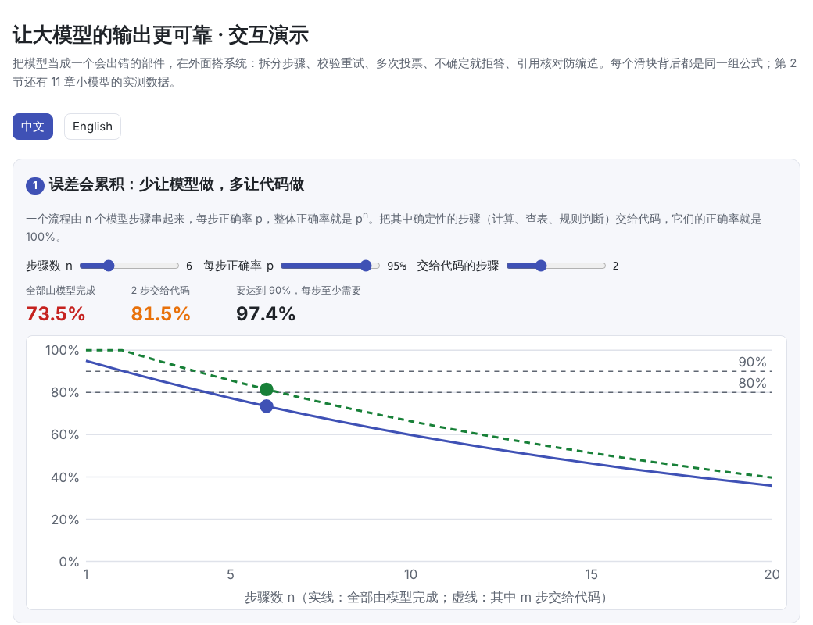
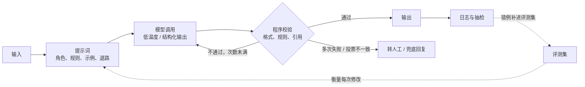

# 怎么让大模型的输出更可靠？怎么减少编造？

> 🌐 [English](reliability.en.md) · 📅 核实日期：2026-10-30 · 🏷️ 可靠性、提示工程、角色扮演、校验与重试、幻觉 · 🎮 **[打开交互演示](interactive/reliability.html?lang=zh)**

[](interactive/reliability.html?lang=zh)

## 一句话回答

**不要指望一条提示词让模型像程序一样可靠。把模型当成一个会出错的部件，在它外面搭一套系统：能测量，能校验，能重试，没把握时能拒答。**

提示词决定单次调用的正确率 $p$，系统决定最终的正确率。几个关键事实：

- **误差会累积**：$n$ 个各自正确率为 $p$ 的步骤串起来，整体正确率是 $p^n$。每步 95%，5 步就只剩 77%。确定性的部分（计算、查表、规则）应该交给代码。
- **校验 + 重试最有效**：程序校验器拦下错误就重试。单次 70%、错误都能被拦下，最多试 3 次，就能达到 97%。但**校验器看不到的错误，重试多少次也去不掉**。
- **投票只对分散的错误有效**：模型在某类题上一贯犯同一个错时，多次采样投票只会把错误确认下来。
- **没把握就拒答**：只自动处理有把握的部分，其余转人工，用覆盖率换准确率。这往往是做到“像程序一样可靠”最现实的路。
- **编造（幻觉）要靠“给资料 + 要引用 + 程序核对引用”来防**。一句“不要编造”作用有限。



## 详细解释

### 1. 先建评测集，否则不知道是 60% 还是 90%

“80–90% 的准确率”必须先能测出来。收集 50–200 个真实输入，写好期望输出或判分规则，每改一次提示词就全量跑一遍：

- **能用程序判分的就用程序**：JSON 是否合法、字段是否齐全、数字是否在范围内、是否包含必须的关键词。
- **开放式回答**可以让另一个模型按评分表打分（LLM-as-judge），但要先和人工打分对比，确认二者一致。
- **专门放进“陷阱题”**：资料中没有答案的问题、前提错误的问题、试图让角色“出戏”的消息。分别统计编造率和正确拒答率。

不测量的话，每次修改都只是凭几个例子的感觉，很容易一处变好、另一处悄悄变坏。

### 2. 拆小任务：误差会累积


一个流程如果由多个模型步骤串起来，整体正确率是各步正确率的乘积。所以：

- **确定性的事交给代码**：算数、日期、查数据库、规则判断，这些代码能做到 100%。
- **模型只做它擅长的**：理解意图、分类、抽取、改写、生成自然语言。
- **每一步的输入输出都定义清楚**，这样每一步都能单独校验、单独评测。

### 3. 提示词怎么写

提示词决定单次调用的正确率 $p$。比较可靠的做法：

| 做法 | 为什么有效 |
| --- | --- |
| **写清角色、任务、背景、约束、输出格式** | 模型看不到你脑子里的上下文；说明“为什么”能让它推广到没写到的情况 |
| **给 3–5 个多样的示例**，包括边界情况和拒答的情况 | 示例比描述更能确定格式和语气；示例的顺序与标签分布也会影响输出（Zhao et al., 2021），所以要多样 |
| **给一条退路**：不确定时输出固定的拒答语或 `needs_human: true` | 没有退路时，模型倾向于硬答 |
| **用 XML 标签分隔指令、资料和示例**；长资料放前面，问题放最后 | 减少把资料当成指令；关键信息埋在长上下文中间容易被忽略（Liu et al., 2023） |
| **正面表述规则**：“遇到 X 时这样做”，而不是只写“不要做 X” | 给出替代行为，模型更容易照做 |
| **需要推导的任务先思考再回答**，或使用推理模型 | 见 [10 推理模型与测试时计算](../10-reasoning/README.md) |

### 4. 角色扮演：保持人设一致

角色扮演的难点是**一致性**：语气、知识边界、设定不能前后矛盾，也不能在多轮之后“出戏”。

- **写一张设定卡**：身份、性格、说话风格、回复长度、知道什么、不知道什么。设定卡之外的经历要求“不具体化”，避免模型临场编造细节。
- **示范对话**：至少包括一段普通对话、一段“资料里没有答案”的拒答、一段用户试图让角色出戏时的回应。
- **防止人设漂移**：研究发现，多轮对话中模型对系统提示的遵循会逐渐减弱，几轮之后就明显漂移（Li et al., 2024）。可以由程序在每条用户消息前附上一句简短的人设提醒，或定期把对话摘要后重新开始。
- **降低温度**，减少随机性。
- **分清两类内容**：允许自由发挥的（闲聊、语气词）和必须准确的（价格、规则、设定事实）。只对后者做程序校验。

交互页第 6 节可以勾选组件，拼出一份角色扮演系统提示词模板。

### 5. 解码层面：温度与结构化输出

- **需要稳定的任务用低温度**（0–0.3）。在 [11 解码与采样](../11-decoding/README.md) 的小模型上，温度 0.2 时 100% 的句子合乎语法，温度 3 时只有 3%。
- **需要固定格式时用结构化输出**（JSON Schema、约束解码）：在采样时就把不合法的词元屏蔽掉，格式可以做到 100% 合法。11 章的实验中，温度 3 加上语法约束，100% 合乎语法。注意它只保证**格式**，不保证**内容**正确。
- **温度 0 也不等于完全确定**：服务端的批处理会带来细微的数值差异，同一个输入偶尔会得到不同输出（Thinking Machines, 2025）。需要可复现时，要在系统层面缓存结果。

### 6. 校验 + 重试：校验器看得到的错误才会消失


设单次正确率为 $p$，校验器能拦下比例为 $c$ 的错误答案（并且不误杀正确答案），最多尝试 $r$ 次。每次尝试被拦下的概率是 $q = (1-p)c$，于是：

$$
\text{准确率} = p\,(1 + q + q^2 + \dots + q^{r-1}), \qquad \text{转人工} = q^r, \qquad \text{上限}\ (r\to\infty) = \frac{p}{p + (1-p)(1-c)}
$$

- $c = 1$（错误都能被拦下）：$p = 0.7$、$r = 3$ 时准确率 97.3%，平均只调用 1.39 次。
- $c = 0.5$：再怎么重试，$p = 0.5$ 的上限也只有 67%。

上图是一个真实的小实验：让 [11 章](../11-decoding/README.md)的小 GPT 在温度 T = 2 下“写一个合乎语法的句子”，单次成功率只有 30%。

- **完整的语法检查器**：试 4 次后达到 77%（6 次 88%）。
- **只检查前 3 个词的校验器**：能拦下 45% 的错误，试 4 次后只有 43%，再多试也停在公式给出的上限 44% 附近。

实测点和公式基本吻合。

所以投入应该放在**校验器的覆盖面**上：JSON Schema、取值范围、枚举值、业务规则、引用核对、单元测试（代码任务）。

**只让模型“自己再检查一遍”通常不够**：没有外部信号的自我纠错常常无效，甚至会把对的改错（Huang et al., 2023）。有效的反馈来自程序校验的报错、工具的执行结果、资料的比对。把具体的报错信息放进重试的提示词里，比单纯“再试一次”更好。

### 7. 多次采样投票，以及没把握时拒答


对有标准答案的任务（分类、抽取、数值），可以采样 $k$ 次取多数（自洽性，Wang et al., 2022）。效果取决于错误的形态：

- **单次正确率 > 50%、错误分散时**，投票有效：$p = 0.7$ 时 15 票能到 95%。
- **模型一贯犯同一个错时**，投票反而有害：$p = 0.4$、错误一致时，15 票只有 21%。
- **现实中题目有难有易**：70% 的简单题（单次 95%）加 30% 的难题（单次 25%，错误一致），单次 74%，15 票反而是 71%。投票救不了模型“一贯不会”的题。

投票更有价值的用法是**判断有没有把握**：5 次采样里同一个答案只拿到 2–3 票，说明模型不确定，就转人工或用兜底回复。上面右图中，要求至少 4/5 票一致才作答时，覆盖率 70%，作答部分的准确率 98%。这就是用覆盖率换准确率（选择性预测，Geifman & El-Yaniv, 2017）。

### 8. 编造（幻觉）：为什么会发生，怎么减少

**为什么会编造**：模型学的是生成看起来合理的下一个词，本身没有“不知道”这个默认选项。训练和评测通常把“不回答”和“答错”一样扣分，模型因此学会了猜（Kalai et al., 2025）。最容易出现编造的情况有：

- 冷门事实
- 带错误前提的问题
- 资料里没有答案却被要求回答
- 要求给出具体的名字、数字、链接、引用

**减少编造的做法**，大致按效果排序：

1. **把事实交给它，而不是让它回忆**：用 RAG 或直接把资料放进提示词，写明“只根据资料回答”。
2. **先引用、再回答，并用程序核对引用**：要求每条结论附上逐字引用，程序检查引用是否真的出现在资料里，对不上就拦下重试。这就是第 6 节的“校验 + 重试”，而且覆盖率很高。交互页第 5 节有一个十几行的核对程序。
3. **允许并示范拒答**：给出固定的拒答语，并在示例中示范一次。
4. **让输出只能从已知集合里选**：产品名、ID、字段值用枚举或约束解码限定，之后再查数据库确认存在。
5. **用工具代替记忆**：计算交给代码，查询交给数据库或搜索。
6. **多次采样比一致性**：真实的事实几次采样往往一致，编造的细节每次都不一样（SelfCheckGPT，Manakul et al., 2023）。不一致就拒答。
7. **逐条核查**：把回答拆成一条条陈述，另开一次调用逐条判断“资料是否支持”，不支持的删掉（Chain-of-Verification，Dhuliawala et al., 2023）。
8. **检查问题的前提**：要求模型先判断前提是否成立。
9. **微调要谨慎**：用微调教新知识反而可能增加编造（Gekhman et al., 2024）。事实靠检索，微调用来教格式、语气和“不知道时拒答”这类行为。

### 9. 提示词到顶以后

- **事实类错误**：用 RAG 和工具（19 RAG 与向量数据库、21 Agent，计划中）。
- **格式、风格、人设一致性**：用几百到几千条高质量样例做 SFT 或 LoRA，见 [08 微调](../08-finetuning/README.md)。
- **上线后**：记录日志、抽样复查、给错误归类，把错例补进评测集，形成闭环。

## 为什么重要

模型本身是概率性的，单次调用不可能 100% 正确，但系统可以做得很可靠。三件事是可以设计的：

- 由谁来做哪一步
- 怎么校验
- 没把握时怎么办

把精力花在这三件事和评测集上，通常比反复雕琢提示词的措辞更有效。

## 代码

[`code/reliability.py`](code/reliability.py) 推导并验证了上面的公式，并在 11 章的小 GPT 上实测“校验 + 重试”（运行约 20 秒）：

```bash
python docs/qa/code/reliability.py
```

```text
== 3. a real model: write a grammatical sentence / 真实模型：写一个合乎语法的句子 ==
  one attempt at T = 1.5: 56% grammatical; the 3-word validator catches 38% of the errors
  full grammar check  : 1 tries 59% (formula 56%), 2 tries 82% (formula 81%), 4 tries 95% (formula 96%)
  first 3 words only  : 1 tries 59% (formula 56%), 2 tries 68% (formula 66%), 4 tries 69% (formula 68%)
  retries only remove the errors the validator can see  ✓
```

配图与交互页的数据由 [`figures/reliability_figures.py`](figures/reliability_figures.py) 生成。

## 与知识库的关系

- [08 微调](../08-finetuning/README.md)：提示词到顶后，用 SFT / LoRA 固定格式与人设
- [10 推理模型与测试时计算](../10-reasoning/README.md)：先思考再回答、自洽性投票、验证器
- [11 解码与采样](../11-decoding/README.md)：温度、约束解码与结构化输出
- [推理强度是怎么设置的](reasoning-effort.md)：让模型多想一会儿的代价
- **18 提示工程**、**19 RAG 与向量数据库**、**21 Agent 与 agent loop**、**23 评测**（计划中）

## 来源

- Anthropic. [Prompt engineering overview](https://platform.claude.com/docs/en/build-with-claude/prompt-engineering/overview)、[Reduce hallucinations](https://platform.claude.com/docs/en/test-and-evaluate/strengthen-guardrails/reduce-hallucinations)、[Keep Claude in character](https://platform.claude.com/docs/en/test-and-evaluate/strengthen-guardrails/keep-claude-in-character)（官方文档）
- OpenAI, 2024. [Introducing Structured Outputs in the API](https://openai.com/index/introducing-structured-outputs-in-the-api/)（JSON Schema 约束输出）
- Kalai et al., 2025. [Why Language Models Hallucinate](https://arxiv.org/abs/2509.04664)
- Wang et al., 2022. [Self-Consistency Improves Chain of Thought Reasoning in Language Models](https://arxiv.org/abs/2203.11171)
- Huang et al., 2023. [Large Language Models Cannot Self-Correct Reasoning Yet](https://arxiv.org/abs/2310.01798)
- Manakul et al., 2023. [SelfCheckGPT: Zero-Resource Black-Box Hallucination Detection](https://arxiv.org/abs/2303.08896)
- Dhuliawala et al., 2023. [Chain-of-Verification Reduces Hallucination in Large Language Models](https://arxiv.org/abs/2309.11495)
- Gekhman et al., 2024. [Does Fine-Tuning LLMs on New Knowledge Encourage Hallucinations?](https://arxiv.org/abs/2405.05904)
- Li et al., 2024. [Measuring and Controlling Instruction (In)Stability in Language Model Dialogs](https://arxiv.org/abs/2402.10962)（人设漂移）
- Liu et al., 2023. [Lost in the Middle: How Language Models Use Long Contexts](https://arxiv.org/abs/2307.03172)
- Zhao et al., 2021. [Calibrate Before Use: Improving Few-Shot Performance of Language Models](https://arxiv.org/abs/2102.09690)
- Geifman & El-Yaniv, 2017. [Selective Classification for Deep Neural Networks](https://arxiv.org/abs/1705.08500)
- Thinking Machines, 2025. [Defeating Nondeterminism in LLM Inference](https://thinkingmachines.ai/blog/defeating-nondeterminism-in-llm-inference/)
